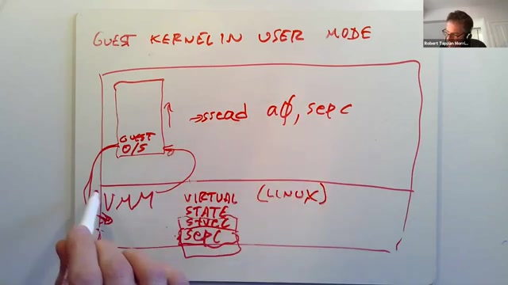
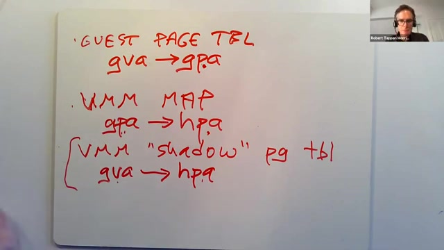
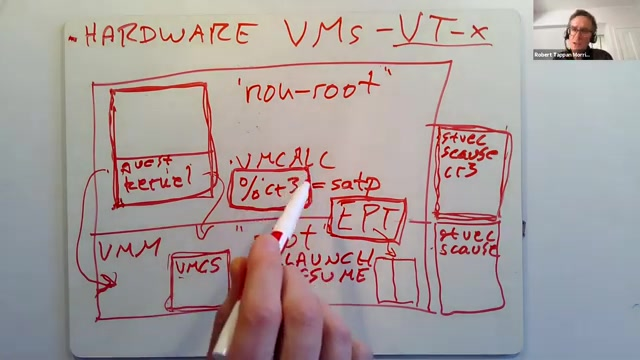
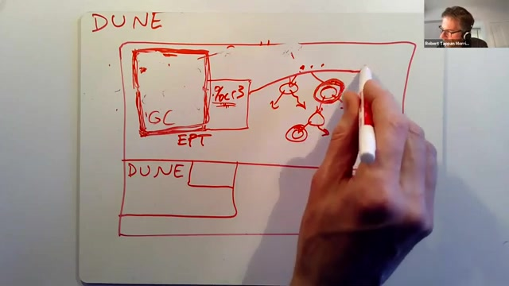

# 第 19 讲 · 虚拟机：从陷入模拟到 Dune

## 00:00–03:00｜让操作系统运行在一台“模拟出来的计算机”上

Robert 将本讲分为三个部分：先用熟悉的 RISC-V 说明如何构造 trap-and-emulate（陷入并模拟）虚拟机，再介绍处理器后来加入的虚拟化支持，最后讨论 Dune 如何把这些硬件用在普通进程上。

虚拟机首先是一种足够逼真的计算机模拟，逼真到能运行操作系统。课程使用的 QEMU 可以作为直观例子，但这里接下来要讨论的实现策略，不应与 QEMU 的所有执行方式画等号。

板书从最底层的硬件画起：其上是虚拟机监控器 VMM，再往上是一个或多个 guest。某个 guest 可以运行 Linux 内核，内核上有 vi 和 C 编译器；另一个 guest 可以运行 Windows 及其应用。真正控制底层机器的一侧叫 host，运行被虚拟化操作系统的一侧叫 guest。

这比“用户程序在内核上运行”的旧图多了一层。VMM 的职责不是替应用实现文件接口，而是向整个操作系统提供机器环境。因此后面说到权限时，要同时问清楚：是在 host 还是 guest 中？是在 guest 内核还是 guest 用户程序中？

## 03:00–06:00｜guest 的两种权限，以及为什么需要多台虚拟机

guest supervisor mode 是 guest 内核以为自己所在的内核态，guest user mode 则是其应用所在的用户态。经典目标是让未经修改的 Linux 或 Windows 直接启动，甚至不知道自己被放进了虚拟机。VMM 因而必须把两种模式的差别也模拟出来，而不是只让程序的算术运算得到正确答案。

为什么在一台机器上放几个操作系统？企业可能需要名称服务、安全服务等很多服务器，每个负载都很轻。为每个服务购买一台物理机器，会让大量资源闲置；把它们放在同一台硬件上的不同虚拟机中，可以提高利用率。

云计算进一步利用这种间接层。以课堂提到的 AWS 为例，提供者可以把“租给用户的机器”与具体物理服务器分开，根据负载决定放在哪里、是否把更多客户装进同一台服务器。实现方式就是把现有内核整体往上移，在它们下面加入一个新的资源管理层。

课程自己的内核开发也受益：大家能在自己的环境里启动 xv6，而不必每次操作专用裸机。虚拟环境也让调试支持更容易安排，下一段继续说明这一点。

## 06:00–09:00｜调试、检查点与迁移：新的一层带来新能力

在 QEMU 中运行 xv6，提供 GDB 调试入口比直接对真实机器做同样的事方便。VMM 知道 guest 的执行状态，因此还能把整个运行中的操作系统及其进程保存成检查点，之后从那个状态恢复。这可用于调试、可靠性，也可以复制同一机器映像，启动多个副本。

另一个技巧是迁移：某台物理服务器要关闭或替换时，把正在运行的虚拟机搬到另一台机器。guest 使用的是虚拟硬件环境，所以这个间接层提供了移动运行状态的空间，而不必让应用重新认识一套底层设备。

虚拟机不是最近才出现的概念，讲者把其历史追溯到 1960 年代。它今天的重要性还在于，它改变了操作系统设计的讨论对象：内存分配、调度、保护这些熟悉的问题仍然存在，但管理对象从进程变成了整台虚拟机器。

随着虚拟机普及，相当一部分系统研发活动也向 VMM 这一层移动。研究它不仅是学习一种部署工具，也是换个视角重新看传统内核的职责。接下来进入 RISC-V 上的软件虚拟化设计。

## 09:00–12:00｜两项目标：足够兼容，不能逃逸

假设要构造能运行 xv6 的 RISC-V 虚拟机。第一项目标是兼容：guest 在真实硬件上依赖的行为，在虚拟机上也应成立。理想情况下，不仅熟悉的操作系统能运行，连 VMM 作者没有见过的操作系统也能运行，所以不能只为某段已知内核代码写特例。

第二项目标是隔离。云客户提供的不一定是普通 Linux，也可能是故意试图越界的修改版内核。VMM 不能因为 guest 自称“我现在是内核”就让它读别人的内存、控制任意磁盘或网卡。guest 只能使用分配给它的资源。

Robert 用普通 Unix 进程作对比：按权限规则，进程之间往往可以通过文件、管道或信号交互；而虚拟机通常把各 guest 放进更分离的系统环境。这里谈的是设计上的隔离目标，而不是证明所有现实 VMM 都不存在漏洞。

这一点解释了为什么“把内核当作一段普通代码启动”还不够。即使它功能上可以跑，只要它能任意控制真实机器上的页表，就失去了虚拟化最重要的边界。

## 12:00–15:00｜完全模拟很直观，但逐条解释太贵

现实实现会对“guest 完全不知道自己被虚拟化”作折中。Linux 和常见 VMM 会协同演进，在受控接口上让 guest 主动配合，以提高设备访问效率。保留隔离并不要求对每一个接口都坚持模仿旧硬件。

最容易想象的实现，是写一个解释器：读入 xv6 的机器指令，逐条判断是 load、move 还是其他操作；用软件变量保存 32 个通用寄存器、控制寄存器及其他机器状态，再按照指令语义修改这些变量。这样在概念上能实现完整机器，难点主要是把所有细节做对。

性能问题也很直观。一条 guest 指令可能需要解释器执行几十条 host 指令才能完成，guest 的执行速度因而只是真实硬件的一小部分。对于云计算这样重视资源利用率的环境，这种纯解释路径通常不合适。

这一段不是说任何软件模拟器都只能逐条解释；讲者是在拿最简单的方案作基线，引出下一个问题：能否让大多数 guest 指令直接在真实 CPU 上运行，只对危险操作作特殊处理？

## 15:00–18:00｜直接执行与权限之间的矛盾

如果真实处理器和 guest 使用相同指令集，就可以把 guest 内核的指令装进内存，然后跳到入口，让 CPU 真正执行它们。普通计算因此可以很快，但内核迟早会执行特权指令，例如向 RISC-V 的 `satp` 写入页表根。

若把 guest 放在真实用户态，写 `satp` 会成为非法操作；若直接把它放到真实 supervisor mode，它就可能配置自己的页表，访问不属于它的物理内存。前者不能原样工作，后者不安全。

陷入模拟采用的基本策略是：**guest 内核也在真实用户态执行。** VMM 为它安排好初始内存环境，再通过自己的返回指令进入 guest。加法、普通函数调用和合法内存访问都可以直接运行；碰到不允许在用户态执行的特权操作，硬件自动把控制权交回 VMM。

因此，guest 尝试写页表根并不意味着真的写成了。VMM 有机会在操作生效前查看导致异常的指令，并决定怎样模拟它应有的效果。

## 18:00–21:00｜谁安装 trap handler？VMM 本身必须有权限

guest 执行到写 `satp` 的指令时，处理器因权限不够而陷入。VMM 的处理程序能检查指令，知道 guest 原本想做什么；关键在于真实页表根还没有被 guest 任意改变。

**学生提问：**安装异常处理入口本来就是特权操作，VMM 如果也是 host 上的用户程序，怎么截获这些异常？

**讲者澄清：**当前示意图假定 VMM 就是在真实 supervisor mode 运行的内核：机器启动的是 VMM，它能设置真实 `stvec` 等控制寄存器。有些系统正是如此实现。

另一类实现先启动 Linux，再把需要权限的 VMM 部分放进 Linux 内核，可能作为可加载内核模块运行。Dune 就属于这种组织方式。这里不能把“界面上像一个应用程序”与“实现虚拟化所需的全部代码都在用户态”混为一谈。

本段的信任关系是：VMM 是我们信任、允许控制真实硬件的软件；guest 是被限制的一侧。即便 guest 认为自己处于 supervisor mode，它也没有因此取得 host 的 supervisor 权限。

## 21:00–24:00｜为 guest 保存一份虚拟控制寄存器

在这套 RISC-V 设计中，关键是 supervisor 专用指令在真实用户态执行会产生陷入。guest 读取 `scause`、修改 `stvec` 等动作因此都会被 VMM 看见。页表项本身是内存，不能单凭这条规则解决，稍后单独讨论。

VMM 为每个 guest 建立一份虚拟状态表。例如所谓 guest 的 `stvec`、`sepc`，可以只是 VMM 内存中的变量。guest 写这些寄存器时，VMM 更新变量；guest 读取时，VMM 返回变量的值，而不是让它直接观察 host 当前的真实控制寄存器。

讲者开始推演一个读取特权寄存器的例子：guest 想把 `sepc` 读入普通寄存器 `a0`。这条指令会先陷入 VMM，VMM 解码出它要读的寄存器，再取出为该 guest 保存的虚拟 `sepc`。

讲者一时没有想起指令名，用了口头的“supervisor read”说明其效果。这里对应的 RISC-V 写法是 `csrr a0, sepc`；这是术语校订，不是课堂已运行的命令演示。

## 24:00–27:00｜模拟读取，以及区分不同 guest 的状态

*原片 24:00，未裁剪。板书的 `sread a0, sepc` 是讲者临时使用的示意写法；下方 virtual state 中有 `stvec`、`sepc`，并非实际存在一条名叫 sread 的 RISC-V 指令。*

继续上一个例子：进入 VMM 后，入口代码会在 trapframe 中保存 guest 的通用寄存器。VMM 不必立即对真实 `a0` 做最终修改，可以直接把虚拟 `sepc` 填进 trapframe 的 `a0` 槽位。随后恢复通用寄存器，并让 guest 从被模拟指令之后继续执行。guest 看到的就是“读取成功，a0 得到 sepc 的值”。

这里必须前进的是那条被模拟的读取指令的 PC，而不是反复返回到同一条指令。若实现遗漏这一点，就会不断重入同一个 trap。真实返回由 VMM 的 `sret` 完成，但 guest 感受到的是它自己的读取指令已经执行。

**学生问如何区分多个 guest。** Robert 类比 xv6 的当前进程：VMM 给每个 guest 保存独立状态，并在每个核上记录当前运行的是哪一个 guest；处理陷入时查相应的状态结构。

**学生再问能否给一个 guest 多个核。**成熟 VMM 可以。另一个问题则追问：既然部分计算使用真实寄存器，为什么 `sepc` 等寄存器必须另设虚拟副本？这就要区分真实陷入的原因和 guest 应当看到的原因。

## 27:00–30:00｜真实 scause 与 guest scause 为什么不能共用

假设 guest 用户程序刚发起系统调用，guest 内核进入了它自己的处理逻辑。它读取 `scause` 时，希望看到的是“用户程序系统调用”。然而这次读取本身是在真实用户态执行的特权指令，于是 host 的真实 `scause` 表示的却是“非法指令／权限异常”。两者描述的是不同层的事件。

如果直接把真实 `scause` 交给 guest，它的异常处理代码就会误判。VMM 自己需要真实寄存器来处理真实陷入，同时必须维护另一组值，表现出 guest 机器应该经历的状态变化。这正是 trap-and-emulate 中“emulate”的含义。

这种方案可以主要靠软件实现，甚至可以设想修改 xv6，让它在 supervisor mode 充当 VMM，再运行另一个 xv6 guest。需要保存的不只是一组以 `s` 开头的寄存器，还包括**虚拟权限模式**。

为什么模式也要记？guest 内核读取特权寄存器可以被模拟成功，guest 用户程序做同样的事却应当被判为非法。它们在 host 看来都是真实用户态，所以 VMM 必须查询虚拟模式，才能决定是完成操作，还是向 guest 内核呈现一个权限异常。

## 30:00–33:00｜虚拟模式、hart，以及“普通指令还会不会执行”

guest 内核通过 `sret` 返回用户程序时，这条特权指令会让 VMM 得到控制权，因而 VMM 知道应该改变虚拟模式。除了模式，VMM 还要知道自己正在模拟哪一个 hart，即 guest 所见的执行核身份。

RISC-V 的设计使这种方案相对清晰：如果敏感操作在低权限下能悄悄执行出不同结果而不触发异常，VMM 就难以介入。讲者强调不同处理器在这方面的友好程度不同，后面会提到传统 x86 的困难。

**学生问：**guest 内核中真的会执行东西，还是每一步都陷入 VMM？

**回答：**普通指令直接执行。例如把两个寄存器相加、做一次普通函数调用，都不需要 VMM 逐条模拟。陷入只发生在需要特殊处理的事件上。

**学生进一步确认 guest 是否还有用户态和内核态。**从未经修改的 xv6/Linux 的角度，两种模式都存在；它可以执行特权操作，也知道 `sret` 后应进入用户环境。VMM 必须让这些操作呈现正确效果，虽然在当前软件方案中，这两个 guest 模式在真实机器上都以用户态运行。

## 33:00–36:00｜逐步推演 sret 与 ecall

先看 guest 内核执行 `sret`。真实 CPU 将它视作用户态执行特权指令，进入 VMM。VMM 把虚拟模式改成 user；准备离开 VMM 时，把真实 `sepc` 设置为虚拟 `sepc` 中保存的目标，然后执行自己的 `sret`，到达 guest 内核希望恢复的用户程序位置。为了兑现 guest 用户态的内存权限，还需要切换相应的页表视图。

再看反方向：guest 用户程序执行 `ecall`。这同样先进入 VMM，而不是直接进入 guest 内核。VMM 查看虚拟模式和导致陷入的指令，模拟一次 guest 的系统调用异常：把 guest 的调用位置记到虚拟 `sepc`，把虚拟模式改成 supervisor，把虚拟 `scause` 设为系统调用。

最后，VMM 令自己的真实返回 PC 指向 guest 虚拟 `stvec` 所指定的入口，再通过真实 `sret` 回到 guest 世界。接下来执行的是 guest 的 trap handler，或它的 trampoline。guest 内核因此开始正常处理系统调用。

注意这里的两种“返回”：VMM 从真实 trap 返回，可能恰恰是在**进入** guest 的 trap handler。若只用一个“内核／用户”的二分法理解，会把这两层控制流混在一起。

## 36:00–39:00｜guest 页表里的物理地址不是真实物理地址

CPU 控制状态之外，还剩两块关键内容：页表和设备。guest 会写 `satp`，VMM 虽然能截获这件事，却不能简单照抄到真实 `satp`。那样仍会允许 guest 通过自己构造的页表接触任意内存。

另一方面，VMM 必须尊重 guest 要求的映射效果。guest 程序的取指、load 和 store，都应落到它的操作系统安排的数据上。因此需要区分 guest virtual address（GVA）、guest physical address（GPA）和 host physical address（HPA）。

guest 自己的页表描述 GVA→GPA。VMM 可能给 guest 看起来连续的一段物理内存，但真实 backing pages 可以散布在 host RAM 中。guest 所见的“物理地址”只是这个虚拟机器内部的地址，并不直接等于真实机器地址。

课堂用几十 GB 的分配规模作示意，口述中容量单位有来回变化；推导并不依赖具体容量。关键是：VMM 另外知道每个 GPA 对应的真实 HPA，而且只能把分给该 guest 的页放入这张对应表。

## 39:00–42:00｜把两层映射合成为 shadow page table

*原片 41:00，未裁剪。三行分别是 GVA→GPA、GPA→HPA、GVA→HPA；此处仍是软件合成影子页表，不是 EPT 硬件方案。*

VMM 为 guest 维护 GPA→HPA 的映射。当 guest 请求把某个页表装进 `satp`，VMM 读取其页表项：先取得某个 GVA 对应的 GPA，再查出 GPA 实际对应的 HPA，最后把 GVA→HPA 的结果写入一张新的 **shadow page table（影子页表）**。

真正装进硬件 `satp` 的是影子页表，而不是 guest 提供的那张表。于是 CPU 在直接执行 guest 普通访存时，只需要用真实硬件理解的一套映射，不需要每次 load 都先陷入软件。

隔离也在合成过程中落实：影子页表只能包含 VMM 允许该 guest 使用的 HPA。如果 guest 在原页表中填入一个没有分配给它的 GPA，VMM 不能把那个数字当成真实物理地址照用。guest 再怎么安排自己的 GVA，都不能扩大 VMM 为它分配的物理内存集合。

**学生问创建新进程、新页表时怎么办。**guest 仍像正常 xv6/Linux 一样建立页表，然后尝试写 `satp`；这一步触发 VMM 来建立或选择对应的影子映射。下面继续把这个过程说完整。

## 42:00–45:00｜新页表建立后，修改现有 PTE 又怎么办

在创建 guest 进程的例子里，VMM 看到的是“guest 想把这张表作为当前表”。它检查其 PTE，利用 GPA→HPA 映射转换地址，对无权使用的地址按虚拟机器的规则处理，最后安装影子表并返回。guest 的操作步骤并没有因为虚拟化而改成一套新的 API。

更棘手的是，guest 内核可能不切换 `satp`，而是直接读写当前页表项。PTE 就是普通内存，写 PTE 并不天然是一条会陷入的特权指令。

Robert 利用 RISC-V 页表同步规则解释如何获得介入点：修改 PTE 后，软件不能假定 MMU 立刻使用新映射；要用 `sfence.vma` 建立所需的同步。该指令属于特权操作，在当前方案中会陷入 VMM。

因此 VMM 可以在这个同步点检查 guest 当前页表的变化，再把合法变化反映到影子页表，而不必把每一条普通 store 都变成异常。这里是教学级设计思路，不是完整实现所有 A/D 位、并发页表更新等细节的算法。

## 45:00–48:00｜同步点、直接映射，以及陷入的成本

guest 的 `sfence.vma` 陷入后，VMM 扫描并更新相应影子映射，再执行真实的页表同步操作，让硬件使用更新后的影子表，最后返回 guest。

**学生确认：**此时 MMU 实际只走影子表，并没有 EPT？**回答：**正是如此。这里还没使用专门的虚拟化硬件；EPT 属于后面另一种实现。guest 的 GVA→GPA 表供 VMM 解释，CPU 当前实际使用 GVA→HPA 的影子表。

**学生问 guest 内核的直接映射会不会失效。**它在 guest 自己的地址世界中仍可以是直接映射，guest 能正常运行；只是落到真实物理机后，不一定还满足相同数值关系。虚拟化保留的是 guest 观察到的关系。

**学生担心大量 trap 的性能。**讲者认可：如果程序大量进入内核，guest 内核又频繁使用特权指令，这些陷入会明显增加成本。过去这样的方案已经很有用、广泛使用，但减少这些陷入正是后来 Intel/AMD 加入虚拟化硬件的重要动机。

> 编者校订：`sfence.vma` 的意义是同步与失效相应地址翻译缓存；不应把课堂简化说法读成“执行 fence 以前硬件绝不可能观察到新 PTE”。

## 48:00–51:00｜模拟真实设备：让寄存器访问引发异常

要让操作系统启动，还需要磁盘、网卡、控制台，可能还需要显卡、声音、鼠标与键盘。VMM 不能只实现 CPU 和内存，就宣称提供了完整机器。

第一种办法是挑选一种广泛支持的真实设备，准确模拟它的接口。guest 已有该设备驱动，所以只要模拟足够好，就可以不修改 guest。

以 xv6 的 UART 为例：驱动预期在固定地址读写设备控制寄存器。VMM 可以故意不给这些地址建立有效的普通内存映射，使访问产生 page fault。异常处理代码识别 guest 要读或写哪个“设备寄存器”，更新软件维护的设备状态，再返回合适的值或者完成相应动作。

因此 guest 以为自己把一个字符写到了串口，底层实际上可能只是把字符送到宿主显示窗口或终端；它访问的并不是一块真实串口硬件。对于慢速设备这很实用，但如果每一次寄存器交互都要陷入，吞吐和延迟就会受到影响。

## 51:00–54:00｜专门设计虚拟设备：用队列减少同步交互

若 guest 必须完全不知道虚拟化，模拟它认识的真实设备往往是必要途径。但现代 guest 可以安装专门的虚拟设备驱动。于是第二种策略是重新设计接口，使它适合软件实现，而不必逐个模仿真实硬件寄存器。

例如，guest 把一批命令描述结构写到共享内存队列，VMM 读取队列并完成工作。这使设备驱动与设备实现不必每一步都同步“问一句、答一句”，从而减少需要陷入的交互。

课程中的 `virtio_disk.c` 就是一个具体例子。xv6 组织磁盘请求，QEMU 根据请求读写宿主上的 `fs.img` 文件。guest 看到的是磁盘接口，真正保存数据的却可以是宿主文件。

课堂把重点放在“减少控制寄存器访问与陷入”，不是说 virtio 完全没有 MMIO。其初始化、队列通知等仍涉及控制接口；区别在于主要请求信息能够通过内存中的描述符和队列传递。这是对课堂口头简化的技术说明。

相较于第一种方案，它能提供更高效率，但 guest 必须认识这个新接口，也就是配备相应驱动。

## 54:00–57:00｜设备直通，以及设备模拟为什么仍很难

第三种策略是把真实设备或设备的一部分直接分给 guest。讲者以现代 NIC 为例：一块网卡可以提供多个彼此隔离的接口，让不同 guest 与各自那一部分硬件直接通信。VMM 先完成授权和配置，之后数据路径可以减少软件模拟，获得很高效率。

这依赖合适的硬件支持。讲者谨慎区分理论上可以让 guest 很少察觉，与现实驱动通常知道自己在使用某类特殊接口这两件事。

把三种策略放在一起看：模拟真实设备强调兼容，专门的虚拟接口强调软件交互效率，直通强调直接利用真实硬件。它们并非只能三选一，一个 VMM 可以同时用多种办法服务不同设备。

Robert 认为，实际 VMM 的大量实现难度在设备模拟和驱动：必须准确到能与真实 guest 操作系统协同工作，尤其模拟已有复杂设备时，细节远比画一张 CPU 虚拟化示意图多。

**学生追问：**虚拟设备与设备模拟看起来都是软件，究竟差在哪？接下来用驱动预期的接口来区别它们。

## 57:00–60:00｜设备问答：区别在“模仿谁的接口”

一个不了解虚拟化的操作系统可能已有很多磁盘驱动，但那些驱动针对的是可以购买的真实设备。若想原样运行它，VMM 就必须选择其中一种设备，准确实现它的寄存器和响应语义。

这种真实设备接口并不一定适合 trap-and-emulate。驱动可能频繁读状态、写控制寄存器，每次都期待立即得到响应；在模拟环境里，每次操作就可能变成一次昂贵的 trap。

专用虚拟设备则允许重新设计交互方式。例如把请求批量放进队列，避免频繁同步访问。代价是 guest 必须有对应驱动。学生用“系统既有某型号磁盘驱动，也加一个虚拟磁盘驱动”来确认，讲者表示这正是 xv6 的情况。

virtio 还是多个虚拟化系统支持的标准，但讲者没有声称 xv6 已在那些系统上测试过。另有学生问，把 xv6 移到此前展示的真实开发板是否需要换磁盘驱动。回答是通常需要按板上实际接口实现；不能把“CPU 指令集相同”当作“所有设备驱动都能复用”。

## 60:00–63:00｜VT-x：让许多特权操作不再经过 VMM 软件

设备问题告一段落后，课堂转入硬件辅助虚拟化。Intel VT-x 的动机包括：虚拟机使用越来越普遍；软件陷入模拟开销较大；传统 x86 的一些行为又使纯 trap-and-emulate 很难正确实现。

核心思路是把先前由 VMM 软件维护的一部分“虚拟控制状态”交给硬件。guest 执行特权指令时，不一定先退出到 VMM，而是直接作用于属于 guest 的受控状态。这既可以降低执行成本，也可以简化监控器实现。

讲者画出 host 与 guest 使用的两组控制状态，并借用熟悉的 RISC-V 寄存器名称说明角色。这里是在解释原理；真实 VT-x 属于 x86，不意味着 x86 真的有 `stvec` 或 `satp`。

普通 VMM 运行时使用 host 状态；进入 guest 后，处理器切换到相应 guest 状态，并继续施加防止逃逸所需的限制。这样让 guest 拥有它需要的内核行为，不再等于把整台 host 的控制权交给它。

## 63:00–66:00｜root、non-root 与 VMCS

Intel 把 host 一侧的运行环境称为 VMX root，把 guest 一侧称为 VMX non-root。在 non-root 中，guest 仍有自己的 supervisor/user 区分。不能把 non-root 误解成普通用户态：guest 内核可以在 non-root 的高权限级执行。

在允许直接执行的配置下，guest 对自己的控制状态进行读写，硬件即可完成，而不需要每次陷入 VMM。这就是相较前面软件方案最重要的性能变化。

VMM 仍需明确配置 guest。它在内存中准备 VMCS，即 Virtual-Machine Control Structure：保存与 guest 运行相关的状态、初始值及控制选项。硬件和 VMM 借助它完成进入、退出与恢复。

新指令 `VMLAUNCH` 用于首次进入相应 guest，`VMRESUME` 用于恢复已经启动过的 guest。讲者还引出 `VMCALL`：它让 non-root 一侧主动请求退出，交回 root 一侧处理。这里介绍的是各指令的角色，不是完整的 VMCS 初始化代码。

> 编者校订：课堂概括为“特权指令可直接执行”；实际是否 VM exit 取决于指令类型和 VMCS 控制，不是所有特权操作都无条件直通。VMCS 也不等于自动替软件保存全部通用寄存器。

## 66:00–69:00｜能直接执行，不代表失去调度与内存控制

guest 可以通过 `VMCALL` 主动返回 VMM，但 host 不能只等 guest 自愿交回 CPU。课堂所述配置让设备中断、尤其定时器中断触发 VM exit。VMM 因而能重新获得控制，在多个 guest 之间分时调度。

这与 xv6 利用定时器切换进程的目的相似，只是现在被调度的是 guest。所谓 guest 拥有自己的内核态，也不能让它无限独占真实 CPU。

另一个大问题是页表。x86 的 `%cr3` 扮演类似 RISC-V `satp` 的页表根角色。如果让 guest 直接加载自己的 `%cr3`，可以避免此前每次切表都要陷入、合成影子表的开销。但只凭这一层页表，guest 仍可能构造映射去访问不属于它的内存。

所以 VT-x 还需要一个由 VMM 掌握、guest 不能任意控制的内存约束层。讲者开始画 Extended Page Table（EPT），下一段推演它与 guest 页表的配合。

## 69:00–72:00｜EPT 把地址管理权和物理内存授权拆开

*原片 70:00，未裁剪。左侧区分 non-root 与 root，标出 VMCALL、VMLAUNCH/VMRESUME 和 VMCS；中间的 `%cr3` 与 EPT 是两层地址转换。右侧借用 RISC-V 的 `stvec/scause` 类比控制状态，不能当作 x86 寄存器清单。*

在 non-root 中，guest 页表把 GVA 转成 GPA；EPT 再把 GPA 转成 HPA。EPT 由 VMM 配置，guest 并不能因为拥有自己的 `%cr3` 就修改它。

由此得到两个同时成立的性质：guest 可以快速改变自己的地址空间布局；host 仍决定 guest 最终能接触哪些真实物理页。guest 在第一层随意安排映射，第二层仍然把结果限制在授权范围内。

与影子页表不同，这里的硬件直接理解两阶段转换。先前是 VMM 软件预先合成 GVA→HPA 的表；现在让 MMU 在硬件支持下完成组合，从而减少 guest 切表和改表所需的 VMM 软件工作。

**学生问两个核是否要再增加第三套寄存器。**讲者回答，每个核本来就有各自的执行状态和虚拟化设施，可以在两个核上同时运行不同 guest。关键不是给整个系统只准备一份 guest 状态，而是正确管理每个正在运行的虚拟 CPU 状态。

## 72:00–75:00｜一个 VMM 可以管理多个 guest；Dune 改变的是抽象

学生继续问，是否每个 guest 都要另有一个 VMM。Robert 再用 xv6 类比：一个 xv6 内核可以用多个 `struct proc` 管理多个进程；同样，一个 VMM 可以为每个 guest 维护状态结构。一个核上运行多个 guest，则由定时器中断驱动切换。

基础机制讲完后，课堂转向 Dune。它的有趣之处，是使用本来为虚拟机准备的硬件，却不向应用提供“再启动一个完整 guest OS”的机器抽象。

设想先运行普通 Linux，再加载 Dune 内核模块。程序仍希望拥有 Linux 进程的功能：使用系统调用、与现有系统服务配合。Dune 让选择进入其模式的进程，获得额外的特权硬件能力。

这样的进程运行在 VMX non-root 的 supervisor/ring 0 环境，拥有自己的 guest 控制状态，例如 `%cr3`。它因此能够设置自己的页表；而 Dune 模块仍通过 EPT 限定它可接触的物理内存。其目的不是让应用比其他进程拥有更多系统权限，而是让应用更灵活地管理自己的那一份资源。

## 75:00–78:00｜在一个进程内部建立可信与不可信两层

EPT 的映射反映进程正常获准使用的内存。因此 Dune 进程即使任意修改自己的 `%cr3`，也不能凭此读写其他进程或 Linux 内核的内存。改变的是进程内部的管理能力，不是对外授权。

除了页表，进程还可以利用 non-root 内部的 supervisor/user 权限分层。课堂用浏览器插件说明：浏览器希望运行第三方视频解码器或广告拦截插件，但不完全信任它。可信浏览器部分运行在 guest supervisor 模式，不可信插件运行在 guest user 模式。

浏览器配置自己的页表，让插件只能访问被允许的一部分页面；其余浏览器状态则不对 guest user 开放。插件不能因为与浏览器同属一个 Linux 进程，就任意改写浏览器的全部内存。

插件还可能需要发起 `fork`、`read`、`write` 等调用。其普通系统调用入口会先到进程内部的可信部分，而非直接越过浏览器进入 Linux。于是浏览器获得一个审核这些行为的位置，下一段继续说明这个边界。

## 78:00–81:00｜沙箱调用拦截，以及并发 GC 的新问题

插件尝试执行系统调用时，浏览器的可信 runtime 可以选择拒绝、在内部处理，或者代表它执行获准的 Linux 调用。内存限制与调用拦截结合，才形成课堂这里所说的沙箱。

Robert 特别说明，普通 Linux 上也能用其他技术实现类似效果；Dune 的贡献是让硬件保护机制直接服务于进程内部，提供一种较优雅且高效的实现途径。

另一个应用是垃圾回收，这次不再考虑不可信插件。假设应用使用追踪式 GC：从寄存器等根出发，沿对象中的指针遍历，能到达的对象仍然存活，最终不可达的对象可以回收。

若 GC 与应用线程同时运行，遍历到一半时，应用可能改写一个已经扫描过的对象，新增或移动指针。GC 之前建立的可达性认识就可能过时。讲者用对象图说明：已经看过的节点后来又有变化，因此需要知道哪些位置值得重新检查。

这把问题从“怎样扫描所有对象”收敛成一个硬件相关的问题：怎样低成本地发现扫描期间发生的写入？

## 81:00–84:00｜用 PTE dirty bit 找到需要重扫的页

*原片 81:00，未裁剪。左侧是 GC 与 `%cr3`，下方是约束进程的 EPT；右侧对象图用于说明已扫描对象后来被改写的情形。截图未显示完整 GC 算法。*

Dune 允许应用自己的页表由其 `%cr3` 指向。页面可以保持正常可访问，硬件在写入时设置对应 PTE 的 dirty bit。GC 完成一轮追踪后，读取这些 D 位，就知道哪些页中的对象可能已经被修改，需要重扫。

重点是应用能够直接用 load/store 访问自己的 PTE，而不必为了查询这些状态反复进入 Linux。讲者说有些操作系统提供相关系统调用，也坦言此处并不确定普通 Linux 的具体接口；不能把这句课堂判断扩大成对所有现代 Linux 版本的断言。

这种机制对垃圾回收负载较重的程序可能很有价值。它也呼应了前面应用级虚拟内存课程讨论的问题：如果应用知道自己的内存访问语义，把某些机制交给它使用，可能比固定的通用接口更高效。

**学生问能否让沙箱里的插件也自行使用这个 GC 技巧。**讲者指出两种用法不能直接叠加：插件被放在 guest user 模式，恰恰不能控制 `%cr3`，否则它可能破坏沙箱。当前设计中，直接管理页表和 D 位的能力属于 guest supervisor 一侧，并没有自动多出第三层权限给插件使用。

## 84:00–87:00｜部署条件、“进程抽象”与 fork 的疑问

**学生问浏览器若依赖 Dune，遇到不支持它的电脑怎么办。**回答是这确实有部署前提：底层要支持 VT-x，Linux 中也要加载 Dune 模块。它是研究系统，展示的是一种可能值得推广的能力，而不是已经能无条件部署到每台机器上的通用浏览器功能。若以后成为标准系统能力，应用才可能像依赖其他 Linux 功能一样依赖它。

**另一位学生确认高层理解：**是否可以说，以前在这套硬件环境中运行一台 VM，现在换成运行一个进程？Robert 认可这种直观说法，但强调它提供的主要还是进程抽象，只是使用了具有额外功能的 CPU 虚拟化机制。

约 86:11，讲者表示正常授课时间已到，愿意继续回答问题；录像随后仍有实质讨论。

**课后提问：**论文说 Dune 进程 fork 后的子进程不是 Dune 模式，这会不会让被隔离的代码通过 fork 逃出去？讲者先要求明确攻击场景：对 Linux 本就拥有正常调用权限的可信进程部分，fork 不会凭空增加权限；真正需要分析的是进程内部的不可信插件。

## 87:00–90:00｜fork 不会自动绕过沙箱 runtime

不可信插件请求 fork 时，其系统调用先被可信 supervisor 部分截获。沙箱 runtime 必须决定是否允许以及怎样实现，而不能机械转发所有调用。Dune 提供硬件能力，并不替应用写好所有沙箱策略。

如果可信部分自己调用 Linux fork，子进程确实继承相应内存映像，且按论文约定不在 Dune 模式。可信代码随后必须理解这一状态变化；不能在没有建立保护的情况下继续运行插件。讲者还指出，原来用于切换 guest 权限模式的特权指令，在普通进程状态下也不能照常执行。

学生随后澄清自己的误解：插件不是另一个独立的 Dune 进程；Dune 进程是承载沙箱机制的那一方，插件是其中受限制的代码。讲者确认，并再次强调可信 runtime 必须谨慎处理调用。

接着学生确认：Dune 程序的 supervisor 权限之所以不危及 Linux，是因为它处在 non-root 中，仍被 EPT 约束。讲者同意。

最后出现一个更具体的问题：论文所说用户页表把压缩过的地址恢复到原布局是什么意思？Robert 开始从物理地址位宽小于虚拟地址位宽解释，并明确表示这是现场推测。

## 90:00–93:00｜地址位宽与两阶段 page walk 的代价

对于地址布局，讲者用“虚拟地址可能是 48 位、物理地址可能是 36 位”作例子，说明 EPT 所接受的 guest physical 空间比进程习惯的虚拟地址空间窄，需要安排映射才能把地址放进去。他提醒这些数字只是当场用来说明问题的例子。

> 编者核对：论文 §3.4 确实用 36 位物理／48 位虚拟作例，并把代码与堆、mmap、栈三个区域各限为 4GB，压入 GPA 的前 12GB，再由用户页表恢复原来的 GVA 布局。受到限制的是中间 GPA 的可表示范围，不能把课堂口头解释读成“Dune 的最终 GVA 只能有 36 位”。具体机制见课程资料 §3。

**学生问 EPT 是否让地址翻译更慢。**回答是可能，而且最坏情况不只是简单多一次访存。guest 页表本身是多级结构，读取每一级 PTE 也是内存访问，这些访问还可能各自需要 EPT 翻译；EPT 同样有多级。实际硬件有缓存，所以通常不会每次遇到最坏情况。

**学生追问既然如此，为何 AWS 看起来仍很快。**讲者的判断是，硬件辅助虚拟化再加上高效的设备方案，能够使整体开销保持较低，接近真实机器。这里是课堂对工程实践的解释，并非对某项云产品做了实测。

## 93:00–96:00｜影子页表一定要重建吗？缓存与增量更新

学生回到软件陷入模拟方案：VMM 是否真的要创建一张影子页表？每次切换是否都重新生成，还是可以记住旧版本？

讲者回答两点。第一，影子表确实是实际存在的页表，因为真实 MMU 要用它直接翻译 guest 普通内存访问，不能只把两张逻辑表留在软件里而不提供硬件可用的映射。

第二，实际实现完全可以缓存和复用。若发现 guest 只改了一个 PTE，聪明的 VMM 可以只更新对应部分；切换到另一个虚拟机时，也可以保留暂时不运行 guest 的影子表，回来时继续使用，而不是每次丢弃。

guest 内部还有多个进程和页表，VMM 能看到 guest 的页表根切换，也就可能维护多份相关影子表。如何追踪、缓存和保持一致，确实曾经耗费很多工程工作。EPT 的意义之一正是把这部分组合工作交给硬件，让软件不必为每个 guest 地址空间都自己合成完整映射。

约 95:51，课堂出现告别，但录像还没有结束；随后还有关于 GC 收敛性的最后一个问题。

## 96:00–97:28｜GC 会不会永远追着 dirty pages 跑

**学生问：**GC 扫描完发现 dirty pages，再扫一遍又有新的 dirty pages，这个过程会不会一直继续下去？

**讲者回答：**这是实际需要解决的问题。在这里讨论的策略中，先让 GC 完成一轮并发扫描，然后暂停其他应用线程。暂停后再检查 dirty pages、重扫相关对象，此时没有其他线程继续制造新的改写，因此可以完成收尾、形成可回收对象集合，再恢复此前暂停的线程。

这解释了“并发垃圾回收”不等于“整个周期绝无暂停”。主要扫描可以与应用并发，但最后仍可能用一个停止其他线程的阶段保证完成。本讲只交代这个收尾思路，没有展开 Boehm GC 所有算法细节；讲者也说明 Dune 论文没有篇幅完整解释 GC。

最后是简短的感谢和告别。原始自动字幕最后一条延伸到 97:30.159，超过视频元数据时长 97:28；本页按实际视频时长封顶，不把超出的字幕持续时间当成另有内容。

## 来源与校订说明

- Robert Morris，*6.S081 Fall 2020 Lecture 19: Virtual Machines*；课程官方课表所链视频，David Morejon 频道，2020-11-16 发布，97:28。视频 ID：`R8obXHAIPY0`。
- 文字依据为英文原语言 ASR（`en-orig`），无人工英文字幕；全部 2,642 条已读。窗口按字幕起始时间与语义组织，不是精确逐句对齐。开头 0–2.800 秒无字幕。
- 已实际查看原片 24:00、41:00、70:00、81:00 四张单帧，截图仅用于本页课堂讲解，未裁剪；没有下载全片音视频。
- 本页用自主组织的中文说明保留讲授次序、推导和问答；未全片听音，未逐帧复核。原 ASR、规范化字幕与校订记录分开保存。
- 官方 `l-vmm.txt` 用于核对专名和机制。讲义含性能表讨论，但本片未讲这些实验结果；它们放在[课程资料](#/c/mit-6.s081-2020/lec/lec19?v=materials)，不伪造课堂讲授。
- 课堂主要是板书与问答，没有可据字幕确认的现场代码运行。本页的 RISC-V 指令写法用于说明其含义；不能把前半课的软件 RISC-V 方案、后半课的 x86 VT-x 与 Dune 混作一种 ISA。
- 固定 xv6 参考快照不等于录课工作树；未运行 xv6 实验或 Dune 评测。概念提炼与自测见[课程笔记](#/c/mit-6.s081-2020/lec/lec19?v=notes)。
