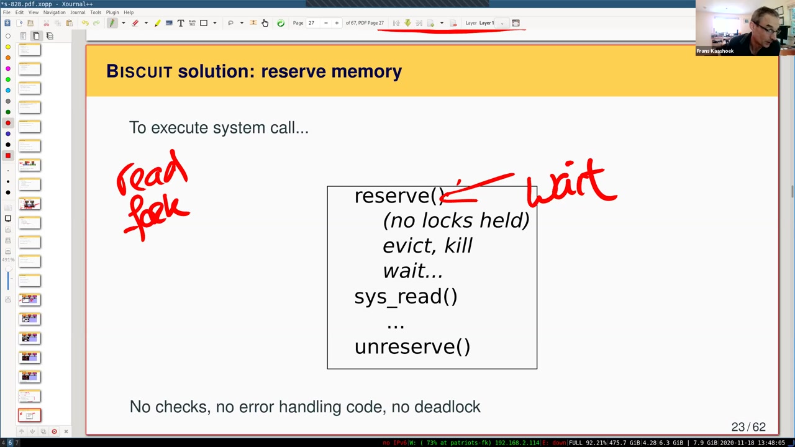
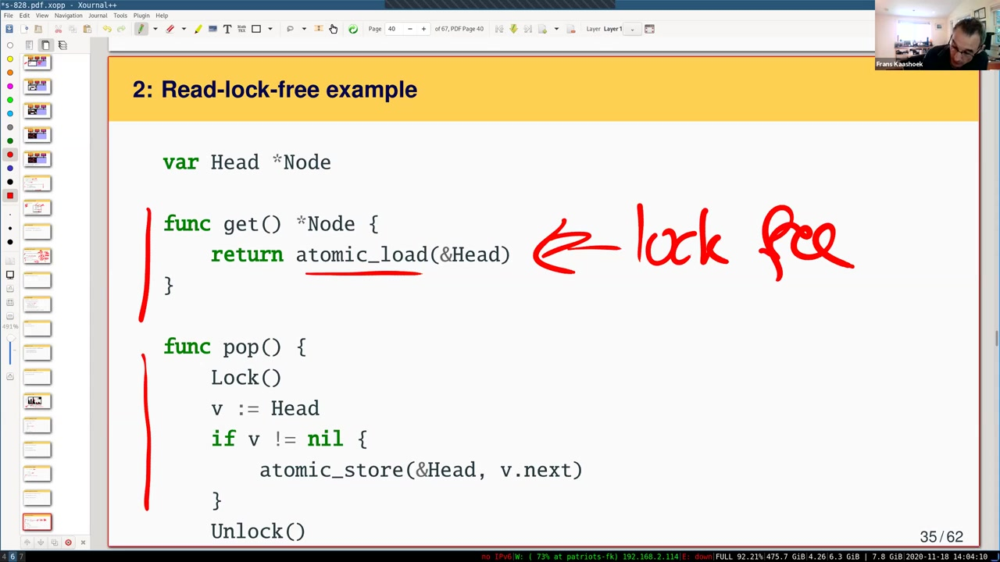
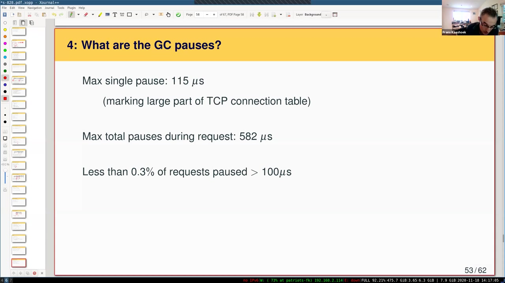

# 第 20 讲 · 内核与高级语言

## 00:00–03:00｜为什么值得重新问内核该用什么语言

Frans 请愿意的同学打开摄像头，希望远程授课也尽量保有课堂交流的气氛。本次使用幻灯片，讨论他与 Robert Morris、Cody Cutler 合作的 Biscuit 论文；Cody 是主要作者，也曾多次担任这门课的助教。讲者提到，介绍自己的研究并不是他最习惯的授课方式，但这项工作的起点确实来自 6.S081／6.828 学生反复提出的问题。

那个问题是：**为什么内核一定要用 C？** 做实验时，大家可能花很久寻找一个错误，然后发现若使用另一种语言，似乎根本不会允许自己写出这种代码。操作系统研究者也一直争论该选什么语言，只是观点很多，可供比较的事实不够。论文并不打算用一句话宣布某种语言获胜，而是希望提供数据，让争论能落实到具体收益与代价。

为此，作者决定写一个新内核。语言必须包含自动内存管理，也就是由垃圾收集器负责回收，而非每次都由程序员决定何时 `free`。与此同时，内核组织仍然沿用传统的单体 Unix 结构。这样，后面比较时尽量只改变实现语言，不同时引入完全不同的操作系统架构。可以先把它想成一个功能更丰富、认真做过性能优化的 xv6。

## 03:00–06:00｜C 给内核什么，又把什么责任交给程序员

xv6 为教学简洁保留了许多线性查找，甚至某些代价较大的算法。想研究高性能内核，不能直接把这些做法照搬，然后把慢归咎于语言。Biscuit 从一开始就要追求更强的功能和更好的性能。讲者会先补足背景，再进入设计细节，并欢迎大家随时提问。

Windows、Linux 和 BSD 等常见内核大量使用 C。它的吸引力是控制力：分配、释放内存由程序员决定；源程序里几乎没有看不见的大段运行时代码，读 C 时常能想象编译出来的机器指令；可以直接操作页表项位或设备寄存器；依赖很少。就像 xv6 的启动，只需要少量汇编准备好环境，很快就能执行 C。

这些优点的另一面是安全责任。数组后面多写几个字节、栈上的写入越界、对象释放后仍被其他代码使用，都可能成为漏洞。线程共享动态对象尤其难处理：一条线程不再需要对象，不代表别的线程也不再需要。程序员必须决定谁负责回收，以及什么时候回收才真正安全。C 允许精确控制这些事，却不替程序员证明决定是正确的。

## 06:00–09:00｜内存安全能消掉什么错误

xv6 的很多结构预先静态分配，动态对象生命周期的复杂性比生产内核少一些，但越界和释放后使用仍然会出现。讲者联系同学们在写时复制实验里的经历：页面引用与释放时机一旦处理不对，就会出现难查的 use-after-free。

作者研究论文时查看了 2017 年公布的 Linux 内核漏洞，其中有 40 个与这类内存安全错误有关，可能产生严重后果。高级语言的价值在于改变错误的后果或让错误根本无从发生：越界操作会被运行时检查拦下，可能引发 panic；由 GC 负责回收的对象不会在仍然可达时被正常回收。因此不能简单把“会崩溃”与“允许攻击者控制内核”视为同一种失败。

除了内存安全，高级语言还提供自动回收、并发支持和更好的抽象。例如 Go 的接口、其他语言的类，都有助于组织模块。于是自然会追问：既然如此，为什么 xv6 或 Linux 不直接使用 Go、Java、Python？答案之一是这些便利有运行时成本，通常称为 **HLL tax，高级语言额外开销**。下一步必须把这个词拆成可测量的东西。

## 09:00–12:00｜“语言额外开销”不只是垃圾收集

访问数组要检查索引，使用指针可能要检查是否为空，某些类型转换需要动态判断；垃圾收集则需要追踪对象、区分仍在使用与可以回收的内存。这些工作都消耗 CPU。问题不仅是平均速度，还包括执行是否被收集工作延迟。

另外，高级语言与内核可能有接口上的不匹配。内核要访问设备与特定内存，需要手写启动或上下文切换汇编；语言若完全禁止这些能力，就难以落地。并发模型也可能不合适：前面调度课里一条线程把锁的责任交给另一条线程，这种模式在普通应用里不常见，却会出现在内核中。

所以研究目标同时包含安全、可编程性和性能，而不是只测一项微基准。这里需要接近高性能生产内核的实现。若拿原本就慢的 xv6，与另一个同样慢的 Go 内核比较，结果主要反映算法与实现简化，并不能说明 Go 与 C 的差距。

已有研究确实测过用户程序采用高级语言的代价，但内核对内存管理与并发的要求有自身特点。讲者因此强调：不能把用户程序上的语言比较原封不动搬来，作为内核选型的答案。

## 12:00–15:00｜为什么已有高级语言内核还不能回答问题

用高级语言写内核并不是新发明，从早期 Lisp machine 到多种研究系统，都已有很长历史。然而许多项目的目的在于探索新架构、新隔离方式或新接口，性能评价主要针对这些新设计，而不是在结构相同的条件下比较语言。改变语言同时改变架构，得到的差距很难归因。

理想实验似乎是把一个生产级 C 内核完整重写成高级语言版本，再做比较；但小型研究团队不可能复制 Linux 社区长期投入的开发规模、硬件支持和细节优化。因此作者退而求其次：构建高级语言内核，保留与 Linux 相近的重要结构，把测试涉及的路径优化到相近的性能范围，再研究语言开销。

这个办法有明确风险。Biscuit 与 Linux 终究不是同一套功能，缺少的功能、不同的设计取舍，都可能改变数字。因此即使测到吞吐量接近，也不能声称做出了严格的语言胜负判断。研究能提供的是比直觉更多的证据，以及对差距来源更深入的理解。

讲者停下来询问是否有问题，再转入具体方法。这里没有可辨认的学生提问；课堂是在提醒大家，后面每一项测量都要记住它能回答什么、不能回答什么。

## 15:00–18:00｜相同应用、相同系统调用，以及为什么选 Go

比较两边时，上层运行同一应用，例如 NGINX Web 服务器。Biscuit 提供 Linux 所支持接口的一个子集，尽量保持系统调用参数与调用约定相同，让应用产生相同的系统调用工作。两边内核负责完成这些请求，再测量各自代价。即便这样，作者仍要花很多时间消除实现差异带来的不公平。

为什么选 Go？首先它编译成机器代码，不依赖 Python 式解释执行路径，而且编译器生成的代码质量不错。其次，它面向系统编程，与汇编或外部代码交互方便，并发支持也足够灵活。还有一条对本研究特别重要：它确实有垃圾收集器，能够用来回答“内核采用自动内存管理究竟需要付出什么”这个问题。

讲者回顾项目开始时的环境：当时 Rust 的流行程度、成熟度与稳定性尚不如后来。这个历史选择不表示 Rust 不适合写内核，而是说明选型与研究发生的时间有关。若现在重新开始，Rust 当然值得考虑；但语言是否适合工程，与它是否能回答同一个研究问题，还需要区分。

## 18:00–21:00｜Rust 是否会更快，以及先记住自己的实验错误

Rust 同样面向系统编程，运行时较小，能生成高效代码。它通过所有权与类型系统避免依赖垃圾收集，因而绕开了本研究特别想量化的 GC 成本。Biscuit 的研究不是预先认定“GC 一定不能用”，而是实际测量它是否真的不可接受。

**学生问：**如果用 Rust 重写 Linux，并投入同等程度的优化，会不会比 C 版本更快？

**讲者答：**这只能推测，因为没有做这个实验。他不预期一定超过 C，更可能处于相近范围。C 非常底层，许多 Rust 能实现的优化也可以用 C 表达。但这不是实测结论，不能把这种判断当成论文证明。

接着，Frans 把问题交还给学生：回想实验里那些花掉大量时间的错误，哪些可能被高级语言避免？不要只凭对某种语言的好恶回答，而是选一个自己真正遇到的故障，想清楚其原因。讲者计划在结尾重新讨论这个问题，也欢迎立刻提出经验。这给后面的实现介绍设定了一个观察角度：语言提供的便利到底对应哪一种真实开发困难？

## 21:00–24:00｜用户程序仍是普通程序，内核线程变成 goroutine

大家可以把最痛苦的实验错误记在心里，再看 Biscuit 的组织。它仍然有用户空间和内核空间，是传统单体内核。用户程序可以使用任意语言；这篇论文拿来测试的程序主要是现成的 C 程序，而不是要求应用也改写为 Go。

与一个用户进程通常只有一条执行线程的基础 xv6 不同，Biscuit 支持一个地址空间中存在多条用户线程。每条用户线程在内核中都有对应线程，用来执行系统调用等工作。这些内核线程采用 Go 的 goroutine。概念上它们仍是执行上下文，区别在于调度、切换以及条件变量等支持由 Go runtime 提供，而不是由 Biscuit 从头重新实现。

这立即引出启动依赖：普通 Go 程序运行在已有操作系统之上，runtime 可以向下请求内存等服务；Biscuit 本身就是内核，下面只剩硬件。机器启动后要先让 runtime 有能力工作，再让它支持内核代码。这里不能凭一句“Go 已编译成机器码”就认为所有依赖都消失了，后面需要一层很薄的适配代码来补上。

## 24:00–27:00｜shim、功能规模和系统调用接口提问

这层适配叫 **shim**。它给 runtime 提供启动所需的服务，让原本以为自己运行在 OS 上面的 runtime 能在裸机上建立堆等基础设施。等基础环境就绪，内核的大部分工作仍可以按正常 Go 代码编写。

Biscuit 有虚拟内存、支持 `mmap` 的映射管理、日志文件系统、网络协议栈和设备驱动。规模约 28,000 行 Go、58 个系统调用，明显超出 xv6。讲者对 xv6 的调用数只作了口头估计，这里不把该估计作为精确版本统计。

**学生问：**用户调用接口是否仍像 xv6，一样把参数放进寄存器，再执行 `ecall` 那样的指令？

**讲者答：**基本原理相同，稍后会具体说明。

功能方面，Biscuit 支持多核并发，用更细粒度的同步减少相互阻塞；文件系统可联系前面 ext3 论文的日志设计来理解；虚拟内存使用 VMA 一类区域描述结构；TCP/IP 能与其他机器通信。10 Gb 网卡与磁盘驱动也比教学用设备复杂。讲者把它与接下来的网络驱动实验作联系：实验接触的是更简单的设备，Biscuit 为性能需要实现得更充分。

## 27:00–30:00｜系统调用的跨特权过程不因 Go 改变

每个进程有自己的页表，用户与内核的隔离仍由硬件权限保证。用户线程发起系统调用时，在对应的内核 goroutine 中继续执行；如果请求阻塞，同一地址空间的其他线程仍可能获得运行机会。Go 的 `go` 语句所创建的执行上下文，被 Biscuit 用作内核线程的基础。

接口的步骤与 xv6 类似：用户侧库把参数装入寄存器，执行进入内核的特殊指令，建立保存状态的 trap frame，由内核处理请求，再恢复用户执行。课堂幻灯片将 x86 入口／出口标为 `SYSENTER`／`SYSEXIT`；Biscuit 的目标是 x86-64，而课程 xv6 用 RISC-V，因此不要把这些指令名直接写进 RISC-V 实验。这里要掌握的是同一个受控跨权限边界的结构。

**学生问：**Go 通常鼓励 channel，是否会把 xv6 那些锁操作改成用 channel 通信？

**讲者答：**实际没有大量使用 channel，主要仍用锁与条件变量，形态更接近 xv6 和 Linux。语言提供某个抽象，不意味着所有内核路径都应被它改写；具体经验会接着解释。

## 30:00–33:00｜把 runtime 放上裸机后，页表与中断怎么办

作者曾尝试更多使用 channel 的文件系统设计，但性能不理想，后来改回更传统的同步方式。选择 Go 的目的并不是让每个模块都必须展示 Go 的所有特性。

第一个实现难点是裸机 runtime。团队希望修改尽可能少，以便继续吸收新版本 runtime 的改进，项目过程中也确实多次升级。Go runtime 为跨操作系统运行而保持了相对有限的底层依赖，因此模拟它真正需要的服务，比想象中可行；许多服务主要用于初始化。

第二个难点是不同应用的地址空间。普通 Go runtime 通常只调度同一个应用中的 goroutine，而 Biscuit 用它承载多个进程。既然不想大改调度器，就不能假定每次 goroutine 切换都顺便切换用户页表。因此用户／内核边界必须安排页表处理；内核读写用户数据时，需要像 xv6 的 `copyin`、`copyout` 那样做软件页表翻译，而不是直接解引用任意用户指针。

第三个难点是设备中断。runtime 平常在用户态运行，不会直接收到网卡、磁盘、时钟等硬件中断，也不会像内核自旋锁代码那样在关键操作时自动关中断。这意味着不能直接把普通 Go 处理代码塞进任意中断入口。

## 33:00–36:00｜中断入口保持很小，真正棘手的是堆耗尽

解决中断问题的方法是让直接的中断处理极其有限：不拿普通锁，不分配内存，只记录发生了事件，并让相应的设备处理 goroutine 获得运行机会。真正的设备工作放到正常 goroutine 中执行，它就可以安全使用普通 Go 同步和内存分配设施。这样避免中断打断 runtime 的临界区后，又进入同一把锁或同一个尚未完成的内部操作。

这些问题大体在设计初期就能预料。更出乎意料、也更难的是 **heap exhaustion，内核堆耗尽**。讲者说明只会给出问题与方法的主要脉络，完整细节留在论文。

设想内核有一个用于动态对象的堆，里面放文件描述对象、socket 状态、进程记录等。基础 xv6 把其中许多结构预先放进固定大小的表；较完整的内核通常按需分配。用户不断打开文件、创建 socket、fork，内核便不断增加对象。若所有可用空间都被仍然活着的对象占据，下一个请求还需要一个新对象，该怎么办？这是资源仍被使用的问题，不能简单说“运行 GC 就好了”。

## 36:00–39:00｜为什么在分配器里等空闲内存会死锁

堆耗尽不必来自恶意行为。机器负载很高，几个应用同时需要大量资源，而旧资源暂未释放，也可能进入这个状态。C 内核同样面临它，只是通常能让分配器返回失败；Go 的普通 `new` 没有让调用者检查分配失败的常规返回分支，因此 Biscuit 必须安排出一条不同的路径。

讲者列出几个直觉方案。第一是直接 panic；xv6 的缓冲区缓存在找不到可用项时就可能这样做，但这对要长期提供服务的内核显然不理想。第二是让分配器等待，直到有人释放内存。表面上这最省事：调用者不用处理失败，只是等待更久。

问题在于等待时可能已经持锁。先考虑一个大内核锁：线程拿着锁进入分配器并睡眠，另一个本能释放内存的线程却进不了内核，自然无法唤醒前者。细粒度锁也不能自动避免这个环：等待分配的线程持有某个锁，而释放对象所需的路径恰好要同一个锁，就形成循环等待。因而“总会有人释放”不构成正确性论证，必须看这个人能否真的运行到释放步骤。

## 39:00–42:00｜失败回滚的复杂性与入口预留

第三个方案是让分配返回空指针，由调用者逐层撤回操作。但系统调用可能已经分配过别的对象，或者完成了一部分多步骤文件系统更新。要退出就必须把这些状态处理妥当，不能只写一个 `return -1`。这种回滚路径数量多、触发少、容易出错。

Linux 实际会结合等待、重试与失败处理，相关争论可以从 “too small to fail” 讨论看到。对 Biscuit 来说，Go 不允许把普通分配直接改写成这类可恢复失败接口，而且一些分配是语言设施隐式引入的，因此团队希望找一个结构上更简单的办法。

讲者停下来确认大家是否理解问题，再介绍方案：**在进入系统调用实际工作之前，先预留足够的堆容量。** 例如执行 `fork`，首先不是马上拿锁、复制数据，而是调用 `reserve`。只有能确保本次调用在最坏情况下所需的空间都能得到，才允许它向下运行。这个门槛把“是否有资源完成请求”的判断前移，而不是等到请求执行到一半再遇到失败。

## 42:00–45:00｜安全等待的位置，以及预留过大的代价

*原片 42:40，已查看的真实单帧、未裁剪。手写箭头把 wait 指向 reserve；`no locks held` 是避免分配等待死锁的关键，之后才执行 `sys_read()`，最后 `unreserve()`。*

如果入口处还没有足够内存，就先等待。这个时候系统调用尚未持有内部锁，也没有做了一半的资源更新，因此不会制造前面那种由分配等待引出的锁依赖环。内核可以回收缓存、释放软状态，必要时终止消耗资源过多的进程；条件满足后再继续执行请求。

调用一旦获准开始，其受预留覆盖的堆分配就不必处处检查失败，也减少了对应的回滚代码。调用结束时释放预留额度，供其他请求使用。这里讲的是额度核算，不表示调用创建的每个长期对象都在返回时消失；完整记账方法见课程资料 §2.2。

关键问题于是变成：怎样知道一个系统调用最多需要多少？粗暴地给每次调用预留半台机器的内存当然安全些，但会把并发度压得很低。预留量必须既保守，又不能大得失去实用性。

Go 在这里提供了意外帮助：语言与工具生态便于静态分析。作者可以沿 `read → f → g → h` 这样的调用关系，查找各处可能的分配、对象大小与生命周期，估计任何时刻可能同时活着的最大内存量。接下来最重要的区别是“累计分配多少”和“同时需要保留多少”。

## 45:00–48:00｜逃逸分析、最坏情况，以及人工提供边界

沿调用图分析时，不能只把最深栈上的局部变量简单相加。假设 `h` 分配对象，并把指针返回给 `g`；`h` 返回后，对象仍可能被 `g` 使用。它已经逃逸出 `h` 的生命周期，必须继续算入活跃内存。逃逸分析就是用来识别这种关系：哪些分配在某个函数返回后必然不可达，哪些仍需保留。

**学生问：**同一函数在不同负载下分配量不同，是取最坏情况吗？

**讲者答：**是的，工具必须保守，分析最坏的调用路径与可能的分配需求。真实运行可能只用很少，但预留的保证不能建立在平均值上。

保守分析也不是全自动魔法。有些循环次数取决于系统调用参数，静态工具看不出有效上界，程序员就要提供注解。递归同样可能具有与输入相关的深度，因此作者修改了少数内核函数，避免这类递归，使分析更容易得出有用结果。研究的取舍是让内核代码适当配合可分析性，换取入口处更简单可靠的内存管理，而不是声称能自动算出任意程序的精确资源需求。

## 48:00–51:00｜分析工具的复用，以及性能优化仍然要做

给循环补边界、检查特殊分配，需要熟悉内核的人投入几天工作。Go 的 slice 扩容也要考虑：添加一个元素可能触发容量增长，不能只算新增元素的大小。作者为相关结构标注容量上界，让工具得到合理的最大需求。因此“工具自动计算”与“人工约束代码”是配合关系。

**学生问：**这些静态分析工具除了写内核，还用于什么？

**讲者答：**Go 编译器自身就利用类似分析做优化。分析能力封装成包，不只编译器能调用，Biscuit 的工具也能复用；后面的语言特性统计还会再次使用这种设施。

接下来转向实现性能。Biscuit 采用许多成熟内核常见的优化：用大页映射内核指令，减少 TLB 压力；每 CPU 独立的网卡发送队列，降低核间同步；类似 RCU 的目录缓存，使读路径避免锁。重要经验是，Go 没有妨碍实现这些优化。真正花时间的是把数据结构、同步与缓存设计好，而不是因为代码用了 Go 就无法表达它们。

## 51:00–54:00｜有没有为了好看而避开高级语言功能

性能优化仍然费了大量工作，不过那是内核工程本身的工作。评价随后分为收益与成本两部分。讨论收益先问三件事：Biscuit 真正用了高级语言特性吗？代码是否因此简化？能否避免实际安全漏洞？

第一问是在防止一种误导：如果为了快，把所有 Go 特性都绕开，只写成“换了语法的 C”，就不能用结果代表正常使用高级语言的内核。作者因此统计 Biscuit、Golang 仓库和 Moby 两个大型 Go 项目，每千行代码使用各种特性的次数。横轴是分配、map、slice、channel、字符串、多返回值、闭包、finalizer、defer、goroutine、接口等；纵轴是静态出现密度，不是运行时间。

结果没有显示 Biscuit 在系统性逃避语言能力。它使用动态分配、map、slice、多返回值、闭包与包组织，某些项比另外两个项目多，某些少。Channel 确实少，但另外两者也并非大量使用。没有使用 finalizer，也不意味着完全绕开 GC。这个比较支持的结论是“具有正常的高级语言使用形态”，不是单凭一张图证明代码质量或开发效率已经提高。

## 54:00–57:00｜开发便利与共享缓冲区的回收难题

**学生问：**这么多语言特性是如何计数的，是否也用静态分析？

**讲者答：**是。写一个小程序遍历语句，识别语句类型、参数和相关使用，就能统计，不需要手工读完两个百万行级项目。

代码是否更简单，作者承认这里带有主观经验。进程退出后，地址空间描述等复杂对象可能带有很多子结构，GC 能免去逐一追踪并释放其内存的代码。多返回值使接口表达清楚，闭包方便组织任务，map 则让程序员不必为了省去手写哈希表而退回线性查找。这些都让实现更直接。

讲者用共享缓冲区给出一个具体例子：先分配对象，再启动一条 goroutine 调用 `process1(buf)`，当前线程继续执行 `process2(buf)`。两条执行流都要访问同一对象，但结束顺序不确定。C 代码必须决定由谁回收，怎样证明另一条执行流已经结束。Go 则让两边各自持有正常引用，等两边都不用了，再由 GC 找到并回收。难点不是分配那一行，而是跨线程生命周期协调。

## 57:00–60:00｜读无锁链表：移出数据结构不等于可以释放

*原片 58:45，未裁剪。`get` 只原子读取 Head，`pop` 持锁更新 Head；画面中的“lock free”指读侧，不是说写侧或整个数据结构都无需同步。*

收集器从线程栈等根出发追踪引用，当没有任何执行流还指向缓冲区时，才会在之后回收。C 当然可以用引用计数解决共享生命周期，但计数更新本身需要锁或原子操作，多核争用时也可能成为性能瓶颈。于是内核常希望读路径既不拿锁，也不反复写引用计数所在的缓存行。

课堂用链表头示例说明这个问题。`get` 原子读取 `Head` 并返回指针，不拿锁；`pop` 则先拿写侧锁，读取当前头，再把 `Head` 原子更新为下一个节点，最后解锁。这个设计只有读路径无锁，不能把它叫作所有操作都无锁。

难点是 `pop` 之后能否立刻 `free` 被移出的节点。答案是否定的：另一个读者可能恰好在原子更新前获得了旧指针，随后继续访问它。写者之间有锁，并不能保护这些不拿锁的读者。

Linux 的 RCU 用延迟回收处理这类问题，等到符合安全条件后再释放。但读者与写者必须遵守一组规则，不能只学会一个原子 load/store 就认为生命周期问题结束了。后面的 RCU 课会专门讨论这些规则。

## 60:00–63:00｜GC 简化的是回收协议，安全收益仍有边界

课堂提到的经典 RCU 使用方式，对读侧临界区中的睡眠或调度有限制，程序员要谨慎遵守。GC 则直接依据是否仍有引用判断可回收性，不需要为了内存回收单独要求读者在某个调度点前放弃指针。这里免去的是释放协议，数据结构更新的原子性与逻辑正确性仍然需要设计。

然后回到 CVE 检查。作者人工读修复补丁，判断若对应逻辑写在 Go 中，结果是否改变。65 个可检查的漏洞里，11 个无法判断，14 个属于仍可能在 Go 中发生的逻辑错误；剩余 40 个分成 8 个 use-after-free／double-free 与 32 个越界。前一类由正常的 GC 生命周期管理避免，后一类可能变成边界检查 panic 或被语言机制消除。

Panic 会影响服务可用性，并不是理想结果，但通常优于让内存损坏变成执行攻击者代码的机会。因此这项评价说的是特定漏洞类别的缓解，并非“Go 内核没有漏洞”。

讲者进入性能部分，并说明时间有限，可能跳过部分幻灯片，以便留下讨论时间。实验在真实机器上运行：四核 2.8 GHz Intel 处理器、16 GB RAM、关闭超线程；使用 Web 服务器、键值存储与邮件型基准，让内核承担大量工作。

## 63:00–66:00｜应用级吞吐量与额外开销分解

这些应用的执行时间主要花在内核，因此能检验系统调用路径，而不是测一个几乎不进内核的用户计算程序。第一个问题是 Biscuit 是否与生产内核处于相近性能范围。比较时采用 Linux 4.9 系列，并关闭 Biscuit 没有的一些功能，例如页表隔离、retpoline 等，以尽量减小功能不对称。

课堂口头把差距概括为约一成，强调不要对这个数字作过度解释。两边并不完全等价，但至少没有出现几倍、十倍的落差，这使继续讨论语言开销具有意义。精确吞吐量及比值见课程资料 §4.5；口头估计不替代论文表格。

随后通过性能剖析，把 CPU 时间归类：GC；函数入口的 prologue 检查；写屏障；以及数组边界、空指针等安全检查。Prologue 要检查当前 goroutine 的栈是否够用，必要时触发扩栈，也承担运行时协调。写屏障则在并发 GC 期间帮助收集器正确追踪新建立或被修改的引用。

测量中的 GC 确实运行了，不是给一个无穷大的堆、让测试结束前根本不收集。接下来观察到的低 GC 百分比，必须放在这些应用的存活对象规模下解释。

## 66:00–69:00｜GC 开销由存活数据和余量共同决定

这些负载里，最明显的高级语言额外开销反而是函数入口检查。GC 大约占 1%–3%，写屏障不到 1%，安全检查约 2%–3%。讲者认为 prologue 在未来有优化空间，但这是当时实现测得的结果，不能先把尚未完成的改进算进去。

GC 的低成本不具有普遍保证。活着的对象越多，每轮要追踪的工作通常越多；可供继续分配的空闲堆空间越少，就越频繁地收集。为把这个因素放大，作者人为保留约两百万个 vnode，可理解为大量类似 inode 的文件描述对象，总计 640 MB 存活数据，然后改变额外空闲内存。

当空闲只有 320 MB 时，存活／空闲比为 2，GC 占到 34%；若空闲是 1,280 MB，即存活数据的两倍，GC 约降到 9%。这意味着该实验要把 GC 控制在约 10% 以下，需要的**总堆空间**约为存活数据的三倍，而不是说整台机器所有内存都必须乘三。

**学生问：**写屏障是否通过修改页面权限实现？讲者用此前 Appel–Li 课中的复制收集帮助类比：收集时必须追踪某些指针访问和变化。但这只是概念联系，不能把那次复制式 GC 的实现照搬到 Go；准确区别接下一段。

## 69:00–72:00｜读表澄清与请求累计延迟

关于写屏障，课堂强调它帮助发现需要被收集器追踪的指针。**编者校订：**Go 1.10 在本文使用的是并发、非移动的标记清扫 GC；这里的写屏障是编译器插入的引用更新检查，不是把堆分成 from-space／to-space 的复制算法，也不等于给页面设置只读权限。

**学生问：**为什么存活数据能比 free 还大？是否总共只有 320 MB，却存了 640 MB？

**讲者答：**表里的 free 是额外可用余量，不是总量。第一行总量是 `640 + 320 = 960 MB`，最后一行是 `640 + 1280 = 1920 MB`。余量更大，收集器在与应用交错运行时更从容，因此开销下降。学生确认误把 free 看成 total，疑惑得到澄清。

接着讨论暂停。Go 的并发 GC 用很短的 stop-the-world 阶段协调工作，然后让应用继续执行；分配时还会夹带少量收集工作。因此即使没有一次很长的全局停顿，请求仍可能遭遇多次小延迟。

NGINX 测量中，单次分配遭遇的最大 GC 延迟为 **115 微秒**，原因是标记 TCP 连接表的一大部分；一次请求把多次暂停相加，最坏为 **582 微秒**。**校订说明：**本段 ASR 两次写成 150，slides 与论文均为 115；这里保留校订依据，不声称已逐句听音确认。

*原片 71:40，未裁剪；实际画面确认 115 μs 与 582 μs，第三行是不到 0.3% 的请求累计 GC 延迟超过 100 μs。*

## 72:00–75:00｜尾延迟预算与更接近控制变量的微基准

只有不到 0.3% 的请求因 GC 延迟超过 100 微秒，但“很少”不自动等于“可以接受”。如果服务要求极低的最坏延迟，偶发的半毫秒级额外等待仍可能不合格。讲者以《The Tail at Scale》中毫秒到十毫秒量级的服务延迟作参照，说明某些应用可能有预算容纳它，而不是保证所有应用都能接受。

团队也观察到，升级 Go runtime 往往带来更好的 GC 延迟表现，这正是尽量少改 runtime、便于跟随上游的好处。

最后一个技术比较试图更直接隔离语言因素：挑选两条足够小、能够人工核对的内核路径，修改 C 与 Go 两边，使功能尽可能相同，再比较执行时间与机器指令。完整系统无法做到严格相同，但一个受限的路径更有机会。

课堂重点展示 pipe ping-pong：数据经管道来回传递，触发系统调用、唤醒和调度。Go 路径约 1.2 千行，C 约 1.8 千行；稳定阶段不分配堆对象，因此不触发 GC。剖析中两边最耗时的十条指令相对应，为“正在做相似工作”提供额外证据，而非仅凭源程序看起来相似。

## 75:00–78:00｜C 的优势与学生的生命周期错误

在这条受控路径上，C 版本吞吐量约为 Go 的 1.15 倍。额外的函数入口、安全检查等使 Go 每轮执行更多指令，差距约 16%，与运行时间趋势一致。讲者的结论是 Go 确实更慢，但仍具有竞争力。比值是 1.15，不是 ASR 误写的 1.5；它也不代表所有内核工作都有固定 15% 的成本。

讲者跳过后续扩展性幻灯片，回到开头的问题：如果 xv6 实验可以换用 Go 等高级语言，大家希望换吗？哪些具体错误会消失？

**一位学生的例子：**在函数内建立对象，把指针返回给外部，之后继续使用时才发现对象已不存在。Frans 将它归入典型的生命周期错误；第二次遇到可能更快认出，但第一次很费时间。**编者说明：**若该对象位于函数栈帧，这更精确地称为 use-after-return，与手动 `free` 后使用属于同一类悬空引用问题。

**另一位学生认为：**虽然某些错误非常折磨人，直接使用低层语言仍有学习价值。没有高级抽象挡在中间，才能真正理解内核如何操作内存。这把“工程上最好用什么”与“课程里最好学什么”区分开了。

## 78:00–81:00｜字符串、map，以及 xv6 为什么仍会保留 C

学生继续分享经验。一位同学曾写过字符串末尾，程序没有立即给出有用错误，而是在别处表现得很奇怪；并不只发生在最初的工具实验。讲者认同，真正的字符串对象与边界保护能改善这种体验。

另一位同学提到，经常想要 map，却只能反复写循环查找；但对原来主要使用高级语言的人来说，C 也让自己第一次强烈意识到：程序最终是从 CPU 的角度执行这些具体操作。前一位同学又补充，问题曾与字符串复制函数是否补上 NUL 结束符有关；字幕没有可靠给出具体函数对，因此这里不擅自补成某两个确切 API。

Frans 感谢这些反馈，并明确说课程不会因为 Biscuit 研究就把 xv6 改成 Go。课程目标是理解 CPU 与系统调用接口之间发生的一切。Go runtime 隐藏了线程实现和调度等内容，而这些恰好是课程要自己动手实现与理解的对象。

不过，若项目目标不再是教学，而是写一个安全且足够快的新内核，就应该依据需求重新选择。课程采用 C 的理由，不能直接变成所有新内核都应采用 C 的理由。

## 81:00–84:00｜结论之后的问答：真实硬件与 QEMU

讲者给出的是条件化建议：若 CPU 性能压倒一切，无法接受这类额外开销，或者必须极度节省内存，C 是合理选择；若安全与开发便利更重要，而性能是“重要但不是唯一目标”，高级语言也完全值得考虑。研究让作者更确信，语言并没有神秘地禁止人们写内核，关键是理解它的支持与代价。

正式讲授结束，Frans 祝同学们顺利完成 mmap 实验，也提醒离校过感恩节的同学旅途平安；愿意继续提问的人可以留下。

**学生问：**实验既然跑在真实硬件上，最初怎样开发并启动？

**讲者答：**启动时用 shim 准备硬件环境，满足 runtime 对堆内存等服务的请求。但绝大多数开发其实在 QEMU 上进行；论文测量才在真实硬件上完成。换到实机还会遇到不同 boot loader 与启动代码的问题。Biscuit 在 QEMU 中看起来很像 xv6：主要是 shell 提示符，没有窗口系统。讲者表示可以展示，但字幕中没有随后实际运行演示的证据。

学生追问启动代码写错会怎样；回答是可能连最早的启动打印都看不到，机器表现为没有进展，需要定位最早失败的位置。

## 84:00–87:00｜如何调试启动，以及为什么 goroutine 可以很多

早期启动还没有完整调试设施时，可以同步写 UART，在代码的几个位置输出简单字符，看看执行到底到达哪里。它不是舒适的调试体验，但能逐步缩小故障范围。

**学生问：**给 Go runtime 补齐的那些底层服务是否全部由汇编实现？能不能早点开始用 Go，只把不可避免的部分留给汇编？

**讲者答：**论文里约 1,500 行汇编的一个重要用途就是启动准备。有些代码理论上可用 C，但项目不想引入 C。不过团队也尽量早用 Go，早期 Go 代码必须特别谨慎，例如不能执行内存分配。确切哪些代码还能改写，讲者需要看仓库才能回答，不能现场给出一个精确的最小汇编量。

**另一问：**Go 为什么能支持十万条 goroutine，难道能直接创建十万个 pthread 吗？

回答首先涉及栈：Go 栈按需增长，函数入口检查空间是否足够，不够再扩展；这就是前面测到的 prologue 的用途。许多 pthread 实现更重，而且还对应内核中的线程状态。大量 goroutine 并不意味着每条都有同样重量的底层线程。

## 87:00–90:00｜goroutine 的承载层，与“编译语言为何还要 runtime”

**学生追问：**普通 Go 程序对 goroutine 的调度，是完全在用户空间完成，还是需要内核支持？

**讲者答：**主要在用户空间。Runtime 向操作系统建立一组底层线程，课堂称其为 M，再把许多 goroutine 复用到这些线程上。并不是每个 goroutine 都单独对应一个内核线程。学生确认这种多对少关系后，又问 C／C++ 能否采用类似方法节省内存；回答是可以，已经有支持大量轻量线程的库。这不是只有 Go 才能实现的思想。

部分同学告别后，又有人提出更基础的疑惑：C 编译成机器码直接在 CPU 上运行；Go 也编译成机器码，为何还需要 shim？是不是两种语言的执行本质不同？

Frans 从功能而非“编译／解释”回答：Go 程序依赖线程、调度器、map 和垃圾收集等动态服务。这些服务在程序运行时必须实际执行。GC 需要堆，runtime 原本会向操作系统请求内存；Biscuit 没有下层 OS，因此要由 shim 满足这部分需求。机器代码的存在不能替代这些资源准备步骤。

## 90:00–93:00｜runtime 也会编译，但不会因此消失

**学生继续问：**那把 runtime 也编译成机器码，不就不需要它了吗？

**讲者答：**runtime 本来就被编译了。它是程序运行时一起存在的一部分代码；编译只是改变表示方式，并不会让 GC、调度与内存分配的任务凭空消失。C 也有少量运行支持，讲者用打印和字符串操作作为类比；Go 依赖的功能更多，运行支持便更大。

**学生尝试概括：**shim 是否可以看成一个提供底层功能的小 OS 层？

讲者认可这个帮助理解的类比，又回到 xv6：启动汇编先准备一块栈，才能调用 C 的入口。也可以把这几条必要指令想作极小的适配层。Go runtime 需要的准备项目更多，所以对应的 shim 更大，但核心问题相同——让上层代码所假设的执行环境先成立。

学生表示这个类比解决了疑惑。随后另一位学生回到 pipe ping-pong：自己在第一个实验中只写了很短的程序，为何论文比较中会出现约一千行的代码？Frans 开始澄清，实验里写的是用户侧驱动，论文对齐的是它触发的内核实现路径。

## 93:00–94:28｜最后区分基准程序与内核路径

一个很短的用户程序会调用大量并不写在该程序里的内核功能：进入系统调用、保存寄存器或 trap frame、分派系统调用、查询文件描述符、找到管道、复制数据、阻塞与唤醒接收者、调度，最后再恢复用户执行。论文所比较的就是这一整条被触发的内核路径，而不是说用户侧 ping-pong 本身必须写一千行。

学生再问，如果换成 xv6，相关内核代码是否会明显更短。讲者没有当场给出确定行数，而是再次列举要算进去的 trap、fd、pipe、copyin／copyout 与调度等部分，表示必须实际查看代码才能知道。

**编者校订：**末段字幕出现“这些行数指汇编指令”的表述，和论文 §8.7.1 的统计口径不一致。论文明确区分源代码行数（Go 1,200、C 1,786）与每次往返执行指令数（Go 5,259、C 4,540）。本段的教学要点是区分用户侧驱动与内核工作量；不要把这两种数字混在一起。录像在问答尾句结束，最后约 0.8 秒没有字幕。

## 来源、校订与覆盖说明

- V20：MIT 官方 2020 课表所链视频，David Morejon 频道，2020-11-19 上传，Frans Kaashoek 主讲，94:28。英文自动字幕，无人工英文字幕；本页为按原顺序的自主中文译述。
- S20：MIT 课程团队，[课堂提纲](https://pdos.csail.mit.edu/6.S081/2020/lec/l-biscuit.txt) 与 [slides](https://pdos.csail.mit.edu/6.S081/2020/lec/l-biscuit-slides.pdf)，仅辅助核对，不当成视频漏段的替代品。课表网站标注 CC BY 3.0 US；视频许可单独未确认。
- P20：Cutler、Kaashoek、Morris，*The benefits and costs of writing a POSIX kernel in a high-level language*，OSDI 2018。论文里的完整计数、实验条件和课外机制见[课程资料](#/c/mit-6.s081-2020/lec/lec20?v=materials)。
- 2433 条有文本字幕全部阅读。开头 0–2.159 秒无字幕；末条结束于 94:27.199。窗口是连续阅读索引，允许完整句子按语义跨越边界，不能作为精确逐句同步稿。
- 仅取并实际查看原片 42:40、58:45、71:40 三帧，保留原画面，无裁剪；未下载全片、音轨或视频片段。截图仅用于本页对照讲解。
- 已明确校订 Biscuit、goroutine、NGINX、MAXLIVE、RCU、write barrier 等 ASR 误词，以及 115 微秒、1.15 倍、源代码行数与执行指令数的区别。未全片听音或逐帧核对；没有把口头“可以演示”记成已执行演示；没有运行 Biscuit、xv6 或网络实验。
