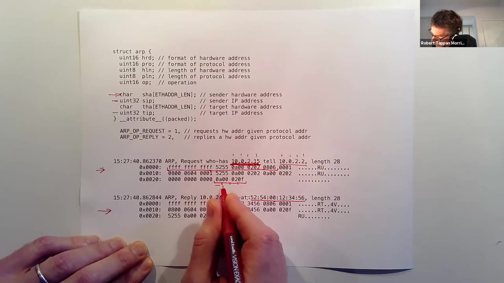
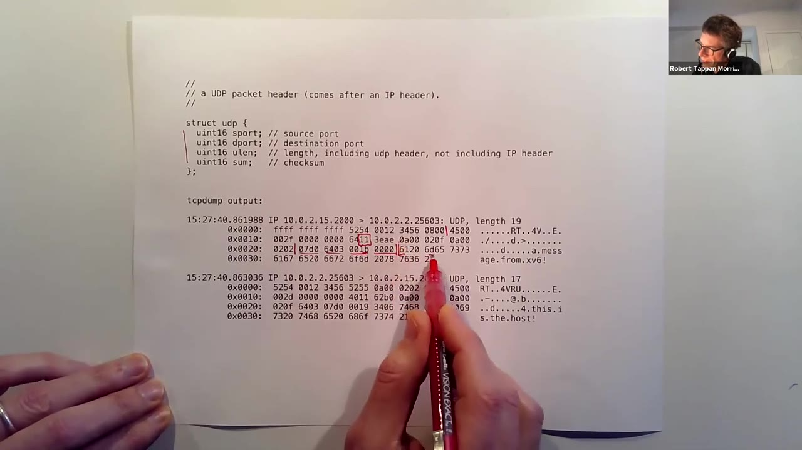
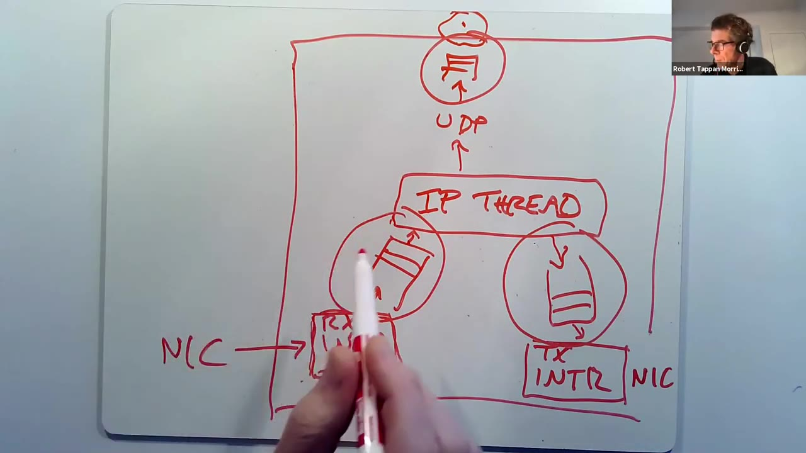
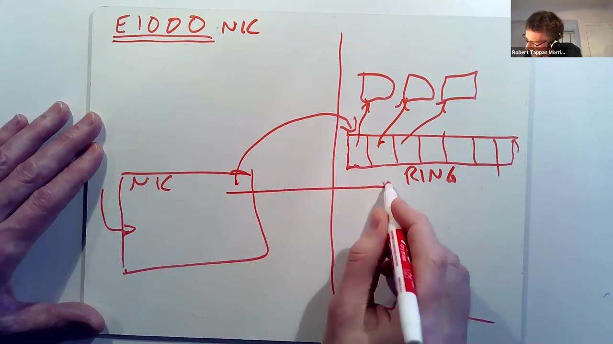

# 第 21 讲 · 网络：从包头到接收活锁

## 00:00–03:00｜局域网把主机连接起来

感恩节后恢复上课，Morris 确认声音正常，说明本讲分成三个部分：网络协议与包格式、操作系统中的网络软件结构，以及指定论文揭示的活锁问题。前两部分也为最后的网络实验作准备；实验的核心是编写网卡驱动，而不是从头实现所有网络协议。

板书首先画出连接多台主机的一张网。主机可能是笔记本、服务器，也可能是路由器；连接它们的底层设施可能是共享电缆、以太网交换机，或者 Wi-Fi 无线网络。网络软件尽量在较低层隐藏这些差异，使浏览器与 HTTP 服务器等应用可以通过比较一致的接口通信。

这里先考虑局域网 LAN。它不是整个互联网，而是一组能够在本地网络中相互通信的主机。讲者用广播来说明它的尺度：有些协议需要把消息送给本地所有主机，这在较小范围内可行，但不能把整个互联网都做成一个广播范围。接下来要解决的，就是如何把多个这样的局部网络连起来。

## 03:00–06:00｜跨网络通信为什么需要路由

Morris 用几十到几百台主机的例子说明广播范围不断扩大的成本；这些数字是课堂的直观尺度，并非 LAN 的协议硬上限。随后板书把 MIT、Harvard 与 Stanford 的本地网络通过路由器连起来，路由器之间还可以有远距离链路，构成互联网骨干。

MIT 的一台主机要给 Stanford 的主机发包，包不能只在本地广播。发送者需要一种能够命名远端主机的地址，沿途路由器则要根据地址判断下一跳：是朝 Harvard、Stanford，还是其他地方走。**寻址与逐跳转发**共同把局域网扩展成互联网。

课堂把两类职责分开：以太网协议处理本地链路上的通信；IP 协议叠在其上，提供跨网络的寻址与路由。接下来不是先讨论复杂的路由算法，而是观察实际传输的字节：包里究竟有哪些字段，主机与路由器的软件如何读这些字段，并据此决定下一步操作。

## 06:00–09:00｜以太网帧与软件看见的头部

同一 LAN 上的主机发送一串字节，以太网把这个传输单位称作帧。帧头提供足够的信息，让接收端辨认“发给谁、来自谁、里面是什么协议”。课堂关注的三个字段依次是目的以太网地址、源以太网地址与类型：两项地址各 48 位，类型 16 位，后面才是负载。

48 位地址标识网络接口。类型字段不解释应用数据，而是告诉接收软件应该把后续字节交给哪个上层协议。例如，收到帧后到底调用 ARP 处理代码，还是 IP 处理代码，不能靠猜负载的内容来决定。

讲者还用“开始／结束标志”概括底层硬件如何辨认帧边界。这些线路上的信号细节通常不交给驱动作为普通包字节处理。驱动看到的主要是帧头与负载。

随后他展示实验提供的 `kernel/net.h`：里面用 C 结构体描述各类包头。软件不只是把它当说明文档，还据此拆解收到的字节、填写待发送的字段。因此结构布局必须与线上格式对应。

## 09:00–12:00｜EOP 不是线路边界信号

**学生问：**这里硬件使用的包起止标记，是否就是实验中的 EOP（end of packet）？

**Morris 澄清：**不是。实验的 EOP 是驱动与 NIC 之间传递信息的一种机制；刚才讲的是线路编码如何表达包边界，是另一层问题。他用一种历史编码思路举例：如果一组信号能表达四种符号，可以让其中两种表示数据位 0、1，另两种表示边界。这个例子用于说明“边界不必是普通数据字节”，并明确表示自己不知道现代以太网具体采用的全部细节。

话题回到地址。采用 48 位是为了给大量网卡分配不同的标识。课堂介绍传统的厂家分配方式：前 24 位对应厂家，后 24 位由厂家给不同网卡分配。因此同一厂家的一批网卡可能高位相同、低位不同，甚至连续。

这里要区分两个问题：地址能够区别不同接口，并不意味着它能告诉路由器接口位于世界上的哪里。以太网地址在本地网络中很好用，但其厂家编号不是网络地理位置或路由前缀。

## 12:00–15:00｜用 tcpdump 对照以太网头

如果目标与自己处于同一个 LAN，以太网地址可以让目标接口识别发给它的帧；如果目标在远方，单靠这个地址就缺少路由线索。这为后面的 IP 地址作铺垫。

课堂展示的是网络实验产生的 `tcpdump` 输出。第一部分为捕获时间，其后是工具解析出的可读说明；下面还有原始十六进制字节。Morris 按帧头顺序拆解：最前面的六个字节全是 `ff`，表示以太网广播；再往后的六个字节是发送接口地址；再后面两个字节是 `0806`，说明负载属于 ARP。

这份流量来自 QEMU 中运行的 xv6，并非真实网卡。因而发送地址的高位不能简单当作真实厂家编号来推断硬件，虚拟环境会配置自己的地址。余下的字节需要按 ARP 格式解释。

讲者鼓励学生在自己的电脑上尝试 `tcpdump`，因为实验调试也会用到这种方法：先识别工具已经解释出的信息，再回到十六进制字节核对字段位置，而不是把一整行输出当作不可理解的字符串。

## 15:00–18:00｜ARP：把本地 IP 地址对应到以太网地址

IP 地址与以太网地址承担不同职责。本讲使用 IPv4 的 32 位地址；讲者把其高位直观地解释为网络编号、低位解释为网络内部的主机编号，并提醒实际组织更复杂。路由器可根据网络部分选择下一跳，而以太网地址本身没有这种结构。

但包最终要在某一段本地以太网上交付。已知目标 IPv4 地址，如何知道该填哪个 48 位以太网地址？ARP（地址解析协议）通过请求与应答动态建立这个对应关系：发送者在 LAN 中广播询问谁拥有某个 IP 地址；拥有该地址且在线的主机返回自己的以太网地址。

ARP 包本身装在以太网帧里面。因此线上先出现目的地址、源地址、类型三个以太网头字段，随后才是 ARP 头。接收端看到类型 `0x0806`，便知道下一段字节应该交给 ARP 代码。

ARP 头也携带地址类型、长度、操作类型以及发送者和目标的地址。它既要表达“这是一个解析请求还是应答”，也要说明正在建立哪一对 IP／以太网地址的关系；主机可据此维护动态映射表。

## 18:00–21:00｜ARP 请求、应答与十六进制字段

课堂继续展示实验中的 ARP 交换。QEMU 模拟出一个以太网环境，xv6 与宿主侧网络通过它通信。示例中宿主侧知道 xv6 的 IP 地址，希望取得其以太网地址，于是发送请求；xv6 收到后发现目标 IP 正是自己，返回应答。这部分应答代码由实验提供。

`tcpdump` 已经把请求概括成“谁拥有这个 IP，请告诉发送者”，把应答概括成“这个 IP 位于这个以太网地址”。Morris 再把这些说明对应到原始字节：前 14 字节仍然是以太网头，类型仍为 `0806`；ARP 头末端的 `tip` 是要查询的目标 IP，前面还有目标硬件地址、发送者 IP 与发送者硬件地址。

他一边指字段一边修正“发送者／目标”的口头指认。请求不知道目标硬件地址，所以相关字段并不能提供有效的目标 MAC；应答才补上这个信息。读输出的关键不是记住画面上的一串数，而是把每个字段放回它在请求或应答中承担的角色。具体地址与字节的核对见下一窗口的原片画面。

## 21:00–24:00｜ARP 地址校对与两个学生问题

*21:10 原帧，未裁剪。上方 `sha/sip/tha/tip` 分别为发送者硬件地址、发送者 IP、目标硬件地址、目标 IP；下方请求查询 `10.0.2.15`，由 `10.0.2.2` 发起，应答给出 `52:54:00:12:34:56`。*

Morris 从目标 IP 开始倒着拆字段。**编者校订：**画面中的目标地址字节是 `0a 00 02 0f`，对应十进制 `10.0.2.15`；ASR 把口述数字和“hex”混在一起，不能照字面写成 `10 00 02 15` 的十六进制字节。发送者 IP 是 `10.0.2.2`。

**学生问：**已有以太网地址就能回复，ARP 为什么还要带发送者 IP？讲者先表示自己不能确定所有字段的历史理由，随后提出一种解释：ARP 被设计为可适配不止以太网，因而倾向于自包含，甚至重复携带外层以太网头已有的硬件地址。这里的回答是探索性的，并未严格逐项证明发送者 IP 字段为何必要。

**另一位学生问：**右边的一列字符是什么？那是同一批字节的 ASCII 解释，不可打印的字节用点表示。当前多是二进制字段，所以不太直观；稍后包里有真正的文本负载时，这一列就有用了。

## 24:00–27:00｜嵌套包头对应逐层处理

Morris 特别停下来强调协议嵌套。刚才看到的是以太网头后接 ARP；更一般的包可能是以太网包含 IP，IP 包含 UDP，UDP 又包含 DNS 消息。上一层眼中的完整包，在下一层只是负载。

发送时，DNS 软件先构造消息，再让 UDP 添加 UDP 头；UDP 需要 IP 的传送服务，于是 IP 再添加 IP 头；最后加上以太网头交给本地链路。于是一个应用消息外面逐步包上了不同层负责的元数据。

接收时方向相反。软件知道包来自以太网接口，先检查以太网头，根据类型找到下一层，去掉当前头，再由下一层检查并解释新的头部。IP 的协议字段也起到类似的分派作用。各层可以检验格式，不合要求便丢弃；检验通过才继续往上交。

这个“发送向前加头、接收从前拆头”的过程，也预示了内核软件的结构。以太网只解决本地交付；即使本地可以用 ARP 找到目标，IP 仍是承担更一般互联网寻址的层。

## 27:00–30:00｜IP 的地址具有跨跳意义

实验 `net.h` 也定义 IP 头。以太网类型为 `0x0800` 时，后面按 IPv4 包解释。不同于只在一段 LAN 上使用的以太网头，IP 头表达从原始发送主机到最终目标主机的通信。包离开当前以太网后，外层链路头可以被去掉并换成下一段链路需要的头；源、目的 IP 则具有贯穿端到端路径的意义。

课堂主要关注源 IP、目的 IP 和协议号。路由器根据目的 IP 的网络部分选择转发方向，目的主机根据协议号决定交给 UDP 还是 TCP 等处理代码。讲者以历史上 MIT 的 `18.*` 地址作直观例子：世界各地的路由表可以把这个前缀映射到朝 MIT 更近的一跳；同时提醒近几年情况已有变化。

随后他切回抓包，准备按以太网头、IP 头的顺序解析。这里的“IP 头基本保持相同”是课堂的概括，并不表示每一个字段逐跳不变；例如 TTL 与相关校验和需要随转发更新。

## 30:00–33:00｜现场发现广播地址异常，解析 IPv4 与 UDP 协议号

看抓包时 Morris 发现一个值得保留的异常：示例本是两个特定主机之间的通信，但以太网目的地址却全为 `ff`。真实网络中通常不该这样发送单播业务。他没有给出确定原因，只说可能与自己的实验解法或 QEMU 有关，随后继续分析其余字段。

以太网类型 `0800` 后是此处长度为 20 字节的 IP 头。源地址为 xv6 的 `10.0.2.15`，目的地址是模拟网络宿主侧的 `10.0.2.2`。这两个地址定位的是通信两端，不要拿前面的广播 MAC 把它们也解释成 IP 广播。

讲者从 IP 头末端向前查找重要字段，指出 16 位头部校验和，途中修正一次字段边界。校验用于发现头部损坏；若检查失败，软件应丢弃该包。紧邻的协议号是十六进制 `11`，即十进制 17，对应 UDP。

因此接收端得到明确的下一步：去掉 IP 头之后，由 UDP 软件解释后续字节。课堂暂不逐项展开所有 IP 字段，只指出其中还包括长度等信息。

## 33:00–36:00｜从目标主机继续找到目标应用

到达正确主机还不够。一台主机同时运行许多使用网络的应用，IP 地址不能独自说明包应该交给哪一个。UDP 和 TCP 用端口号参与这个分派。

Morris 先比较二者：TCP 除了定位通信端点，还维护序列号、发现丢失并重传，向应用提供按序且无缺口的数据；UDP 简单得多，提供尽力而为的数据报交付，不负责实现 TCP 那套可靠传送机制。本讲与实验重点是 UDP。

UDP 头中的源端口和目的端口各为 16 位。应用通过 Unix 的 socket API 表达自己希望接收发往某个端口的数据，内核建立相应状态并提供文件描述符。收到匹配的数据时，应用便能从自己的 socket 读取。

有些服务使用约定俗成的端口，例如 DNS 常用 53。请求 DNS 服务时，目的端口可以预先知道；而发起请求的客户端也需要一个本地端口，以便之后把回复交给正确的应用。这引出下一段源、目的端口的配对关系。

## 36:00–39:00｜UDP 抓包：长度、校验和与可读负载

客户端给 DNS 服务器发请求时，目的端口是 53，源端口则取自本机为客户端分配的端口。服务器回复时把请求的源端口作为回复的目的端口，客户端内核据此找到等待回复的 socket。端口不是主机地址，而是主机内进一步分派通信的线索。

*38:20 原帧，未裁剪。UDP 头为 `sport/dport/ulen/sum`；示例从 `10.0.2.15:2000` 发到 `10.0.2.2:25603`，回复将端口调换。ASCII 列可以读到 `a message from xv6!` 及宿主回复。*

课堂继续沿着 14 字节以太网头、20 字节 IP 头向后走。协议号仍是 `0x11`，其后八字节是 UDP 头。讲者指出这两个端口只是实验选择的值，没有特别的标准服务含义；长度字段为 `0x001b`，即 27 字节，包含八字节 UDP 头及 19 字节负载。示例 xv6 发出的 UDP 校验和字段为零，讲者说明提供的软件未填写它。

这次负载是真正的 ASCII 文本，所以右侧字符列有了直观意义。一条消息被放在 UDP 内，再放在 IP 内，再放进以太网帧。窗口末学生开始询问：不知道远端 MAC 时，是不是先交给路由器？

## 39:00–42:00｜本地交付、远端下一跳与包长限制

**关于远端 MAC 的回答：**主机先根据目的 IP 判断是否在本地网络。若在本地，用 ARP 获得该目标的以太网地址并直接发送；若目标位于远端，就把包交给本地路由器。路由器检查目的 IP，选下一个路由器，沿途一跳一跳接近目的地。发送者不需要解析远方主机在远方 LAN 上的 MAC。

**聊天区问：**包的长度有没有上限？有，而且不同层有不同限制。Morris 以传统以太网的 1500 字节和一些现代网络支持的约 9000 字节大帧为例。编者说明：1500 通常指以太网负载／IP MTU，而非把全部链路头尾都算进去的帧总长度；大帧也不是所有链路都默认支持。

为什么不把一个包做得无限大？讲者给出两个考虑。第一，线路可能受到噪声影响，有限长度的校验码对不同长度消息的检错能力存在设计约束；第二，所有可能接收该包的主机与路由器都要准备足够缓冲区。极大且变化范围悬殊的包会使缓冲管理更困难、更昂贵。这里是设计动机的概述，并非一个适用于所有编码的统一误码概率公式。

## 42:00–45:00｜从包格式转向内核协议栈

除了链路限制，IPv4 头的 16 位总长度字段本身也给出了接近 64 KiB 的上限。讲者结束包格式部分，说明完成网络实验后会看到类似的 xv6 发包及宿主回复；实验提供的软件还会发 DNS 查询并打印回应，学生实现的是底层网卡交互部分。

接下来画的是一种典型的内核网络软件组织，Morris 明确提醒实际系统还有很多其他安排。最上面是浏览器、DNS 服务器等应用；应用通过 socket API 创建或配置端点，获得读写用的文件描述符。

内核的 sockets 层维护端点状态，使端口等协议信息能对应到供应用访问的 socket 对象；每个 socket 通常还有收到数据、等待应用来读的队列。课堂把这种关系简化为端口与 fd 的表，目的在于说明协议数据最终怎样进入进程接口，并不是说真实实现只需一张全局“端口→整数 fd”表。

实验提供的 sockets 层非常精简。理解它时应先看接口与数据的流向，再看下一层究竟需要保存多少协议状态。

## 45:00–48:00｜UDP、TCP、IP、ARP 与驱动的分工

sockets 之下是 UDP／TCP。UDP 的处理相对简单：从收到的头中取出目的端口，将负载交给相应 socket 的输入队列。TCP 则要为连接保存大量状态，如序列号、尚未确认的数据以及需要重传的内容；这些集中在协议控制块等结构中。实验给了简单 UDP，没有 TCP。

再下面是 IP 与 ARP；ARP 在图中与 IP 相邻，但不是“所有 IP 包都必须再封装成 ARP”。最底下是一个或多个 NIC 驱动，驱动与真正的网卡硬件交互，硬件连接 LAN。以太网相关处理常与驱动结合，并不一定在软件中另有一个独立、统一的层。

包到来时，NIC 接收字节，驱动把数据交给上层。各层检查本层头，去掉它，再交给下一层：例如 IP 检查后交给 UDP，UDP 找到 socket 并排队。应用发送时方向相反，数据向下流动，各层逐个加头，最后交给 NIC 发送。

因此，协议在包内的嵌套，确实在很大程度上影响软件的模块划分。但这张图还没有回答一个对论文至关重要的问题：**这些代码到底由谁、在什么时机运行？**

## 48:00–51:00｜mbuf 与接收中断的第一段工作

Morris 补上贯穿协议栈的包缓冲区。各层并不是只传抽象消息，实际操作的是保存字节的 buffer；等待应用处理的队列可以是这些 buffer 组成的链表。实验使用 `mbuf`，并有相应分配机制。它不是协议栈中的新一层，而是各层共用的数据表示与存储工具。

随后从分层图切换到控制流图。一个网络栈常有多个独立执行实体：各自接收输入、处理、产生输出，通过队列解耦。因此“属于哪个协议层”与“在哪个执行上下文里运行”不是一回事。

传统安排中，NIC 收到包后触发中断。中断处理程序把包从 NIC 取出来，放入软件输入队列，留给后续代码处理，然后返回。它希望只完成必须立即完成的工作，不在中断里做全部协议计算。

这样做的历史理由是网卡缓冲少，突发数据可能很快塞满它，而主存空间相对充裕。尽快把包搬到主存，看起来能减少网卡丢包。但如果后续处理一直拿不到 CPU，单纯把包搬进软件队列就未必是好事。

## 51:00–54:00｜转发线程、发送完成与应用是不同参与者

软件输入队列后面可以有一个网络／IP 处理线程，也可能是其他形式的执行实体。它取出包后有两种主要去向：若交付本机应用，调用 UDP 等上层函数，最后排进 socket 队列；若本机充当路由器，便查询目的地址，把包排入相应出口的发送队列。

Morris 指出，普通操作系统完全可以承担路由工作，家用 Wi-Fi 设备或路由盒内部常运行 Linux。论文研究的也正是这种主机式路由器，而不是必须使用特殊路由硬件。

出口还存在发送完成处理。NIC 发完先前的包、可以接收后续任务时，需要软件回收完成资源并推进发送队列。于是控制图中不只有接收中断与 IP 线程，还包括发送侧处理，以及最终读取 socket 的用户应用。

这些实体的调度方式不同。NIC 事件触发中断，内核线程由某种线程调度机制运行，应用又参与进程调度。论文的单处理器环境下，中断处理与网络线程不能同时执行，而且中断有绝对优先权；多核可能提供更多并行，但不会自动消除所有资源竞争。

## 54:00–57:00｜三个队列的用途与双向网卡问题

*55:00 原帧，未裁剪。`RX INTR` 为接收中断，`IP THREAD` 为网络处理线程，`TX INTR` 为发送侧中断；上方 UDP 后还有等待应用读取的队列。圈出的队列连接不同执行实体。*

队列至少有三个用途。第一，吸收暂时突发：NIC 可能短时间比 IP 线程产生得更快，可以先放一会儿。第二，保持发送硬件忙碌：软件预备好多个待发包，让 NIC 发送当前包时还有后续工作。第三，使不同执行实体不必同步运行；网络线程不用知道应用或每个中断具体何时被调度。

这种解耦很方便，但论文会说明各阶段完全不了解彼此进度也有代价。至少在过载时，前级需要知道后级是否还能消费。

**学生问：**同一个 NIC 不能同时负责收发吗，为什么图上画两张？当然可以。讲者的笔记本通常就是同一个 Wi-Fi 接口收发。画两个接口是为了表示路由器把一个网络收到的包转发到另一个网络，而不是说接收与发送天生需要两张网卡。

## 57:00–60:00｜多接口与旧式 NIC 缓冲

接着上一问，Morris 用家庭路由器作例子：一侧连接 cable modem／外部互联网，另一侧是 Wi-Fi 网络，两者是不同接口。服务器也可能用一张接口对外服务，另一张连接独立的内部数据库网络。多接口的关键是连接不同网络，并不是区分收与发。

随后单独讨论包怎样从 NIC 到达主存。讲者对论文中网卡采用的模型是：NIC 从线路接收并解码字节，将包排进自己的内部内存，然后通知主机。驱动查询网卡是否有待收数据，再由 CPU 执行复制循环，把包逐字节或逐字搬到主存的包缓冲区。

因此，网卡有自己的待收队列，主机也可能有另一条软件队列，中间的复制工作消耗 CPU。这个历史方案便于理解论文中接收处理为何昂贵。

但从现代处理器的角度看，CPU 反复访问外设总线是相对缓慢的操作；即便设备就在同一台机器内，这个往返也远慢于许多本地计算。因此高性能接口倾向于避免让 CPU 用大量细粒度读写来搬完整包。

## 60:00–63:00｜E1000 用 DMA ring 指定包的落点

实验模拟的 E1000 使用另一种安排：NIC 通过 DMA 把包直接放入主存。驱动处理时，包字节已经在主存里，不必再从 NIC 内部逐字节复制。问题随之变为：NIC 怎么知道应写到哪些地址？

驱动初始化时分配一批包缓冲区，再构造一个环形描述结构。课堂先把它简化为一组指向包缓冲的指针，例如 16 个缓冲；驱动把环在主存中的地址告诉 NIC。硬件记录下一个应使用的条目，收包时读取该条目里的缓冲地址，把字节 DMA 到那里，然后推进索引。走到数组末端就绕回开头，所以称为 ring。

*62:30 原帧，未裁剪。左侧 NIC，右侧主存中的 ring 与包缓冲。箭头表达 NIC 读取环条目后找到具体缓冲区；实际实验描述符还包含长度、状态等，并非只有裸指针。*

这是接收 RX ring。发送方向也有类似结构：驱动把希望 NIC 发送的数据放在缓冲区中，并通过发送 TX ring 告诉硬件。环的管理正是实验驱动需要完成的工作。

## 63:00–66:00｜E1000 与现代网卡、实验网络栈的边界

**学生问：**E1000 与高性能生产环境网卡相比怎么样？Morris 说，E1000 推出时曾是严肃生产环境使用的先进网卡。现代网卡聪明得多，但 DMA 与环形缓冲描述符的核心组织方式仍然常见。

改进之一是多队列。课堂举例可以配置 32 个接收队列，让硬件根据包中的字段决定 DMA 到哪一个环。这样在运行多个客户虚拟机的主机上，就有机会把不同流量直接导向相应虚拟机的队列。另一个改进是卸载某些协议工作，例如在网卡上做校验和计算，减少 CPU 负担。

**另一位学生问：**实验的驱动与 IP 层之间似乎没有那个输入队列？讲者确认：实验网络栈被精简到很小的规模，比真实系统简单得多。学生接着问这样是否性能更差，Morris 没有给出未经测量的结论；他说明自己没有在真实环境测试这个栈，而且设计实验时基本没考虑性能。

下一窗口继续澄清：实验实现的限制首先是功能范围，不能把教学上更简洁的调用路径直接排成“比真实栈快／慢”的结论。

## 66:00–69:00｜DMA 涉及地址翻译与缓存一致性

实验网络栈缺少大量真实系统功能，例如 TCP 和多 NIC 支持；“没有某个队列”不能独自代表总体实现质量。

**学生问：**让 NIC 直接访问内存，需要整体硬件作什么改变？此前是否一切都必须经由 CPU？Morris 先重申，前一张旧式模型图里的 NIC 并不直接访问主存，而由 CPU 复制。他对所有历史硬件细节没有把握，随后提出两个关键问题。

其一是 DMA 地址如何解释。NIC 使用的地址是否经过翻译？讲者推测现代设备总线与 DRAM 之间的硬件可以配置翻译表，使设备使用的地址映射到实际内存，并说明这种能力在某些情形下很有价值。这里保留其不确定性，不把这段回答扩写成完整 IOMMU 实现讲解。

其二是缓存一致性。CPU 刚写好待发包时，最新字节可能仍在 write-back cache 中，主存里还是旧版本；NIC DMA 读取时必须得到最新数据。讲者指出 Intel 等平台有相应机制协调缓存与 DMA，某些系统还可利用设备写入与缓存的配合，让 CPU 更快取得收到的数据。看似简单的“设备读写 RAM”，在真实硬件里其实涉及不少协作。

## 69:00–72:00｜从吞吐量曲线开始读论文

Morris 转到论文，决定直接用图推动讨论。首先看图 6-1：被测主机是一个双接口路由器，一侧收到包，另一侧转发出去。横轴是输入速率，纵轴是实际观察到的输出速率，单位都是包／秒；此时重点看不经过 `screend` 的实心圆曲线。

他让学生先不依赖作者解释，提出最基本的问题：为什么曲线上升？为什么停止上升？为什么之后反而下降？峰值位置和下降速度分别受什么限制？这是一种读性能图的方法——先分清坐标与工作负载，再问曲线形状需要什么机制解释。

**学生答上升原因：**未饱和前还能处理更多输入，因此输出也增加。讲者确认：如果每个到来的包都能转发，那么每秒到 2000 个就会发出 2000 个，曲线自然是 $y=x$。

另一位学生用“中断来不及处理”解释停止上升，讲者暂时将其放到后一个问题：即使系统设计完全正确，也不可能无限增加吞吐量；必须先区分正常的容量上限与不正常的过载崩塌。

## 72:00–75:00｜容量上限与每包 200 微秒的估算

CPU 每秒只能执行有限指令。每个包都要检查头部、计算或检查校验和、查路由表并推进发送，因此即使没有设计错误，吞吐量也会在某处封顶。

Morris 将图上的峰值近似读作每秒 5000 包，据此估算每包消耗约 $1/5000$ 秒，即 200 微秒。这个换算是一个瓶颈假设下的量级推断，并非直接测量出的每个函数耗时。优化也许能把每包成本降到 150 微秒，把容量提高一些，但任何有限硬件仍然有上限。

也不能一看平台就自动认定 CPU 是瓶颈。另一个候选是网络速率：论文使用的是 10 Mbit/s 的以太网，线路无论如何都不能每秒承载超过其额定比特数。讲者于是追问，约 5000 包／秒会不会已经触及线路限制？

这里必须同时考虑包大小。小包在线路上可以达到大约每秒一万到一万五千包，因此后续会据此判断，观测到的峰值更可能受 CPU、内存等主机处理能力约束，而不是线路已经塞满。

## 75:00–78:00｜为什么额外输入会夺走已接收包的处理机会

在这些小包条件下，10 Mbit/s 以太网允许的包率明显高于图中的峰值。理想的有限容量路由器，应当先沿 $y=x$ 增长，到容量后维持平台，例如稳定转发约 5000 包／秒，将剩余输入丢弃。

实际曲线却在输入继续增加时往下掉。讲者给出作者定位的原因：额外输入仍使高优先级接收路径不断工作。这个旧式路径还要把包从 NIC 复制到主存，成本不小；而接收处理优先于真正执行 IP 转发的线程。

假设每秒输入 10000 包，主机最多完成 5000 包，另 5000 包必然要丢。问题不在“有丢包”，而在丢掉这些额外包之前仍花掉大量 CPU。每多来一个包，就又占用一段接收处理时间，使网络线程更难获得执行机会，反过来让能完成的包更少。

极端情况下，CPU 全部用于输入端处理，转发线程完全不运行。这就解释了为何曲线不是在容量处变平，而是向零滑落。论文还讨论中断批处理，因此这里“包触发中断”的课堂直观说法，不应理解为每个包严格对应一次独立硬件中断入口。

## 78:00–81:00｜活锁、浪费的前置工作与丢包位置

Morris 将这种“输入越多、有效吞吐越低”的现象称作 interrupt livelock，并把它推广到多阶段系统：前级与后级需要相同资源，而调度总优先喂入新工作，后级就可能被饿死。

竞争对象也不一定只有 CPU。比如另一个设计中的 DMA 可能大量占用内存带宽，即使 CPU 还有执行能力，主机处理包所需的内存访问也可能受影响。这是课堂的机制类比，不是论文在其测试机上测得的另一条曲线。

接着定位旧设计的具体丢包点：NIC 后面是接收处理程序，它把包复制进软件输入队列；网络线程应从该队列取包。过载后线程得不到 CPU，队列达到长度限制；接收处理程序仍取出新包，却发现无法入队，只能丢弃。然后下一批到来，又复制、又丢。

CPU 不是停止工作，而是在反复做不能产出结果的前半段工作。课堂将下降区间也称为活锁现象；论文严格区分吞吐退化与最终趋近零的 receive livelock。无论用哪一种口语范围，核心都是不能只统计“接收代码忙不忙”，必须统计最终完成了多少工作。

## 81:00–84:00｜中断唤醒，忙时轮询，空闲再睡眠

讲者说明正式时间基本用完，准备压缩讲解解决方案。先看修改后的曲线：输出增长到约 5000 包／秒后保持平台，不再因输入继续增大而崩塌。

新结构仍有网络线程与中断处理程序，但分工变了。NIC 第一次发出中断后，中断处理程序只唤醒网络线程，并让该 NIC 的中断保持关闭；它不再把包从 NIC 搬到软件输入队列。中断返回后，网络线程自己检查 NIC，取出少量包并完成协议处理，再继续检查。

如果还有包，就继续轮询；如果没有待处理工作，重新允许 NIC 中断，然后睡眠。之后到达的包又会通过中断唤醒线程。高负载时始终有工作，因而主要靠循环轮询；低负载时无需持续空转，也能在新包到来后迅速响应。

关键不只是少做几次中断入口，而是输入端不能再不断抢占正在推进包处理的线程。课堂这里举的每轮少量包为五包，来自所示实验配置；它不是对所有网卡都适用的常量。窗口末学生追问：多 NIC 时这个循环究竟检查哪几个接口？

## 84:00–87:00｜轮询范围、配额与 NIC 内部队列

**学生问：**轮询检查所有设备，还是只检查发出中断的那一个？Morris 明确说自己不确定论文循环的精确实现。他讨论一个合理设计：为每个 NIC 记录中断／轮询状态，循环检查接口并从有包的接口取一些数据；没有待处理工作时再开中断睡眠。这是课堂推理，论文实际回调注册与轮询细节另见课程资料 §4。

**学生再问：**既然中断不搬包，循环运行时包从哪来，难道每次只有最初一个？答案是包首先排在 NIC 自己的内部内存里。网络线程向硬件询问有无待收包，分配主存缓冲，把字节复制出来，然后处理；当然可以连续取得多个。

为什么不把某个 NIC 里的全部包一口气处理完？讲者解释配额的用途：即使一个接口堆着一百包，每次只处理少量，也能让其他输入接口和发送侧获得服务，避免被单个持续繁忙的接收源独占。

学生进一步担心这要求 NIC 增加内存。讲者没有声称论文确实升级了硬件，而是把问题拆成轻载与过载：轻载时中断唤醒后很快会取包；持续过载时，本来就有一部分输入必须丢弃。

## 87:00–90:00｜关中断不会让网卡停止接收

关于是否需要更大缓冲，Morris 指出输入与输出速率之差就是持续丢弃的量。在持续过载中，再加很多缓冲只能暂存更多终究来不及处理的包；缓冲真正有价值的用途，是吸收短暂突发，等软件赶上来。课堂用五包配额讨论小缓冲的直觉，并未给出保证无损接收所需容量的严密下界。

**另一位学生确认：**禁用中断时 NIC 还能把新包放入自己的队列吗？能。中断通知与网卡接收是两件事。NIC 仍独立接收线路数据，仍向自身缓冲区排队；禁用的是向 CPU 请求这类中断的机制，并不是停掉接收硬件。

讲者再次限定此处使用的模型：论文课堂讨论的 NIC 先把包留在自己的内存里，由主机来取，不是前面 E1000 的 DMA ring 模型。不同 NIC 的数据搬运方式不能混在一起。

这个区分消除了一个常见误会：中断处理程序不搬数据，不代表数据凭空消失；数据先在设备队列中等待。队列满时才由设备丢弃多余输入，网络线程负责取出其有能力继续处理的一部分。

## 90:00–93:14｜尽早丢包仍不等于所有下游都能前进

上一个问题的关键结果是：新设计在过载时主要由 NIC 缓冲区满而丢弃多余包，不必先花主 CPU 时间复制再丢。把无效工作挡在更早的位置，保住主机处理已接收包的能力，是理解它避免活锁的一条路径。

**最后一位学生问：**轮询线程已经取出几个包，但软件内部其他队列全满了，会怎样？Morris 回答，这完全可能。比如数据需要交给本机应用，而应用没有足够快地读 socket，那么 socket 缓冲会满，网络线程仍可能在后面丢包。

更严重的是，网络线程可能用掉 100% CPU，导致应用没有机会读取。此时虽然不再由接收中断饿死网络线程，却变成网络线程饿死应用；已经做过协议处理的包最后仍被丢弃。这可以称为网络处理活锁，说明换掉一层中断机制不是整个系统完成进度的证明。

论文对这一情形增加了队列反馈：当交给应用的队列积压过多，就暂停从 NIC 继续取包，并保持相应输入通知受抑制；让应用得到 CPU，把队列消费到较低水平，再恢复输入。这样资源才从“接新包”转向“完成旧包”。

讲者以“多阶段处理的任何阶段都可能出现类似活锁”收尾，学生致谢。93:01 之后仅有致谢与回应，最后一条字幕结束于 93:09.840；到视频 93:14 之间没有字幕，不补写额外讲授。

## 来源、校订与覆盖说明

- V21：Robert Morris，*6.S081 Fall 2020 Lecture 21: Networking*，课程官方课表链接视频，David Morejon 频道，2020-11-30 发布，93:14。完整阅读原语言自动字幕；没有进行全片听音复核。视频授权字段未提供，故采用自主组织的中文译述而非逐句全文译本。
- 原始 ASR 为 `sources/video.en-orig.json3`，原始时间与文本提取见 `sources/captions.normalized.json`；31 个窗口的主题、演示、问答和证据范围见 `sources/coverage.json`。去掉口头重复，疑问与教师不确定的回答均保留其性质。
- 四帧分别取自 21:10、38:20、55:00、62:30，均已实际查看，未裁剪。包地址、UDP 长度与负载依据前两帧校对；未逐帧核对整个视频。
- O21：MIT 2020 [Networking 提纲](https://pdos.csail.mit.edu/6.S081/2020/lec/l-net.txt) 仅作术语与范围核对。提纲中的磁盘／UART 对比、完整 `screend` 图解、NAPI、复杂流水线反馈等，并未全在本视频展开，不能当作已讲内容补入时间线。
- P21：Jeffrey C. Mogul、K. K. Ramakrishnan，*Eliminating Receive Livelock in an Interrupt-driven Kernel*，USENIX 1996。精确评测条件与论文机制见[课程资料](#/c/mit-6.s081-2020/lec/lec21?v=materials)，提炼与自测见[课程笔记](#/c/mit-6.s081-2020/lec/lec21?v=notes)。
- 本文未运行网络实验。课上 `net.h` 与网络扩展属于实验／录课环境；共享固定 xv6 参考快照并不是录课工作树，不能用它替换画面中的结构或声称逐行一致。实验内容统一见[net 实验页](#/c/mit-6.s081-2020/lab/net?v=zh)。
