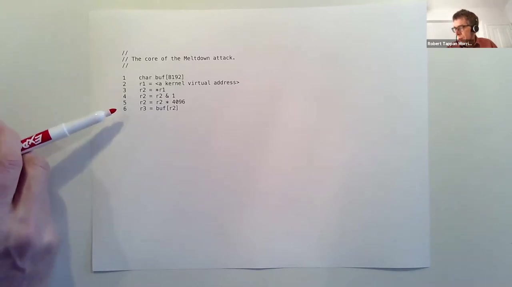
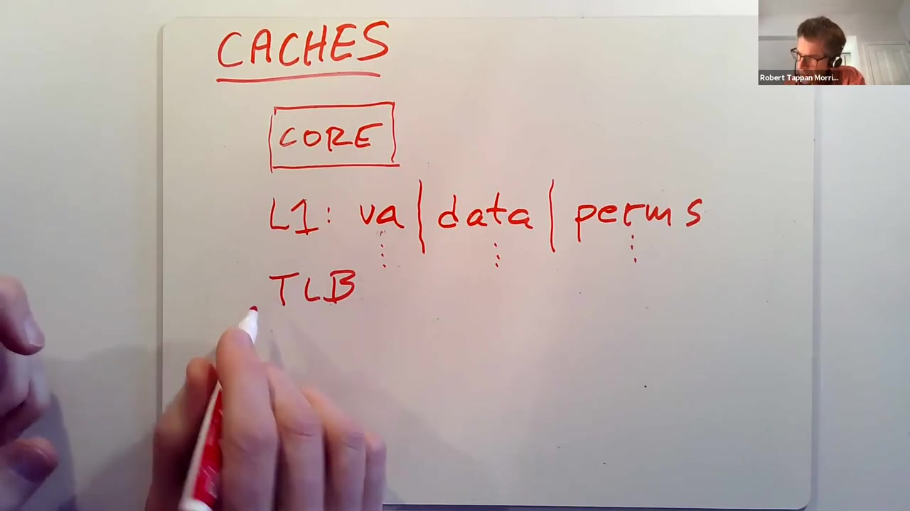
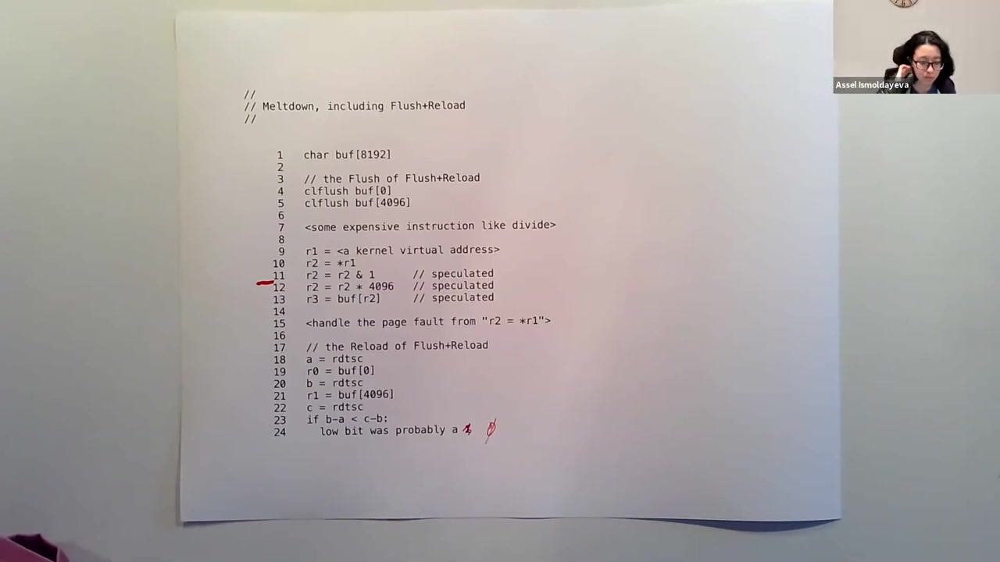

# 第 22 讲 · Meltdown 中文译述

## 00:00–03:00｜页表隔离为什么还值得怀疑

操作系统的安全并不是第一次出现在课程里。此前讨论用户态与监督态、页表、系统调用参数检查，都是为了建立隔离：用户程序不能读取内核中的秘密，也不能随意读取其他用户的进程。内核既依赖硬件限制访问，也需要谨慎处理用户传来的地址，避免自己成为越权访问的帮手。

Robert 从这个熟悉的基础引入 Meltdown：只学习保护机制的正常工作方式还不够，还应看它们如何失效。2018 年初公开的这个攻击尤其令人不安，因为它挑战的不是某个系统调用里漏了一次检查，而是“正确设置页表就能保证用户／内核隔离”这一基本信念。

攻击属于微架构攻击。这里的“微架构”指处理器内部的实现细节，而不是程序员从指令手册看到的抽象规则。许多细节没有完整公开，研究人员通过实验和推断了解它们，再把这些隐藏行为组合起来。讲者以录课时的认识说明，Meltdown 本身已有有效修复；更令人担心的是，是否还存在一长串同类问题。这也是这篇论文值得放进操作系统课程的原因。

## 03:00–06:00｜先看一个看起来必然失败的程序

假设攻击者已经能在目标机器上运行普通用户程序，例如有一个分时系统账户，或者购买了托管服务。机器里还有不属于他的秘密，可能位于内核，也可能属于其他进程。攻击者没有直接读取这些秘密的权限。

讲者给出一个 C 与汇编混合风格的教学片段。`r1`、`r2`、`r3` 表示寄存器，`buf` 是攻击者自己合法拥有的用户内存。它表达的是以下数据依赖：

```text
用户缓冲区 buf：8192 字节
r1 ← 希望观察的内核虚拟地址
r2 ← 该地址中的数据
r2 ← r2 的最低一位
r2 ← r2 × 4096
r3 ← buf[r2]
```

最低位只有两种值，因此最后一次读取只可能落在 `buf[0]` 或 `buf[4096]`。这一次只试图观察一个 bit，并不是一次恢复整个寄存器。



*原片 05:00，已实际查看：纸上第 4 行 `r2 & 1` 提取最低位，第 5 行乘以 4096，第 6 行用它选择用户缓冲区位置。保留原帧，未裁剪。*

首先需要回答的却是：用户程序怎么可能执行第二步？大家已有的页表知识告诉我们，它应当失败。内核地址对应的页表项不允许用户访问；CPU 查到权限不匹配后，应当产生 page fault。讲者借用本课程 RISC-V 的 `PTE_U` 名称说明这个权限边界，但论文主要讨论的处理器是 x86，不能把这个名称当成 x86 页表位的正式写法。

## 06:00–09:00｜映射存在和允许访问是两回事

如果在片段后面加一条打印寄存器的语句，会发生什么？程序会在访问内核地址时异常，根本不会正常走到打印位置。所以 Meltdown 并不是“普通 load 已经可以合法返回内核数据”。问题在于，这串最终会失败的指令，仍然能够留下可利用的信息。

论文的一个重要前提是：用户程序运行时所用的页表，也包含内核映射。映射的用户可访问位为零，所以普通用户代码不能使用它，但虚拟地址仍然对应一个明确的物理位置。

为什么操作系统要这么做？因为系统调用进入内核后可以继续使用同一张页表，只改变权限级别，不必再换页表。进入和退出内核因此更快，也能减少地址转换缓存失效带来的后续代价。

**学生问：能再解释一次内核和用户的映射吗？** Robert 改用 xv6 对比。课程里的 RISC-V xv6 在用户页表中保留用户地址、trampoline 和 trapframe 等少数必要映射，并不把整个内核放进去。论文攻击的是另一种组织方式：用户程序执行期间，完整内核映射已经在当前页表里，只靠权限位挡住访问。学生的问题促使他把“有映射但不许读”和“根本没有映射”分开讲清楚。

> 编者校订：此处关于切换页表会清缓存的讨论，主要应理解为 TLB／地址转换管理成本；不能概括成所有处理器每次换页表都清空全部数据缓存。后面的缓存图也是教学简化。

## 09:00–12:00｜为什么知道内核地址不是可靠防线

Robert 继续解释共用页表：系统调用一进入监督态，同一组内核页表项立刻可用；操作系统过去广泛采用这种方式，也符合当时硬件接口鼓励的设计。移除用户页表中的内核映射，恰好会成为后面讨论的修复方法。

**学生问：攻击者必须知道自己想读的地址吧？** 是的，这确实是额外工作。攻击者拿到的必须是相应内核虚拟地址，不能只说“我要找密码”就自动知道位置。

但讲者提醒，不应把“地址难找”当作完整的安全论证。高价值秘密可能值得攻击者花几个月研究。他可以检查内核源码和编译结果，在自己的机器上增加诊断输出，了解数据结构的位置；也可能反复扫描候选地址，寻找有意义的数据。防御设计不能只依赖对方没有耐心。

内核并非没有意识到这个问题。为增加猜地址的难度，系统早已使用内核地址空间布局随机化 KASLR：在不同启动中改变内核的位置。它出现得比 Meltdown 更早，本来就是为了妨碍其他依赖地址的攻击。接下来讨论机制时，课堂暂时假定攻击者知道、能够猜中，或能通过搜索得到一个有价值的地址。

## 12:00–15:00｜转向处理器内部：条件尚未算完时怎么办

如果 CPU 真像指令手册描述得那么简单，刚才的攻击没有意义：非法 load 触发异常，故事就结束了。要理解它为什么仍有效，需要两块背景：推测执行，以及缓存。Robert 先暂时放下安全，解释推测执行原本解决的性能问题。

他构造一个普通程序：`r0` 保存一个可能有效、也可能尚未初始化的地址；内存中的变量 `valid` 说明该地址能否使用。程序先把 `valid` 读进 `r1`，只有它等于 1 才读取 `*r0`，然后对读出的数加一；否则走另一条路径，把结果设成零。

这里的条件检查在正常程序中完全合理。`valid=0` 时，程序根本不应该解引用 `r0`，即使 `r0` 是坏指针，也不应出错。困难是 `valid` 自己位于内存，CPU 可能很久以后才知道它的值。

读这个例子时，要分别追踪条件、地址和数据：CPU 还不知道条件是否成立，不等于它不知道 `r0` 的内容；而知道一个地址，也不等于已经拿到那个地址所指的数据。这些独立的等待正是并行执行能够发挥作用的地方。

## 15:00–18:00｜分支预测怎样填补访存等待

若读取 `valid` 真要访问 DRAM，可能耗费几百个周期。讲者用约 2 GHz 的处理器作数量级示例：核心本来可以很快执行指令，却因为一项慢速内存请求而空等大量周期。这会严重浪费执行资源。

因此处理器会预测分支方向。一个简化理解是，CPU 记住最近执行过的分支以及它们过去走了哪一边，再以此猜下一次。即便没有历史，它也可能先挑一个方向执行，而不是完全停止。这里讲的是预测思想，不是某款 CPU 分支预测器的完整算法。

假设它预测 `valid==1`，便可以在 `valid` 返回前发起 `*r0` 的读取。这个 load 得到数据后，还可以继续算加一，把后续依赖链向前推进。它此时不知道这些工作最终是否有用，但猜对时就提前完成了大量工作。

等 `valid` 真正从内存返回，CPU 再核对预测。如果猜对，已经完成的计算可以继续使用；如果猜错，就必须撤销错误路径的效果，转到正确分支。核心思想是把“已经做了工作”与“这项工作已经成为程序的正式结果”分开。

## 18:00–21:00｜撤销推测需要保留什么状态

当 `valid=0`，原先沿 `valid=1` 路径执行的读取和加一都不应成为正式结果。CPU 会取消它们对寄存器的修改，并从正确分支重新开始。从普通程序的最终行为看，应该像从未走错一样。

Robert 用“影子寄存器”解释这个机制：推测阶段写入的是暂时的寄存器状态，成功后才成为正式结果；失败则丢弃这些暂态值。因而 `r2`、`r3` 赋值可以被撤销。这是帮助理解提交与回滚的模型，不是在公开某款处理器的全部电路设计。

讲者特别强调，支持这些动作的硬件非常复杂，很多实现细节并不公开。围绕 Meltdown 的解释中，有一部分是通过外部现象推测 CPU 内部发生了什么。不能把每一句“可能这样实现”都改写成已被厂商确认的事实。

接下来把问题推进一步：如果 CPU 提前执行 `*r0` 时，`r0` 恰好是无效指针，该怎么办？普通指针有效时，处理器可以先读取数据；但坏指针所导致的异常不能像一个普通计算结果那样不加判断就暴露出来。否则预测错误也会让本来正确的程序崩溃。

## 21:00–24:00｜异常为什么也必须等到正确时刻

假如 `r0` 非法，但 `valid` 最后是零，那么解引用发生在一条本来不该走的路径上。CPU 必须抛弃它，不能对程序报告这个 page fault。只有 `valid=1`、这条读取确实属于正确执行路径时，才应报告异常。

这就引出了 retirement，即指令退休／提交。课堂的关键规则是：一条指令不仅要执行完，而且所有更早的指令也必须已经退休，它才可能正式提交。这样才能知道前面的分支没有把它排除，也没有更早的异常使后续执行失效。

因此，执行单元已经尝试了一次内存访问，与操作系统真正收到异常之间，可能隔着相当长的时间。前面的 `valid` 读取还没结束，后面的非法访问就不能先改变程序可见的控制流。

这不是为了让攻击有机可乘而额外发明的机制，而是为了让推测执行仍遵守程序语义。安全问题出现在另一个层面：**在异常正式报告以前，处理器是否已经把不该给出的值传给了后续计算，以及这些计算留下了什么。**

## 24:00–27:00｜数据暂时流入寄存器，为什么仍可能危险

Robert 把“非法地址”进一步拆成两种：没有任何页表映射，以及有映射但当前用户没有权限。对于第一种，他明确没有给出完整内部行为解释；对第二种，受影响 Intel 处理器表现出关键现象：即便用户权限不允许，数据仍可能暂时流入内部寄存器，并被后续指令使用。

在教学例子里，`*r0` 暂时进入 `r2`，随后加一产生 `r3`。等到这条 load 要退休时，CPU 报告权限异常，撤销相关寄存器结果。从最终寄存器状态看，用户并没有成功读到秘密。

因此有两种不同的“先做再决定”：一是猜分支该往哪里走；二是在更早的操作还没有正式完成、异常结果尚未对程序生效时，继续执行后面的指令。Meltdown 真正需要的是后者所产生的暂态窗口，不一定需要一个写在攻击代码里的 `if`。

**学生追问：是不是先把 `r0` 指向的内容放进 `r2`，以后才处理权限问题？** Robert 确认课堂要表达的正是这种可观察效果：后续计算短暂接触到了数据，最终异常又把架构状态恢复回非法读取之前。

> 编者校订：不能由“异常在退休时交付”推出“权限位一定直到退休才开始检查”。论文 §5.1 描述地址转换与权限检查可并行发生；漏洞的核心是检查失败仍未及时阻断秘密向暂态依赖指令传播。

## 27:00–30:00｜能否更早阻止不合法的数据传播

对前一个问题，Robert 补充：最终出现异常时，错误路径的寄存器修改已经撤销，异常处理看到的仍是符合指令语义的状态。

**另一位学生问：既然权限信息可以读到，为什么不在推测 load 时就拦住？** 讲者分两层回答。第一，受影响的 Intel 芯片实际没有以这种方式阻断数据，所以攻击才能成功。第二，从设计上说，这样做是可行的：即便异常仍要等到正确的时刻报告，也不必先把秘密交给后续暂态计算。

他用 AMD 作对照。同样支持大体相同的 x86 指令集，不代表内部实现相同；论文没有在所测 AMD 处理器上复现这一 Meltdown。一个广为接受的解释是，它们不会在这种无权限访问中把真实数据提供给暂态依赖指令。讲者认为当时较新的 Intel 处理器也在采取类似办法。

这段回答的重要性不是记住某个品牌永远安全，而是理解：**同样的指令集语义，可以由安全性质不同的微架构实现。** Robert 随后再次提醒，厂商公开的信息有限，关于检查究竟安排在哪一级、性能影响多大，课堂里包含推测。

## 30:00–33:00｜架构正确不等于所有可观察行为都安全

讲者给两个词下定义。Architectural 指手册承诺给程序的行为，例如加法使用哪些寄存器、无权限访问会产生什么异常；microarchitectural 指内部怎样实现这些承诺，例如缓存、推测执行和暂时寄存器。

优化的原始目标是透明：内部可以做非常复杂的事情，但程序计算出来的结果，应该与一台按指令顺序直接执行的简单机器一致。非法读取最终触发异常，并撤销不应存在的寄存器值，乍看已经实现这种透明性。

Meltdown 恰好利用了这个“乍看”。架构层面不允许用户获得的值，曾经影响过微架构状态；如果这些状态还有别的观察方法，最终撤销寄存器就不够了。换句话说，安全边界不能只检查最后留在通用寄存器中的数。

讲者接着转向第二块背景——缓存。缓存本来也被当作不会改变程序含义的优化，但它显著改变指令耗时。接下来的推导会把这种耗时差别变成读取隐藏状态的工具。

## 33:00–36:00｜核心、L1、TLB 和更远的存储层

Robert 画出一幅简化缓存图。最上面是 core：解释指令、保存寄存器、执行加法和除法等操作的部分；load／store 则与内存系统交互。

靠近核心的是小而快的 L1 数据缓存。他以几十 KB、每行大约 64 字节说明数量级。板书把 L1 画成含虚拟地址、数据、权限的信息表，并用“可能包含从页表复制的权限”解释为什么缓存命中仍须受访问控制约束。命中时几周期就能得到数据。

若在 L1 找不到，教学图接着经过 TLB：它缓存页表转换，帮助获得物理地址。TLB 本身未命中时，需要进一步读取页表；命中则有了查询更低层缓存和主存所需的物理地址。后面是更大的缓存，再后面才是 RAM。

这幅图的作用是建立“数据越远，等待越长”的直觉，并为缓存中同时存在用户和内核数据作铺垫。它不要求学习者把真实芯片理解为一条严格串行的流水线。

> 编者校订：现代 x86 L1 常用虚拟索引、物理标记，TLB 与 L1 查询可以并行。图中的 `VA | data | perms` 是课堂推演模型，不能据此认定实际 L1 完全按虚拟地址标记，或权限位必定存放在每条缓存行内。课后问答也补充了并行查询。

## 36:00–39:00｜缓存中的内核数据与权限检查



*原片 36:00，已实际查看：`CORE` 为核心，L1 被画作 `va | data | perms`，下方写出 TLB。这一帧尚未画完更低层缓存；权限与寻址栏是课堂解释模型，不是实际芯片结构规格。*

L1 未命中但更低层命中，会比 L1 慢；一直到 RAM 才找到数据，则慢得多。返回的数据会进入缓存，供后续访问使用。课堂给出的量级是：L1 几周期，L2 十几到几十周期，主存几百周期；2 GHz 时一个周期约半纳秒。这些是帮助理解的示例，不是论文所有机器共享的测量值。

缓存会同时保留不同来源的数据。例如系统调用执行过内核代码后，即使已经回到用户态，一些内核数据仍可能留在 CPU 缓存里。保持这些热数据，是重复系统调用能够更快的原因之一。

那么用户态能不能直接把缓存中的内核数据读走？正常情况下不行：缓存加速的是访问，不能取消权限规则。对应映射不允许用户访问，最终仍应产生 page fault。攻击所依赖的是受影响硬件在暂态阶段没有完全遵守这个数据传播边界。

课堂也讨论了虚拟地址随页表切换而改变含义的问题，并以清缓存说明如何避免误用旧条目。但这里应沿用上一节的限定：真实系统可用物理标记、地址空间标识等方法管理缓存；“切页表必清 L1”不是对所有现代 CPU 都成立的结论。

## 39:00–42:00｜时间让微架构不再透明

Robert 指出，性能优化不可能在所有意义上透明，因为它的目的本来就是改变时间。如果有缓存和没有缓存完全无法区分，那它就没有带来速度收益。类似地，只要计时够精细，一次 load 很快返回，便暗示数据很可能已缓存；等待很久则暗示它要从更远处取得。

因此，微架构虽然不属于普通指令的结果语义，却能通过时间间接观察。几纳秒与几十、上百纳秒的差别已经很大，不必直接打开 CPU 查看缓存内部位。

这也解释了为什么微架构并不是真正无人关心的秘密：编译器作者、优化关键路径的程序员一直在研究它。厂商会发布优化指南，公开一些有用信息，但通常不足以让读者完全重建芯片内部逻辑。公开接口、间接可测行为与未公开实现，构成了一个复杂的中间地带。

下一步不是立刻窃取秘密，而是先解决更小的问题：给定一个自己有权访问的地址，能不能判断某段代码刚才是否访问过它？这正是 Flush+Reload 在课堂里的用途。

## 42:00–45:00｜Flush+Reload 先建立一个已知的起点

假设想知道函数 `f()` 有没有访问地址 X。X 必须是测量者可读取的内存；如果它只是别的进程完全私有的内存，用户代码不能凭空读取它来测时。若进程之间存在共享内存，情况可以不同，但本例只用攻击者自己的缓冲区。

第一步是确保 X 当前不在缓存里。Intel 提供 `clflush`，可以将指定缓存行刷出。这样，在调用函数以前，我们先建立一个明确的“未缓存”状态。

即使没有这条便利指令，也可能通过访问足够多其他数据，挤掉缓存里的旧内容。Robert 用一个容量有限的缓存解释直觉：新数据越来越多，旧数据总会被替换。实际怎样保证特定行被驱逐，还依赖缓存组织和替换策略，课堂没有给出普适实现。

第二步调用 `f()`。它可能读取 X，也可能不读。调用结束后，如果 X 又出现在缓存里，就可能是函数访问留下的痕迹。剩下的问题是：怎样在不直接查看缓存表的情况下，判断 X 是否已经缓存？

## 45:00–48:00｜Reload 用访问时间读取痕迹

第三步开始测时间。CPU 提供精细时间戳指令，课堂使用 x86 的 `rdtsc` 作说明：先记录一个时间，读取 X，再记录一次时间，计算差值。差值小，意味着这次访问很可能命中缓存；差值大，则可能需要访问更远的存储层。

讲者用几周期与约 150 周期作直观对比，并提醒不能把测量结果看成无条件真理。函数可能访问过 X，后来又访问冲突的数据，把 X 挤走；也可能存在其他活动影响缓存。所以“未命中”不严格等于“从未访问”，它是在受控条件下很有用的信号。

目前仍没有越权读取：被测地址属于自己，得到的是“哪块合法内存被访问”的信息，而不是直接读出了内核。真正的攻击要把这个观察方法与前面的暂态执行组合起来。

讲者回到最初片段，这次加上完整的 Flush 和 Reload 两部分。缓冲区仍有两个候选位置，区别在于执行前先刷出它们，异常恢复后再分别测量。

> 编者校订：这里是计时思想，不是可直接运行的测量程序。编译器优化、指令重排和时间戳序列化会影响结果，实际实现需要相应屏障及校准；`rdtsc` 的计数也不应简单等同于动态变化的核心实际周期数。

## 48:00–51:00｜为什么相隔一页，为什么先放慢指令

两个候选地址为什么是 `buf[0]` 和 `buf[4096]`，而不是相邻字节？一方面，相邻字节可能根本在同一条缓存行里；另一方面，硬件预取器可能把邻近缓存行也一起取来。如果两个候选点都因此变热，就分不清哪一个是秘密实际选中的。课堂把它们相隔整页，以减少这种干扰。

执行暂态链之前，先对刷出这两个候选位置。接下来，讲者在示意代码里放了一条代价较高的指令。他明确说，这一行未必是每个实现都必需的；它的目的，是延迟后面非法 load 的退休，让秘密依赖的后续读取有时间发生。

推导依据仍是顺序退休：较早指令没结束，较晚指令就不能先退休。因此可设想先做一次必须等 RAM 的读取，或者某种耗时计算，再让后续执行单元提前处理攻击片段。若非法 load 太早报告异常，最后一次 `buf[...]` 访问还没来得及产生缓存效果，攻击就失败了。

这里争取的不是“让非法访问变合法”，而是让最终被取消的几条指令有足够长的暂态执行窗口。

## 51:00–54:00｜秘密不留在寄存器，却留在缓存选择中

现在逐步合起来看。当前页表能把选定内核地址转换到物理位置；受影响处理器暂时把该位置的数据交给后续计算。随后取最低位，乘以 4096，并读取对应的用户缓冲区位置。

最低位为零时，最后一次读取使 `buf[0]` 对应缓存行变热；最低位为一时，变热的是 `buf[4096]`。稍后权限异常真正发生，寄存器里的暂态结果被撤销。可是缓存内容没有随之完全恢复为执行前的样子，这就是攻击留下的通道。

异常也不是攻击过程的终点。讲者说明，用户程序可以通过系统提供的异常／信号处理安排重新获得控制，论文还有其他处理方式。这里没有展示可运行程序，而是在解释：为什么“发生过 page fault”不意味着“之后不可能再观测缓存”。

恢复后，测量第一个候选位置耗时 `b-a`，再测第二个候选位置耗时 `c-b`，比较谁更快。**53:47 左右，学生指出示例判断的方向写反了：如果 `b-a < c-b`，不正是 `buf[0]` 已缓存吗？** 这个问题接入下一窗口，不能照抄官方提纲中把这种情况写成最低位为 1 的错误。

## 54:00–57:00｜现场纠错，以及为什么不需要那个 if

**Robert 确认学生说得对：更快的是 `buf[0]`，最低位应当是 0。** 他检查并修改了例子，感谢学生发现问题。正确对应关系是：



*原片 54:20，已实际查看：第 19 行先读 `buf[0]`，第 21 行再读 `buf[4096]`；第 23 行比较 `b-a < c-b`，第 24 行原来的 1 已被红笔划改，右侧补上 0。这个画面和前一窗口的学生纠错相互印证。*

| 观察到的较快位置 | 暂态编码的最低位 |
|---|---:|
| `buf[0]` | 0 |
| `buf[4096]` | 1 |

这只是在假设信号清楚时的解码关系；两处都慢或都快，不能机械硬判。

**学生又问：前面解释推测执行的代码有 `if`，现在为什么没有？** Robert 澄清，那个条件分支用于展示合法程序中为什么需要推测执行。本攻击中，CPU 是在尚未正式处理前面 load 的异常时继续执行，不需要显式加入同样的 `if`。只要更早指令尚未退休，后续执行就可能仍是可撤销的。

**另一位学生问：现在只读一个 bit，怎样读出一个完整寄存器？能否一次读 64 位？** 最直接的方法是分别观察各个位。若用“每种值对应缓冲区一个不同位置”的编码，一次处理 64 位就需要 $2^{64}$ 个候选位置，空间根本不可行。一次读 8 位则只需 256 个候选位置，是另一个可以讨论的选择。

## 57:00–60:00｜读得更多不一定更快；攻击程序在哪里运行

一次泄漏一个字节时，缓冲区可以有 $256\times4096$ 字节，但接收方必须判断 256 个候选页中的哪一个被访问。课堂强调，耗时的大头往往是 Flush+Reload 测量，而不是短暂的数据编码链。

反而一次只编码一位，课堂的双候选方案对一个字节只需约 16 次候选探测；一次编码一个字节，却要扫描 256 个候选。因而“每次传更多位”不自动等于更高吞吐量。论文还有省掉零候选测量的优化，详细权衡见课程资料。

**学生问：这种用户程序要放在哪里运行，是否需要特别的位置或权限？** Robert 用分时机器举例：攻击者只是普通登录用户，同一台机器还有很多其他用户。若系统使用受影响硬件与旧式共用页表布局，攻击者可以尝试观察内核中的 I/O 缓冲区、网络缓冲区等，其中可能暂时包含其他人的敏感数据。

更广的影响来自内核对物理内存的映射。如果内核地址空间还映射了其他进程所使用的物理页，泄漏范围就不仅是内核自己创建的数据，也可能包括其他进程的编辑器内容等。这里说的是存在相应映射时的后果，不是用户进程突然获得了任意物理地址访问指令。

## 60:00–63:00｜云、浏览器，以及失败的内存转储

课堂把场景扩展到云服务：多个客户共享硬件时，是否能互相观察，取决于虚拟机监控器或容器如何组织隔离。Robert 使用“可能”“取决于细节”的表述，并没有说所有虚拟化模式都能被同一种 Meltdown 直接跨越。

另一个可能入口是浏览器。网页、插件或 JavaScript 会把不完全可信的代码带到用户机器上，浏览器再执行它们。**学生问：有人通过 JavaScript 或 WebAssembly 真正展示过这种攻击吗？** 讲者明确回答自己不知道，尤其不确定具体细节是否成立。他提到精确计时可能是 JavaScript 方案的困难，WebAssembly 更接近底层，但没有把猜测说成已有演示。

随后转向论文最后一页的转储输出。研究人员确实从自己的测试机器读取出了数据，但输出里也有大量 `XX`。这些标记表示没有成功恢复相应字节，并不是原始秘密就包含字母 X。课堂开始用这些“洞”说明，机制能够成立，不等于每次读取都稳定成功。

## 63:00–66:00｜低速、重试和未完全解释的成功条件

Robert 指出，论文讨论过只有每秒约十字节的情形。如此低的有效速率说明，攻击需要很多次尝试，才偶尔得到可辨别的缓存信号；附录中连续的 `XX` 则显示，某些字节即使重试也未在那次转储里恢复出来。

一个容易想到的解释是，目标内核数据已经位于 L1 时更容易成功，因为距离核心近；不在 L1 时需要更多访存工作，可能赶不上异常取消前的窗口。但讲者马上限定：不能简单归纳成“不在 L1 就永远不行”。论文报告重试后仍可能成功，说明还有更复杂的时序竞争。

他建议阅读论文附录，那里补充了定位目标进程、寻找数据地址等实用层面的工作。课堂把它作为研究人员自有机器上的完整示范讨论，而非已知恶意攻击案例。

最后进入修复。Meltdown 与 Spectre 在相近时间公开，引发强烈反应，是因为它们触及了长期依赖的隔离基础。即使操作系统软件没有常见内存错误，硬件优化仍可能让秘密跨出边界。

> 编者校订：共享论文 §6.1.6 明确用跨物理核实验说明目标无需位于攻击者 L1；§6.2 对未缓存数据写的是多数系统 **低于 10 B/s**，还有特定优化后的 3.2 KB/s。课堂的“约十字节”和 L1 猜测不能替代这些带条件的实测结果。

## 66:00–69:00｜KAISER／KPTI：把映射本身拿走

短期软件修复的想法直接对应攻击前提：不要让完整内核映射出现在用户态所用页表里。论文称为 KAISER，Linux 后来的名称是 KPTI。课堂用 xv6 的进入过程类比：用户态运行时使用用户页表，系统调用经过少量过渡代码后，切换到包含内核映射的页表。

这样，原先那个内核虚拟地址不再只是“能翻译但不准访问”，而是在当前用户页表中根本没有目标映射。CPU 没有相应转换，就不能沿原来的路径获得秘密数据。这个防御不需要把所有缓存都关掉，而是撤掉攻击依赖的一条寻址关系。

代价是进入和离开内核都要处理页表切换。若地址转换缓存不能保留，后续还要重新填充 TLB，系统调用就可能变慢。课堂再次使用了较粗的 L1 描述；准确理解仍应是具体缓存组织决定代价，不能把数据缓存必然整体失效当作 KPTI 的定义。

讲者接着提到 PCID 一类机制，可以让不同地址空间的转换带上标识，减轻切换时的冲刷成本。它不能让切换完全免费，但能避免把所有有用转换都丢掉。

## 69:00–72:00｜软件代价与硬件修复的设计取舍

Robert 回顾当时对软件补丁性能的担忧：人们一开始怕拆分页表会太慢，而实际影响与工作负载有关。课堂以约 5% 说明一些常见负载的估计值，并提醒大量应用并不是一直进入、退出内核。这里没有课堂实测，也不能把它当成论文给所有机器测出的固定损失。

硬件修复则是更早阻止不允许的数据交给暂态指令。即使最终异常交付仍要保持精确顺序，也可以让无权限 load 无法把真实秘密供给依赖操作。讲者认为 AMD 原有实现和当时较新的 Intel 改动体现了这一方向，但保持了实现细节不完全公开的限定。

**学生问：如果多做这个检查似乎不难，Intel 当初为什么不做？** Robert 只能猜测：设计者可能认为寄存器最终会回滚，用户看不到秘密，提前阻断就没有架构层面的额外收益；而 L1 到核心的数据通路又极其关键，多几级逻辑也可能影响时钟或延迟。

他不是在报告厂商内部决策，而是在解释这种错误判断如何发生：如果只把最终寄存器结果当作观察范围，内部暂态传播就显得无害；一旦把缓存时间纳入观察，结论就不同了。

## 72:00–75:00｜硬件修好后是否还拆页表，漏洞又是怎样找到的

前一个回答还有一个细节：即便提前阻断秘密，退休阶段的异常处理机制仍然必需。提前阻断不是把所有后面的精确异常逻辑删掉，因此在旧的思维框架里，它可能被当成一份额外工作。

**学生问：有了硬件修复，内核会撤回 KAISER 以恢复性能吗？** Robert 表示不少系统可以选择开关，但自己不完全掌握当时 Intel 修复与内核策略的具体状况。另一位课堂参与者补充，Linux 会根据处理器报告的能力调整缓解措施，也可以查看相关状态；他同样说明近期没有重新检查，不能把这段讨论写成现场验证结果。字幕没有可靠给出所说命令名称。

**学生继续问：研究者原本想做什么，怎么发现这类问题？** 课堂回答，这是安全研究的一部分。一些研究团队此前就长期研究如何绕过地址随机化，另一些如 Project Zero 的工作则可能来自不同方向。许多微架构侧信道问题已经研究了多年，并不是突然从零发现一个孤立技巧。

这一窗口中的问题都指向同一件事：攻击与防御不是静止的产品标签，而是研究、处理器实现和操作系统策略之间持续变化的关系。

## 75:00–78:00｜还会不会有下一个 Meltdown

**学生问：微架构优化这么多，是不是很可能还有类似漏洞？** Robert 的回答并不乐观，也没有给一个可量化概率。几十年来，CPU 厂商不断加入提高性能的巧妙机制；现在安全研究意识到了新的观察方式，就需要重新检查这些积累下来的设计。

课堂参与者补充，录课前两年的安全会议里，经常能看到利用推测执行性质的新攻击。这说明 Meltdown 并非讨论的终点。

更大的问题是：究竟只要逐个修好若干实现错误，最后就能恢复原来的安全直觉；还是我们对“共享同一机器但互相隔离”的总体信任需要重新思考？云计算把不同客户放到同一硬件上，浏览器把远程代码带进本地执行，都依赖隔离足够可靠。

Robert 并没有宣布隔离完全不可行。他认为它大概仍能做好，但这些攻击削弱了那种“权限位设置正确就不必再考虑底层”的简单故事。后面的问题会进一步把视野扩展到缓存以外的共享资源。

## 78:00–81:00｜安全代价不只发生在 CPU 内部

**学生问：能不能把处理器做得更直白，少用复杂微架构，同时保留高性能？** 讲者把具体漏洞与广泛问题分开。Meltdown 这种禁止数据过早传播的修复，可能不需要明显损失性能；但其他侧信道并不都这么容易消除。

在共享服务器上，即使完全不讨论推测执行，磁盘、网络、内存带宽也在共享。一个租户的访问影响另一个租户的等待时间，后者就可能通过干扰推断前者的行为。讲者没有声称每一个设想都已实用，而是提醒，过去不少看似麻烦的攻击后来确实变得可行。

密码学长期面对类似问题：加密程序使用秘密决定访问模式时，缓存时间可能泄露密钥信息。这样的泄漏不一定来自某个违反功能规范的“硬件 bug”，也可能是资源共享本身带来的可观察差异。

一位学生还提到通过 CPU 电磁辐射与机器学习推断执行活动的研究。课堂把它作为更广的侧信道例子，并未核实特定论文、精度或实验设置。这里的收获是认识观察面很多，而不是把这一提问当成一条已经验证的性能结论。

## 81:00–84:00｜威胁模型会变化；课后补充缓存层次

Robert 用“现实可行的攻击”和“理论上可以但代价太高的攻击”之间的边界收束主讲。系统往往不能不计成本地防御每一个物理上可能的观察方式；但秘密价值提高、攻击技术进步、共享环境更普遍，都会移动这条边界。

约 82 分钟，他宣布主讲结束并继续接受问题。**学生问：L1 是每个 CPU 独有的吗，L2 是否共享？** 他说明不同型号结构不同，前面的图是简化。常见组织是每个核心有自己的小型 L1 和更大的 L2，再共享一个 L3；也有让各核心利用其他核心缓存、使总体缓存容量更容易共享的设计。

**学生又问：使用物理地址的缓存有什么好处，是为了处理不同进程吗？** Robert 用别名解释：同一份物理数据可能通过不同虚拟地址访问。若只按虚拟地址辨认，原先以另一个虚拟地址缓存的副本就不容易直接找到；按物理地址辨认则能跨这些不同映射复用数据。

这组问答修正了把一幅课堂图当作所有 CPU 结构的误解。L1、L2、L3 的存在、共享范围、索引与标记方式，都要结合具体实现讨论。

## 84:00–87:00｜MMU 不是一个孤立方块；页表也是内存数据

**学生问：MMU 在这些缓存和 TLB 的什么位置？** Robert 回答，不能把它想成只放在某一处、所有请求都串行穿过的单一盒子。地址转换、TLB、缓存查询和权限相关逻辑分布在访存路径上。他补充，实际机器常常同时查询 TLB 与 L1：若 L1 没找到数据，物理地址可能已经准备好了，可以继续后续查询。

**学生确认：但这些仍然是硬件吧？** 是的，但“硬件”不代表简单。芯片有极多晶体管，利用复杂设计工具和结构化方式实现，其内部行为可以像大型软件系统一样复杂。

**另一个问题：页表项本身会进入普通缓存，还是只存在 TLB 里？** Robert 解释，TLB 未命中后需要读取内存中的页表；从更低层缓存的角度，这也是内存访问，所以页表内容可以被缓存。TLB 保存的是翻译结果，普通数据缓存保存的是页表在内存里的字节，两者不是同一类对象。

他对 L1 是否参与这条路径仍使用简化模型表达推测，不应推广为所有实现的定律。窗口末尾，学生转问 Spectre 与 Meltdown 的关系，课堂进入最后一组机制比较。

## 87:00–90:47｜Spectre 的区别与披露问答

Robert 以一种 Spectre 场景作解释：攻击者与受害者共享某些微架构资源，例如分支预测器的状态。攻击者先影响预测行为，受害者后来运行时可能沿错误路径暂态执行，访问它自己有权读取的数据，再在缓存中留下痕迹。如果还存在合适的共享内存，攻击者可以用 Flush+Reload 一类观察方法解码。

这与课堂的 Meltdown 例子不同：Meltdown 的非法 load 在攻击者自己执行的指令中；这里则是诱导受害者的代码访问秘密。两者都可能利用暂态执行与缓存，但越过安全边界的方式不同。课堂没有完整展开所有 Spectre 变体。

**学生理解为：是不是不用自己知道并读取秘密地址，只要让对方去读？** Robert 确认“不用自己直接执行那个 load”这个区别，同时马上补充：攻击者仍需要很深入地了解受害程序，不是随便训练分支就能无条件让它读取任何秘密。

**最后的问题是漏洞披露：论文公开也会教会攻击者，研究者会先通知厂商吗？** 课堂说明，作者在公开前通知了 CPU 与操作系统厂商，研究领域有相应协调披露流程。参与者补充，这种协调并不总是顺畅，公开时间与各系统更新到位的时间也可能有差异。

讲者提到“不能排除别人更早知道”的可能性，这不是已经发现早期恶意利用的证据。学生又转述自己在百科页面看到 Ubuntu 补丁发布时间的担忧，课堂没有进一步核实该时间线。最后大家道谢，下课；视频结束于 90:47，原始最后一条自动字幕延伸超过片长约 2.12 秒。

## 来源与校订说明

- Robert Morris 主讲，MIT 6.S081 Fall 2020 Lecture 22，课程课表所链视频，David Morejon 频道于 2020-12-02 上传，90:47。英文自动字幕 2,435 条全部阅读，按原片顺序自主改写；没有做全片听音或全画面核对。
- 官方课堂提纲：[l-meltdown.txt](https://pdos.csail.mit.edu/6.S081/2020/lec/l-meltdown.txt)，用于核对 `buf`、4096、retirement、KAISER／KPTI 等术语。提纲计时结论写反；课堂 53:47–54:14 的学生提问和教师确认已经纠正，本文保留该过程。
- 字幕里的 `colonels`、`risk 5`、`flesh and reload`、`cash`、`default` 等，按上下文分别校为 kernel、RISC-V、Flush+Reload、cache、fault；不可靠的说话人统一写作“课堂参与者”，未猜测 Linux 命令名。
- 三张课堂图取自 05:00、36:00、54:20 的真实单帧，均已实际查看，未裁剪；只为取得单帧远程定位媒体，没有下载或听看全片。
- 课堂对缓存组织、权限检查位置、AMD／Intel 内部原因、浏览器可行性和约 5% 补丁代价的说法，保留其示意或推测性质。历史结论不作为当前所有处理器、操作系统的安全判断。
- 论文的实际环境、单位、统计口径、未缓存与不可缓存内存、KAISER 残余映射，详见[课程资料](#/c/mit-6.s081-2020/lec/lec22?v=materials)；机制提炼与自测见[课程笔记](#/c/mit-6.s081-2020/lec/lec22?v=notes)。
