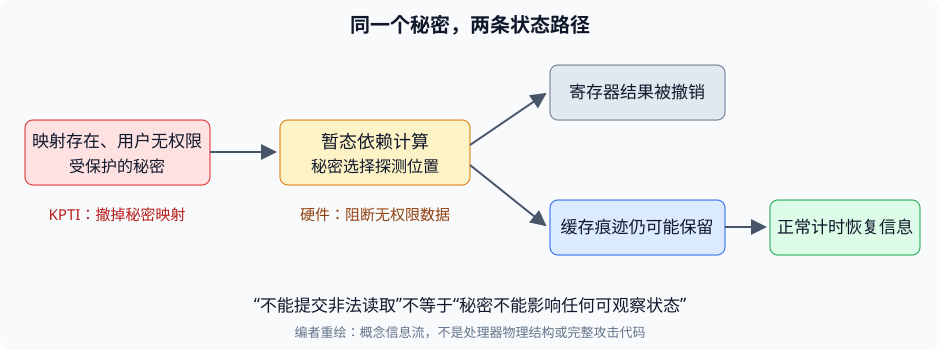

# 第 22 讲 · 隔离必须约束信息流

**Meltdown 揭示的缺口是：处理器可以拒绝一次访问的最终结果，却已经让被拒绝的数据影响了后续可测状态。** 理解本讲的目标，是解释这两件事为什么不矛盾，并指出软件和硬件修复各切断哪一步。

## 1. 把隔离从“结果”推进到“观察”

此前的页表直觉是：用户没有权限，load 产生异常，秘密不会进入用户程序。这个推理默认只检查架构结果——寄存器、已提交的内存写入、异常控制流。

现在加入另一种观察：**相同的合法读取，耗时会不会依赖某个秘密？** 如果会，攻击者即使从未在架构层面完成非法 load，也可能逐步推断秘密。

*编者概念图。上支路遵守异常与回滚语义，下支路仍可能把秘密带入正常测量结果；不是实际芯片结构。*

用编者自己的形式化表达：对两个只在秘密 $S$ 上不同的执行，如果公开输出相同，但攻击者能测的时间 $T$ 分布明显不同，就不能仅凭“寄存器结果一样”断言隔离成立。我们要关注的是信息能否流出，而不只是非法指令是否最终提交。

这不意味着处理器要在错误路径一发现异常就立刻报告。错误预测路径上的异常根本不该成为程序异常。真正需要的区分是：**异常交付可以延迟，秘密传播却不能因此毫无限制。**

## 2. 三个缺一不可的环节

| 环节 | 在本讲攻击中的角色 | 少了它会怎样 |
|---|---|---|
| 可寻址但无权限的映射 | CPU 能把目标虚拟地址翻译到秘密所在物理页 | 没有相应转换，不能沿原路径得到秘密 |
| 暂态数据传播 | 受影响 CPU 把秘密提供给后续依赖操作 | 只产生异常而不传出真实数据，编码链无法携带秘密 |
| 可观察的持久副作用 | 用户缓冲区的哪个缓存位置变热取决于秘密 | 全部可观察状态都与秘密无关，接收方无从区分 |

前两个环节解释越权从哪里来，第三个解释为什么最终回滚仍然不够。只有缓存时序差，没有无权限秘密进入依赖链，不能自动得到 Meltdown；只有暂态秘密而没有能保留下来的可观察编码，也无法恢复它。

课堂的完整组合见[中文译稿](#/c/mit-6.s081-2020/lec/lec22?v=draft) 48:00–54:00。论文还把异常恢复和接收方分离成独立组件，见[课程资料](#/c/mit-6.s081-2020/lec/lec22?v=materials) §4。

## 3. 一次观测怎样变成一个 bit

设秘密最低位为 $b\in\{0,1\}$，探测位置为 $p_b=\text{base}+4096b$。重点不是读取到了探测缓冲区里存的什么值，而是**哪一个位置被读取过**。

理想化地，先让两个位置都不在缓存中，暂态编码访问其中之一，恢复后再测两者：

$$
b=0\Rightarrow T(p_0)\text{较小},\qquad
b=1\Rightarrow T(p_1)\text{较小}.
$$

因此，课堂先测 `buf[0]` 得到 `b-a`，再测 `buf[4096]` 得到 `c-b` 时，若前者更短，应该推断秘密最低位为 **0**。这里时间戳变量 `b` 与上式秘密位 $b$ 只是不同上下文的记号，不能混用。课堂学生在 53:47 指出这个方向错误，教师在 54:01 确认；实际改笔画面只放在中文译稿。

现实观测还可能出现两处都快、两处都慢、零值偏置等现象。不能把所有失败都解释为秘密为零。概率性观测需要重试和错误率评估；“没有测到”与“测到零”要在记录里分开。

## 4. 为什么撤映射比再清一次权限位有效

软件原本已经正确设置“用户不可访问”。把同一权限位再清一次，不会改变受影响处理器的暂态数据传播。

KPTI 改的是更早的前提：用户态页表不再包含大部分内核秘密的映射。于是目标地址不再有当前可用的物理指向。少量系统调用／中断过渡映射仍须精心安排，因此不应把它概括成“用户页表里绝不能有任何内核页”。

硬件修复则可以保留映射，但阻止无权限真实数据流向依赖计算。它与“每次访存都彻底关闭乱序”不同：合法访问仍可优化，精确异常仍按正确时刻交付。

本课程 RISC-V xv6 使用不同用户／内核页表，可以帮助理解这个设计。共享代码快照固定于 `e23d53f27f6e187732a92a2b4705639d1c260f05`，只是 2020 参考树，**不是录课工作树**；页表结构类比也不构成对任意 RISC-V 实现的硬件安全证明。入口机制可回看[第6讲](#/c/mit-6.s081-2020/lec/lec06?v=notes)。

## 5. 两个性能推导

### 5.1 为什么一次泄漏8位不一定更高效

用一个候选位置表示一个可能值时，一次编码 $k$ 位需要 $2^k$ 个候选。令一次暂态尝试成本为 $C_t$，一个候选测量成本为 $C_m$，则一个简化模型是：

$$
\text{每位成本}\approx\frac{C_t+2^k C_m}{k}.
$$

当 $C_m$ 占主导，从 1 位增到 8 位，候选数从 2 增到 256，接收成本增长得比信息量快。论文的单候选测量优化还会进一步减少单比特成本，但零值偏置和重试会改变有效速率。公式只是编者建立直觉的模型，不是论文拟合出的性能公式。

### 5.2 为什么“最高582 KB/s”不能概括攻击速度

最终速率取决于暂态窗口内成功编码的概率、恢复异常的代价、候选扫描次数和重试次数。目标从 L1 移到 L3 或 DRAM，会改变竞争条件；使用 TSX 或系统异常处理，也会改变恢复代价。

所以评测必须同时读“机器、目标缓存位置、异常恢复方式、吞吐、错误率”。论文的 582 KB/s、12.4 KB/s、低于 10 B/s 分别来自不同条件；完整数据和原文 503／582 口径差异集中在课程资料 §6.3，本页不把它们变成一个平均数字。

## 6. 容易形成的错误结论

| 误解 | 更准确的判断 |
|---|---|
| 最终 page fault，就一定没有泄漏 | 异常只约束架构提交，不能自动消除全部微架构痕迹 |
| Meltdown 一定要先训练分支预测器 | 课堂核心是无权限 load 的暂态依赖链，显式 `if` 不是必要条件 |
| 读取秘密就是读取缓存里那一行内核数据 | 接收方测的是自己有权访问的探测内存；秘密通过位置选择编码 |
| 权限异常延迟，说明权限检查一定也延迟到退休才启动 | 检查可更早或并行完成；核心在于失败未及时阻断数据传播 |
| L1 没有目标数据，就不可能成功 | 论文专门测了非攻击者L1、未缓存与不可缓存场景，条件不同 |
| 换页表必定清空L1和所有数据缓存 | TLB、地址空间标签、物理标记等机制要分开；课堂图是简化 |
| KPTI 修好 Meltdown，也就修好 Spectre | 两者越界方式不同，需要分别分析 |
| AMD／ARM 是一个永远安全或永远不安全的整体 | 只能引用论文实际测试与当时报告的具体范围 |
| 云上运行成功意味着任意VM可读宿主任意内存 | 映射和虚拟化方式决定边界，不能用容器结论替换全虚拟化结论 |

## 7. 自测：能否沿信息路径推理

1. 若错误路径上的非法load一执行就立即触发程序异常，会出什么问题？

分支预测可能错误。正常控制流根本不应访问该地址时，立即异常会让合法程序因处理器猜错而崩溃。因此精确异常需要等到确认该指令应当生效；但这不要求先把无权限秘密交给暂态指令。

2. 已把PTE的用户访问权限关掉，为什么KPTI还要去掉映射？

原攻击本来就假设权限位正确。去掉映射改变“CPU能不能在当前地址空间找到秘密”的前提，不是重复做同一种权限标记。对应软件修复见课程资料 §7。

3. 只清除暂态寄存器，不恢复缓存，什么时候会有问题？

暂态操作使用了秘密，而且秘密改变了攻击者后来能区分的缓存状态时。若缓存变化与秘密无关，这次变化本身不携带该秘密；不能只看到“有缓存副作用”就认定完成越权攻击。

4. 一次测量中两个候选地址都很慢，可以肯定秘密位是0吗？

不能。可能编码没赶上窗口、目标没成功到达、缓存行被替换或测量受干扰。论文可以通过特定编码约定与重试把“没有一信号”当作零候选，但必须承担并测量误判率。

5. 为什么恢复一个字节可能需要1 MiB探测数组，却只实际关心256条缓存行？

256种字节值各选一个位置，按4096字节间隔分布，所以地址跨度是256×4096字节。每个候选测的是一条相关缓存行，并不要求一次把对应整页全部加载进缓存。

6. 如果硬件修复不让无权限值进入依赖计算，是否还需要正确退休与异常处理？

需要。阻断秘密传播解决信息流问题；顺序退休与精确异常解决程序语义问题。两套要求不是互相替代。

7. 论文在某个AMD处理器上跑通玩具缓存实验，但读不出内核秘密，矛盾吗？

不矛盾。玩具实验只需要暂态指令留下缓存痕迹；完整Meltdown还要求受保护数据流进那条暂态链。前者成立不推出后者成立。

## 学习定位

| 想解决的问题 | 去哪里展开 |
|---|---|
| 为什么能先执行、后退休，异常如何安排 | 中文译稿 12:00–30:00 |
| Flush+Reload 与课堂完整推导 | 中文译稿 42:00–58:00 |
| 54分钟现场纠错与真实改笔画面 | 中文译稿 54:00–57:00 |
| 异常处理、TSX、零值偏置、KASLR假设 | 课程资料 §4–5 |
| 实验机型、单位、错误率、非L1条件 | 课程资料 §6 |
| 软件防御的残余映射 | 课程资料 §7 |
| 主讲结束后的MMU、页表缓存和Spectre问答 | 中文译稿 81:00–90:47 |

## 来源与范围

- **V22**：Robert Morris，MIT 6.S081 Fall 2020 Lecture 22，课程官方课表所链视频，David Morejon 频道，2020-12-02，90:47。全部原语言自动字幕已阅读，课堂细节仅在中文译稿展开；未全片听音。
- **O22**：[MIT 2020 官方课堂提纲](https://pdos.csail.mit.edu/6.S081/2020/lec/l-meltdown.txt)，用于校对术语与课堂结构，不单独当作课外阅读重译。
- **P22**：Lipp 等，[Meltdown: Reading Kernel Memory from User Space](https://pdos.csail.mit.edu/6.S081/2020/readings/meltdown.pdf)，2018，课程指定18页快照。全文抽取文本已读，关键原页、图表和数字的核对范围见课程资料与 `sources/coverage.json`。
- 本页的观察模型、成本公式、信息流图和自测为编者提炼，不是论文逐字翻译。未运行攻击、补丁评测或任何课程实验。
