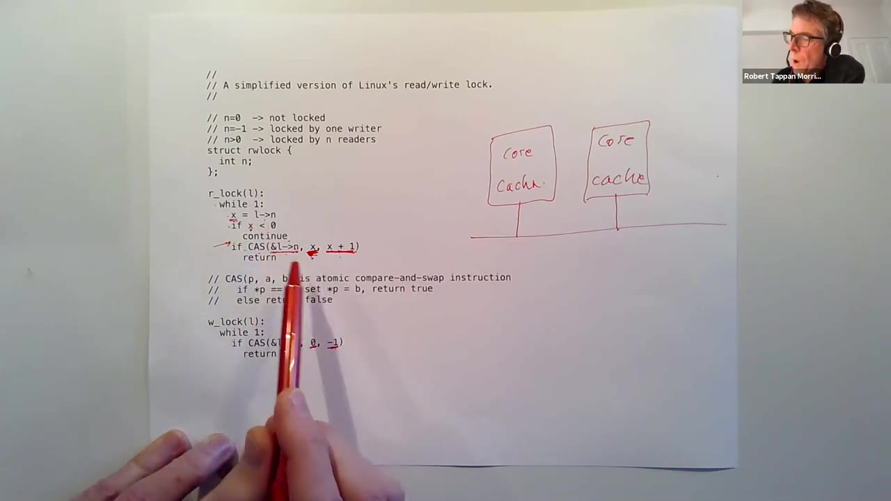
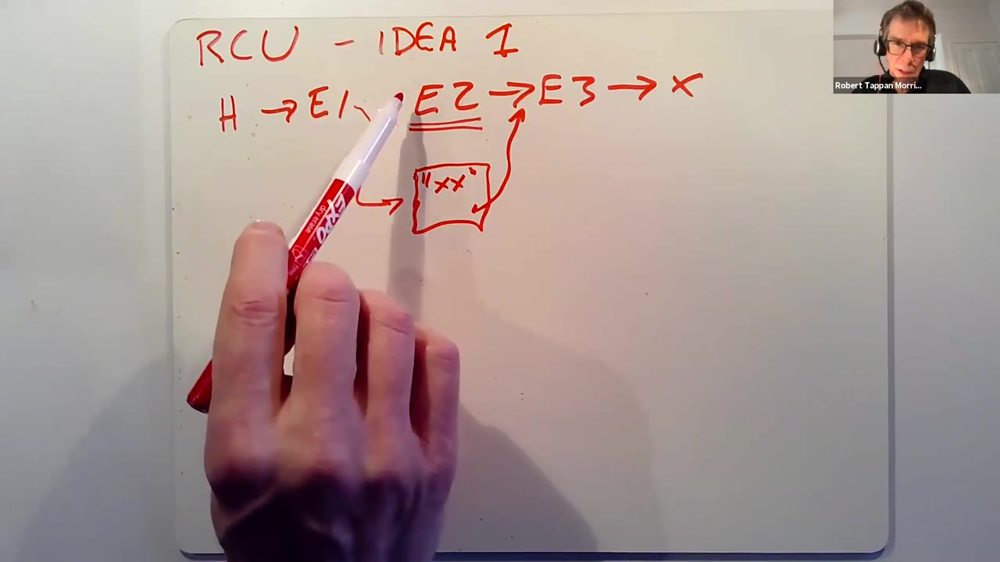
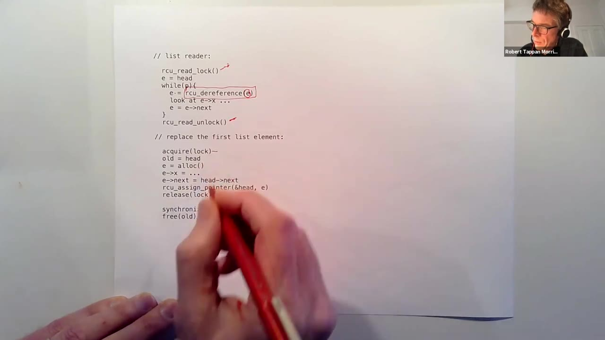

# 第 23 讲 · RCU 中文译述

## 00:00–03:00｜多核硬件为什么没有自动带来内核加速

本讲从多核性能问题切入，但只研究其中一个具体情形：**内核中被很多线程共享、读取远多于修改的数据**。Linux 的 read-copy update，简称 RCU，是这个情形下很成功的办法。

机器有四、八、十六乃至更多核时，内核本身就是一个并行程序。理想情况下，八个核同时做有用工作，就能比只用一个核完成更多工作；买到更多核，必须让内核也能并行，应用才能真正获益。

从应用行为看，这似乎不应该很难。多个程序如果一直在用户空间独立计算，本来就容易并行；即使它们不断发起系统调用，很多操作仍然没有明显依赖。例如两个进程各自 fork、从不同管道读取，或访问不同文件，逻辑上通常不必相互等待。这里说的是“很多情况”，并非所有系统调用都互不相关。

问题藏在实现层：不同操作最后可能碰到相同的内核资源。表面上独立，不等于内部访问的数据结构独立。讲者由此转向共享状态如何限制吞吐量的问题。

## 03:00–06:00｜共享资源与读多写少的单链表

内存分配器、CPU 调度器、磁盘缓存、inode 缓存，都可能被许多进程共同使用。两个完全不知道对方存在的程序，只要系统调用需要分配内存或查缓存，就可能同时进入同一套共享数据结构。生产内核为消除这类瓶颈投入了大量工作。

已经学过的自旋锁首先解决正确性：把可能相互干扰的执行排除出去。代价也来自这一点——锁通过禁止某些并行执行，让代码更容易推理。它很通用，但如果不必互斥的操作也被串行化，性能就受损。

课堂建立一个贯穿全讲的例子：全局 `head` 指向单链表，每个节点装有字符串以及 `next` 指针，末尾指向空。多数调用者只扫描链表寻找目标，并不改内容；偶尔有写者修改字符串、插入节点或删除节点。

如果永远没有写者，读者直接遍历即可，无需讨论同步。恰恰是这些不频繁却真实存在的修改，使我们必须给并发读取一个正确性解释。不能因为“通常没人在写”就假定读取安全。

## 06:00–09:00｜读写锁的承诺，以及它不会强制的规则

按 xv6 的常规做法，链表由一把锁保护。写者当然要取锁，读者也必须取锁，否则可能看到更新一半的数据，或者跟随失效指针。这能保证安全，却让两个纯读者也无法同时使用链表。

自然的改进是读写锁。读者调用 `r_lock` / `r_unlock`，写者调用 `w_lock` / `w_unlock`。允许的状态有两类：多个读者同时持锁，或者一个写者独占。不能既有写者又有读者，也不能有两个写者。

这个接口看起来正好满足读多写少的场景：常见情况下让很多读者并行，少见的写入再独占。

**学生问：持有读锁的代码，如果实际上执行写操作，机制如何阻止？**

讲者回答：它不会阻止。这与 xv6 的自旋锁一样，是内核开发者必须遵守的约定，不是硬件为每次内存访问自动检查的权限。若调用者不按规则使用，代码就是错的。下一窗口继续说明这个信任前提。

## 09:00–12:00｜用一个整数表示读写锁

内核代码由受信任的开发者编写；同步机制的正确性依赖所有相关代码遵守同一套协议。采用读写锁的目标，是使真正只读的访问可以利用多核，而不是提供隔离恶意内核代码的能力。

然而，如果普通读写锁已经足够快，就没有必要研究这篇 RCU 论文。要找到问题，必须看锁的实现。课堂给出一个简化 Linux 风格的模型：锁里只有计数 `n`。

- `n == 0`：没有持有者。
- `n == -1`：有一个写者。
- `n > 0`：有 `n` 个读者。

读锁获取在循环中先把 `l->n` 读到局部变量 `x`。若 `x < 0`，说明写者正在工作，继续等待。否则希望把读者数加一。但这里不能写成普通的 `n = n + 1`：刚检查完非负，另一个核上的写者就可能抢先把它改成 `-1`。读取、检查、更新之间的空隙，正是接下来要解决的竞态。

约 11 分钟处讲者短暂确认聊天区是否有问题，随后继续实现推导；字幕没有给出可辨认的实质性聊天提问。

## 12:00–15:00｜CAS 把“检查并更新”变成一个原子动作

读者需要的不是无条件加一，而是：**只有当前值仍等于刚才看到的 `x`，才改成 `x + 1`。** Compare-and-swap，简称 CAS，提供这种原子操作。

课堂使用 `CAS(p, expected, desired)` 的教学记法。硬件比较 `*p` 与 `expected`；相等就写入 `desired` 并报告成功，不相等则不修改并报告失败。关键是比较与写入之间不能被另一次针对该位置的原子操作插入。读者执行 `CAS(&l->n, x, x + 1)`，失败后回到循环重新读取。

写者只允许在没有任何读者或写者时进入，因此反复尝试 `CAS(&l->n, 0, -1)`。这个条件既排除现有写者，也排除任何非零读者数。

**学生问：解锁是不是把计数恢复成之前的 `x`？** 讲者区分两种解锁：写者是唯一持有者，写解锁把 `n` 置回零；读解锁则通过原子操作把读者数减一，不能恢复某次调用之前的旧值。

学生随后追问：如果写者恰好在读者计算 `x`、执行判断的过程中进入，会怎样？讲者先确认提问所指的位置，再选取最危险的交错，逐步演算。

## 15:00–18:00｜交错演算：写者抢先与计算参数时的中断

设读者已经读到 `x = 0`，也通过了 `x < 0` 的检查，尚未执行 CAS。此时另一核上的写者先成功执行 `CAS(&l->n, 0, -1)`，共享计数已经变为 `-1`。

读者随后仍传入自己保存的两个参数 `0` 和 `1`。这不是错误，反而是安全性所在：CAS 发现内存中的当前值是 `-1`，不等于预期零，于是不修改计数、报告失败。读者回到循环，现在读到 `-1`，便等待写者退出。旧的观察不能使它误闯写者临界区。

**另一名学生问：如果在计算 CAS 参数 `x + 1` 的时候来了中断，会不会算错？**

讲者指出，计算参数发生在真正执行原子指令之前；`x` 是当前代码保存的局部变量。中断或线程切换不会凭空修改这个局部值。原先保存了零，那么恢复后仍给 CAS 传零和一。共享计数可能已改变，但 CAS 正是用来检测这一点的。

这里必须分清两件事：局部快照是否稳定，以及共享内存是否仍匹配它。前者由局部变量保存，后者由原子比较验证，不能混为一谈。

## 18:00–21:00｜两个读者如何都进入，以及公平性疑问

学生确认，保存局部变量很重要；如果把 CAS 的两个参数分别写成对共享 `l->n` 的重新读取，期间的变化就可能使“预期值”和“新值”失去对应。讲者认同：先固定一次观察，再用 CAS 检查它，才是这里的意思。

现在考虑两个读者同时从 `n = 0` 开始。二者都读取零，都尝试把零改为一。但同一内存位置上的 CAS 不能都以旧值零成功：第一个成功后，第二个看到的当前值已经是一，所以失败。

失败的读者重新循环，读到一，再尝试把一改成二。如果没有其他干扰，这次成功。最终两个读者都进入临界区，计数为二。接口确实允许并行读取，但获取权限的过程仍然包含串行竞争与重试。

**学生进一步问：已经有读者进入，一个写者开始等，后来又有新读者到达；新读者能否一直越过等待中的写者？**

这个问题把正确性与公平性区分开来。锁可以始终不让读写同时发生，却仍然让某类请求长时间得不到执行机会。讲者在下一窗口解释为什么这个简化实现会出现写者饥饿。

## 21:00–24:00｜写者饥饿与每核缓存

只要仍有读者持锁，`n` 就大于零；写者要求的 `CAS(..., 0, -1)` 因而一直失败。与此同时，新读者只检查是否有写者持锁，并不会因为“有写者正在等待”而停止进入。如果读者不断到来，计数可能始终降不到零，写者便可能一直饥饿。讲者明确承认这是当前方案的缺点。

**另一名学生问：两个读者时，第二个已经需要重试；推广到很多读者，是不是越来越浪费？** 讲者说，这正是接下来要讨论的核心问题。即使完全没有写者，许多核同时获取读锁也可能十分昂贵。

为说明原因，课堂画出多个核及各自的一级缓存，中间通过互连网络通信。普通读取可以把数据保存在本核缓存中；但一个核要修改其他核也缓存了的数据，就必须使那些旧副本失效，即 invalidation。

当很多核几乎同时读取锁计数，大家都会缓存它。随后某个读者 CAS 成功，虽然它只是为了取得“读”权限，却对这个共享计数实施了一次写入，于是触发跨核一致性通信。

## 24:00–27:00｜为什么读锁也会让缓存行来回争抢

假设有 `N` 个核同时获取同一把读锁。它们首先都读到旧计数。第一个成功的 CAS 修改计数，必须让其他缓存副本失效。其他核再执行比较时，需要获取较新的计数，发现已不等于原来的预期值，于是失败并重试。

剩下的 `N-1` 个核重新读取，再由其中一个成功修改，其余继续失败。按课堂采用的同时竞争模型，共有约 `N` 轮成功更新，每轮伴随数量级为 `N` 的一致性相关工作；累计通信、重读与尝试呈现二次增长。讲者口头先说了一次 `O(N)`，随即更正为总工作 `O(N²)`。

*原片 25:00，未裁剪。左侧纸面列出 `n` 的三种状态、读者 CAS 与写者 CAS；右侧手绘两个 `core/cache` 方框及互连。笔尖指向读者也必须修改的共享计数。*

理想的并行读是：十六个核同时读已缓存的链表，耗时接近一个核的读取时间。实际却可能是链表访问只有几十个周期，读锁获取耗费数百乃至数千周期，锁反过来主导开销。

> 编者注：这里的二次量级是讲者针对同时争抢的简化推演，不是每一种缓存协议、每一种读写锁的普遍墙钟时间定律。

## 27:00–30:00｜真正的目标：读取共享数据时不写共享状态

这个实现把便宜的只读访问，变成了昂贵的读写访问。链表本来很少变化，各个核可以长期使用本地缓存；为了进入临界区，却必须修改共享锁计数，造成跨核通信，可能抹掉原本希望获得的并行收益。

讲者强调，比重试循环的精确细节更重要的是：**读操作为了同步，产生了共享写入。** 对没有被修改的数据，本地缓存可以用极低代价满足读请求；对多个核缓存的数据进行写入，则需要协调其他副本。只要每次读都带着这种共享写，扩展性就受到限制。

因此目标不只是“把锁实现得稍快”，而是让扫描链表真正成为只读访问，包括不再做那些为了加锁而产生的共享写入。

先做一个思想实验：保留写者之间的锁，让读者完全不加锁直接遍历，行不行？有时特定数据确实可以这样处理，但不能直接假定本例安全。接下来逐一检查写者会做的三种事情，寻找读者可能遇到的具体故障。

## 30:00–33:00｜去掉读锁后出现的三类错误

第一种是原地修改节点内容。若字符串逐字节从旧内容改为新内容，读者同时取字节，可能得到一半旧、一半新的混合值。即使没有非法地址，读到的逻辑内容也已经错误。

第二种是插入节点。以表头插入为例，写者需要分配新节点、填写字符串和 `next`，然后让 `head` 指向它。若先暴露新指针，节点内容尚未初始化，读者就可能读到垃圾字符串，或把垃圾 `next` 当作合法地址继续访问。

第三种是删除节点。写者把 `head` 改为第二个节点，再释放原来的首节点。更新后才读取 `head` 的读者可以正常从第二个节点开始；但在更新前已经拿到首节点地址的读者，并不会自动忘掉自己的指针。

所以，“链表已经不再指向它”与“已经没有人使用它”是两回事。最后一种情况的后果，需要跟踪被释放内存如何再分配来理解，课堂在下一窗口继续展开。

## 33:00–36:00｜RCU 是对读写双方的组织规则

旧节点一旦进入空闲链表，就可能被分配给完全不同的用途。原来的读者还在看它，内存却被其他代码覆盖；从读者角度，正常节点突然变成垃圾，最终可能沿错误指针访问。这就是过早回收带来的问题。

本讲始终假设写者之间仍使用普通锁。现在要解决的不是两个写者互相覆盖，而是读者不取这把锁后，怎样与写者共存。单纯删掉读锁显然不够，但刚才三类具体错误可以分别修复。

讲者把 RCU 描述为一种组织并发代码的方式，而不只是某个神奇函数：写者遵守更多规则、做更多工作，换来读者非常便宜的访问。写者通常更慢，读者则无需互斥锁或争抢共享计数。

第一条规则对准内容混合问题：不要直接改动读者正在使用的旧内容。若要改变节点 `E2` 的字符串，分配一个新节点，用它表达更新后的版本，再把这个新版本接入结构。旧版本先保持原样，留给已经走到那里的读者。

## 36:00–39:00｜复制、初始化、切换指针，旧节点先保留

课堂画出 `head → E1 → E2 → E3`。写者创建 `E2'`，填好新的内容，并让它的 `next` 也指向 `E3`。等新节点完整可用后，再通过一次指针写，把 `E1->next` 从旧 `E2` 改为 `E2'`。

读者在 `E1` 处读取 `next`，会走向旧节点或者新节点。走向旧节点时，旧字符串没有被改；走向新节点时，看到的是准备好的新字符串。两条路径都能继续到 `E3`，不必让读者与写者互相等待。

*原片 37:00，未裁剪。白板标题为 `RCU – IDEA 1`；上方是旧链 `H → E1 → E2 → E3`，下方新节点同样连到 `E3`。需要切换的是 `E1` 的后继，不是覆盖 `E2` 的字符串。*

**学生问：旧 `E2` 到 `E3` 的连接要删除吗？** 讲者说，暂时都保留。这恰好通向 RCU 最复杂的一部分：如何确定何时能释放旧节点。

另一个追问认为，这个连接本来就是 `E2` 的一部分，普通删除会连同节点一起释放。讲者再次指出区别：可能有读者恰好在替换之前已经走进 `E2`，因此目前不能释放；不是永远不回收，而是现在还不能回收。

## 39:00–42:00｜一次提交写与适合 RCU 的数据结构

讲者把切换 `E1->next` 的那次写称作 **committing write，提交写**。在本课假定的适当指针对齐与机器条件下，一次指针存储不可分割：读者看到的是旧指针或新指针，而不是半个旧地址加半个新地址。普通字符串更新却需要多次写，不能享受这种性质。

这种做法的适用性依赖数据结构：能否把一次复杂更新整理成“私下准备，最后用一个指针发布”？单链表很自然；读者需要双向遍历的双链表就困难得多，因为两侧指针要协同改变，普通机器不能把两个不同地址的更新当成一次原子存储。

树也可以适配。若要更新树中某个位置，可以创建通往该位置的新节点或新分支，让新旧版本共享那些未改动的子树，最后切换根指针。读者从某个根进入后，就沿着那个版本的结构读取。

这不是要求每次复制整棵树，而是说明：**把版本选择集中到一个可发布的入口**，能使多次准备工作对读者表现成一次版本选择。不具备这种结构的数据，直接使用本课这套方案就不容易。

## 42:00–45:00｜源码顺序不等于其他核看到的顺序

“先初始化 `E2'`，再改变 `E1->next`”听起来很简单，但普通 C 代码按这个顺序写，并不足以保证其他核也按这个顺序观察。编译器与处理器都可能调整内存操作的顺序。

课堂再次拆开步骤：分配 `e`，填写它的内容，令 `e->next = E3`，最后 `E1->next = e`。若发布指针的效果先被读者看到，而节点初始化尚未对它可见，就重现了插入时读取半成品的问题。这样的程序可能测试时一直正常，实际运行偶尔才出错。

第二条规则因此是处理内存顺序。写者在提交写之前使用适当的屏障，保证初始化不会被挪到发布之后。从语义上说，看到新指针的读者应该也能看到为该版本准备好的内容。

读者侧也需要使用对应的访问机制：先取得指针，再按正确的顺序读取指针所指对象。讲者在白板上把指针保存到临时寄存器 `r1`，准备在指针读取与对象读取之间画出屏障。下一窗口围绕这一点出现了很重要的追问。

## 45:00–48:00｜读者屏障的疑问：讲者保留不确定性

读者先读取 `E1->next` 得到 `r1`，然后访问 `r1` 所指节点的内容与后继。课堂用屏障表述所需顺序：不能把后面的内容访问放到取得指针之前。配合写者的发布顺序，若读者得到新节点指针，应读取到已初始化的新节点。

**学生问：不知道 `r1` 的值，怎么可能先读取 `r1` 指向的内容？这不是天然的数据依赖吗？**

讲者承认这个问题把自己问住了。他尝试提出一种可能性：同一地址过去曾被用作别的对象，该核可能缓存过旧内容；若读取新对象时竟使用了先前的缓存值，就会有麻烦。但他明确说，自己并不确定具体机器是否会这样，也没有现场给出一个经过验证的例子。

随后他又考虑编译器行为，但仍没有把猜想说成结论。这个问答的实质并不是证明了某一种缓存故障，而是暴露出课堂简化屏障说法需要进一步核对具体架构与编译器规则。

> 编者注：此处保留讲者的不确定性。论文明确讨论依架构而异的屏障，并特别提到 DEC Alpha；具体阅读说明见「课程资料」§2。不能把现场提出的缓存猜想当作已证实的硬件解释。

## 48:00–51:00｜什么时候才能释放旧版本

讲者以“还需要回去想一个具体例子”结束读者屏障的问答，然后回到第三个问题：新节点发布后，旧 `E2` 迟早需要释放，但此刻可能仍有读者持有旧指针。

一种直觉办法是为每个节点加入引用计数：读者开始使用时加一，结束时减一，写者等它归零。但这会立刻把问题带回来——每次读都必须修改共享计数，多个核争抢同一缓存行。RCU 希望避免的，恰恰就是这些看似微小的共享写入。

另一种可能是垃圾回收语言。运行时跟踪可达性，确认所有线程和数据结构都不再引用旧节点后，再回收内存。讲者认为这是可以想象的途径，但 Linux 并不是用这种语言实现的，而且不能凭空认定换成普通垃圾回收器就一定提升性能。

RCU 转而利用内核已经掌握的执行事件。目标是建立一对规则：约束读者在什么范围内使用指针，再让写者等一个足以证明这些使用已经结束的事件。这样无需让每一次读取向共享引用计数报到。

## 51:00–54:00｜用上下文切换证明旧读者已经离开

课堂给出第三条核心规则的两部分。

第一，读者不能把指向 RCU 数据的引用带过上下文切换。也就是说，在本课讨论的读侧临界区里，不能主动 `yield` 或睡眠，把 CPU 交给别的线程后再回来继续使用该指针。

第二，写者摘除旧节点后，推迟 `free`，直到每个核都至少经过一次上下文切换。由于任何旧引用都不能跨过这个事件，等所有核都经历它，摘除前可能存在的读者就一定已经结束相关访问。

等待可能达到毫秒量级或毫秒的一部分，所以这不是“免费删除”。不过读多写少是本讲前提，少量写者承担较高成本，可能换来大量读者的收益。

一个易理解、但并非最高效的实现是：让发起等待的线程短暂地在每个核上运行一次。它能在某核运行，说明该核至少完成了所需的调度切换。论文用这个方法说明 `synchronize_rcu()` 的基本正确性。

写者流程由此变成：修改结构、调用 `synchronize_rcu()`、再释放旧对象。等待必须针对摘除之后的读者完成情况，而不能把很早以前发生过的切换拿来作为证明。

## 54:00–57:00｜同步等待与异步回调

讲者沿时间顺序重述证明：先把 `E1->next` 指向新节点；此前可能取得旧指针的核，随后都经历一次合格的上下文切换。按读者规则，它们此时不能再持有旧对象的有效引用，所以旧节点才允许释放。

`synchronize_rcu()` 的等待确实可能很长。写者稀少时，这未必影响整体性能；若调用者不想在这里停下来，还可以使用 `call_rcu`。

课堂把这个接口抽象为“回调函数加对象指针”：把未来要执行的释放动作交给 RCU，RCU 将它记到待处理列表后立即返回。后台记录各核的进展，确认相关旧读者结束，再用保存的参数调用回调。例如回调可以释放那个旧节点。

异步只是把等待移走，并没有让旧内存立即可用。若更新不停地提交回调，等待列表可能增长很长，每个条目还关联一份尚未释放的对象。于是写者虽然返回得很快，系统却积压越来越多的待回收内存。讲者特别提醒，这种压力在极端情况下会耗尽内存；下一窗口继续强调这一代价。

## 57:00–60:00｜延迟释放不等于内容一致，临界区也不能任意变长

大量 `call_rcu` 可能把可用内存变成“已经不用、却尚未达到回收条件”的对象。讲者据此解释，为何不应只因接口立即返回，就忽略其后台成本。

**学生问：等待解决的是过早释放，可读者仍可能看见正在修改、尚未完整的新对象吧？**

讲者把三条规则重新分开：避免半改内容靠第一条，即不原地改旧节点，而是构造新节点后用单次指针写切换；初始化与发布的顺序由第二条保证；第三条才负责回收。学生确认，切换是一个原子的指针存储，而覆盖整个字符串不是。

**另一名学生问：读者不能切换线程，是否意味着临界区必须控制工作量，否则会长时间占用核？**

讲者回答，确实应保持短小。实际中，RCU 往往替换的是原先已被锁保护的短临界区；那些临界区原本就承受着缩短持锁时间的压力，因此通常不会突然变成长计算。尽管如此，限制是真实存在的，特别是不能在持有这类指针时执行可能让出 CPU 的操作。

## 60:00–63:00｜读侧 API 实际做什么

一个典型禁例是持有 RCU 指针时发起磁盘读取，然后睡眠等待完成。问题不只是“时间长”，更是它跨越了本课禁止的调度边界。若要那样组织代码，就不能直接依赖当前这套生命周期规则。

课堂转到链表读者与替换首节点的伪代码。读者在遍历前调用 `rcu_read_lock()`，结束后调用 `rcu_read_unlock()`。名字里有 lock，但这里几乎不做普通互斥锁的工作。

讲者在此说得比早先的简写更精确：进入临界区时设置本地状态，使定时器中断**不触发抢占式上下文切换**；中断本身仍然可以发生。退出时恢复相应状态。为了支持嵌套，实际可以用计数，而不是单个布尔标志。

遍历时使用 `rcu_dereference` 取得需要遵循 RCU 访问规则的指针，再读取节点内容、走向下一个节点。课堂把它讲成“取指针加适当顺序约束”；并不是像普通读锁那样更新一个全局读者数。

写侧仍必须先处理写者之间的互斥。本例用普通自旋锁，确保只有一个写者同时改变链表。RCU 没有替写者解决这个问题。

## 63:00–66:00｜替换表头的完整次序与指针逃逸

写者取得锁后，先把原首节点保存到 `old`，否则替换完成就不知道该回收谁。接着分配新节点 `e`，写好数据，把新节点的 `next` 设成旧首节点的后继。

通过 `rcu_assign_pointer` 发布新表头，初始化与提交之间的顺序由该接口处理。随后可以释放写者锁；保存着的 `old` 仍不能立刻释放。要先执行 `synchronize_rcu()`，等可能拿到旧表头的读者完成，最后才 `free(old)`。

*原片 63:00，未裁剪。纸面上方是读侧临界区与 `rcu_dereference`，下方是保存 `old`、构造 `e`、发布表头、解锁、等待、释放的写者次序。画面中的 `while(p)` 与其他位置的 `e` 不一致，是教学伪代码变量笔误；不能直接当可编译代码抄用。*

接下来讲者强调一个接口约束：在读侧临界区中可以使用节点，但不能在退出临界区后，简单把该节点或节点内部字符串的裸指针返回给任意调用者。那样调用者可能被抢占或睡眠，而你已经失去了保护其生命周期的依据。

## 66:00–69:00｜能返回副本，不能无保护地返回内部地址

**学生问：那是否连“读取第 i 个节点的值”这样的接口都无法实现？**

讲者区分值与地址。可以在读侧临界区里复制字符串，再把独立副本交给调用者；不能随便返回仍位于 RCU 节点内部的那个字符串地址。后者仍依赖旧节点继续存在，退出临界区后就没有这份保证。

当然，也可以设计更复杂的约定，让调用者负责保持保护范围，但不能把普通查找函数的返回值默认当作长期有效引用。当前课堂例子强调的是最简单的、临界区内完成使用的方式。

讲者随后回到性能：RCU 近乎消除了读取中的同步开销，不是消除了业务工作。一条十亿节点的链表仍要很久才能扫描完，那是读取量本身造成的。设置本地读侧状态、执行必要的访问顺序机制也有成本，只是比争抢共享锁低得多。

写者则既要保留原来的锁，还要构造替代对象、等待回收条件。`synchronize_rcu()` 内部可以让出 CPU，不一定一直自旋，但从调用到返回的经过时间仍可能很长。

## 69:00–72:00｜性能必须看工作负载；多插槽机器的共享内存

若读侧操作很短、读很多而写很少，RCU 的收益可能非常明显；若写入频繁，反而可能更慢。因此把一个内核子系统改成 RCU 后，必须用不同负载测量，不能仅凭接口名字判断性能。

**学生提出一个旁支问题：多核原子操作依赖共享内存；如果机器实际上有多套 RAM，如何统一？**

讲者先区分程序员可见的逻辑模型与物理布局。在本课讨论的普通多核机器上，硬件呈现一个所有核可访问的共享物理内存空间。但物理上未必是一组均匀连接的 RAM。

例如一个处理器芯片有 32 个核，要构造 64 核机器，可以在主板上装两个芯片。为了让本地内存访问快，每个芯片附近连接自己的 RAM，通过宽数据通道访问。于是会出现一个芯片上的代码需要读取另一个芯片旁边内存的情况。

课堂画出两个 CPU 芯片、各自的 RAM，并开始说明芯片之间的高速互连如何让这个物理布局仍呈现共享内存的编程模型。

## 72:00–75:00｜远端内存访问与 RCU 的适用边界

芯片知道哪些物理地址属于本地 RAM，哪些属于另一端。访问远端地址时，它经互连发出请求，让对端读取其 RAM，再把结果送回来。四插槽等更复杂布局也遵循类似思路；背后有大量工程工作，才能把直观的共享内存抽象映射到真实硬件连接上。

学生表示这个物理背景解答了疑问。讲者回到 RCU：它不是所有锁瓶颈的通用替代品。

首先，RCU 不加速写入，通常还使写入更复杂，所以需要读显著多于写。其次，不能把本课这种受保护引用跨越睡眠；如果确实需要睡眠，可以在醒来后重新进入读侧临界区并重新查找，但对象可能已经不存在，代码必须面对这一事实。

再次，最直接的方案要求更新能靠一次提交指针发布，不能任意原地改共享对象。链表、树等容易解释，其他结构可能需要额外设计。讲者提到论文还讨论 sequence locks 等更复杂方案，但本次课堂没有逐步展开其实现；相关课外内容见「课程资料」§5。

## 75:00–78:00｜旧数据语义，以及写多读少时的分区

另一个限制是读者可能继续看到旧版本。某个读者在替换前拿到旧对象地址，之后可以在自己的合法临界区里继续读它。相对于现代机器的指令速度，这段时间可能并不短；RCU 本身不是“所有读者立刻转向最新对象”的机制。

讲者认为许多场景允许这种并发重叠，但也坦承，论文提及某些必须更严格处理旧对象的例子，自己并没有在课堂上完全解释其业务要求。这里不把未解释的例子包装成已完成的课堂推导。

接着问题反过来：若共享数据主要被写，该怎么办？最有力的办法是重新组织数据，消除不必要的共享；次之是使常见操作只访问本核的半私有分区。

课程 locking 实验的内存分配器就是例子：把一条全局空闲链表拆成每核空闲链表，常见分配和释放只修改本核的那一份，只有资源不足才去看别的核。Linux 的分配器和调度队列也有类似方向。讲者是在回顾已有实验思想，本讲没有现场运行或布置新的 RCU 实验。

## 78:00–81:00｜把代价移到少见操作；RCU 总结与旧值追问

对调度器，每个核通常从自己的线程队列取工作，没工作时才到别的核寻找。对统计计数器，如果增加次数远多于读取总数，也可以让每个核维护一份计数：频繁的更新只改本地状态，少见的读取则获取各份计数并求和。

这样做使写入快、全局读取慢，恰好与 RCU 把成本放在写侧的方向相反。没有一种技巧对所有访问比例都最好；关键是让高频操作避免跨核共享写，把协调成本推给低频操作。

讲者总结，Linux 中有大量读密集的内核数据，因此 RCU 的适用面很广。其重要突破是让读者摆脱普通锁以及与之相伴的共享写入，还允许读者在更新过程中继续执行。使这一切成立的关键，是类似垃圾回收的 **grace period，宽限期**：旧对象必须等到相关读者不可能继续使用后再释放。

**学生在总结后追问：读者在临界区里不就是读当时的数据，读完离开吗？为什么还要特别说“旧数据”？** 这个提问触发了最后一轮细致的时间顺序解释。

## 81:00–84:00｜发布已经完成，重叠读者仍可能读取旧对象

讲者先用普通直觉说明疑惑：如果代码把某值改成一，再输出“完成”，之后有人仍读到修改前的值，似乎很奇怪。RCU 的版本替换需要更仔细地区分时间点。

设链表中的一个节点原先装着一，写者构造装着二的新节点并发布替换。一个读者在替换前已取得旧节点指针，但尚未读取其中的值。写者完成发布并宣布“完成”后，这个读者才继续读取自己保存的旧节点，读到的仍是一。

这不是加一个内存屏障就能解决的问题：读者访问的确实是旧对象，不是新对象的初始化没有传播。旧对象被刻意保留，正是为了让这个访问安全。

**学生确认：也就是说，读取开始得比替换早，只是实际读内容比较慢？** 讲者答是。二者本来重叠，大多数应用不能要求任意重叠操作都有唯一确定顺序，因此通常可以接受；但具体接口若有更强要求，就需要额外处理。讲者再次说明，对论文某个旧值引发实际问题的例子，自己此刻没有完全理解。

> 编者注：这里的“完成”指发布新版本，不应与“同步等待宽限期已经返回”混淆；后者会保证对应的旧读侧临界区已结束。

## 84:00–87:00｜RCU 的名字、自旋锁竞争与分布式锁

学生询问 read-copy update 的名字是否来自第一条“复制后更新”的想法，讲者表示自己的理解是这样：先读出旧状态、创建副本，再发布替换，而不是原地覆盖。

**另一名学生问：前面说读写锁争抢导致缓存一致性开销，自旋锁难道没有同样问题？它如何解决？**

讲者回答，普通 xv6 式自旋锁并没有自动解决。竞争少时，它非常快；很多核同时争抢时，它可以非常慢。确实存在扩展性更好的锁，但高负载下更好，可能要付出低负载开销较大的代价。多核同步的性能取舍没有简单的万能答案。

**学生最后问：锁能不能跨越不同系统，例如多台服务器？**

讲者肯定这种做法存在。分布式数据库把数据放在多台服务器上，一项事务若要访问不同服务器的数据，就可能需要从多处取得锁。还有一些系统尝试在独立机器之间模拟共享内存：访问远端机器的数据时，由基础设施负责发送请求并取回内存内容。

讨论没有把单机 RCU 直接扩展成分布式协议，而是在回答“跨机器同步是否存在”这个问题。

## 87:00–88:06｜跨机器通信的代价与结束

模拟分布式共享内存的一种动机，是在工作站集群上运行原有并行程序，替代昂贵的大型共享内存机器。要让这件事可行，锁与内存访问需要适应远高于本机缓存访问的通信成本，研究者因此设计了不同的协调方式。

讲者指出，跨机器时减少通信与同步成本的压力只会更大，实际技术也往往不完全等同于本讲的单机方法。随后询问是否还有问题，学生致谢，讲者回应，课程结束。

## 来源、校订与覆盖说明

- V23：Robert Morris，*6.S081 Fall 2020 Lecture 23: RCU*，David Morejon 频道，2020-12-07 上传，视频 ID `KUwyCGMTeq8`，时长 5286 秒。本文根据原语言英文自动字幕自主组织，不逐句复制或机械翻译英文。
- 共读取 2369 条非空字幕，起点 00:05.440，原始末尾 88:06.120；最后窗口按视频 88:06 封顶。开头 5.440 秒没有字幕，不据此补造发言；中间停顿与 ASR 的 `[Music]` 标记未当作课程内容。
- 专名及 API 以 2020 官方 `l-rcu.txt` 与指定论文核对：ASR 的 `rights` 多数实际为 writes，`freeze` 多数为 frees，`rc/rcu/recopy` 按语境校订为 RCU。提问者统一匿名，未推定身份。
- 真帧为原片 25:00、37:00、63:00，分别远程提取一帧并实际查看，均未裁剪。没有下载全片，没有声称全片听音或画面复核。
- 46:21–48:18 的读者依赖顺序追问，以及约 75:50、83:42 对旧值业务例子的保留意见，均保留讲者不确定性；补充解释单独放在编者注或课程资料。
- 官方提纲包含 NMI、IP options 与更高效的宽限期实现等内容，本次录像没有逐项讲完。它们不补写进课堂时间轴，课外阅读见[课程资料](#/c/mit-6.s081-2020/lec/lec23?v=materials)。2018 slides 也不是本片画面或另一份 2020 课堂实录。
