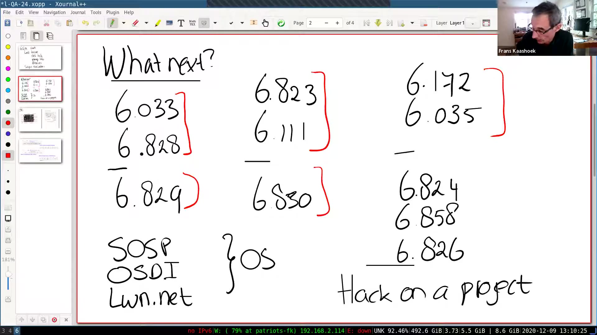
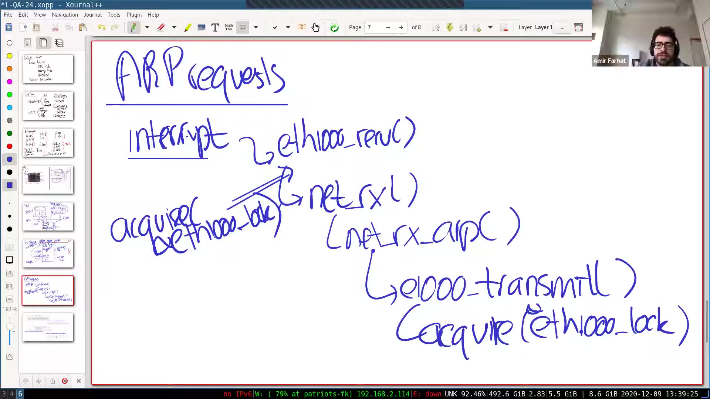
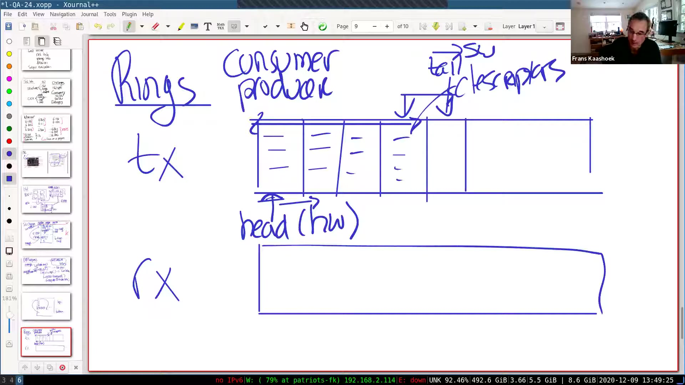
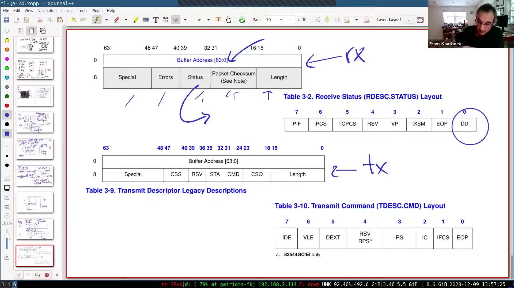
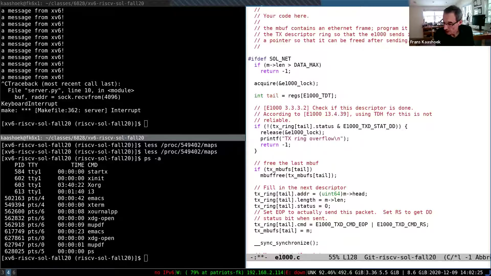
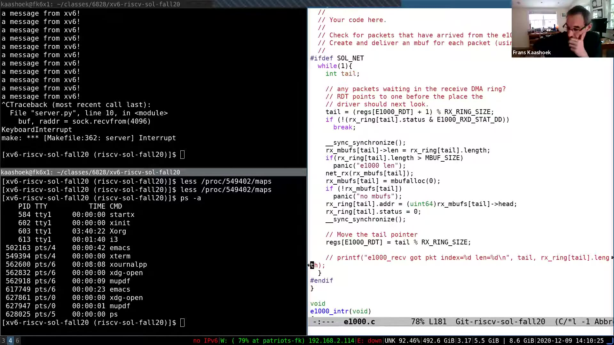
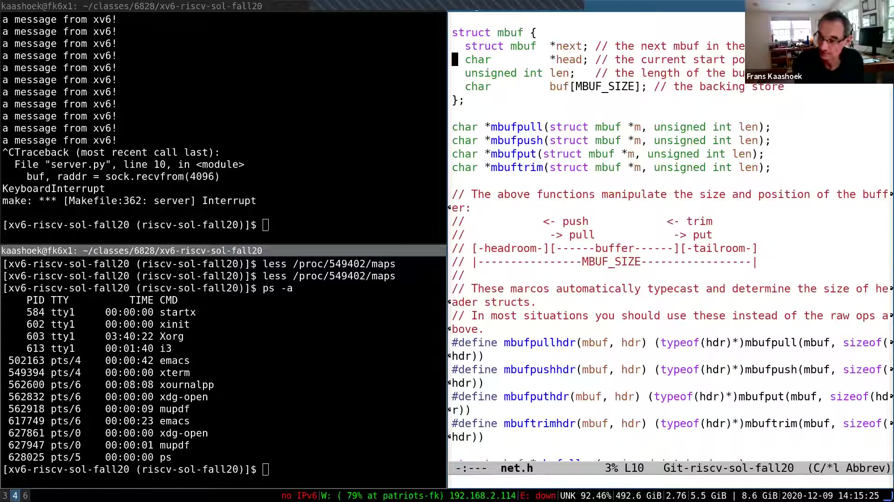
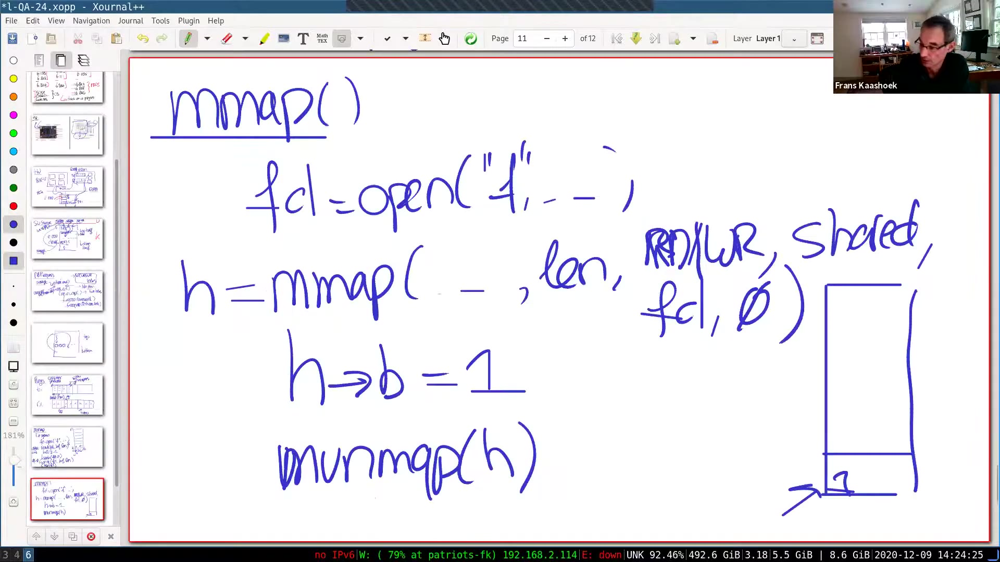
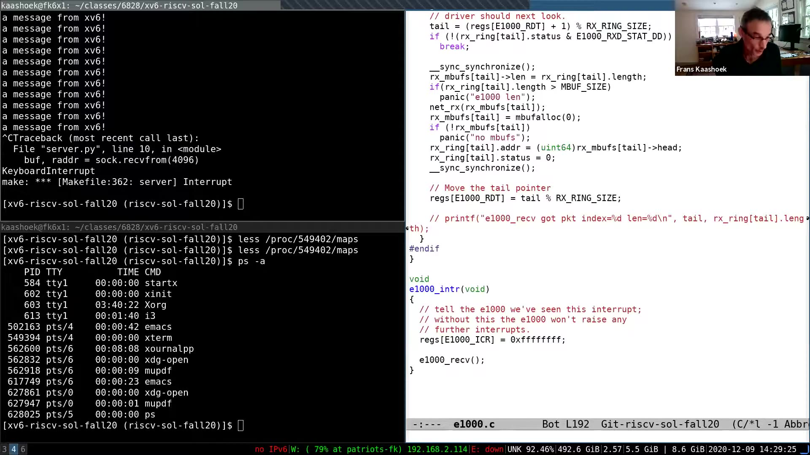

# 第 24 讲 · 课程问答

## 00:00–03:00｜最后一讲：想继续学什么，还留下了什么问题？

声音检查之后，Frans 说明今天没有预设的新理论主题，而是本学期最后一次集中答疑。准备讨论的内容来自学生邮件：网络实验的实现、可能涉及的 mmap 实验，以及学完 6.S081 后可以选择什么课程。他决定先回答最后一个问题，同时欢迎学生随时改变讨论方向。

他提醒大家填写课程评价，也感谢学生持续参与：尤其是课程后半段的论文，即使与当周实验没有直接联系，很多人仍认真阅读、尝试理解，并提交了有质量的问题。随后留出时间征集其他问题，字幕中没有记录到这一轮的实质提问。

约 02:21 开始讨论后续学习。Frans 强调，系统方向相当宽，下面只是部分选择。对于尚未修过 6.033 的同学，这门课值得考虑，尤其可以训练读系统论文的能力。他接着介绍原来的操作系统课程 6.828，为下一段区分本科课与研究生课作铺垫。

## 03:00–06:00｜从本科操作系统走向研究与相邻方向

*原片 05:00，「What next?」板书列出课程编号、SOSP/OSDI、LWN.net 和自行做项目。课程编号据此核对；这是当时的学习路线，不是当前开课承诺。*

Frans 解释当时的课程分工：6.S081 面向本科操作系统学习；6.828 是研究生层次，默认已有本科 OS 基础，进一步通过项目构建系统，并阅读更现代的研究论文。这里不是建议初学者立刻跳过基础，而是在已经能理解内核机制以后，把问题扩展到研究与设计。

如果更喜欢操作系统与硬件之间的联系，可以继续学计算机体系结构 6.823，或通过 6.111 动手构建硬件。性能和编译器方向则包括 6.172、6.035；Frans 提到有学生正同时修 6.172 和本课，也顺带提及动态语言相关的编译课程，但字幕不足以可靠恢复该课的完整名称与编号。

网络与数据库又各自形成一条课程路线。6.829 会深入本课只触及一部分的网络内容；6.830 研究数据库这种重要的存储系统。课程组相关的其他选择包括分布式系统 6.824、计算机安全 6.858，以及涉及系统软件验证的 6.826。关于哪门课下学期或下一学年开设，讲者说的是 **2020 年末的安排**，不应直接当作今天的选课日历。

## 06:00–09:00｜研究论文、Linux 实践与网络实验的讨论入口

对于“研究界现在在做什么”，Frans 建议直接浏览系统会议。他以刚结束不久的 OSDI 为例：论文可公开阅读，线上会议也留下了演讲录像，可以先看主题，再挑感兴趣的论文深入。想跟踪 Linux 的实际发展，则可以阅读 LWN.net 上有关内核变化的文章。若最享受的是实验，继续扩展实验或自己提出小项目，也是一条有效路线；课程组强调的仍然是动手学习。

约 07:41，讨论转到刚截止的网络实验。Frans 准备从四方面梳理：硬件如何限制驱动结构；驱动与内核其他部分如何组织；ring 和 descriptor 如何协调收发；最后再看实现及 mbuf 的作用。

学生邮件中的疑惑不是单纯“这一行代码怎么写”，而是为什么接收函数没有锁、为什么接收处理必须循环，以及描述符 command 字段中的位究竟通知硬件做什么。接下来的讲解围绕这些问题展开。

## 09:00–12:00｜驱动难在哪里：规范，以及两种并发

Frans 先请学生回想实验的主要困难。第一项是读硬件规范：E1000 虽然适合教学，仍是一块功能很多的网卡。手册包含远超本实验需求的模式与选项，真正困难的往往是弄清驱动必须遵守哪些约定，而不是把几行 C 语法写出来。

第二项是并发，而且要区分两类。**硬件—软件并发**中，网卡可以持续发送、接收数据，CPU 同时运行驱动；双方必须有明确的协调协议，约定当前谁可以读写哪个对象。**软件—软件并发**中，多个内核执行流可能同时进入驱动，也可能有中断处理介入；需要分析它们是否会操作同一份状态。

这两种问题不能混成“加一把锁就好”。锁可以限制某些软件执行流，却不意味着网卡也会遵守这把锁。反过来，描述符状态已经建立了硬件交接协议，也不代表多个发送进程之间不会互相覆盖。Frans 为后面的锁与 ring 问答先分开这两条线。

## 12:00–15:00｜看不到包时如何思考，以及 QEMU 背后的硬件模型

第三项困难是调试。给控制寄存器写值，相当于告诉设备开始工作；如果抓包记录里没有出现预期的数据包，通常不能像普通 C 函数那样直接在网卡内部设置断点、一步步追踪。需要回到寄存器、缓冲区和硬件规范之间核对，寻找哪项约定没有满足。Frans 询问这些困难是否符合学生体验，字幕没有记录新的具体问题。

约 13:18，他展示一张主板照片，提醒大家不要因为实验运行在 QEMU 里，就忘记自己正在编写设备驱动。QEMU 模拟的是包含处理器和多个设备的整台机器，而不只是运行用户程序的环境。照片中 CPU 只是风扇下面的一部分；以太网接口、内存和其他外设同样参与系统工作。

讲者明确说明，QEMU 并不精确模拟照片里的这一块主板。照片提供的是思考模型：CPU 写设备寄存器，经过硬件动作，最终有一个包从网络接口发出去。后面会把这张现实硬件图进一步简化，便于讨论软件与设备的协作。

## 15:00–18:00｜CPU、RAM、网卡与内存映射寄存器

从带多个核心、缓存、内存连接和以太网控制器的结构图，Frans 抽出一个更简单的模型：RISC-V 核、RAM 与 E1000 通过互连联系。真实机器中，内存通常有更直接、更快的连接，设备通过 PCI/PCIe 一类总线接入；课堂把连接画得简单，是为了突出交互关系，而不是规定物理布线。

RAM 中保存内核代码和数据，也将保存网络数据包。E1000 内部则有控制器及其寄存器。软件访问的是 **memory-mapped I/O registers**：这些寄存器占据物理地址空间中的某些地址，CPU 使用 load/store，硬件按地址把访问送到设备，而不是普通 RAM。

因此，“通过指针写一个地址”不一定只是在改普通内存。若地址对应设备控制寄存器，写入的位就可能意味着更新队列尾部、启动工作等操作。Frans 在图中举出 head、tail 这样的寄存器，后面会把它们与描述符环对应起来。

## 18:00–21:00｜描述符在 RAM 中，DMA 让设备直接搬运数据

Frans 继续区分控制路径和数据路径。控制寄存器用于告诉网卡该做什么；真正要发送或接收的包存放在 RAM 中。RAM 里还放着 TX ring 和 RX ring，两者都由一组描述符组成。初始化时，驱动把这些 ring 的地址告诉网卡，之后网卡就可以据此找到待发送的数据或可接收数据的缓冲区。

发送时，E1000 按描述符指出的地址直接读取包的内容，再送上网络。CPU 不需要逐字节把整个包搬进网卡；这就是 **DMA，直接内存访问**。接收方向同样需要预先准备好可供设备写入的内存。

约 20:41，讲解回到硬件—软件并发：CPU 与 E1000 都会操作这些环，所以“它们共享内存”只是起点，还必须约定访问权。某些描述符当前归设备处理，另一些由驱动准备或回收。接下来的 head、tail 和状态位，就是这种交接协议的一部分。

## 21:00–24:00｜学生问：网卡和 RAM 是否各有一份 ring？

**问题。** 学生看到驱动中的数组与硬件图里的环，想知道 RAM 中是否有一组收发环，而 E1000 或驱动里又有另外一组。

**回答。** 硬件规范中的 TX/RX 描述符环就位于 RAM，CPU 与网卡访问的是这些同一份结构。不要把图中的设备与内存理解成各持一份、再互相复制的 ring。

不过，xv6 驱动确实还维护另一类数组，例如保存 mbuf 指针的 `tx_mbufs`。这是操作系统自己的记录：网卡并不知道它的存在，只知道驱动通过寄存器公布的描述符环，以及描述符中填写的数据地址。两类数组按槽位对应，但用途不同；后面的代码会解释为什么发送完成后回收内存需要这份软件记录。

约 22:49，Frans 开始画软件结构：E1000 驱动有发送和接收两个主要入口。收到设备中断时，内核通过既有 trap/中断路径识别设备，再进入接收处理。这为之后讨论“上半部、下半部”与执行上下文建立基础。

## 24:00–27:00｜用户发送路径与中断接收路径如何相遇

课堂把在中断处理上下文中执行的部分称为驱动的 bottom half，把普通进程或内核线程调用的部分称为 top half。驱动上面是实现 IP、UDP 等协议的网络栈，再上面才是用户程序，例如 `nettests`。

用户通过文件描述符调用 `write`，内核识别这是网络相关对象，交给协议栈组织数据包，然后调用驱动的发送函数，填写 TX ring。之后若响应到达，网卡发出中断，内核进入接收函数检查 RX ring。

关键是：接收中断不必等用户程序走到某个“收包函数”。CPU 可以原本正在执行用户代码，也可以正在执行允许中断的内核代码；一旦中断被接收，就转去执行处理程序。在本课的 xv6 自旋锁用法中，持锁会关闭本核中断，但这不等于其他核心或设备停止工作。

与此同时，发送侧可能由多个进程同时调用。课堂由此把调用层次图变成并发分析：不仅问函数在哪里，还要问**是谁在调用它、哪些调用可能同时存在**。

## 27:00–30:00｜发送需要锁，接收为什么可能不需要？

`nettests` 的一些测试会 fork 出多个进程，让它们分别经网络栈进入发送函数。所以发送侧必须有锁或其他纪律，避免两个发送者使用同一个描述符槽，或者互相覆盖尾指针更新。

Frans 对本实验接收路径给出的前提不同：同一设备的接收中断处理不会同时出现多个正在执行的 `receive` 实例；已有中断尚在处理中时，后续事件不会直接变成另一个并行接收处理。接收可以与另一个核心上的发送并行，但这还不能单独推出它需要与发送共享一把锁。

**学生问：怎样判断代码属于 top half 还是 bottom half？** 回答再次强调执行上下文：这里把中断处理调用的接收路径称为下半部，把普通进程或线程上下文称为上半部。这是课堂当前采用的说法，不是仅凭函数名或代码文件位置划分。

约 29:43，Frans 开始直接回答“为什么 receive 不加锁”：首先，本实验没有多个接收实例互相竞争。还需进一步确认接收与发送是否修改相同的数据结构，不能只检查前一条。

## 30:00–33:00｜接收与发送状态分离，但 ARP 会从接收回到发送

在课堂讨论的实现中，收发环及其软件记录是分离的；接收函数没有与另一接收实例竞争，也没有与发送函数并发修改同一套 ring 状态。因此课程组的接收实现没有在入口处取得发送所用的锁。

为什么一些同学“为了保险”加锁后反而 panic？Frans 画出一个平时容易忽略的调用链。收到 ARP 请求时，外部主机是在询问某个 IP 地址对应的以太网地址。接收中断进入 `e1000_recv`，把包交给 `net_rx`，协议栈识别为 ARP 请求，继续到 `net_rx_arp`，然后为了回复请求调用 `e1000_transmit`。

这个发送函数仍然必须取得发送锁，因为别的进程也可能正在发送。于是，一次接收中断可以先向上调用协议栈，再从协议栈回到驱动的发送入口。软件分层图上的“上、下”并不是彼此隔绝的执行世界；这次回调仍处在原来的调用链中。

## 33:00–36:00｜同一调用链重复取锁：panic 的真正原因

*原片 34:00，ARP 请求从 interrupt 经接收、`net_rx`、`net_rx_arp` 到发送函数。两处 acquire 指向同一把锁；这是一条调用链内部的重复获取，不是两个接收线程。*

**Frans 提问：** 如果 `e1000_recv` 一进来就持有 `e1000_lock`，ARP 回复继续调用发送函数，会发生什么？

**学生回答：** 发送函数会再次尝试取得同一把锁。Frans 确认：持锁者就是当前执行流自己，然而释放锁要等内部调用返回，内部调用又在等锁。xv6 的检查会发现这种重复获取并 panic，避免静默地陷入自锁等待。

**追问：** 如果改变锁的实现，已经持有锁的执行流再次 acquire 时不阻塞呢？Frans 说，这类机制叫递归锁或可重入锁。有学生在邮件里提到，自己确实为解决这个问题修改了 xv6 的锁。它可以解决这里的重复获取问题；课程组采用的更简单方案则是接收端不取得这把不必要的锁。

**另一位学生问：为什么 receive 里会有两个线程？** Frans 纠正这个理解：问题并不需要两个接收线程。只有一次接收调用，它沿协议栈调用到了发送函数；在这条调用链里，第二次获取了已经持有的锁。下一段继续澄清这一区别。

## 36:00–39:00｜不是嵌套接收中断；何时接收路径才需要锁？

学生进一步确认，是不是第一个接收中断还没完成，另一个中断又进入了接收函数。Frans 明确说不是：这里的问题是 **receive → 网络栈 → ARP → transmit**，同一个执行流绕回了驱动，而不是两个接收中断同时运行。

他列出几种针对当前问题的安排：允许递归取锁；接收不取锁；或者收发使用不同的锁。对于本实验，接收没有需要这把锁保护的共享状态，因此课程组选择了最简单的一种。

**追问：有没有应该给 receive 加锁的情况，例如有两块网卡？** Frans 把讨论拉回判断标准：常见原因是中断路径与进程路径共享数据结构。例如前面学过的 console/UART 相关路径，输入处理与读取侧会共同操作队列，这时需要锁保护队列。设备数量只是可能改变并发关系的条件，真正要分析的是谁与谁共享了什么。

约 38:48，他准备重画一张更抽象的软件组织图，解释如何通过队列把中断工作与后续工作分开。

## 39:00–42:00｜用队列分开中断与线程，再看收发环

另一种常见驱动组织是让中断处理只做少量工作，例如取出到达的数据并放到队列；之后由另一个线程从队列取走，完成后续处理。这样下半部不必直接沿协议栈再调用回驱动，刚才那条递归调用链也就不会以同样方式出现。

本实验为了减少代码、简化结构，没有完全采用这种分离方式；某些数据仍会进入队列，但 ARP 这样的路径会在中断调用链里立即形成回复。Frans 并未据此说“所有驱动都应该这样写”，而是解释为什么本实验的锁安排与之前的 console 例子看起来不同。

约 40:31，主题转回 ring。TX/RX ring 都在 RAM 中，由 CPU 与网卡共同使用。每个槽位是一条固定格式的 descriptor；软硬件的配合可以看成生产者—消费者关系。以发送环为例，软件不断提供发送任务，网卡消耗这些任务，head 与 tail 记录双方推进到哪里。

## 42:00–45:00｜推进 tail 就是在移交描述符使用权

*原片 44:00，TX 环标出由硬件推进的 head（hw）与软件推进的 tail（sw）；下方 RX 图此时还未展开。这张图用于理解所有权，精确槽位边界以后面的代码为准。*

发送环中，软件控制 tail，硬件推进 head。驱动填好新描述符后更新 tail，通知网卡增加了可处理的任务；网卡按描述符找到数据并发送，完成后继续推进自己的位置。环的关键不是“数组能绕回去”这一点，而是每一段当前由谁管理。

Frans 在图上圈出交给硬件的区域：一旦描述符已经提交给设备，软件就不能继续随意修改它。否则网卡读到的地址、长度或数据会在处理途中改变。只有设备完成工作，软件才能回收相应资源。课堂先用 head/tail 说明概念，后面的代码通过 DD 状态检查是否完成。

约 44:18，讨论切到接收方向：硬件把收到的内容放入预先提供的缓冲区，并填写描述符状态；软件检查完成状态，取走已收到的包，再将槽位交还设备。字幕在切换时仍出现了 “transmission” 一词，但随后的“已接收到的数据”及 DD 检查明确是在讲接收。

> 编者核对：这段图解的口头索引描述不作为精确代码。2020 实验页明确：TX 使用当前 `TDT` 指向的槽；RX 的下一待检查槽是 `(RDT + 1) % RX_RING_SIZE`。两种 tail 的边界含义不能混用。

## 45:00–48:00｜为什么采用环形队列，而不是只有一个槽？

接收描述符的 DD 位由设备设置，表示设备已完成该描述符。软件据此知道可以处理数据，处理后推进接收尾部，把缓冲能力交还设备。双方通过状态和位置配合，避免同时把同一个槽当作自己的工作区。

**学生问：这是共享内存通信的一种通用方式吗？** Frans 回答，生产者—消费者式协调很常见，不仅软件之间会用，许多设备也采用类似的结构。

他进一步反问：为什么需要多个槽？像之前的 UART 示例那样，用一个发送位置、发送后等待完成，不是更简单吗？学生指出，这是为了应对突发的数据包。Frans 认可：高速网络可能以很高速度连续发送或收到一批包。发送侧一次准备多个任务，设备可以连续处理；接收侧则先把一批到来的包存进缓冲区，让 CPU 稍后逐个处理。环形布局使有限大小的队列可以循环使用。

临近 48:00，Frans 问接收队列满了会发生什么，学生开始用手册里的丢包策略回答。

## 48:00–51:00｜队列满会丢包；head/tail 不是纯软件变量

**回答队列满的问题。** 这个实验模型中，如果没有可用接收槽，后来到达的包就无法放入 ring，会被丢弃。网卡没有坏、网络链路没有坏，也可能因为操作系统来不及处理突发流量而丢包。Frans 补充，TCP 等更高层协议可能负责重传，但“上层会补救”不是当前驱动能无限存储数据的理由。

**学生问：head 和 tail 只是软件对队列的抽象吗？** Frans 回到前面的硬件图：它们对应控制器寄存器，驱动与网卡都知道这些状态。“由软件控制 tail”指的是谁负责更新，不是说 tail 只存在于某个普通 C 变量里。收发方向各有相应的寄存器。

约 50:09，开始看描述符格式。其字段布局由硬件规定，驱动不能按自己的喜好改变。接收描述符中最重要的字段之一是地址：它告诉网卡把收到的包写进 RAM 的哪块缓冲区。随后还有描述实际收到的数据长度和状态的字段。

## 51:00–54:00｜RX 的 DD，TX 的 EOP 与 RS

*原片 52:00，上方 RX 的 Buffer Address 是缓冲区地址，Length 是长度，Status 是状态；右侧圈出 DD。下方 TX 的 CMD 是命令字段，命令位中可见 RS 与 EOP。阴影标记接收时由硬件填写的部分。*

接收图中用阴影区分硬件填写的字段与软件预先提供的字段。软件提供缓冲区地址；硬件收到数据后填写长度、状态等信息。DD 表示 descriptor done，是驱动检查完成情况的依据。这种字段归属再次体现了软硬件各自承担的职责。

发送描述符同样有数据地址，但含义变成“去这里读取要发出的字节”。command 字段告诉网卡如何处理描述符。课堂特别解释两个位：**EOP（End of Packet）** 表示这是一个包的最后一条描述符；**RS（Report Status）** 要求设备报告处理完成状态，让驱动之后能判断是否可以回收旧缓冲区。本实验一个包放在一个描述符中，因此该描述符也就是包尾。

Frans 再次强调，这些结构由硬件定义。接下来不是设计一种任意的数据结构，而是看 C 结构如何精确表达硬件格式，以及驱动怎样配合。约 53:44，画面切到课程组的代码，准备检查 mbuf、发送和接收实现。

## 54:00–57:00｜发送代码：先检查完成，再回收旧 mbuf

代码里首先出现两组不同的东西：`tx_ring` 保存硬件描述符，另一数组保存相应槽位的 mbuf 指针。后者只是软件记录。切换到定义后，Frans 逐项指出 `struct tx_desc` 对应硬件格式中的 64 位地址、长度、若干字节字段和 special 字段；RX 也有自己的结构声明。

约 55:35 开始检查发送逻辑。函数先取锁，因为多个进程或内核执行流可能同时发送；再读 tail，检查该槽的 DD。**DD 没有置位，表示前一份任务仍未完成，不能覆盖该槽，函数返回失败。** 若已完成，才进入复用路径。

如果该槽的软件记录里还有一个旧 mbuf，就可以释放它，再记录这次提交的新 mbuf。软件需要保留这个指针，因为描述符里只保存包数据地址，而发送完成后还要回收整个缓冲对象。这里不是“函数返回就发送完成”，而是旧任务完成后，在下一次复用这个槽时回收旧对象。

## 57:00–60:00｜填描述符之后，为什么还要内存屏障？

*原片 57:00，代码先检查 `E1000_TXD_STAT_DD`，再回收旧 mbuf、填写新描述符，并调用 `__sync_synchronize()`。注释还提醒不能仅凭 TDH 判断发送资源可回收。左侧终端已有历史输出及人为中断 server 的记录，不能据单帧推断本段重新完成了全部测试。*

接着，驱动把新 mbuf 中当前数据起点 `head` 填入描述符地址字段，填写长度，清除旧状态，设置 RS 和 EOP。**描述符准备完成之后，才更新设备的 tail 寄存器**；后者相当于告诉网卡：新任务已经可以读取了。

在两者之间，代码使用同步屏障。Frans 解释，这要防止编译器或处理器把“通知设备”提前到“数据已准备好”之前。设备发现 tail 改变，就可能立即读描述符；如果地址、长度或 command 还不是新值，网卡就可能处理错误的数据。最后，发送函数释放锁并返回。

**学生要求再次解释同步调用。** Frans 从内存次序和缓存的角度解释：前面的写入必须先对后续消费者有效，不能跨越屏障随意重排。他回到 CPU、RAM、E1000 的图，说明设备需要看到新描述符，而不是旧值。

> 编者说明：课堂用“写入落实到 RAM”作直观说明。这里可靠的结论是**先准备描述符，再发布 tail，保证设备所需的可见性与次序**；不能把普通内存屏障概括成所有平台通用的缓存刷写或非一致 DMA 同步机制。

约 59:46，Frans 抛出下一个问题：既然已经有描述符，为什么还需要 mbuf？

## 60:00–63:00｜学生问：mbuf 的链表在哪里使用？

一位学生指出，驱动向硬件交代地址是一件事，但收到的包还需要一种对象交给网络栈。Frans 认可：mbuf 是操作系统的抽象，与网卡规定的描述符格式不是一回事。收到一个包后，上层可能先把它排队，等用户进程稍后 `read`；在这段时间里，数据必须有独立的保存位置。

**追问：** 学生在自己写的驱动代码里没有调用那些链表入队、出队操作，因此不明白 mbuf 为什么要设计成可以连成链。课堂随即查找相关代码。最初提到 `net.c`，随后定位到 socket 接收队列的操作：UDP 包经过网络栈分派后，对应 mbuf 被放入接收 socket 的队列。

用户进程此刻可能正在做别的事，并未阻塞在读取上。包先留下来，待进程对这个 socket 发起读取，再从队列里取出。一个 socket 可以累积多个 mbuf，因此需要队列链接。学生只编写最底层的发送、接收函数，没有亲自使用这些队列函数，并不表示上层提供的代码也没有使用它们。

## 63:00–66:00｜接收代码为何必须循环，而非一次中断只取一个包？

*原片 65:00，`while(1)` 内从 `(RDT + 1) % RX_RING_SIZE` 找下一槽，DD 未置位则退出。向上交付包之后，代码分配新 mbuf、更新地址、清状态，再更新 RDT。画面同时可见长度及分配失败检查；本页只解释课堂思路，不提供可直接提交的完整解答。*

回答完 socket 队列的问题，课堂回到接收实现。函数根据接收尾部定位下一个槽，检查 DD；没有完成的新数据就停止，有则读取实际长度、更新 mbuf 的长度，并调用 `net_rx` 交给网络栈。然后为这个槽准备新的接收缓冲、清除完成状态，再更新 RDT，把该槽重新交还设备。

**核心问题：为什么这些步骤包在循环里？** 有些同学最初只处理一个包，结果 `nettests` 运行到某个阶段就不再收到响应。学生猜测，批量处理能摊薄中断成本。Frans 说这的确是好处，但先要看到更根本的正确性问题。

第一个包到来时，设备提出中断请求；CPU 可能还在关闭中断的临界区，尚未执行接收函数。这期间更多包仍然可以被 DMA 到空闲描述符中。**设备提出的通知，不是软件可以逐个兑现的“每包一张票”。** 等处理程序终于运行时，ring 中可能已积累多包。如果只取第一个，其他包就会留下来。

## 66:00–69:00｜突发响应的反例，以及“扫描整环”没有得到定论

Frans 用并发测试说明后果：假设同时发出约十个请求，多个响应接连回来；第一个响应触发通知，其余响应进入 ring。若接收函数只拿走一个就退出，上层会继续等待剩下的响应，可它们实际上已经在 ring 里，未必还会有新中断推动处理，于是程序看上去卡住了。

如果测试始终“发一个、等一个”，可能完全暴露不出这个错误。因此循环不只是提高效率，还要清理已经到达的工作。正确的停止条件来自描述符状态，而不是“本次已经处理了一条中断”。

**学生问：改成一个 for 循环，扫描整条队列，会不会也错？** Frans 最初说，可以考虑检查 DD，只处理完成的项；但马上补充自己没有尝试过，不能确认这个方案。学生又提醒，在软件读取 tail 之后，设备仍可能收到更多包。Frans 随后强调，任意绕环扫描很危险：必须遵守 tail/head 所表达的所有权边界，并只消费已经交给软件的完成项。

这里课堂**没有给出“任意扫描所有槽位一定正确”的结论**，也没有运行这个替代方案。保留下来的结论是按环的协议和完成状态推进，而不是把一次遍历当作已验证的新实现。

## 69:00–72:00｜mbuf 的 head 指针为什么不能代替 buf 数组？

*原片 70:00，`net.h` 中的 `struct mbuf` 包含 `next`、`head`、`len` 与 `buf[MBUF_SIZE]`。下方注释区分 headroom、有效 buffer 和 tailroom，并画出移动数据边界的操作。*

**学生追问 mbuf：** 既然 `head` 已经指向数据，为什么还需要那个叫 backing store 的字符数组？课堂查看 `net.h` 中的定义。Frans 解释，`buf` 才是真正分配出来、用来容纳数据包字节的空间；`head` 只是指向这块空间内部、标识当前包数据从哪里开始的指针。

换句话说，“地址在哪里”与“那里实际有多少存储空间”不是同一件事。只保留一个指针不会自动产生包的存储。画面中的注释还显示，这样的对象可以通过移动有效数据边界支持头部空间等操作。

Frans 补充，类似 mbuf 的结构在网络栈中很常见，课程也可以把它进一步简化，只是这里保留了更接近实际系统的组织。讲者提到 Linux 有相似结构。编者术语说明：Linux 常用的是 `sk_buff`，并非所有系统都将其命名为 mbuf。

约 70:49，他征询学生意见：继续讲网卡的更多细节，还是留下时间谈 mmap？没有明确偏好后，约 71:31 决定转到 mmap。他说明这次要回答的更接近“为什么要有 mmap”，而不是完整展开它的实验实现。

## 72:00–75:00｜文件里的结构数组：读出修改后直接 write，会写回原处吗？

切换话题之后，Frans 从文件 API 讲起。文件系统除了目录、链接等接口，还提供最熟悉的 `open`、`read`、`write`、`close`。假设应用把一个文件解释为一组结构，每个结构例如占 16 字节，现在想修改其中某个结构的字段。

一个直觉做法是：打开文件，把开头 16 字节读到缓冲区，在内存里把某个字段改为 1，再调用 `write` 写回，最后关闭文件。Frans 在文件示意图上指出目标记录，并问：这次写入真的会改变刚读出的那条记录吗？

课堂停下来等待回答，随后反复引导学生关注“写入从文件的哪里开始”。重要的不是改的是第几个字节，而是 `read` 和 `write` 还通过打开文件对象共享了**当前偏移量**。本段字幕对所指字段位置有“首字节／第三字节”的不一致，因此这里不把具体成员名或字节序号补造成确定的代码。

## 75:00–78:00｜read 推进偏移；lseek 修正位置；mmap 改变访问方式

Frans 提醒，读取成功后文件偏移会推进。读完开头的 16 字节，当前偏移就是 16；接着调用没有显式位置参数的 `write`，写入会从 16 开始，而不是回到 0。学生回答“从长度那里开始”，讲者确认这会改变后面的区域，而非原先想修改的第一条记录。

通常的 Unix 接口可以用 `lseek` 调整偏移：在写之前把位置设置回 0，就能写回刚才读出的那段。课堂只是说明该调用的目的，没有实现它；原始 xv6 也不提供完整 Unix 的全部调用，不能据此假定基础 xv6 已有 `lseek`。

为什么 mmap 对这种场景方便？Frans 开始写另一组操作：先打开文件，再把它以可读写权限、`MAP_SHARED` 和文件偏移 0 映射到地址空间，得到指向映射起点的指针。接下来就可以通过该指针定位结构和字段，而不必每改一处都手动安排 read、seek、write 的文件位置。

## 78:00–81:00｜mmap 适合随机访问结构，流式 I/O 仍有自己的优势

*原片 79:00，板书用 `h` 表示 mmap 返回的位置，再写 `h->b = 1`。读写权限、共享映射及文件偏移 0 都是这里的语义重点；`munmap(h)` 等为课堂省略式板书，不是完整的可编译 API 调用。*

在映射方案里，应用用指针修改相应字段，之后解除映射。Frans 对照图中的文件与内存位置，强调这种接口在操作“文件内部的数据结构”时更自然：把文件看作一个可寻址的字节数组，按地址访问所需部分，而不是靠不断改变隐含偏移定位。

**学生问：大型存储系统或数据库会使用这种方式吗？** Frans 回答，有不少应用会用 mmap，这类数据结构访问是它吸引人的用途。这个回答说明接口的适用场景，没有比较具体数据库产品，也不构成“所有数据库都使用 mmap”的结论。

他同时为传统接口辩护：标准输入不断产生字节、程序顺序读取，再向另一个流写出结果时，read/write 很合适，偏移自动推进反而有利。mmap 的方便之处在于对文件不同位置的结构化访问。两种接口各有擅长的访问模式，而不是旧接口完全被新接口取代。

> 编者说明：本段讲的是访问接口与便利性，没有展开落盘时机、事务、崩溃一致性或持久化保证。普通内存赋值、`MAP_SHARED` 与数据已经安全持久化不能画等号。

约 80:36，Frans 因时间所限结束 mmap 话题；本讲没有继续演示页故障处理或 mmap 实验完整解法。

## 81:00–84:49｜课程结束之后，还有一道中断问题

Frans 宣布本学期课程结束，再次邀请大家填写评价。他提到远程学期无法面对面交流的遗憾，也感谢学生在讲座、论文和实验中的投入。助教随后感谢同学参加 office hours 和 check-off：这是他们第一次采用这种实验面谈形式，也一起应对了远程教学中的变化。

**约 83:00 的课后提问。** 一位学生道谢后继续问：硬件怎么知道软件已经处理完前一次接收中断，从而允许后续中断？

**回答。** Frans 指着驱动的中断相关寄存器操作，解释有多个层次：软件要告诉网卡已经看到这次中断，让它可以继续报告后续事件；但这不等于 CPU 当场就已经允许响应中断。处理器还有自己的中断使能状态，等处理器重新允许接收中断、设备又有请求时，处理程序才可能再次进入。学生表示自己忘了这一处寄存器操作。

*原片 84:00，`e1000_intr()` 中可见 `regs[E1000_ICR] = 0xffffffff;`，随后调用 `e1000_recv()`；注释说明这是告诉 E1000 软件已经看到本次中断。*

> 编者核对：画面补足了字幕没有念清的寄存器名及顺序。讲者口头说“重新允许中断”，这里具体显示的是对 ICR 中断原因状态的确认/清除，不是修改 CPU 中断使能位，也不是展示 IMS 屏蔽设置。设备状态确认、平台中断控制器的完成通知和 CPU 中断使能是不同层次；末段没有逐项推演平台控制器的完整协议，不能补称课堂已经证明全部时序。

最后是征询其他问题和相互道谢。最后一条自动字幕从 84:48.400 延续到 84:50.480，超过视频元数据时长；本页时间上限按 84:49 截止，不把尾部单词扩写成新的内容。

## 来源与说明

- **V24**：Frans Kaashoek 主讲，David Morejon 频道，*6.S081 Fall 2020 Lecture 24: Final Q&A lecture*，2020-12-09 上传；视频 ID `W9m6m0OGNB8`，时长 84:49。视频入口见课程页视频信息。
- **C24**：YouTube 原语言英文自动字幕，无人工字幕可用；完整阅读 2,257 条有效文本事件，范围 00:06.960–84:50.480，按 28 个窗口自主组织为中文译述。时间窗口用于定位，不声称是逐句对齐译文。未全片听音或连续观看。
- **F24**：实际提取并逐张查看原片 05:00、34:00、44:00、52:00、57:00、65:00、70:00、79:00、84:00 九帧，保留全画面，未裁剪；只在本译稿中展示。未下载整片或完整音轨。
- **S24**：[2020 官方课表](https://pdos.csail.mit.edu/6.S081/2020/schedule.html) 将 12 月 9 日列为 LEC 24 Q&A，未指定教材或论文阅读；因此本讲不另外生成「课程资料」。
- **N24**：[2020 网络实验页](https://pdos.csail.mit.edu/6.S081/2020/labs/net.html) 仅用于核对名称、收发索引和 mbuf 所有权；本页讲的是课堂讨论，实验要求以实验页为准。本次未编译、运行驱动或执行评分。
- 视频未查得明确开放许可；本文以自主结构化译述呈现问题和推理，省去口头重复，不复制完整英文字幕。原始字幕、校订说明、时间证据与画面记录保存在本讲 `sources/`。
- 课堂代码不等同于共享 xv6 固定快照 `e23d53f`，后者不是录课工作树，也不是已验证的 net 实验解答。没有据该快照补造视频中的代码或运行结果。
