# FlashAttention的数学不变量：不存整行，如何不丢归一化？

## 1. 这页要证明什么，不负责什么？

先读[ext04的资源账本](#/c/stanford-cs336-2026/lec/ext04?v=notes)：不物化二次注意力矩阵很有价值，但仅说“分块”还不够。softmax的分母依赖一整行；分别对小块softmax再相加，通常会算错。

本页回答三个问题：

1. 已经读过的key集合，能否用少量统计量表示其对输出的贡献？
2. 新块出现更大score时，旧贡献要怎样换到同一尺度？
3. 前向没保存完整概率，反向怎样恢复所需信息？

softmax稳定性基础回到[bridge07](#/c/stanford-cs336-2026/lec/bridge07?v=notes)，矩阵梯度回到[L02](#/c/stanford-cs336-2026/lec/lec02?v=notes)。本文是原创数学教程；FlashAttention两篇论文的主张、算法逐行解释、版本问题及实验评价统一在[L06材料](#/c/stanford-cs336-2026/lec/lec06?v=materials)。本页不提供block调度、Triton kernel、autograd实现或A2可提交答案。

## 2. 先缩到一个query行

固定一个query $q\in\mathbb R^{d_k}$。key索引为 $j$，value为 $v_j\in\mathbb R^{d_v}$。把缩放、有限位置bias等已经包含在标量score $s_j$ 中：

$$
s_j=\tau q^\mathsf T k_j+b_j,
\qquad \tau=\frac1{\sqrt{d_k}}.
$$

合法key集合记为 $\mathcal J$。先假设 $\mathcal J$ 非空、合法score为有限实数、没有dropout。目标是：

$$
\begin{aligned}
p_j&=\frac{e^{s_j}}{\sum_{t\in\mathcal J}e^{s_t}},\\
o&=\sum_{j\in\mathcal J}p_jv_j.
\end{aligned}
$$

$p_j$ 是标量，$o,v_j$ 是 $d_v$ 维向量。加到分数上的bias、缩放常数以及mask语义必须在所有块和反向中一致；不能在局部归一化时偷偷换了算子。

### 一个最容易想错的方案

将key分成两个集合，各算一个局部softmax输出 $o_A,o_B$，然后取平均。问题是：两个块拥有的**全局概率质量**通常不同。即使块大小相同，也不能按 $1/2$ 加权；更不能直接 $o_A+o_B$。

要正确合并，需要知道的不只是“这个块的均值”，还有“这个块在共同尺度下有多重”。

## 3. 三个统计量，就是我们维护的承诺

对已经处理的非空集合 $A\subseteq\mathcal J$，定义：

$$
\begin{aligned}
m_A&=\max_{j\in A}s_j,\\
\ell_A&=\sum_{j\in A}e^{s_j-m_A},\\
u_A&=\sum_{j\in A}e^{s_j-m_A}v_j.
\end{aligned}
$$

- $m_A$：当前指数参考点，是标量。
- $\ell_A$：在这个参考点下的总权重，是正标量。
- $u_A$：同一参考点下的**未归一化加权和**，是 $d_v$ 维向量。

局部输出满足 $o_A=u_A/\ell_A$。$u_A$ 不是已经归一化的输出，不能拿它直接当attention答案。

这三个等式是**不变量**：不管分了多少块，每轮更新后都必须等于“对迄今全部合法key一次性计算”的对应统计量。证明可以围绕这个承诺展开，而不必记忆某段复杂kernel的变量名。

## 4. 合并时，分子和分母必须一起换尺度

设 $A,B$ 不相交，且都非空。共同参考点为：

$$
m=\max(m_A,m_B).
$$

旧权重可以改写为：

$$
e^{s_j-m}=e^{m_A-m}e^{s_j-m_A}
\quad(j\in A).
$$

令：

$$
\alpha=e^{m_A-m},\qquad
\beta=e^{m_B-m}.
$$

因为 $m$ 不小于两个局部最大值，有 $0<\alpha,\beta\le1$。合并公式随之得到：

$$
\begin{aligned}
\ell&=\alpha\ell_A+\beta\ell_B,\\
u&=\alpha u_A+\beta u_B,\\
o&=u/\ell.
\end{aligned}
$$

**只缩放分母、不缩放旧分子，会改变答案。把 $\alpha$ 错写成倒数也会改变答案。** 新最大值越大，旧权重相对它应该越小，而不是被放大。

若维护的是已归一化局部输出，则同一个公式变成：

$$
o=\frac{\alpha\ell_Ao_A+\beta\ell_Bo_B}
{\alpha\ell_A+\beta\ell_B}.
$$

这显示了为什么不能简单平均两个局部输出。若始终维护 $u$，则可把除以 $\ell$ 留到所有块处理完；减少重复归一化没有改变不变量。

### 为什么处理更多块仍正确？

合并式右边逐项展开后，恰好就是对 $A\cup B$ 的定义。于是只要初始块满足定义，每次合并都保持定义，最终便得到全部合法key的输出。

在精确实数算术下，分块和合并顺序不改变结果，因为最终描述的是同一个集合；在浮点下，求和顺序会改变舍入，不能据此承诺逐bit一致。这个结论也不替某种线程布局作性能保证。

## 5. 四个key的完整手算：最大值变了，旧贡献怎么办？

这是编者构造的算例，不是论文benchmark。取自然对数：

$$
s=(\log1,\log2,\log4,\log1),
$$

$$
v=(2,-1,3,6).
$$

这里 $d_v=1$，所以输出是标量。分成 $A=\{1,2\}$ 与 $B=\{3,4\}$。

### 先处理A

$$
\begin{aligned}
m_A&=\log2,\\
(e^{s_j-m_A})_{j\in A}&=(1/2,1),\\
\ell_A&=3/2,\\
u_A&=(1/2)\cdot2+1\cdot(-1)=0.
\end{aligned}
$$

故 $o_A=0$。

### 再看B

$$
\begin{aligned}
m_B&=\log4,\\
(e^{s_j-m_B})_{j\in B}&=(1,1/4),\\
\ell_B&=5/4,\\
u_B&=1\cdot3+(1/4)\cdot6=9/2.
\end{aligned}
$$

故 $o_B=(9/2)/(5/4)=18/5$。

### 换到共同尺度，合并

新最大值是 $\log4$，因此：

$$
\alpha=1/2,\qquad \beta=1.
$$

$$
\begin{aligned}
\ell&=(1/2)(3/2)+5/4=2,\\
u&=(1/2)\cdot0+9/2=9/2,\\
o&=(9/2)/2=9/4.
\end{aligned}
$$

用整行直接核对：全局概率为 $(1/8,1/4,1/2,1/8)$，加权和是：

$$
\frac{2-2+12+6}{8}=\frac94.
$$

两个块的全局概率质量是 $3/8$ 与 $5/8$。局部输出的正确组合为 $(3/8)\cdot0+(5/8)\cdot(18/5)=9/4$；简单平均却得到 $9/5$，已经错了。

*编者原创机制图。箭头表示同一统计量换参考尺度，不是GPU线程或真实执行时长。*

### 对合并做两个快速检查

1. 把所有 $s_j$ 同加一个常数，$m$ 同加该常数，$\ell,u,o$ 不变。
2. 若所有value都等于同一个向量 $c$，必有 $u=\ell c$，输出就是 $c$。

第二项还可抓住“旧分子乘错倒数”的错误：保留同一组score，把四个value都改为1。此时 $u_A=\ell_A=3/2$、$u_B=\ell_B=5/4$，正确合并给 $u=\ell=2$，输出为1。若旧分子误乘2而分母仍正确乘 $1/2$，输出就会变成 $17/8$。前面的原例恰有 $u_A=0$，单靠那一例反而抓不住这个错误；测试集合必须针对不变量设计。

这两个检查比只拿随机输入“看起来差不多”更容易定位缩放、归一化与广播错误。

## 6. 从一行到行块：别把统计轴写错

设当前query块有 $R$ 行，key块有 $C$ 行：

$$
\begin{aligned}
S_{\rm tile}&\in\mathbb R^{R\times C},\\
m,\ell&\in\mathbb R^R,\\
U&\in\mathbb R^{R\times d_v}.
\end{aligned}
$$

每一行维护自己的 $m_i,\ell_i$。合并时 $\alpha_i$ 同时乘该行的旧 $\ell_i$ 和旧 $U_{i,:}$；它沿value特征轴广播，而不是沿query轴归约。最终：

$$
O_{i,a}=U_{i,a}/\ell_i.
$$

例如两行score分别为 $(1000,1001)$ 和 $(-1000,-999)$。各行减各自最大值后都成为 $(-1,0)$，所以得到相同概率。

若只用一个全局最大值1001，**在精确算术并仍保留逐行分母时**归一化仍等价，但第二行会出现极小指数，有限精度下可能全部下溢。若连分母也跨行共用，那就连数学定义都变了。应分清“跨行参考点带来数值风险”和“跨行归一化本身错误”，不能把两件事混说。

### 保存LSE，恢复局部概率

一行最终的自然对数归一化量为：

$$
L_i=m_i+\log\ell_i.
$$

对某个重新算出的合法score，可恢复：

$$
P_{ij}=\exp(S_{ij}-L_i).
$$

$L_i$ 的形状是每query行一个数，不是每个特征一个数。注意符号约定：本文 $L$ 始终是 **logsumexp**；不要与另一份推导里把 $L$ 定义为“指数和”的符号混用。保存统计量的语义比变量名更重要。

## 7. mask、空集合与数值边界，是证明前提的一部分

### 7.1 因果mask使用位置，不是tile内编号

对同一段序列、包含自身的因果自注意，允许条件为 $j\le i$。如果query和key来自不同起点或已有缓存，必须比较对应的**全局位置**。把一个矩形tile机械地按局部下三角处理，会把缓存偏移或长短不同的轴弄错。

mask必须在max与指数归一化前生效。先对所有位置softmax，再把不允许位置的概率置零，分母已被未来位置污染，行和通常不再为1。

### 7.2 一个块全被遮住，不等于整行无合法key

对某一行而言，当前key块可能没有合法元素，但其他块有。这一块应对分母与分子贡献零，已有统计量保持不变。空集合可以在数学合并中当作恒等元；不要把它当成普通非空块去计算：

$$
-\infty-(-\infty).
$$

这在浮点下产生NaN。常见的初始记号 $m=-\infty,\ell=0,u=0$ 只是空状态表示，必须配合“空状态/空块”的明确语义，而不是证明任意代入指数都安全。

### 7.3 整行没有合法key，没有普通softmax答案

所有位置都是 $-\infty$ 时，分母为零，普通softmax归一化没有定义。某个框架可能约定返回零、报错或出现NaN；需要核对那个具体API与后端，不能由本文公式替它制定通用规则。

同长度、含对角线的常规因果attention通常每行至少有自己，但padding、跨序列mask或严格过去mask可能破坏这一条件。本页手算与导数均假设合法集合非空。

### 7.4 “用很小的有限数”不是无条件替代负无穷

如果一整行都被替成同一个有限最小值，稳定softmax仍可能返回均匀分布，而非“全部禁止”。如果分数中已有NaN或正无穷，减最大值也未必能修好。正确的mask语义和非有限输入处理应先于性能讨论。

### 7.5 稳定不代表没有舍入误差

减max可避免对有限合法score直接求指数时的向上溢出，但不能消除以下问题：

- $QK^\mathsf T$ 本身可能已经溢出或损失精度；后续减max无法恢复丢掉的信息。
- 很小权重可能下溢为零；很小的新贡献可能被累加舍入吞掉。
- $\ell$ 和向量累加器的精度不能由输入dtype自动决定。
- 改变tile顺序、归约树或矩阵乘模式，数学相同也可能产生不同低位。

若内部用 $2^x$ 而非 $e^x$，须利用 $e^x=2^{x\log_2e}$ 一致换底；保存的归一化量究竟是自然对数还是以2为底，也须一致。把两种约定混用不是“容差差一点”，而是在算不同概率。

## 8. 反向：先推导需要什么，再决定保存什么

先处理一个头，令：

$$
\begin{aligned}
Q&\in\mathbb R^{S_q\times d_k},\quad
K\in\mathbb R^{S_k\times d_k},\\
V&\in\mathbb R^{S_k\times d_v},\quad
O\in\mathbb R^{S_q\times d_v}.
\end{aligned}
$$

用 $G=\partial\mathcal L/\partial O$ 表示上游梯度，与 $O$ 同形状；下文 $dX$ 简记对 $X$ 的梯度，不是一次有限扰动。

由 $O=PV$：

$$
dV=P^\mathsf T G,\qquad dP=GV^\mathsf T.
$$

因此 $dV:(S_k,d_v)$，$dP:(S_q,S_k)$。对一行softmax，雅可比满足：

$$
\frac{\partial p_j}{\partial s_t}
=p_j(\mathbf1_{j=t}-p_t).
$$

将上游 $dP$ 代入，得到：

$$
\begin{aligned}
D_i&=\sum_jP_{ij}dP_{ij},\\
dS_{ij}&=P_{ij}(dP_{ij}-D_i).
\end{aligned}
$$

这里最有用的一步不是写出大雅可比，而是改写那个行归约：

$$
\begin{aligned}
D_i
&=\sum_jP_{ij}\langle G_i,V_j\rangle\\
&=\left\langle G_i,\sum_jP_{ij}V_j\right\rangle\\
&=\langle G_i,O_i\rangle.
\end{aligned}
$$

所以每行的 $D_i$ 可以从已经有的输出和上游梯度计算，不必先物化整行 $dP$ 再归约。

对于 $S=\tau QK^\mathsf T+M$，合法位置的输入梯度为：

$$
\begin{aligned}
dQ&=\tau\,dS\,K,\\
dK&=\tau\,dS^\mathsf T Q.
\end{aligned}
$$

这是一次关于 $QK^\mathsf T$ 的链式法则：**$\tau$ 不能漏，也不能算两次**。$dS$ 此处指对已经缩放后的score的梯度。固定mask不可训练，被遮住的位置没有梯度贡献；若另有可学习的有限bias，其梯度还应按广播结构归约，本页不展开实现。

维度检查尤其重要：$dS^\mathsf T:(S_k,S_q)$，乘 $Q:(S_q,d_k)$，才得到正确的 $dK:(S_k,d_k)$。当 $S_q=S_k=d_k$ 恰巧相等时，写错的乘法也可能通过形状检查，所以不能只靠一个方阵测试。

## 9. 同一个四key例子的反向手算

沿用第5节 $P=(1/8,1/4,1/2,1/8)$、$O=9/4$，设标量上游梯度 $G=2$。

$$
\begin{aligned}
dP&=GV^\mathsf T=(4,-2,6,12),\\
D&=GO=9/2.
\end{aligned}
$$

于是：

$$
dS=\left(-\frac1{16},-\frac{13}8,
\frac34,\frac{15}{16}\right).
$$

而：

$$
dV=P^\mathsf T G=(1/4,1/2,1,1/4).
$$

两个有解释力的核对：

1. $\sum_j dS_j=0$。所有score一起增加常数不会改变输出，所以沿全1方向的导数必须为零。
2. $D=\sum_jP_jdP_j=9/2$，与 $GO$ 相同。若两种计算不一致，应先检查归约轴、概率是否属于同一行，以及是否偷偷加入了dropout。

这里没有给出 $Q,K$ 数值，故不假装已经完成 $dQ,dK$ 的数值验证。这是对softmax与加权和局部机制的检查，不是attention kernel的正确性验收。

## 10. 反向为什么不必保存完整P？

从上面的关系可看出所需信息链：

1. $Q,K$ 与一致的scale/mask可以重新产生局部score。
2. 前向保存的逐行LSE把这些score恢复为局部概率。
3. $O,G$ 给出每行 $D$；局部 $G,V$ 给出局部 $dP$。
4. 局部 $dS$ 对 $dQ,dK$ 的贡献，以及局部概率对 $dV$ 的贡献，可以按其归约轴累加。

注意两条不同的归约方向：$dQ_i$ 对key索引 $j$ 累加，$dK_j,dV_j$ 对query索引 $i$ 累加。GQA共享同一个KV头时，多个query头给它的梯度也必须相加；不能只保留最后一个头的贡献。

这证明“需要概率的数值”不等于“必须保存完整概率张量”。代价是重算和额外累加；如何分配线程、消除冲突、使用原子操作或其他归约方案，属于kernel设计，不由代数唯一决定。

### dropout为什么需要另列契约？

若前向实际是 $O=(P\odot R)V$，其中 $R$ 包含固定抽样mask及保留概率缩放，那么对**dropout前概率**的梯度是：

$$
dP=(GV^\mathsf T)\odot R.
$$

此时 $D_i=\sum_jP_{ij}dP_{ij}=\langle G_i,O_i\rangle$ 仍成立，但恢复 $P$ 后不能忘了那个同一份 $R$。重算使用新的随机mask会改变实际前向对应的导数；同一个种子是否足够，还取决于随机数状态、偏移与索引映射。本文不提供dropout重放实现，也不将无dropout例子的测试范围说成已经覆盖它。

## 11. 自测与答案

1. 新最大值比旧最大值大log 4，旧分子应乘4还是1/4？

乘 $e^{-\log4}=1/4$，旧分母也乘同一个系数。它们是在更大的参考指数下表示同一批贡献，不能把旧贡献放大。

2. 为什么保存一个局部输出均值不足以合并？

均值没有告诉你该块的全局概率质量。还需共同尺度下的总权重；本例两块分别占 $3/8$、$5/8$，而不是各一半。

3. 完整概率不存下来，只存最终LSE就足够恢复它吗？

还需要能重建同一个score的输入和约定，包括 $Q,K$、scale、mask、bias等。LSE不是输入信息的替代品；它只解决行归一化常数的恢复。

4. 某个tile对这一行全mask，为什么不能直接照常求max再相减？

可能得到 $-\infty-(-\infty)$，产生NaN。这个空块应是零贡献；整行若无合法key，还必须采用已声明的API语义，而非普通非空softmax公式。

5. 每行score梯度和为零，能证明完整反向正确吗？

不能。它是必要的局部性质，能抓住一类归一化错误，但不能排除scale遗漏、转置错误、错误mask或跨head累加错误。需要独立参照、非方形维度和针对边界的检查。

6. 在线softmax正确，是否代表GPU实现已经正确且更快？

都不代表。代数证明没有覆盖索引、并发写入、尾块、存储精度与同步，也没有测量吞吐。CPU手算只验证局部数学；GPU性能需要[ext06](#/c/stanford-cs336-2026/lec/ext06?v=notes)中的独立测量证据。

## 来源、版本与处理边界

- [FlashAttention v2](https://arxiv.org/pdf/2205.14135v2)：§2.2、§3.1；Appendix B.1–B.2；B.3开头的scale/mask/dropout定义；B.4两条重算观察。作为数学机制来源，本文符号、集合式证明、四key正反向算例及边界组织独立撰写。
- [FlashAttention-2 v1](https://arxiv.org/pdf/2307.08691v1)：§2.2–2.3、§3.1.1的延后归一化与LSE、§3.1.2开头、MQA/GQA段落。固定v1有需要勘误的原公式；本页按不变量推导，不把有问题的式子当权威答案。原文与编者修正的视觉证据和完整清单见[L06材料](#/c/stanford-cs336-2026/lec/lec06?v=materials)，不在此重复论文逐读。
- [PyTorch 2.9 Numerical accuracy](https://docs.pytorch.org/docs/2.9/notes/numerical_accuracy.html)：开头、Batched computations or slice computations、Extremal values及Non-finite values开头。仅用于有限精度与非有限输入的限制，不宣称本文已经检查某个SDPA后端的全mask返回约定。
- 本页没有独立官方录像，不制作字幕或课堂时间轴。论文公开全文翻译授权未确认；只做原创教学和有限来源定位，不发布本地论文原件或复制论文插图。
- [课程公共资料与AI政策](#/c/stanford-cs336-2026)允许概念/API辅助，不允许AI实现作业或排行榜。本页只提供数学推理与手算，不提供完整算法代码、A2前后向实现或调优参数。来源哈希、实际阅读范围与未执行事项见 `sources/p4-attention-profiling/`。
