# GPU性能分析：先证明计时边界，再解释热点

## 1. 核心问题：你测到的是提交、完成，还是整步？

“加了一个优化，时间变短了”至少有三种解释：真的更快；测量边界变了；工作本身少做了。性能分析首先是排除后两种解释，而不是打开一个工具后寻找最高的百分比。

本页承接[bridge08的基本测量纪律](#/c/stanford-cs336-2026/lec/bridge08?v=notes)，增加GPU异步时间线、编译与缓存条件、工具选择、trace解读和复现实验设计。[L05](#/c/stanford-cs336-2026/lec/lec05?v=notes)负责硬件与roofline，[L06](#/c/stanford-cs336-2026/lec/lec06?v=notes)负责kernel结构；attention的计算与字节分子来自[ext04](#/c/stanford-cs336-2026/lec/ext04?v=notes)。这里不制造任何实测延迟、吞吐或显存数据，也不提供A2的benchmark或排行榜实现。

## 2. 用一个实验问题约束所有计时选择

先写一句能被结果否定的话，例如：

> 在相同输入、dtype、梯度与编译条件下，版本B是否减少完整训练step的稳定态墙钟时间，并保持数值检查通过？

这句话立即排除了三种无效比较：只测B的attention前向，却测A的整个step；B省掉梯度或优化器更新；B用热编译缓存，而A从空缓存开始。

| 测量对象 | 主要回答什么 | 不能直接声称什么 |
| --- | --- | --- |
| 某个kernel实例 | 这个设备程序本身的执行行为 | 模型训练整体同比加速 |
| 一段有序GPU工作 | 指定stream/依赖范围的设备经过时间 | 所有CPU准备与所有GPU工作都已包含 |
| 完整step墙钟 | 声明范围内的前向、损失、反向、更新完成耗时 | 数据读取、初始化、checkpoint等未纳入部分也变快 |
| 端到端任务 | 用户实际等待多久 | 单个kernel瓶颈由此已被定位 |

“完整step”必须列出操作集合。比如训练中的forward、loss、backward、optimizer更新和梯度处理，少一项就不是同一工作。随机输入是否允许、初始化与缓存必须如何处理，属于具体任务协议，不能由本页通用建议覆盖；A2固定要求见[A2实验说明](#/c/stanford-cs336-2026/lab/a2-systems?v=zh)。

## 3. 异步时间线：CPU函数返回时，GPU可能刚入队

CUDA操作通常先被主机提交到stream；调用返回不等于设备完成。设：

- $t_0$：主机开始提交这段工作；
- $t_1$：主机提交返回；
- $t_2$：设备真正开始相关工作；
- $t_3$：相关设备工作完成。

$t_1-t_0$ 可能主要反映提交开销；真正依赖结果的用户可能要等到 $t_3$。如果GPU原先有排队任务，$t_2$ 还可能明显晚于 $t_1$。

*编者原创符号时间线；所有长度仅示意依赖，不对应真实时长或工具截图。事件区间也可能包含GPU空隙，不是把所有kernel时长机械相加。*

### 3.1 主机墙钟协议：边界外排空，边界内完成

对于单GPU、希望测一段完整工作完成时间的实验，逻辑顺序是：

1. 在计时起点之前等待先前相关设备工作完成，避免把旧任务尾巴计入本次。
2. 读主机单调时钟。
3. 提交本次所需工作，保留应用内部正常的异步与并行关系。
4. 等待本次所需设备工作完成。
5. 再读主机时钟，计算差值。

第二次等待属于“本次完成”的边界，不可移到停止计时之后。只在结束同步，会把之前积压的工作也算进来；只在开始同步，又可能只测到提交。

这也不是建议给每个算子都加同步。逐算子强行等待会破坏原有流水线、计算通信重叠和CPU/GPU并行，测成另一个程序。测整步时只在整步边界采用必要协议；测多步吞吐时可以明确一次提交多步，末尾等待，再按完成步数归一化。

### 3.2 CUDA events：记录的是设备时间线上的标记

PyTorch `torch.cuda.Event` 的关键契约：

- 计时事件须启用 `enable_timing=True`，默认没有启用。
- `record(stream)` 把标记排进指定stream；未指定时使用当前stream。
- 读取 `start.elapsed_time(end)` 前，需确认结束事件完成；结果单位是 **毫秒**。
- `event.synchronize()` 阻塞主机线程直到事件捕获的工作完成；`event.wait(stream)` 是让目标stream未来的工作等待事件，不是让CPU在此等待设备完成。

对单个stream，把start放在被测工作之前、end放在之后，是清晰的因果边界。事件经过时间仍可能包括两个标记之间的空闲、依赖等待或主机供给不及时造成的空洞；**events不天然等于纯kernel运行时之和**。

它也不会自动把事件开始前的CPU准备和结束后的CPU处理纳入。因而同一工作得到“事件时间”和“端到端时间”两个数并不矛盾，前提是两者边界都清楚。

### 3.3 多stream：没有依赖，结束标记就没有代表性

同一stream内有顺序，不同stream可并发执行，不能按Python代码的先后默认它们已经同步。如果某段工作把任务发到多个stream，而end只放在主stream，主stream可能先完成，结束事件却遗漏旁路stream的尾巴。

要测所有相关工作，必须有明确的开始依赖和结束汇合，或使用覆盖相关设备工作的完成等待。反过来，想研究并发重叠，就不能为了方便把各stream串行化后再说是原程序性能。

PyTorch中 `wait_stream` 等待计算依赖，`record_stream` 解决张量storage在异步使用期间的生命周期；这两种责任不要混为一谈。本文只说明API角色，不给多stream作业实现。

## 4. warmup、编译与缓存：至少五种“第一次”

“预热若干轮”不是一个足够完整的协议。下面的状态不同，解决办法也不同。

| 状态 | 可能影响什么 | 报告中必须交代 |
| --- | --- | --- |
| 设备/库首次初始化 | 第一次调用、上下文、库状态 | 是否含冷启动，是否单独报告 |
| 编译与特化 | 首次shape/dtype/stride、控制流路径 | eager/compile/JIT模式、编译是否在区间内、是否发生重编译 |
| 自动调优 | 第一次尝试多个候选配置 | 调优是否完成，是否与测量样本混在一起 |
| 分配器缓存与延迟状态创建 | 分配开销、第一次优化器状态、峰值 | 是否已经完成完整训练step，是否清缓存 |
| 硬件缓存、频率与温度 | 输入复用、缓存命中、运行状态 | 热/冷缓存目标、频率/功耗条件与其他负载 |

### 4.1 编译缓存、allocator缓存、L2缓存不是一回事

- 编译缓存保存编译产物或相关结果。
- PyTorch缓存分配器复用显存块。
- GPU的L1/L2缓存保存近期数据与硬件相关内容。

`empty_cache()` 不等于“清空全部缓存”，不能拿它证明冷编译或冷L2。反复调用它还会改变分配行为，造成与真实稳态不同的工作负载。

如果任务要求从空编译缓存开始，稳定态预热结果不能替代这个要求；如果研究的是部署后长时间稳态，又不应把编译一次性开销混进每个样本。可以分别报告冷启动与稳定态，而不是删除慢样本后声称兼顾了两者。

### 4.2 预热必须覆盖你准备测的路径

只预热forward，未必预热了backward、优化器状态创建、另一个shape或另一个编译分支。动态shape工作负载还应记录shape序列及对应的编译行为。预热次数应伴随达到什么条件、何时开始取样，而不是声称任意固定次数对所有设备都足够。

同样，profiler调度里的 `warmup` 是**采集器的预热阶段**；它不替你证明模型编译、缓存和完整训练路径都已稳定。

### 4.3 基准工具的参数单位也要读原文

PyTorch 2.9 `torch.utils.benchmark.Timer` 会考虑预热、线程数和必要的加速器同步；`blocked_autorange` 通过成块重复摊薄计时器开销。使用它仍需正确声明被测表达式及工作范围。

本次读取的Triton `main` 文档中，`triton.testing.do_bench` 的 `warmup` 和 `rep` 单位为**毫秒**，不是迭代次数；默认汇总为均值，指定 `quantiles` 时按分位数返回，并忽略 `return_mode`。这只是该页面快照的API事实，不是固定发布版本承诺。它也不能让一个只含forward的函数自动变成完整training step。

## 5. 工具选择：先定位时间线，再下钻一个问题

### 5.1 PyTorch Profiler：把框架操作和设备活动关联起来

适合从模型操作、shape、调用栈和张量分配进入问题。要区分：

- CPU操作或调度记录；
- CUDA设备活动；
- 汇总表的总时间与self时间；
- 某个实例的时间线与按名字聚合后的统计。

`key_averages` 会按操作名，并可按输入shape等分组。一个名称可能覆盖不同shape或不同调用地点；不分组就可能把“少量慢大矩阵”和“大量小矩阵”混成一个平均数。

`record_shapes`、`with_stack` 等增加开销；文档还指出记录shape会暂时保留张量引用，可能影响依赖引用计数的优化并引入额外复制。`with_flops` 对部分算子按公式估算FLOPs，**不是硬件计数器完整测到了所有指令**。

使用采样调度时，`wait`、`warmup`、`active` 分别是阶段；程序必须按声明的step推进调度。保存trace时要明确哪个周期、哪几个step被保留；文档注明Kineto的 `export_chrome_trace` 只导出调度中最后一个周期，不要假设一个文件包含所有周期。

### 5.2 Nsight Systems：回答“设备为什么在等？”

本页依据 **2025.3 User Guide**。CUDA trace区分主机侧CUDA Runtime/Driver API调用与设备侧kernel、内存操作；同一API调用条不等于同一时段设备正在执行该kernel。

先看：

1. 这一step的语义区间在哪里？可用自己的NVTX标注表达forward、backward、update等阶段。
2. 哪些GPU/stream在工作，哪里有空洞？
3. 空洞之前，CPU在计算、阻塞、编译、分配，还是尚未提交下一批工作？
4. 是否存在显式同步、数据复制或跨stream依赖？
5. 热点是单个长kernel，还是许多小kernel及其间隙？

NVTX range是用户给出的语义标注，不是自动计算出的GPU完成时间。主机range结束时，其内部提交的GPU工作可能尚未结束，要借助关联关系和设备行一起读。

官方指南也支持从Systems中选定一个可疑kernel，再进入Nsight Compute；这正好体现“先找值得研究的实例，再收集详细计数器”。

### 5.3 Nsight Compute：回答“这个kernel被什么限制？”

本页固定 **2025.3归档的Profiling Guide**；该页面标题另显示“NsightCompute 13.0 documentation”，两种标识都留在来源记录，不把它当作本机安装版本。

关注与假设对应的少数section，例如：

| 证据类别 | 可以帮助回答 | 不足以单独证明 |
| --- | --- | --- |
| LaunchStats / Occupancy | grid是否足够、资源限制了多少活跃warp | occupancy越高一定越快 |
| SpeedOfLight / ComputeWorkloadAnalysis | 哪类计算流水线接近能力边界 | 一个总百分比代表所有算术都饱和 |
| MemoryWorkloadAnalysis | 哪一层带宽、内存指令或通路受限 | 看到“memory”就一律增加算术强度 |
| SchedulerStats / WarpStateStats | 是否有可发射warp、等待与延迟隐藏 | 占比最高的stall一定决定整步耗时 |

文档提醒：不是所有stall都影响总性能；若调度器仍能持续发射，某些warp等待可能已被其他warp隐藏。寄存器、shared memory、并行块数、访存合并、指令依赖要放在同一kernel上下文中解释，而不是把一个指标当优化目标本身。

## 6. 采集器也会改变被测程序

这不是工具“不可信”，而是测量需要声明扰动。

### Nsight Systems的常见扰动

更详细的API回溯、显存跟踪与trace缓冲区刷新可能增加开销。先用小范围、必要类别的trace找问题；不要把全程最重采集配置下的耗时直接当生产性能。

### Nsight Compute的重放与控制

硬件性能计数器不能一次同时收集任意多指标。工具可能通过多次pass重放kernel，保存并恢复被写入的内存；应用重放则可能重复整个程序。相关代价与普通运行不同。

2025.3归档指南还说明：

- 为将指标归给特定kernel，通常会串行化相关launch；range replay可用于保留一个范围内所需的并发，仍有明确支持条件。
- 默认缓存控制会在重放pass前清GPU缓存，得到更接近隔离运行的条件。
- 工具尝试控制GPU时钟以提高一致性，但配置、分区和热降频会影响实际行为。

所以一次Nsight Compute结果不能无说明地替代真实多stream重叠下的端到端吞吐。记录采集模式、metric/section集合、replay、cache-control、clock-control和实例筛选；优化后回到**无重采集扰动、同边界**的基准，才确认用户关心的收益。

## 7. 读trace的五条反直觉规则

### 7.1 汇总kernel时长，可以大于墙钟时间

设两个并发kernel的区间分别为 $[a,c]$、$[b,d]$，且 $a<b<c<d$。时长和为：

$$
(c-a)+(d-b).
$$

并集跨度为 $d-a$，二者之差为重叠的 $c-b$。这只是区间代数，不是实际trace数据。它说明：跨stream时间求和可能重复计算同一段墙钟，不能把这个和直接当完整step时间。

此外，若中间有空隙，设备活动并集又小于首尾跨度。汇总表回答“总共执行了多少活动时间”，时间线才帮助回答“这些活动如何排列并阻塞完成”。

### 7.2 最大的累积项，不一定是关键路径

一个耗时较长但完全藏在其他工作背后的操作，变快后可能不改变step结束时间；一个较短但位于最后依赖链上的操作，反而可能直接影响完成时间。优化对象应连接到依赖与完成边界，而不只是按表格第一名决定。

对简单串行可加模型，若目标部分占原总时间比例 $p$，自身加速 $s$ 倍：

$$
S_{\rm total}=\frac1{(1-p)+p/s}.
$$

这不是有重叠系统的自动精确公式，而是提醒：局部收益受未优化部分限制。$p$ 应来自相同范围内的有效证据，不应把另一台设备或论文的占比搬过来。

### 7.3 CPU条很长，未必说明CPU算术慢

它可能包含等待GPU、同步或库调用。先看该API语义与相关设备工作，不要把“CPU事件持续时间”全解读成CPU正在做有用计算。

### 7.4 一处GPU空洞，只是一条线索

可能是主机供给不足、数据依赖、同步、分配、编译，也可能是当前可视范围或采集类别不完整。看到空白先核对GPU、进程、stream、时间范围和采集配置，再提出原因；不要凭一张截图就断言“Python瓶颈”。

### 7.5 一项变快，其他项可能重新变慢

融合可以减少launch与中间量搬运，也可能增加寄存器压力、降低并发或改变缓存行为。减少通信字节也可能引入额外打包。每次只改一个明确假设，检查结果正确性，并重新观察整步边界；不是把某个指标变好就结束。

## 8. 显存profiling：容量证据也要有时间边界

[bridge08](#/c/stanford-cs336-2026/lec/bridge08?v=notes)已经区分allocated和reserved。应用到训练profiling，至少要问：

- 统计起点是否在初始化之后？是否包含首次优化器状态创建？
- 输入、输出、梯度与保存激活是否仍被引用？
- 峰值是某次step期间的allocated峰值，还是工具看到的进程占用？
- 释放一个张量后，allocator可能仍预留显存；reserved没降不等于该张量还活着。
- 开启shape/stack/内存跟踪后，采集器本身是否改变了对象生命周期或分配路径？

memory snapshot用于检查分配器状态与分配模式，不能自动覆盖所有外部库或进程的显存。它也不是每个数学张量的逐项资源账本；应将[ext04的理论表](#/c/stanford-cs336-2026/lec/ext04?v=notes)与实际存活事件对应，解释差额，而不是强行让两者相等。

在重复实验中持续保存带计算图的输出，会改变后续显存需求；这不是“算法随迭代越来越费显存”的充分证据。先看是否不经意延长了引用寿命。

## 9. 一份能被别人复核的记录应包含什么？

### 条件记录

| 类别 | 最少写清楚的内容 |
| --- | --- |
| 代码 | 自己实现的版本、改动、被测入口及正确性参照 |
| 硬件 | GPU型号、数量、显存、分区/共享情况；多卡还需拓扑 |
| 软件 | OS、驱动、CUDA运行时、PyTorch、Triton、profiler版本 |
| 输入 | shape、dtype、stride/布局、mask、长度分布、随机种子或固定值 |
| 数值模式 | 梯度开关、训练/推理、autocast、矩阵乘精度、确定性相关配置 |
| 执行模式 | eager/compile、编译和调优状态、图捕获与否、是否重编译 |
| 工作边界 | 是否含分配、搬运、forward、loss、backward、更新、梯度处理 |
| 取样 | 预热策略、重复次数/时长、同步或events协议、异常样本处理 |
| 缓存与运行状态 | 编译缓存、allocator、输入复用、硬件缓存目标、频率/功耗与外部负载 |
| profiler | 采集类别、范围、调度、section、重放及控制配置 |

### 结果记录

- 报告样本数、中位数及离散程度；如果协议要求均值、最小值或指定分位数，应原样遵循并标明，而不是挑最漂亮的一种。
- 分开报告冷启动、编译与稳定态；不要把不同分布混成一个“平均延迟”。
- 同时报告正确性误差、容差依据、失败或OOM；只给速度不足以证明优化正确。
- 原始trace、日志和测量摘要应能关联到同一代码与条件版本。文件名叫“final”不构成可复现证据。
- 没做的项目写“未测”。CPU/MPS的小例不能填进CUDA吞吐栏；没有目标GPU也不应编造一份Nsight报告。

做A/B比较时，交错或平衡运行顺序有助于降低时间漂移影响；若两版本误差范围高度重叠，应保留不确定性，而不是从单次最小值宣布赢家。改变shape、精度或任务规模可以研究机制，但结果只对改变后的条件成立。

## 10. 一个完整的推理闭环，不需要先有漂亮截图

1. **观察**：在同边界测量中确认哪个问题值得研究，例如稳定态整步时间未下降。
2. **定位**：用Systems或框架trace找到具体阶段、stream与实例，核对关联与依赖。
3. **假设**：给出能被反驳的机制，比如“减少的小kernel时间没有缩短最终关键路径”。
4. **下钻**：只收集能够区分机制的计数器或调用信息；不要无目的开启所有指标。
5. **干预**：学生自行实现一个针对性变更，保持工作与正确性契约。
6. **复核**：回到原先无重采集扰动的边界，比较分布、数值与容量；记录结论的适用范围。

这不是要求在每个阶段运行官方大规模实验。没有CUDA设备时，仍能练习形状、区间并集、依赖图和数学不变量；但结论只能是这些机制成立，不能改写为“GPU优化已完成”。

## 11. 自测与答案

1. 主机计时非常短，为什么还不能认为GPU执行很快？

可能只测到异步入队。必须让停止边界代表所需工作完成，并排除开始前的积压工作；还要固定预热、编译和完整工作范围。

2. 两个events放在主stream，就覆盖了所有旁路stream吗？

不会自动覆盖。需要正确的开始依赖和结束汇合，否则主stream的end可能先于旁路工作完成。全设备等待也必须说清范围，不能把无关负载当本次工作。

3. do_bench的warmup=25就是预热25次吗？

本次读取的Triton main页面规定单位为毫秒，不是次数。文档还把默认汇总定义为均值；不能沿用别的版本印象。该快照不等于课程锁定依赖版本。

4. Nsight Compute显示带宽相关指标很高，下一步就该“加大tile”吗？

不能直接下结论。先确认是哪层内存或哪条通路受限、采集与缓存条件、grid和资源约束；tile变大可能增加复用，也可能降低并发或造成寄存器压力。需要有针对性的实验与整步复核。

5. 汇总GPU活动时间大于step墙钟，是工具出错了吗？

未必。并发活动的持续时间求和会重复计入重叠区间；父子事件也可能存在包含关系。需要看时间线、self/total口径与所选范围，不能把所有行相加当墙钟。

6. 采集器warmup、模型warmup和清缓存可以互换吗？

不能。它们分别涉及采集器状态、应用路径/编译/设备状态，以及某类缓存。编译缓存、allocator缓存、L1/L2缓存也不相同。每一个都必须在协议中独立说明。

## 来源、版本与限制

- PyTorch **2.9**：[CUDA semantics](https://docs.pytorch.org/docs/2.9/notes/cuda.html)的Asynchronous execution、CUDA streams前半与Memory management开头；[Event](https://docs.pytorch.org/docs/2.9/generated/torch.cuda.Event.html)主API；[Benchmark Utils](https://docs.pytorch.org/docs/2.9/benchmark_utils.html)的Timer与blocked_autorange；[Profiler](https://docs.pytorch.org/docs/2.9/profiler.html)的Overview、主要参数/开销说明、key_averages、export_chrome_trace与schedule。新取Event/Profiler页的源码链接指向v2.9.1；这是文档定位，不是本机或课程依赖证明。
- NVIDIA [Nsight Systems 2025.3 User Guide](https://archive.docs.nvidia.com/nsight-systems/2025.3/UserGuide/index.html)：Profiling from the CLI开头及相关采集选项；NVTX Trace开头；CUDA Trace / Basic CUDA trace；Launching NVIDIA Nsight Compute from a CUDA Kernel。没有把所有章节或其中截图标作已审读。
- NVIDIA [Nsight Compute 2025.3归档Profiling Guide](https://archive.docs.nvidia.com/nsight-compute/2025.3/ProfilingGuide/index.html)：§2.1、§2.2.1–2.2.2、§2.2.3的Kernel/Application/Range Replay说明、§2.2.6开头、§2.6.1–2.6.4。归档路径为2025.3而页标题显示13.0，均保留，不猜测原因。
- Triton [do_bench](https://triton-lang.org/main/python-api/generated/triton.testing.do_bench.html)：完整API参数与返回值，`main`页面不是稳定发布号；本次快照的实际获取UTC和SHA256在来源分片。未读取或发布fused-attention教程实现。
- PyTorch上游v2.9.0 BSD三条款式许可已复用核读；不据此推断NVIDIA/Triton网站全部内容、第三方截图或论文具有相同授权。本页为独立中文方法论与原创SVG，不转载整篇文档。
- 未启动收费算力、未下载音视频、未执行GPU基准、未采集trace、未完成官方作业。图表不是课堂截图，符号例不是测量记录。[公共资源与AI政策](#/c/stanford-cs336-2026)及[A2指导](#/c/stanford-cs336-2026/lab/a2-systems?v=guide)保留任务与实现边界；确切阅读范围与来源哈希见来源分片。
