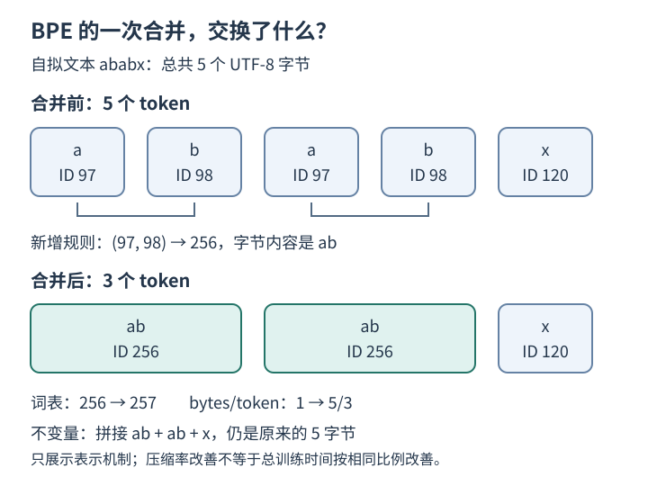

# 课程导论与分词：先决定模型看见什么

## 1. 核心问题不是“怎样调用模型”，而是“怎样分配表示与计算”

给定一段文本、有限训练数据和有限算力，怎样选择模型的基本单位，才能让模型既能覆盖输入，又不把计算浪费在过长的序列或学不到的稀有符号上？这是分词（tokenization）要回答的问题。

本讲学完应能独立说明四件事：

1. 字符串、UTF-8 字节、token ID 是三个不同层次。
2. 语言模型预测的是 token 的条件分布；分词改变了预测任务的单位。
3. 字节级 BPE 通过学习合并规则，在词表大小与序列长度之间折中。
4. “能还原原文”“压缩率较高”“模型训练更好”“实际运行更快”是四种不同证据，不能互相替代。

先修不足时，先补[Python 实验工程基础](#/c/stanford-cs336-2026/lec/bridge04?v=notes)和[概率、信息论与语言建模](#/c/stanford-cs336-2026/lec/bridge02?v=notes)。本页按问题重新组织；课堂介绍、历史回顾和各作业预告的原顺序留在[课堂译述](#/c/stanford-cs336-2026/lec/lec01?v=draft)，不在这里重复展开。

## 2. 三种表示，两个方向，一个基本契约

设原文本为 $s$，分词器的编码为 $E$，解码为 $D$。对分词器声明支持的输入域，首要契约是：

$$
D(E(s))=s.
$$

这叫往返一致性（round-trip）。它要求保留空格、换行、标点等信息；“人看起来意思一样”远远不够。

| 层次 | 是什么 | 不要混淆成什么 |
|---|---|---|
| Unicode 字符串 | Python `str` 中的码点序列 | 固定宽度的字节数组；视觉字符数也不总等于码点数 |
| UTF-8 字节 | 0–255 的整数序列；一个码点可能占多个字节 | 每个字节都能单独解码的字符 |
| token ID | 当前词表中条目的索引 | Unicode 码点，或带数值大小意义的语义特征 |

**编者自拟例子：**字符串 `A中` 有两个码点，UTF-8 表示是四个字节：`[65, 228, 184, 173]`。字节分词器给出四个基础 token；其他分词器可能用更少的 token。即使某个 token 只承载 `中` 的一部分字节，也不意味着信息丢失：应先拼接 token 对应的字节，再整体解码。

这里有两个不对称之处：

- $D(E(s))=s$ 不自动推出对所有 ID 序列 $u$ 都有 $E(D(u))=u$。不同 token 分段可能拼成同一个字符串，而编码器只选择其中一种规范分段。
- 任意 token ID 序列拼起来，也不保证是合法 UTF-8。往返性质针对有效输入经编码后的输出；对任意模型生成的序列，还需要明确解码错误策略。不能用静默替换掩盖本来应该无损的编码错误。

空串的往返也应定义，但“字节数 / token 数”在空串上是 $0/0$，不能随手报告成压缩率 0 或 1。

## 3. 从 token 序列到语言建模目标

分词器一旦确定，模型预测的对象就是它输出的 token 序列。完整的链式分解、NLL、交叉熵与 PPL 推导见[概率桥接 §2–6](#/c/stanford-cs336-2026/lec/bridge02?v=notes)，这里关注分词带来的两个接口变化：

1. **预测步数变了。** 同一文本切成更多 token，就需要更多次条件预测；每一步的前缀和目标也随之变化。
2. **计分单位变了。** token 级平均损失的分母是当前切分下参与计分的 token 数。因此不同 tokenizer 的 PPL 不能直接排序；按相同原始字节数报告分数，也仍须固定文本、上下文、边界和预处理规则。

这些是编者连接分词与语言建模目标的解释，不声称课堂逐项推导了相关公式。编码路径的概率也不自动等于所有能解码为同一文本的路径的概率之和。

词级 tokenizer 若把许多不同未知词都映射为同一个 `UNK`，就改变了任务：模型不必区分这些词也可能得到较好的分数，同时原文已无法无损恢复。这是“指标变好”却没有真正解决原任务的典型风险。

## 4. 分词方案到底在交换什么？

定义本页所用压缩率为：

$$
r=\frac{B}{T}\quad\text{（UTF-8 bytes/token）}.
$$

$r$ 越大，表示同一文本需要的 token 越少。这**不是文件存储压缩比**：实际存储还涉及 ID 位宽、词表与合并表，不能把 bytes/token 当作最终磁盘大小之比。

| 方案 | 有利的一面 | 代价与适用边界 |
|---|---|---|
| 码点级 | 直观、可往返；无需先识别词 | 全量覆盖需要很大的符号空间，常见词仍拆成许多步；“字符”还涉及组合字符问题 |
| 字节级 | 基础词表固定256；覆盖有效 UTF-8 文本无需未知词 | $T=B$、$r=1$；多字节文字和长文会产生很长序列 |
| 词级 | 常见词用少量 token 表示 | 词表大、长尾稀疏；新词、拼写变化和不同语言的分词边界难处理 |
| 字节级 BPE | 保留字节回退；常见片段合并，词表规模可控 | 依赖训练语料和规则；边界不保证符合语义，压缩率随领域、语言变化 |

“字符、字节方案在本讲语境中不理想”不是它们在所有架构上都不成立。课堂讨论的是当前常见、以 token 序列为计算单位的模型；字节原生架构可能采用不同的计算组织。

### 为什么词表也不是越大越好？

对于隐藏维度为 $d$、词表大小为 $V$ 的常见模型：

- 输入嵌入表约有 $Vd$ 个参数。
- 若输出投影不与嵌入共享，还要约 $dV$ 个参数；权重共享可以少存一份，但不会消除输出计算。
- 朴素全词表输出投影，每个位置的工作量与 $dV$ 同阶。
- 较大词表里更多条目很少出现，留给这些条目的训练证据更少。

另一方面，固定原始文本字节数 $B$ 时，$T=B/r$。若仅考察常规稠密自注意力中的两两交互项，它随 $T^2$ 增长。因此当 $r$ 翻倍，该项理论上降至原来的四分之一。

**限定条件非常重要：**这不是总训练 FLOPs 或墙钟时间必定减少四倍。投影和 MLP 有线性于 $T$ 的项，输出层受 $V$ 影响，硬件执行也有自己的瓶颈。正确问题是：“减少了哪一项，增加了哪一项？”资源账本将在[L02](#/c/stanford-cs336-2026/lec/lec02?v=notes)展开。

## 5. BPE 学的是合并规则，不是词义

字节级 Byte-Pair Encoding 的训练从256个单字节条目开始。每轮在**当前分段**中统计相邻 token 对，选一个高频对，用新条目替换它的非重叠出现，并保存这条有先后次序的合并规则。

*图：编者自拟 `ababx` 示例。只展示一次合并的表示不变量；不是课堂截图、完整分词器或 A1 答案。基础词表仍保留全部256个字节条目。*

这个例子里，字节串 `ababx` 从5个 token 变为 `ab | ab | x`，有3个 token，因此 $r=5/3$。词表只多一个条目 `ab`。常见片段“占用更少的预测位置”，并不等于算法证明了它在语义上最重要。

### 不变量比背流程更重要

记词表中 ID $k$ 对应的字节串为 $v(k)$。合并 $a,b$ 得到新 ID $c$ 时，定义：

$$
v(c)=v(a)\Vert v(b),
$$

其中 $\Vert$ 表示拼接。把相邻 $a,b$ 替换为 $c$，前后所有条目的字节拼接完全相同。因此从基础字节分段出发，逐轮合并不会改变原字节串。这就是往返正确性的核心理由；它与“模型效果是否更好”无关。

### 三个很容易混淆的细节

1. **训练与编码不同。**训练在训练语料上学习有序合并；编码新文本要使用已经固定的规则及其优先级，不能重新按每个输入的局部频率训练。否则同一 ID 的含义和模型训练时的接口会失配。
2. **相邻频数与本轮可替换次数不同。**`aaa` 中相邻对 `aa` 出现两次，但这两个出现共享中间位置；一次从左向右的非重叠替换只能合并一次。统计、替换和增量更新必须采用一致的约定。
3. **同频选择影响结果。**多个对并列最多时，必须有确定的 tie-break 规则。课堂小演示取遇到的第一个；不要由此推断官方作业采用相同约定。具体要求应读固定 A1 讲义。

通常完成 $M$ 次新增合并后，基础词表增加 $M$ 个条目；若再保留 $S$ 个特殊 token，目标规模还要把它们计入。不能把“词表大小”与“合并次数”当成同一参数。

### 预分词与特殊 token 为什么不是小修补？

预分词（pre-tokenization）先按规则把文本分块，再在允许的块内合并。这既限制统计和搜索范围，也规定了**哪些边界不能跨过**。因此更改正则表达式不是单纯性能优化：它可能改变学习出的词表和编码结果。

特殊 token 则表达控制或边界，例如文档结束。其“特许控制标记”身份与正文恰好包含同样字符的情况应由接口策略区分；不要在处理它们之前就允许普通合并跨过边界。这里只提出契约，不提供作业的完整正则、训练器或编码器。

## 6. 如何把本讲转成 A1 的学习任务

进入[A1 实验指导](#/c/stanford-cs336-2026/lab/a1-basics?v=guide)时，可以带着下面的检查清单，而不是带着一份现成答案：

| 要形成的证据 | 先问自己 | 不足以证明什么 |
|---|---|---|
| 输入与输出契约 | 支持哪些字符串？换行和空白是否原样保留？ | 单个英文例子往返，不能证明 Unicode 和边界正确 |
| 词表与规则一致 | ID 对应什么字节？顺序与同频规则是否固定？ | 词表大小正确，不代表合并过程正确 |
| 分布外覆盖 | 新词能否退回基础字节而不丢信息？ | 无 `UNK`，不代表多语言压缩效率相同 |
| 性能证据 | 慢在扫描、计数、合并还是 I/O？测量输入是否相同？ | CPU 微例跑通，不等于官方规模训练或排行榜完成 |
| 实验可复现 | 语料切分、版本、配置、词表文件能否重建？ | 同一个随机种子，不会自动固定数据与算法版本 |

朴素实现反复扫描所有合并或全部语料，可能在小样例上正确、在真实语料上极慢。优化前先保存清楚的正确性参照，优化后比较**相同契约**下的输出；不能通过丢掉空白、跳过罕见字节等方式“提速”。

本页不提供可提交的 BPE 实现、Transformer、优化器或训练循环。AI 应用于概念和 API 解释，不代写作业或排行榜代码；校内算力资格及正式交付要求以 A1 页面和公共资料为准。

## 7. 易错点与自测

### 先不看答案

1. `len(s)` 能直接作 bytes/token 的分子吗？对 `A中`，码点级与字节级的 $r$ 分别是多少？
2. token ID 257 比 ID 12 大，是否说明前者语义更复杂？
3. `ababx` 合并 `ab` 后，哪些量变了，哪些量必须不变？
4. 两个 tokenizer 在同一文本上给出 PPL 10 和 8，能否直接选后者？
5. `aaa` 中 `aa` 的相邻计数为2，是否能在同一轮把两个出现都替换？
6. 为什么训练集压缩率很高，仍不足以决定一个 tokenizer 适合代码或中文？
7. 如果 $r$ 翻倍，能否向同伴承诺训练时间缩短到四分之一？

### 提示与答案

1. **提示：先统一单位。**`len(s)` 是码点数，不是 UTF-8 字节数。`A中` 的字节数为4，码点级 $r=4/2=2$，字节级 $r=4/4=1$；本批已用 Python 核对码点数与UTF-8字节。
2. **提示：索引不是度量。**ID 只是查表键；把整张词表及关联模型参数一致重排，不会凭 ID 数字产生语义顺序。
3. **提示：看图的两条轴。**token 数从5变3，词表从256变257；拼接后的5字节内容不变。$r$ 从1变为 $5/3$。
4. **提示：检查分母。**不能。先固定文本、tokenizer 和评测协议；跨 tokenizer 至少需要一致的原始计量单位与边界规则，且理解编码路径分数的限制。
5. **提示：中间字符能用两次吗？**不能。两个出现重叠；一次非重叠替换得到 `aa | a`，不是两个 `aa`。
6. **提示：统计来自哪里？**频繁片段取决于训练分布。要在隔离的目标领域文本上观察序列长度分布、压缩率与后续模型表现；不能用测试集训练分词器后再报告泛化。
7. **提示：只减少了哪一项？**不能。只有固定条件下稠密注意力的二次项有该比例；其余计算、词表成本、内存与执行效率仍需核算和测量。

## 8. 回看课堂的时间导航

以下覆盖整段79:22录像的导航，不表示每一秒都有字幕。时间按字幕主题边界取整到秒，精确边界与空隙保存在来源分片；字幕外的内容不猜写。

| 区间 | 回看要解决的问题 |
|---|---|
| 00:00–00:05 | 开头无字幕，不能据此推断画面或语音 |
| 00:05–03:24 | 本届课程与“从零构建”的范围是什么？ |
| 03:24–11:37 | 小规模学习能迁移什么，效率为什么重要？ |
| 11:37–20:04 | 开放模型、使用方式与可执行讲义如何连接？ |
| 20:04–27:16 | 作业、AI 辅助与算力的课堂说明 |
| 27:16–35:53 | 分词、架构、训练怎样共同构成基础闭环？ |
| 35:53–45:10 | 系统效率与推理的课程预告 |
| 45:10–53:29 | 为什么要思考可外推的训练配方？ |
| 53:29–65:06 | 数据、评测与后训练如何进入同一个资源问题？ |
| 65:06–68:29 | 编解码契约、bytes/token 与词表大小 |
| 68:29–71:58 | 码点、字节、词级方案分别输在哪里？ |
| 71:58–75:22 | BPE 如何逐轮改变分段与词表？ |
| 75:22–77:29 | 固定合并规则怎样用于新文本，A1 还要处理什么？ |
| 77:29–79:17 | 自适应计算与下一讲的衔接 |
| 79:17–79:22 | 末尾无字幕，不补造结语 |

## 来源与编写边界

- 官方课堂：Percy Liang，Stanford CS336 Spring 2026 L01，2026-03-30 课表条目；Stanford Online 于2026-04-14上传。录像身份、79:22时长与许可空值复用 P1 的单视频元数据。视频 ID `JuoVZkPBiKk`；观看入口在页头。
- [固定讲义源码 `lecture_01.py`](https://github.com/stanford-cs336/lectures/blob/de53a9f979a6ee35f7d13a5e1aadee5ea1afc58e/lecture_01.py)：完整读取1–762行。重点为256–317行的接口与学习目标、505–576行的编码和压缩率定义、579–758行的分词说明与演示。
- [固定课堂 trace](https://raw.githubusercontent.com/stanford-cs336/lectures/de53a9f979a6ee35f7d13a5e1aadee5ea1afc58e/var/traces/lecture_01.json)：只读取指定的分词演示状态，不声称全617步逐项阅读。固定提交晚于学期，不保证与录像逐字一致；源码中的 Spring 2025 播放列表仅是历史链接。
- 本次完整阅读1509条英文字幕，覆盖00:04.880–79:17.220；未核音、未观看全片、未截帧。平台 manual/non-ASR 分类不证明技术术语已人工校正；逐项不确定内容及12处大于2秒的字幕空隙见课堂译述页底和 `sources/p2-lec01/` 记录。
- 表示与计分单位的解释、`A中` / `ababx` / `aaa` 示例、工程检查清单与 SVG 为编者自主内容；概率推导统一放在概率桥接。已用 Python 核对字节与拼接微例，没有实现或运行 BPE 训练。没有将课堂引用论文的链接当作已全文精读，也没有新增课外材料页。原始字幕与规范化全文只作本地证据，不按已获授权全文公开。
