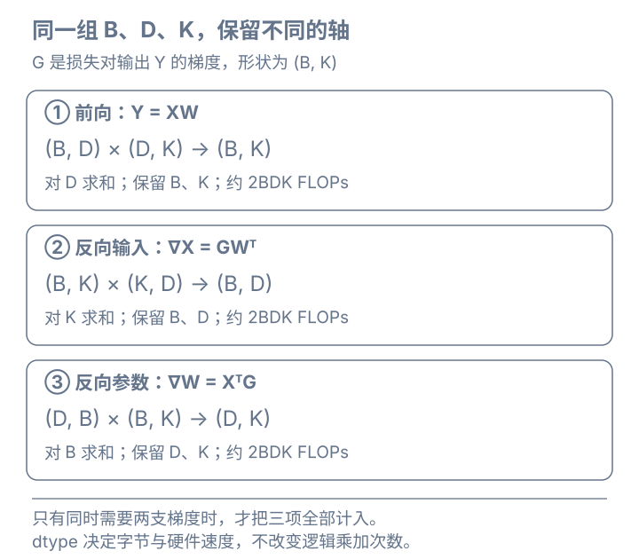

# 把一行张量代码变成资源账本

## 1. 同一行代码，要回答三个问题

看到 `Y = X @ W`，不要只问“结果对不对”。还要问：

1. **语义**：哪个轴是样本，哪个轴被求和？
2. **容量**：哪些张量必须同时活着，各用多少字节？
3. **时间**：需要多少计算、搬多少数据，哪一项限制速度？

本讲把三者连在一起。以下推导和小算例由编者独立组织；课堂定位见末尾时间表。基础规则不再从头重复：轴与广播见[bridge01](#/c/stanford-cs336-2026/lec/bridge01?v=notes)，共享存储与视图见[bridge05](#/c/stanford-cs336-2026/lec/bridge05?v=notes)，浮点格式见[bridge07](#/c/stanford-cs336-2026/lec/bridge07?v=notes)，单位、估算与测量纪律见[bridge08](#/c/stanford-cs336-2026/lec/bridge08?v=notes)。

## 2. 用轴名写出计算，而不是猜转置

设输入 $X\in\mathbb R^{B\times D}$、参数 $W\in\mathbb R^{D\times K}$，输出 $Y\in\mathbb R^{B\times K}$。定义本身就是：

$$
Y_{bk}=\sum_{d=1}^{D}X_{bd}W_{dk}.
$$

输出保留 $b,k$，消去 $d$。`einops.einsum` 用有意义的轴名表达这一件事：

```python
# 接口示意，不是作业实现。
y = einsum(x, w, "batch input, input output -> batch output")
```

对于两组序列特征 $Q:(B,S,D)$、$R:(B,T,D)$，逐批两两内积是：

$$
A_{bst}=\sum_dQ_{bsd}R_{btd},\qquad A:(B,S,T).
$$

`einsum(q, r, "batch query feature, batch key feature -> batch query key")` 中，`feature` 被消去，`batch` 同时出现在输入和输出，所以不同样本不互相混合。这里仅解释收缩操作，不展开下一讲的模型架构。

三类操作不要混为一谈：

| 操作 | 它在回答什么 | 资源提醒 |
| --- | --- | --- |
| `einsum` | 哪些轴匹配、相乘并求和？ | 输出形状决定元素数，收缩轴决定计算量 |
| `reduce` | 沿哪些轴做 sum、mean、max 等归约？ | 减少输出元素，不等于没有读取成本 |
| `rearrange` | 如何拆轴、并轴或换轴？ | 元素数可不变；是否复制取决于布局，不能只看名字 |

例如将 $(S,HD)$ 拆成 $(S,H,D)$，必须给出 $H$ 或 $D$，因为乘积本身不能唯一确定两个因子。并回去时 `(head feature)` 与 `(feature head)` 的元素顺序不同。命名降低写错轴的概率，不自动证明数据排列正确，也不保证比等价原语快。

## 3. 前向一个矩阵乘法，反向为什么通常有两个

用 $G=\partial\mathcal L/\partial Y$ 表示上游梯度，形状仍为 $(B,K)$。从微分出发：

$$
dY=dX\,W+X\,dW.
$$

将每个标量的贡献收集到对应变量，可得：

$$
\frac{\partial\mathcal L}{\partial X}=GW^\mathsf T,
\qquad
\frac{\partial\mathcal L}{\partial W}=X^\mathsf T G.
$$

形状就是第一道检查：$(B,K)(K,D)\to(B,D)$，$(D,B)(B,K)\to(D,K)$。前者对输出轴求和，把误差传回输入；后者对 batch 轴求和，把所有样本对同一参数的贡献相加。



*图：编者依据上述指标公式独立绘制。三条收缩遍历相同的 $B,D,K$ 组合，但保留的轴不同；不是课堂截图。*

普通稠密实现中，每个输出需要 $D$ 次乘法和 $D-1$ 次加法：

$$
F_{\rm forward}=BK(2D-1)\approx2BDK.
$$

两个反向矩阵乘法分别约 $2BDK$，于是该层的前向加反向约 $6BDK$。这里的“2”来自**一次乘法加一次加法**，不是 bf16 的两个字节；改变 dtype 会改变存储与硬件速度，不改变此处逻辑乘加次数。

令参数数目 $P=DK$，该层每批的近似代价为 $6BP$。对大量由稠密线性层主导的计算，遍历 $T$ 个 token 常写成：

$$
F_{\rm train}\approx6TP.
$$

### 这个近似的边界

- 第一层若不需要输入梯度，就不必计算那一支；冻结参数也会改变需要的反向路径。对浅网络，“反向恰好两倍”尤其不能当恒等式。
- 激活、归一化、损失、优化器更新等并未逐项纳入；FLOPs 少不代表墙钟时间可忽略。
- 长序列的两两交互会产生与序列长度平方相关的项，不能仅靠参数数目覆盖。
- 重计算会增加实际执行的 FLOPs；稀疏或按需激活参数不能随意用总参数数目套公式。

**例子。** 三层无偏置方阵，每层宽度 $D=8$，batch 为 $B=4$，共有 $P=3\times8^2=192$ 个参数。主项估计前向 $1536$ FLOPs，前向加反向 $4608$ FLOPs。若第一层输入不求导，少一项约 $2BD^2=512$；非线性与损失还需另外记账。小网络中这些修正的相对影响不能忽略。

## 4. 内存账本：先数元素，再乘字节

对一个没有与别的对象共享存储的稠密张量，逻辑载荷为：

$$
M_{\rm payload}=\operatorname{numel}(x)\times\operatorname{element\_size}(x).
$$

这不是进程总内存，也不必等于分配器保留空间。视图可能共享 storage，临时张量可能只在某一时刻存在。真正关心的是**时间轴上的同时存活峰值**，而不是把程序出现过的所有名字求和。

假设参数和梯度各为 bf16，优化器状态为 fp32，暂不含 fp32 主权重副本：

| 项目 | 元素数 | 字节数 |
| --- | ---: | ---: |
| 参数 | $P$ | $2P$ |
| 参数梯度 | $P$ | $2P$ |
| AdaGrad 累计平方梯度 | $P$ | $4P$ |
| 或 Adam 的两个状态 | $2P$ | $8P$ |
| 简化的每层一份激活 | $BLD$ | $2BLD$ |

因此 AdaGrad 常驻主项是 $8P$ 字节，Adam 是 $12P$ 字节，再加激活、输入、临时工作区及其他状态。这里是在说明**一种指定 dtype 的账本**，不是说所有 PyTorch 优化器或 AMP 配置都恰好如此。

对上一节 $P=192,B=4,L=3,D=8$ 的小例子，Adam 主项 $2304$ 字节，简化激活项 $192$ 字节，共 $2496$ 字节。这只是模型化载荷；真实 autograd 保存哪些输入、输出或掩码、是否复用存储，都可能改变峰值。

### 为什么“12 字节/参数”不是万能公式

- 常见 autocast 使用方式可让模型参数保留 fp32，只让部分运算进入低精度；参数与梯度的存储不能按“打开 AMP”就一律改成 bf16。
- 某些混合精度实现另存 fp32 主权重，需要再加 $4P$；另一些配置本就以 fp32 参数作为更新对象，不能重复添加。
- 优化器状态可能在第一次更新才建立；初始化后测到的内存不是稳态训练峰值。
- 多卡容量相加只是总量上界。若每张卡都复制模型，每卡仍须放得下完整副本；必须有相应分片策略才能利用合计容量。

课堂用 $8\times80$ GB 除以 $12$ 得到约 $53.3$B 参数，只能读作忽略激活等开销、且理想分配状态后的**容量上界**，不是“普通数据并行即可训练53B”的保证。

精度选择的原则是把风险放回具体运算：bf16 与 fp32 具有相同的指数位数，但有效精度更低；这不意味着所有累加都安全。更完整的格式、舍入和稳定性讨论回到 [bridge07](#/c/stanford-cs336-2026/lec/bridge07?v=notes)。

## 5. 算得少，为什么仍然慢

令 $F$ 为工作量，$Q$ 为从某一层内存读写的字节数，$C$ 为计算峰值，$\beta$ 为该层带宽。理想完全重叠时：

$$
\begin{aligned}
t&\ge\max\left(\frac F C,\frac Q\beta\right),\\
I&=\frac FQ,\qquad I_*=\frac C\beta.
\end{aligned}
$$

$I$ 是工作负载的算术强度，$I_*$ 是硬件的计算/带宽比。二者都用 FLOP/byte 表示。相应的 roofline 上界为：

$$
\text{可达吞吐}\le\min(C,\beta I).
$$

当 $I<I_*$ 时，增加计算峰值未必能解决搬运瓶颈；当 $I>I_*$ 时，也只是允许进入计算受限区，不保证某个小而形状不佳的 kernel 已饱和硬件。

下面采用课堂的 bf16、输入读一次/输出写一次的简化口径。忽略缓存、多次读写、工作区与启动开销：

| 操作 | 近似工作量 | 读写字节 | 强度 |
| --- | ---: | ---: | ---: |
| 独立 ReLU，$n$ 个数 | $n$ 次比较 | $4n$ | $1/4$ 次操作/byte |
| 向量点积 | $2n-1$ | $4n+2$ | 约 $1/2$ |
| $n\times n$ 矩阵乘向量 | $n(2n-1)$ | $2n^2+4n$ | 约 $1$ |
| 两个 $n\times n$ 矩阵相乘 | $n^2(2n-1)$ | $6n^2$ | 约 $n/3$ |

矩阵乘法的优势不是符号看起来高级，而是同一输入值能参与多次有用乘加。按课堂采用的 H100 稠密 bf16 峰值 $989.5$ TFLOP/s 与带宽 $3.35$ TB/s，拐点约为 $295$ FLOP/byte；理想 $n=1024$ 方阵的强度约 $341$，而矩阵向量乘仍约为 $1$。

这是**定性分析，不是这里测得的性能**。比较指令和 GELU 特殊函数也不必拥有 Tensor Core 矩阵乘的峰值；课堂将它们折算成操作数，是为了识别搬运主导的数量级。GELU 约20次操作/元素是粗估，不是 API 承诺。相同读写量并不保证 ReLU 与 GELU 实测完全等时。

同样，“推理受带宽限制”主要刻画低 batch、逐 token 解码的一些线性算子；不能推广到所有 prefill、所有 batching、整个推理系统。这里不展开后续讲次。

## 6. 从 FLOPs 到天数：每个分母都必须说明

逻辑工作量除以实测秒数，才是实际 FLOP/s。若用与 dtype、稠密/稀疏模式匹配的硬件峰值归一化，可写：

$$
\mathrm{MFU}=\frac{F_{\rm model}/t}{N_{\rm GPU}C},
\qquad
 t\approx\frac{6TP}{N_{\rm GPU}C\,\mathrm{MFU}}.
$$

MFU 的分子是声明口径的模型计算量；分母时间若采用整步墙钟时间，就会受到搬运、通信和其他停顿影响。重计算执行了更多工作，不应偷偷计入“有用模型 FLOPs”让 MFU 看起来更高。单个矩阵乘法的效率也不能直接等同整次训练的 MFU。

课堂开场的70B参数、15T token、1024张H100、稠密bf16峰值和假定MFU=0.5，给出约144天的数量级；课堂口述约143天。它不是完成训练的实测日志，也没有包括故障、验证、检查点保存等所有现实条件。

给峰值除以2去掉规格表的稀疏口径，与再乘0.5的MFU是两件事。不能把两个“打五折”误以为重复修正，也不能对已经注明稠密的峰值再除以2。GPU异步执行还意味着：测主机提交时间不等于测完成时间。测量细节回到 [bridge08](#/c/stanford-cs336-2026/lec/bridge08?v=notes)。

## 7. 两种省内存方法，改的是不同账项

### 7.1 梯度累积：减少同时存活的样本

把有效 batch $B$ 分成 $m$ 份，每份 $b=B/m$，保持参数不变，分别反向，将梯度累加后再更新一次。激活主项从 $O(BLD)$ 降为 $O(bLD)$，参数、参数梯度和优化器状态并不同比减少。

若每份损失 $\mathcal L_j$ 是该份样本的均值，则整批均值为：

$$
\mathcal L=\frac1m\sum_{j=1}^{m}\mathcal L_j,
\quad
\nabla\mathcal L=\frac1m\sum_j\nabla\mathcal L_j.
$$

因此不能直接相加每份的均值梯度却仍声称得到整批均值梯度。大小不等时，应按各份样本数加权；按 token 平均的损失则应按有效 token 数加权。

这通常**不减少总逻辑计算量**，而且小矩阵可能降低利用率。若存在跨样本统计或不同随机行为，累积梯度与一次大 batch 的计算也不必逐位相同。课堂73:12–73:19字幕的“save on compute”不能据此当作省FLOPs结论。

### 7.2 激活检查点：少保存，需要时重算

对具有 $L$ 层、每层激活大小相近的简单链，保存所有中间量需要 $O(L)$ 份激活。不保存所有中间量，并不意味着反向不需要它们：反向时必须从某个保留点重新前向得到。

一个明确的分段策略是每 $k$ 层保留一个边界，反向到该段时重建并暂存该段内部的 $k$ 层，再立即反传并释放：

$$
M_{\rm activations}=O\!\left(\frac Lk+k\right),
$$

所以 $k\approx\sqrt L$ 给出 $O(\sqrt L)$ 的峰值层数。**在这一策略下**每段只额外前向一次，总额外层计算为 $O(L)$，不是整个网络只做 $O(\sqrt L)$ 次计算。若每求一层梯度都从头重算且不缓存段内结果，才会走向 $O(L^2)$ 的另一种策略。

这是编者的复杂度澄清，不把它改写成讲者在76:00的原话。实际框架还要考虑保存集合、随机数状态和函数副作用；“加上 checkpoint 就必定省一半”不是一般保证。

## 8. 一个可手算的小CPU机制例子

只检查单个线性运算的梯度与形状，不实现优化器、模型或作业模块。下例已在既有 PyTorch 2.5.1 CPU 环境运行，输出及两项梯度与解析值一致；没有使用CUDA或下载数据。

```python
import torch

x = torch.tensor([[1., 2., 0.], [0., 1., 3.]], dtype=torch.float64,
                 requires_grad=True)
w = torch.tensor([[1., -1.], [2., 0.], [0., 1.]], dtype=torch.float64,
                 requires_grad=True)
y = x @ w
loss = y.square().sum() / 2
loss.backward()

g = y.detach()  # d loss / d y
assert torch.allclose(x.grad, g @ w.detach().T)
assert torch.allclose(w.grad, x.detach().T @ g)
print(y.detach().tolist())
print(x.grad.tolist())
print(w.grad.tolist())
```

解析预期：$Y=[[5,-1],[2,3]]$，$\nabla_X=[[6,10,-1],[-1,4,3]]$，$\nabla_W=[[5,-1],[12,1],[6,9]]$。这只能验证这一梯度恒等式，不能验证GPU吞吐、训练稳定性或任何官方实验结果。

## 9. 自测：先写假设，再给答案

1. **把 bf16 换成 fp32，$2BDK$ 要翻倍吗？**
   - 不翻倍；逻辑乘加次数不变。载荷字节翻倍，硬件峰值及算术强度随之变化。
2. **$P$ 不变，batch 从64降到16，哪些内存不会随之缩成四分之一？**
   - 参数、参数梯度及优化器状态。简化激活项缩小，但峰值还受其他临时量影响。
3. **输出梯度为何与输出同形，参数梯度为何对batch求和？**
   - 每个输出标量各有一个偏导；同一参数被多个样本共享，链式法则必须累加所有贡献。
4. **程序里有三个张量名字，就能加三个 `numel × element_size` 吗？**
   - 不能；先检查共享存储和生存期。逻辑载荷、唯一存储占用和分配器保留空间是不同统计量。
5. **microbatch=4，累积8次，等于直接batch=32更新8次吗？**
   - 不等于；累积期间参数固定，只更新一次，并须正确归一化损失。更新8次会走不同参数轨迹。
6. **低MFU一定说明代码写错了吗？**
   - 不一定；内存受限、小算子、通信、硬件模式和统计口径都可能影响它。先找资源瓶颈，再判断可改进空间。
7. **checkpoint每隔 $k$ 层保存后，额外计算究竟是 $O(k)$ 还是 $O(L)$？**
   - 必须说明是单段还是全网，以及是否暂存段内重建结果。本文分段策略的单段重建为 $O(k)$、全网额外重建为 $O(L)$。

## 全片导航

边界依据字幕 cue，表中取到秒，章节切分是编辑导航而非视频自带章节。完整毫秒区间及字幕缺口保存在来源分片。没有字幕覆盖的短间隙不推断为静音或课堂讨论。

| 时间 | 核心问题 |
| --- | --- |
| 00:00–00:05 | 开头无字幕 |
| 00:05–01:01 | Marin训练结果与预测的课堂近况 |
| 01:01–04:43 | 训练天数、内存上界与资源核算习惯 |
| 04:43–13:07 | 张量、字节、fp32/fp16/bf16与混合精度 |
| 13:07–17:00 | fp8/fp4、共享缩放与训练/推理量化问答 |
| 17:00–18:03 | CPU/GPU放置；部分GPU演示未运行的课堂说明 |
| 18:03–22:50 | 用命名轴理解einsum |
| 22:50–24:03 | reduce与是否加速的问答 |
| 24:03–27:27 | rearrange、拆并轴与排列顺序 |
| 27:27–30:50 | FLOPs/FLOP/s、稀疏峰值与一周算力 |
| 30:50–34:46 | 矩阵乘法计数与算法问答 |
| 34:46–40:27 | 计时、同步、MFU及峰值口径 |
| 40:27–48:13 | 搬运与计算、ReLU、算术强度 |
| 48:13–51:22 | GELU、点积与矩阵向量乘 |
| 51:22–54:48 | 矩阵乘法复用；训练与解码的区别 |
| 54:48–57:04 | 硬件配比问答与roofline |
| 57:04–60:16 | 深网络与梯度的基本机制 |
| 60:16–66:47 | 两支反向矩阵乘法与 $6TP$ 边界 |
| 66:47–69:20 | AdaGrad状态的课堂解释 |
| 69:20–72:10 | 内存分账、当堂纠错；训练循环跳过 |
| 72:10–73:20 | 梯度累积 |
| 73:20–76:16 | 激活检查点与保存/重算的取舍 |
| 76:16–77:21 | 总结 |
| 77:21–77:25 | 结尾无字幕 |

## 来源、校正与阅读边界

- 课堂：Percy Liang，Stanford CS336 Spring 2026，Lecture 2，2026-04-01课表讲次；[Stanford Online录像](https://www.youtube.com/watch?v=kuYAsz7zspQ)，77:25。人工/非ASR为平台分类，不是逐词核音保证。已读全部1425 cues（00:05.040–77:20.780），未核音、未看画面、未截帧；少数`INAUDIBLE`及疑似误识别详见 [课堂适度译述](#/c/stanford-cs336-2026/lec/lec02?v=draft)。
- 课堂代码：[录像版trace](https://cs336.stanford.edu/lectures/?trace=lecture_02_recording)，[固定原件](https://raw.githubusercontent.com/stanford-cs336/lectures/de53a9f979a6ee35f7d13a5e1aadee5ea1afc58e/var/traces/lecture_02_recording.json)，实际抽取并读完 `files[lecture_02.py]` 881行。没有读取全部trace事件，也没有下载全部依赖图像或执行课堂脚本。
- 版本对照：[同提交当前源码](https://github.com/stanford-cs336/lectures/blob/de53a9f979a6ee35f7d13a5e1aadee5ea1afc58e/lecture_02.py)仅阅读与录像版的差异；固定提交晚于学期。不能把当前新增的代码或修订后的数字倒填录像。
- 编者API补充：[PyTorch AMP文档2.15](https://docs.pytorch.org/docs/2.15/amp.html)，访问于2026-11-14，实际阅读引言、Autocasting与Gradient Scaling至对应reader第300行；用于区分运算dtype与参数存储，不声称这是课堂运行版本。未逐项核读后续算子白名单，亦不把“自动”理解为所有运算绝对安全。
- 课堂自己修正过的地方包括：02:12–02:16的H100型号、30:15–30:30的一周算力、46:59–47:07的ReLU强度 $1/4$、70:08–70:24用参数**元素数**而非参数**字节数**计算梯度/优化器状态。本文正确分账依据字幕自纠及独立单位推导，不复制录像代码残留笔误。
- 编者另行澄清：录像代码名为 `deep_linear_network`，但其Block有ReLU，讲者57:41–57:45也当堂指出；源码 `model(x).mean()` 产生标量而目标是向量，属于广播的演示，不能充当逐样本回归范例。checkpoint演示还存在非标量直接 `.backward()`、CPU分支不调用测量函数就返回0的限制，不能据此报告实测节省。这里只执行正文独立CPU微例，不运行该课堂脚本。
- 本讲没有独立课外指定材料的已核实依据；讲义中的链接不自动升级为指定精读，故不另建materials占位页。相关作业只回链 [A1来源与任务拆解](#/c/stanford-cs336-2026/lab/a1-basics?v=guide)，不提供实现或排行榜代码。
- 完整URL、SHA256、UTC、阅读范围与时间区间见 `sources/p2-lec02/manifest-fragment.json`、`time-intervals.json`、`review.txt`。原始字幕、源码全文与补充文档仅作本地证据，不发布未授权全文；本文SVG为原创。
