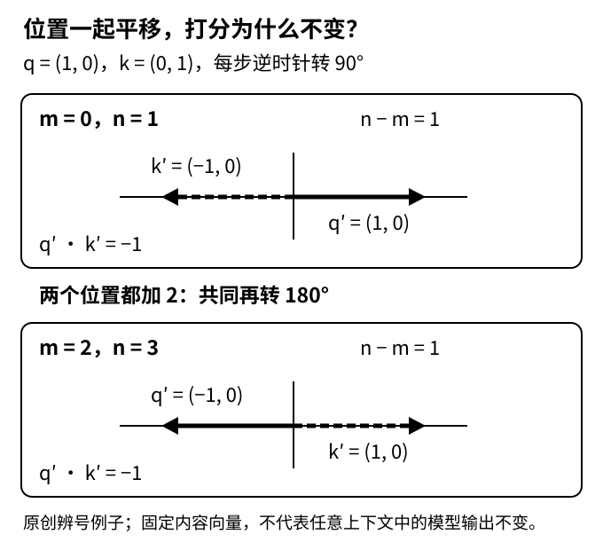

# 从注意力路由到相对位置：Transformer 与 RoFormer 精读

## 1. 两个问题，把两篇论文连起来

第一个问题是：**一个位置怎样根据内容，从其他位置取回信息？** 第二个问题是：**取回多少信息，怎样既取决于内容，也取决于两者相距多远？**

注意力把第一个问题拆成“匹配键”和“汇总值”；RoPE 则让匹配所用的内积带上相对位置。学习重点不是记住两个模型名字，而是分清三个对象：

- **内容变换**：可学习投影决定拿什么特征去比较。
- **可见性约束**：mask 决定哪些位置允许参与比较。
- **位置关系**：位置编码决定比较时如何使用顺序或距离。

本页是两篇论文在本课程中的唯一精读正文。现代架构的取舍见[L03 笔记](#/c/stanford-cs336-2026/lec/lec03?v=notes)，位置与长度实验方法见[位置编码专题](#/c/stanford-cs336-2026/lec/ext03?v=notes)。这里不提供 A1 可提交实现；推导服务于读论文和自行判断接口。

## 2. 先分清“2017 Transformer”与“今天的语言模型”

2017 论文首先处理的是有源序列和目标序列的转导任务。编码器读取源序列，解码器根据已经知道的目标前缀及编码器输出，预测目标的下一个符号。它不是直接把现代 decoder-only 模型画在纸上。

| 问题 | 2017 论文的基础模型 | 固定2026 A1 的模型 |
|---|---|---|
| 信息来自哪里 | encoder–decoder；解码器另外读取编码器输出 | decoder-only；从同一序列的可见前缀取信息 |
| 归一化放哪里 | 残差相加后做 LayerNorm，post-LN | 子层前做 RMSNorm，pre-norm；堆叠后还有最终归一化 |
| 位置怎样进入 | 正弦/余弦向量加到最底部的 embedding | 在各层注意力的 Q、K 上使用 RoPE |
| FFN 的非线性 | 两次线性变换之间是 ReLU，带偏置 | SwiGLU，相关线性层不带偏置 |
| 读什么来确定作业接口 | 论文提供机制和历史背景 | 固定 A1 讲义规定本届接口和实验要求 |

令 $F$ 是一个子层，忽略 dropout，两个残差形式是：

$$
\begin{aligned}
\text{post-LN}:\quad &y=\operatorname{LN}(x+F(x)),\\
\text{pre-norm}:\quad &y=x+F(\operatorname{Norm}(x)).
\end{aligned}
$$

区别不是把标签挪了个位置：前者的主残差路径经过归一化，后者的恒等分支不经过该归一化。训练稳定性的讨论留在 L03 和[梯度诊断专题](#/c/stanford-cs336-2026/lec/ext01?v=notes)，这里不从一张结构图推出“必然更好”。

原论文编码器和解码器各有6层，基础宽度为512。“相同的层”指结构重复，不是所有层共享同一套参数。encoder 的双向 self-attention、decoder 的 causal self-attention、encoder–decoder cross-attention，也不能因都叫 attention 就混成同一个输入契约。

## 3. 注意力是一个受约束的读取操作

### 3.1 先检查轴，再谈公式

先省去 batch 和 head 轴，令查询数为 $T_q$，键值数为 $T_k$：

$$
\begin{aligned}
Q&\in\mathbb R^{T_q\times d_k},\\
K&\in\mathbb R^{T_k\times d_k},\\
V&\in\mathbb R^{T_k\times d_v}.
\end{aligned}
$$

$QK^\top$ 的行对应查询，列对应可被读取的键；键和值必须按同一个位置对齐。令 $M_{ij}$ 在允许处为0、禁止处为 $-\infty$：

$$
\begin{aligned}
S&=\frac{QK^\top}{\sqrt{d_k}}+M,\\
A_{ij}&=\frac{\exp S_{ij}}{\sum_{r=1}^{T_k}\exp S_{ir}},\\
O&=AV\in\mathbb R^{T_q\times d_v}.
\end{aligned}
$$

softmax 沿**键轴**归一化：一个查询把权重分给它能读取的键，而不是让所有查询争夺一个总概率。$Q,K,V$ 是本次输入产生的激活，不是投影层本身的参数。$d_k$ 与 $d_v$ 也不必在数学定义上相同。

### 3.2 为什么除以平方根，而不是直接除以维数？

考虑一个解释尺度的简化模型：$q_i,k_i$ 各分量相互独立、均值0、方差1。于是：

$$
\begin{aligned}
\mathbb E[q^\top k]&=0,\\
\operatorname{Var}(q^\top k)&=d_k,\\
\operatorname{Var}\!\left(\frac{q^\top k}{\sqrt{d_k}}\right)&=1.
\end{aligned}
$$

方差随维数线性长大，标准差随平方根长大，所以使用 $\sqrt{d_k}$。这是尺度动机，不是对训练中所有 Q、K 分布的保证：它们会相关、会改变范数，也不一定满足单位方差。

若 logits 差异很大，softmax 会高度集中。其局部导数

$$
\frac{\partial a_i}{\partial s_j}
=a_i(\mathbf 1_{i=j}-a_j)
$$

说明，接近饱和的注意力分布可能使这条局部反传路径很弱。不能据此把任意损失对 logits 的梯度都笼统说成“必定消失”。减去行最大值解决指数溢出，除以 $\sqrt{d_k}$ 调整分数尺度，二者解决的不是同一个问题。数值稳定机制详见[浮点与稳定性桥接](#/c/stanford-cs336-2026/lec/bridge07?v=notes)。

### 3.3 掩码和右移要一起理解

mask 应在 softmax **之前**排除非法键。若先 softmax 再把非法概率乘0，剩余概率一般不再和为1；非法分数还参与了分母，改变合法位置的权重。

自拟的右移例子如下：

| 张量位置 | 0 | 1 | 2 |
|---|---|---|---|
| 喂给模型的符号 | BOS | A | B |
| 这个位置要预测 | A | B | C |
| 可读取的输入位置 | 0 | 0、1 | 0、1、2 |

位置1可以读取自己的输入 A，但它要预测的是 B，因此不矛盾。“不能偷看目标”不等于“注意力矩阵必须去掉对角线”。训练闭环中的对齐和损失计算见[自回归训练桥接](#/c/stanford-cs336-2026/lec/bridge06?v=notes)。

- encoder self-attention：Q、K、V 来自源序列表示；通常允许看到全部有效源位置。
- decoder self-attention：来自目标前缀表示；需要因果约束。
- cross-attention：Q 来自解码器，K、V 来自编码器；$T_q$ 与 $T_k$ 可以不同。

每个有效查询至少要有一个合法键。全部位置均为 $-\infty$ 时，朴素 softmax 没有有效分布，减最大值也会遇到不定式；应先规定 padding/query 的有效性契约，而非靠一个任意常数掩盖问题。A1 的布尔 mask 约定是 **True 表示允许读取**，不要把其他 API 的反向约定照搬过来。

## 4. 多头、FFN 与词表层各自做了什么？

### 多头不是把一次平均复制多份

令 $X$ 是查询来源、$Z$ 是键值来源；self-attention 时 $X=Z$。按行存 token 时，第 $j$ 个头计算：

$$
\begin{aligned}
Q_j&=XW_j^Q,\\
K_j&=ZW_j^K,\qquad V_j=ZW_j^V,\\
H_j&=\operatorname{Attention}(Q_j,K_j,V_j),\\
Y&=\operatorname{Concat}(H_1,\ldots,H_h)W^O.
\end{aligned}
$$

不同头有不同投影及不同注意力分布，最后通过 $W^O$ 混合。它给模型多个“如何比较、如何读取”的子空间；并不要求每个头自动对应一个可命名的语法功能，也不保证每个头都不可替代。

原论文取 $h=8$，每头 $d_k=d_v=64$，拼接后回到512维。这里的“与单头成本相近”依赖每头维度随头数缩小；若保持每头维度不变再增加头数，不能继续声称成本不变。

### FFN 在位置内混合通道，注意力在位置间传递信息

原论文的 FFN 可以拆成两步看：

$$
\begin{aligned}
h_t&=\operatorname{ReLU}(x_tW_1+b_1),\\
y_t&=h_tW_2+b_2.
\end{aligned}
$$

基础配置是 $512\to2048\to512$。同一层在各位置复用这套变换，不同层用不同参数。FFN 不直接把位置 $t$ 与 $t+1$ 相加；它处理的是已经含有上下文信息的单位置向量。“position-wise”不是“完全不理解上下文”。

### 两次 softmax 不要混淆

注意力 softmax 的类别是**键位置**；输出 softmax 的类别是**词表 token**。若词表大小为 $V_{\rm vocab}$，嵌入表 $E$ 的形状为 $V_{\rm vocab}\times d_{\rm model}$，输出投影把每个隐藏向量转成 $V_{\rm vocab}$ 个 logits。

原论文在其共享词表设定中，把输入、输出 embedding 与输出投影关联到同一权重矩阵，并在 embedding 使用时乘 $\sqrt{d_{\rm model}}$。这个因子不是 attention 的 $1/\sqrt{d_k}$：前者控制输入表示尺度，后者控制匹配分数尺度。权重共享也依赖词表和维度接口，不是“任何两个 embedding 都能直接绑起来”。

固定 A1 的模型接口返回 logits，不能仅因论文图顶端画了 softmax 就额外把它塞进所有训练接口。具体作业导航见[A1 指导](#/c/stanford-cs336-2026/lab/a1-basics?v=guide)。

## 5. 正弦位置编码为什么“能表达位移”，却不自动“只看相对位置”？

### 5.1 先固定 sin/cos 的坐标顺序

对第 $i$ 对坐标，使用从0开始的 $i$：

$$
\begin{aligned}
\omega_i&=10000^{-2i/d_{\rm model}},\\
p_{t,2i}&=\sin(t\omega_i),\\
p_{t,2i+1}&=\cos(t\omega_i).
\end{aligned}
$$

频率随坐标对改变，位置改变相位。把一对位置坐标记为：

$$
s_i(t)=
\begin{bmatrix}
\sin(t\omega_i)\\
\cos(t\omega_i)
\end{bmatrix}.
$$

固定偏移 $\Delta$ 时，令 $a=\Delta\omega_i$，三角恒等式给出：

$$
s_i(t+\Delta)=
\begin{bmatrix}
\cos a&\sin a\\
-\sin a&\cos a
\end{bmatrix}s_i(t).
$$

**注意上右角是正号、下左角是负号。**这里按 $[\sin,\cos]$ 排列；不能直接把下一节对一般 $[x,y]$ 向量使用的旋转矩阵抄来。若改用 $[\cos,\sin]$，矩阵形式也随坐标顺序改变。

这个关系说明固定偏移能由一个线性变换表示。原论文把它作为学习相对关系的动机，并提出超出训练长度的可能性；它不是长上下文表现的证明。有限维时最大波长也只接近论文所述的几何尺度上端，不能把连续区间描述误当成端点必然取到。

### 5.2 “相对可表达”与“内积仅依赖相对位置”是两件事

考虑加法编码后再做投影，令 $B=W_q^\top W_k$，采用列向量：

$$
\begin{aligned}
s_{mn}
&=(x_m+p_m)^\top B(x_n+p_n)\\
&=x_m^\top Bx_n\\
&\quad+x_m^\top Bp_n+p_m^\top Bx_n\\
&\quad+p_m^\top Bp_n.
\end{aligned}
$$

即使未经投影的纯位置内积有漂亮的差角形式，两个“内容—位置”交叉项一般仍分别涉及 $m$、$n$；任意可学习的 $B$ 也不自动保留旋转对称性。因此不能从正弦编码的位移恒等式，直接推出完整注意力打分只看 $m-n$。

RoFormer 的背景部分用不同拆法比较相对位置机制。读这些方法时，可以只抓住三个设计问题，而不背每个历史公式：

1. **把距离放进 K/V 吗？**可以给键或值加入由距离决定的向量；若距离被截断，超出阈值的精确距离就不再区分。
2. **给打分加偏置吗？**形如内容内积加 $b_{m-n}$ 的设计直接影响选择权重，不必改 V。
3. **保留哪些交叉项？**内容—位置、位置—内容和位置—位置项可以分别处理，表达能力与计算组织随之改变。

这些是读懂 §2.1–2.3 的比较坐标，不表示本页已读其引用的所有原始论文。RoPE 的另一个切入点是：不往内积展开式里继续加项，而是改造进入内积的向量。

## 6. RoPE：让绝对旋转在内积中相减

### 6.1 要求的不是“向量不随位置改变”

设 $q=W_qx_m$、$k=W_kx_n$ 是投影后的内容向量。我们希望注入位置后的打分，其**显式位置依赖**只通过相对位移出现；位置后的向量自身当然会改变。

二维列向量采用通常的逆时针正角约定：

$$
R(a)=
\begin{bmatrix}
\cos a&-\sin a\\
\sin a&\cos a
\end{bmatrix}.
$$

把查询和键分别转过各自位置对应的角度：

$$
\begin{aligned}
\widetilde q_m&=R(m\omega)q,\\
\widetilde k_n&=R(n\omega)k.
\end{aligned}
$$

利用 $R(a)^\top=R(-a)$ 及旋转角可相加：

$$
\begin{aligned}
\widetilde q_m^\top\widetilde k_n
&=q^\top R(m\omega)^\top R(n\omega)k\\
&=q^\top R((n-m)\omega)k.
\end{aligned}
$$

这一步才是真正的相对位置结论。若同时把两个位置平移 $c$，$n-m$ 不变，固定 $q,k$ 下的打分不变。它不等于“将一段文字移到任何上下文，模型输出必然不变”：前层内容表示、可见前缀、边界和 mask 都可能变。

### 6.2 为什么有的式子写 $m-n$，有的写 $n-m$？

把 $q=(a,b)^\top$、$k=(c,d)^\top$，令 $\delta=n-m$，直接展开：

$$
\begin{aligned}
s_{mn}
&=(ac+bd)\cos(\delta\omega)\\
&\quad+(bc-ad)\sin(\delta\omega).
\end{aligned}
$$

若使用复数 $z_q=a+ib$、$z_k=c+id$，同一个实数也可写成：

$$
s_{mn}
=\operatorname{Re}\!\left(
 z_q\overline{z_k}\,e^{i(m-n)\omega}
\right).
$$

差号改变是因为共轭和乘法排列改变了表示；不是两种方法算出了相反结果。比较论文或库时，应一起核对：行/列向量、坐标配对、旋转矩阵、共轭位置、位移定义。只看到 $m-n$ 与 $n-m$ 不足以判断错对。

*编者原创示意：取 $q=(1,0)$、$k=(0,1)$、$\omega=\pi/2$。上方位置为 $(0,1)$，下方共同加2；点积都为 $-1$。该人为频率用于辨认符号，不是论文默认频率，也不是模型训练结果。*

### 6.3 扩到一个头的偶数维空间

令该头的旋转维度 $d$ 为偶数，用从0开始的坐标对编号 $j$。频率和旋转后的向量写作：

$$
\begin{aligned}
\omega_j&=10000^{-2j/d},\\
\widetilde q_m&=R_mq,\\
\widetilde k_n&=R_nk.
\end{aligned}
$$

其中 $R_m$ 是块对角矩阵，第 $j$ 个二维块为 $R(m\omega_j)$，其余块为零。

每对坐标有自己的频率，但 Q 与 K 在对应坐标对使用相同的频率方案。由各个二维块相乘，得到：

$$
\begin{aligned}
R_m^\top R_n&=R_{n-m},\\
\widetilde q_m^\top\widetilde k_n
&=x_m^\top W_q^\top R_{n-m}W_kx_n.
\end{aligned}
$$

正交性还给出 $\|R_mq\|_2=\|q\|_2$。**保范数只针对位置旋转**，不说明 $W_q$、整个残差堆叠或训练梯度都稳定；Q、K 本身仍可能变大。

选读 §3.4.1 用极坐标解释一种构造：保持半径不随位置变，并让相位增量只依赖位移；在整数位置上，相邻相位差为常量，于是相位随位置成等差数列。可以把它理解为上述旋转形式的构造动机，不必把论文中的若干简写当作“所有可能的位置编码都只能如此”的唯一性定理。

## 7. 式(34)真正教的是：利用结构，不构造大矩阵

一个二维块的实际作用只有：

$$
\begin{aligned}
u'&=u\cos a-v\sin a,\\
v'&=v\cos a+u\sin a.
\end{aligned}
$$

对相邻坐标配对，定义一个带符号的交换算子 $J$：

$$
\begin{aligned}
J(x)_{2j}&=-x_{2j+1},\\
J(x)_{2j+1}&=x_{2j}.
\end{aligned}
$$

再令 $c_m$、$s_m$ 把每对坐标的余弦、正弦各重复两次，就有：

$$
R_mx=x\odot c_m+J(x)\odot s_m.
$$

这就是 §3.4.2 式(34)所展示的结构。论文在这里的 $\otimes$ 表示按坐标相乘的操作，本页用 $\odot$ 避免误解成 Kronecker 积。每个 token/head 的旋转只需与 $d$ 成正比的工作，无须生成 $d\times d$ 的稠密旋转矩阵。

读实现时应检查四件事：

- **在哪个轴配对？**通常在每头的特征轴内配对，不跨 batch、位置或头配对。用于频率分母的是所采用的旋转维度，不是随手取整个模型宽度。
- **采用哪种布局？**相邻配对与“前半、后半”配对可经固定置换对应，但前提是投影输出、频率布局、缓存和权重约定一起保持一致。仅替换一个交换函数，不保证已有 checkpoint 的行为不变。
- **位置是什么？**分块或缓存推理中的局部数组下标不一定是逻辑位置。要么沿用一致的逻辑位置，要么连同已有键一起采用等价重基准；不能只把新 query 归零。
- **旋转谁？**固定 A1 要求旋转 Q、K，不旋转 V。相对位置影响“读谁”的权重，不要求把被汇总的内容也旋转。

这里给的是数学结构和审读问题，不是模块、缓存、测试适配器或 A1 的完整实现。

## 8. 两个不能夸大的性质：长程衰减与线性注意力

### 8.1 “长程衰减”不是每个内积随距离单调下降

只让 $q,k$ 在一个频率块上非零，并取它们相同，就能得到与 $\cos(\Delta\omega)$ 成正比的分数。它会振荡，既不单调，也不保证在每个远距离都小；对默认频率组也可以构造这样的向量。

选读 §3.4.3 把多频率打分表示为复数加权和。令 $r=d/2$：

$$
\begin{aligned}
h_j&=z_{q,j}\overline{z_{k,j}},\\
S_t(\Delta)&=\sum_{j=0}^{t-1}e^{i\Delta\omega_j}.
\end{aligned}
$$

令 $h_r=0$ 后，分部求和给出一种上界：

$$
\begin{aligned}
&\left|\sum_{j=0}^{r-1}h_je^{i\Delta\omega_j}\right|\\
&\quad\leq
\max_j|h_{j+1}-h_j|
\sum_{t=1}^{r}|S_t(\Delta)|.
\end{aligned}
$$

读这个式子时应看见两部分：与内容有关的系数变化，以及与频率和距离有关的相位累加。论文 Figure 2 展示后一类量的有限范围趋势，本身也有起伏；它不是任意学习到的 Q/K、任意距离下的严格单调衰减定理，更不是 softmax 后每个注意力权重的保证。

**能计算未见位置，不等于能在未见长度上完成任务。**相位组合、训练时见过的距离、上下文干扰和评测设计都仍重要。如何证明长度外推，交给位置编码专题中的独立实验协议，本页不拿图中的趋势替代实验。

### 8.2 兼容线性注意力，不等于把 softmax 注意力变成线性

RoFormer §3.3 还讨论一种不同的核形式。令 $\phi(q)$、$\psi(k)$ 为特征映射，其内积替代 softmax 的指数相似度。关联律允许先聚合键和值：

$$
\begin{aligned}
G&=\sum_n\psi(k_n)v_n^\top,\\
z&=\sum_n\psi(k_n),\\
o_m&=\frac{\phi(q_m)^\top G}{\phi(q_m)^\top z}.
\end{aligned}
$$

特征宽度固定时，无须显式建立所有位置对。论文式(19)把旋转放在特征映射**之后**，但只旋转分子的特征：

$$
\begin{aligned}
G_R&=\sum_n R_n\psi(k_n)v_n^\top,\\
o_m&=\frac{(R_m\phi(q_m))^\top G_R}
{\phi(q_m)^\top z}.
\end{aligned}
$$

分母保留未旋转形式，避免旋转后的正负项相消导致新的零分母风险；原有分母仍须非零。由于旋转后的特征内积可以为负，且分母不是这些分子权重之和，最终系数不再是标准概率分布，不能继续叫作普通 softmax 权重。

这说明 RoPE 可以适配这种计算组织，**不说明 $\exp(q^\top k)$ 自动具有相同的有限维分解**。这里不展开后续系统优化或其他注意力替代方案，相关架构问题见[L04](#/c/stanford-cs336-2026/lec/lec04?v=notes)。

## 9. “Why Self-Attention”应该怎样重新算账？

原论文 §4 同时比较三件事：每层计算量、不可并行的序列依赖、跨位置传播的最长路径。不能只拿其中一列下结论。

以序列长 $T$、宽度 $d$ 为例：

- 稠密注意力的两两交互工作量为 $O(T^2d)$；QKV/输出投影还有 $O(Td^2)$，FFN 也另有自己的成本。论文表中简化的 attention 交互项，不是完整 Transformer 层账单。
- 循环结构沿序列存在 $O(T)$ 的串行依赖；自注意力训练时可并行计算各位置，但自回归**生成**仍要等待前一个新 token。
- 任意两个允许通信的位置可通过一次全局 attention 直接相连；这表示短的信息路径，不表示模型必然学会了长程推理。
- 局部窗口减少交互量，却可能增加跨远距离传播所需的层数。普通局部卷积与扩张卷积也不能共用同一个最大路径结论；对数级路径需要相应的扩张结构。

所以“注意力比循环网络快”要带条件：比较哪部分、序列长与宽度如何、是否计入投影、采用什么硬件和实现。原论文讨论 $T<d$ 的场景，不能当作任意长序列下的普遍定理。实际资源估算见[L02](#/c/stanford-cs336-2026/lec/lec02?v=notes)。

## 10. 优化器节要读出历史配方，而不是默认配置

原论文 §5.3 使用 Adam，$\beta_1=0.9$、$\beta_2=0.98$、$\epsilon=10^{-9}$。设更新步 $t\geq1$、预热步数 $w$：

$$
\begin{aligned}
\eta(t)&=d_{\rm model}^{-1/2}
\min(t^{-1/2},\,t w^{-3/2}),\\
w&=4000.
\end{aligned}
$$

把它拆成两段更容易看清意义：

$$
\eta(t)=d_{\rm model}^{-1/2}
\begin{cases}
tw^{-3/2},&1\leq t\leq w,\\
t^{-1/2},&t\geq w.
\end{cases}
$$

在 $t=w$ 两段连续，峰值为 $1/\sqrt{d_{\rm model}w}$。预热末端附近较大的步幅，与后续逆平方根下降，是这个特定训练配方的组成部分；不能因此把 A1 的 AdamW、其他调度或不同 token 预算都改写成该配方。

选读的训练设定还包含长度相近样本的组批、特定机器与训练时长、残差分支/embedding 上的 dropout、label smoothing。它们说明论文结果依赖一整套实验设定，不是“换成 attention 就自动得到同一结果”。本页不把历史硬件时长转成今日机器承诺；优化器动态的统一讲解见[优化器专题](#/c/stanford-cs336-2026/lec/ext02?v=notes)。

## 11. 自测：能否用反例拆掉错误推断？

1. 为什么 attention softmax 沿键轴，而输出 softmax 沿词表轴？
2. 若 $d_k$ 增大4倍，在独立单位方差假设下，未缩放内积的标准差增大多少？
3. decoder 允许看自己的输入位置，为什么仍能满足自回归约束？
4. 把 $[\sin,\cos]$ 的位移矩阵直接用于普通 $[x,y]$ 正向旋转，会在哪里错号？
5. 为什么两篇公式分别出现 $m-n$ 和 $n-m$ 不能据此判错？
6. RoPE 保范数，能否保证注意力 logits 不会爆大？
7. §3.4.2 中“成对交换再相乘”和构造完整旋转矩阵，在数学与工作量上分别有什么关系？
8. 怎样用一个二维频率块反驳“距离越大，每个 RoPE 分数都越小”？
9. 为什么 RoFormer 式(19)不能解释为通常的概率加权平均？

### 答案与提示

1. 前者为一次读取分配权重，后者为下一个 token 的类别分配概率；归一化对象不同。
2. 增大2倍；除以相应的 $\sqrt{d_k}$ 才保持上述模型中的方差尺度。
3. 输入与预测目标错开一位；可以看到当前已知 token，不能看到将要预测的 token。
4. $[\sin,\cos]$ 位移矩阵的两个非对角符号与标准 $R(a)$ 相反；坐标排序决定形式。
5. 检查共轭、转置、坐标顺序与位移定义。矩阵式 $q^\top R((n-m)\omega)k$ 与本页的复数式给出同一实数。
6. 不能。旋转不增大当前 Q/K 范数，但投影和训练可以改变这些范数。
7. 数学上是同一个块对角线性变换；结构化实现每个向量是 $O(d)$，不需要稠密矩阵及其通用乘法。
8. 令 Q/K 仅在一个频率块相同且非零，打分成为余弦函数，会振荡而非严格单调。
9. 分子可能产生负系数，分母又未用同样的旋转系数求和；它不是 softmax 的概率归一化。

## 原文导航、署名与编写边界

### 固定版本与精确定位

本页的“核心”是**编者精读安排**，不是官方要求全文必读。页码均为固定 PDF 的1起始物理页码；英文原文仍需回到论文阅读，不以本页代替。

| 本页问题 | 原文定位 |
|---|---|
| 原始架构、残差、因果性 | Attention §3.1，p.3，Figure 1；§3.2.3，p.5 |
| 缩放与多头 | Attention §3.2.1，p.4，式(1)与脚注4；§3.2.2，pp.4–5 |
| FFN 与词表层 | Attention §3.3–3.4，p.5，式(2) |
| sin/cos 与位移 | Attention §3.5，p.6，未编号位置编码式 |
| 复杂度与路径 | Attention §4，pp.6–7，Table 1 |
| Adam 与调度 | Attention §5.3，p.7，式(3) |
| 位置机制的比较坐标 | RoFormer §2.1–2.3，pp.2–4，式(1)–(10) |
| 相对约束与旋转构造 | RoFormer §3.1–3.2，pp.4–5，式(11)–(16) |
| 旋转性质与线性注意力 | RoFormer §3.3，pp.5–6，式(17)–(19) |
| 成对实现 | RoFormer §3.4.2，p.7，式(34) |
| 选读：构造动机、衰减上界 | RoFormer §3.4.1，pp.6–7，式(20)–(33)；§3.4.3，p.8，式(35)–(37)与Figure 2 |

- **Attention Is All You Need**：Ashish Vaswani、Noam Shazeer、Niki Parmar、Jakob Uszkoreit、Llion Jones、Aidan N. Gomez、Łukasz Kaiser、Illia Polosukhin；2017年论文，本页固定 [arXiv:1706.03762v7](https://arxiv.org/abs/1706.03762v7)，修订日期2023-08-02，[固定 PDF](https://arxiv.org/pdf/1706.03762v7)。核心 §3.1–3.5（含 §3.2.1–3.2.3）、§4、§5.3 已按范围精读。另读题名/摘要/§1–2及选读 §5.1–5.2、§5.4 的提取文本；§6.1只读开头，§6.2、§6.3、§7和参考文献/Attention Visualizations 未在本批完整精读。没有把 P1 的范围核查升级成此次全篇精读。
- **RoFormer: Enhanced Transformer with Rotary Position Embedding**：Jianlin Su、Yu Lu、Shengfeng Pan、Ahmed Murtadha、Bo Wen、Yunfeng Liu；2021年提出，本页固定 [arXiv:2104.09864v5](https://arxiv.org/abs/2104.09864v5)，arXiv 修订日期2023-11-08，PDF 题头另印 November 9, 2023，[固定 PDF](https://arxiv.org/pdf/2104.09864v5)。核心 §2.1–2.3、§3.1–3.3、§3.4.2 已读；另读题名/摘要/§1和选读 §3.4.1、§3.4.3。§4.2、§4.5等实验和其余正文、参考文献未在本批重新精读；不声称整篇阅读或实验复现。
- **公式视觉核对与编者纠正**：实际打开本地固定 PDF 渲染图，核对 Attention pp.3–7 的架构、缩放/掩码、投影与FFN、sin/cos、复杂度表和调度式；RoFormer pp.3–8 的位置展开、旋转方向、相对内积、线性注意力分母、成对实现与衰减上界。不是全部15/14页逐图逐式审校。RoFormer p.5 式(16)末项在原 PDF 中就漏写了 $x_m$ 的下标与 $W_q$ 的转置，不仅是文本提取丢失；本页按列向量约定独立推导为 $x_m^\top W_q^\top R_{n-m}W_kx_n$，不是声称原式如此印刷。p.3 式(4)原 PDF 使用未解释的位置字母 $k$，§3.3 与 §3.2 的频率编号也有0/1起始切换；本页统一使用已定义的索引。
- **课程交叉定位**：[固定2026 A1 讲义](https://github.com/stanford-cs336/assignment1-basics/blob/a158843b20107949f1a8d7df1b05cd33b9166712/cs336_assignment1_basics.pdf)，Spring 2026 v26.0.3，§3.1与§3.4–3.4.5的相关段落；[固定 L03 讲义](https://github.com/stanford-cs336/lectures/blob/de53a9f979a6ee35f7d13a5e1aadee5ea1afc58e/lecture_03.pdf)，提取文本1–180及300–420行。该讲义提交日期2026-09-12晚于学期，不据此断言与录像完全一致。本分片没有阅读L03全片字幕或核音。
- **许可**：Attention 的 [arXiv 非独占分发许可](https://arxiv.org/licenses/nonexclusive-distrib/1.0/)不授予公众全文翻译权；v7首页另有图表署名使用的有限许可，不扩张为整篇翻译许可。RoFormer 固定版为 [CC BY-NC-ND 4.0](https://creativecommons.org/licenses/by-nc-nd/4.0/)，其[法律条款](https://creativecommons.org/licenses/by-nc-nd/4.0/legalcode.en)不许可共享翻译改编。本页按独立问题组织，使用自主推导、评论和自拟例子，不逐段翻译或替代论文原文；没有搬用第三方插图、实验表或截图。A1 的 MIT 不向论文或课堂素材传递。
- 唯一 SVG 为编者原创，示例未执行训练。本地 PDF 页图仅用于公式取证，不是课堂截图，不嵌入公开正文，也不随正文发布。本页未实现或运行官方作业、未下载数据/模型、未启动收费计算；来源哈希和详细阅读范围保存在 `sources/p3-papers/`。
