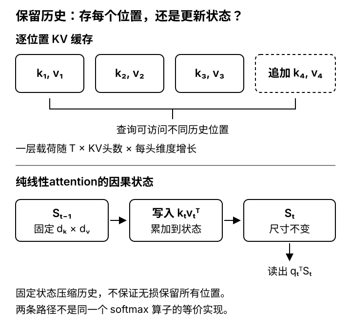

# 把计算花在哪里：Attention替代方案与MoE

## 1. 先分清：你要减少的是哪一笔成本？

长上下文与大参数量是两条不同的扩展轴。前者增加需要联系的历史位置，后者增加模型可学习的参数。本讲研究两种选择：**不让每个位置都与全部历史做同样昂贵的交互；不让每个token都调用全部参数。**

[L03模型架构](#/c/stanford-cs336-2026/lec/lec03?v=notes)负责标准块及现代架构取舍；Attention与RoPE的论文精读唯一正文在[L03材料](#/c/stanford-cs336-2026/lec/lec03?v=materials)。这里不重推标准Transformer或旋转位置编码。资源计数规则沿用[L02](#/c/stanford-cs336-2026/lec/lec02?v=notes)，位置与长度的实验设计回到[位置编码与长上下文](#/c/stanford-cs336-2026/lec/ext03?v=notes)。

| 改动 | 主要改哪一项 | 不自动解决什么 |
| --- | --- | --- |
| MHA改成GQA/MQA | KV头数、投影及缓存载荷 | 每个查询仍可能访问全部历史；不是线性时间attention |
| 窗口或稀疏attention | 参与交互的位置集合 | 远距离信息能否到达、索引器自身成本 |
| 更好的精确attention实现 | 中间量物化、访存与常数 | 不自动消除全局两两交互的二次工作量 |
| 线性attention或结构化状态模型 | 用有限状态替代逐位置保存与读取 | 不保证与softmax attention等价、同质量或更快 |
| MoE替代FFN | 总参数量与每token激活参数量的关系 | 总参数存储、路由、负载不均与通信 |

这些轴可以组合。判断一个“更高效”方案，至少要固定模型质量、输入长度、batch、精度和硬件，再分别报告容量、逻辑运算量与实测时间。本页只推导机制和条件，不给性能榜单。

## 2. 从共享KV走向改变历史表示

[L03 §6](#/c/stanford-cs336-2026/lec/lec03?v=notes)已区分MHA、GQA、MQA及其缓存账本：MHA各查询头有对应KV，GQA让一组查询头共享KV，MQA让全部查询头共享一组KV。本讲只保留这个对照：**共享KV不等于减少所有query，也不消除全局两两交互的二次项。** 接下来讨论的是进一步改变历史信息的保存与访问方式，而不是再调整一次KV头数；这段为编者衔接，不补进L04录像发言。

## 3. 线性attention：等价变形从哪里开始失效？

先看单头，$Q,K\in\mathbb R^{T\times d_k}$、$V\in\mathbb R^{T\times d_v}$。忽略位置编码，标准softmax形式是：

$$
Y=\operatorname{softmax}\!\left(
\frac{QK^{\mathsf T}}{\sqrt{d_k}}+M
\right)V,
$$

其中softmax沿key轴，$M$负责禁止未来或其他不可访问位置。三件事必须分开：

1. **改变求值方式**：不物化完整注意力矩阵，可以仍然计算同一个softmax算子。
2. **去掉softmax**：得到另一个算子；一般不再输出对value的非负归一化加权平均。
3. **在新算子内使用结合律**：这时才有下面的精确代数等价。

对**没有mask的纯双线性形式**：

$$
\begin{aligned}
(QK^{\mathsf T})V&=Q(K^{\mathsf T}V),\\
K^{\mathsf T}V&\in\mathbb R^{d_k\times d_v}.
\end{aligned}
$$

左侧形成 $T\times T$ 中间量；右侧先形成与长度无关的 $d_k\times d_v$ 矩阵。配对主项由 $O(T^2(d_k+d_v))$ 变为 $O(Td_kd_v)$。这里把维度看作固定量，且省略投影等共同成本；“对长度线性”不是“对模型宽度也线性”。

**不能把softmax移到括号外。** 一般不存在把 $\operatorname{softmax}(QK^{\mathsf T})V$ 直接改写为 $Q(K^{\mathsf T}V)$ 的结合律。课堂20:49–21:36的问答也明确区分：去掉归一化是模型改变；后续线性形式与相应递推的等价才是精确的。

### 因果形式不能偷看未来

对列向量 $q_t,k_t\in\mathbb R^{d_k}$、$v_t\in\mathbb R^{d_v}$，定义：

$$
\begin{aligned}
S_0&=0,\\
S_t&=S_{t-1}+k_tv_t^{\mathsf T},\\
y_t^{\mathsf T}&=q_t^{\mathsf T}S_t.
\end{aligned}
$$

展开得到：

$$
y_t^{\mathsf T}=\sum_{i\le t}
(q_t^{\mathsf T}k_i)v_i^{\mathsf T}.
$$

这与**下三角因果配对形式**等价，而不是与包含未来位置的完整 $Q(K^{\mathsf T}V)$ 等价。若定义只允许严格过去，应该先读取 $S_{t-1}$ 再更新；不能在不同表达式里偷偷更换mask。

对固定 $d_k,d_v$，逐token维护一个状态需要 $O(d_kd_v)$ 存储与每步主项计算；这只是该层在增量推理时的历史状态。训练反向保存集合、分块工作区以及混合架构中的全局attention缓存要另外算。

有些“线性attention”还使用特征映射、正值核与归一化分母。其线性复杂度依赖可分解核和固定特征维数；分母还须有明确的非零处理。不能把这些变体统称为“删掉softmax后与原模型完全一样”。本页只推导课堂采用的最简状态形式，不扩充未读论文。

*编者原创机制图。两条路径保留历史的方式不同，不是两个完全等价的模型；图中状态尺寸不随长度增长，不代表它保存了全部历史信息。*

## 4. 状态模型：控制保留、写入与定向覆盖

纯累加状态只会不断写入。课堂把Mamba-2与Gated DeltaNet放在同一条机制线上：在状态递推上增加输入依赖的控制。以下是**本讲的简化方程视角**，不是完整模型规格或相应论文精读。

### 保留门：旧信息传多少？

$$
\begin{aligned}
S_t&=\gamma_t S_{t-1}+k_tv_t^{\mathsf T},\\
\gamma_t&=f(x_t).
\end{aligned}
$$

$\gamma_t=1$ 恢复累加，$\gamma_t=0$ 丢弃旧状态。在通常的衰减解释中取 $0\le\gamma_t\le1$；这是解释前提，不是任意函数 $f$ 自动保证的性质。课堂还提到输出可另有从当前value直接经过的路径；那是与状态读出相加的项，不能把它误算成历史状态大小。

### 定向覆盖：不仅“再加一次”，还修正旧关联

课堂Gated DeltaNet形式为：

$$
\begin{aligned}
S_t={}&\gamma_t
(I-\beta_t k_tk_t^{\mathsf T})S_{t-1}\\
&+\beta_t k_tv_t^{\mathsf T}.
\end{aligned}
$$

$\beta_t=0$ 表示不写当前信息，**不表示整个状态不变**：旧状态仍乘 $\gamma_t$。把式子展开，更容易看见更新方向：

$$
\begin{aligned}
S_t={}&\gamma_tS_{t-1}\\
&+\beta_t k_t\left(
 v_t^{\mathsf T}-\gamma_t k_t^{\mathsf T}S_{t-1}
\right).
\end{aligned}
$$

括号里是当前value与旧状态沿key读出的差异。与反复累加同一key相比，这允许模型修改已有关联。

**手算对照。** 取 $d_k=2,d_v=1$、$S_{t-1}=(2,5)^{\mathsf T}$、$k_t=(1,0)^{\mathsf T}$、$v_t=7$，且 $\gamma_t=\beta_t=1$。纯累加给 $(9,5)^{\mathsf T}$，定向覆盖给 $(7,5)^{\mathsf T}$：第二方向不动，第一方向被更新为当前值。

只有在key单位范数且适当门值下，$I-k_tk_t^{\mathsf T}$ 才是严格的正交投影；一般门值对应部分修正，任意key长度下更不能保证“完整擦除”。讲者17:38–17:46也提醒了归一化条件，不能把直觉比喻写成无条件定理。

### 为什么这不等于普通LSTM的串行限制？

若一个层的输入已经给定，且递推写成 $S_t=A_tS_{t-1}+B_t$，其中 $A_t,B_t$ 只依赖该位置输入而不是上一状态，则仿射变换可以组合：

$$
\begin{aligned}
(A_2,B_2)\circ(A_1,B_1)
={}&(A_2A_1,\\
& A_2B_1+B_2).
\end{aligned}
$$

组合具有结合性，因此有构造并行扫描或分块计算的空间。但**存在并行表达不等于任意结构都便宜**：稠密状态转移、状态尺寸和kernel实现仍决定代价。若门必须先读取上一状态再产生，也不能直接沿用上述输入独立的预计算条件。

## 5. 混合与稀疏：不要把局部收益说成全网线性

课堂展示的MiniMax、Nemotron、Qwen例子保留部分全局softmax层。它们用于说明组合的可行性，不是本页独立复现的质量或吞吐结论。

若层数固定，仍有比例 $p>0$ 的全局attention层，那么总成本可以包含：

$$
C(T)\approx a(1-p)T+bpT^2,
$$

其中 $a,b$ 含层数、头数与宽度。降低 $p$ 可以显著降低某个实际长度下的成本，但只要保留二次项，渐近上就不能称整网严格线性。固定大小状态还要求把长历史压缩进有限表示；增加状态维度能缓解容量瓶颈，同时也增加成本。

**稀疏attention是另一条路。** 先选出每个query可访问的 $k$ 个位置，再在这些位置上做softmax。第二阶段的配对主项约为 $O(Tk(d_k+d_v))$，不是必须形成一个 $k\times k$ 的子序列自注意力矩阵。应按实际“每个query选择哪些keys”计数。

课堂DSA的索引器仍比较全体候选，带有全局两两打分，因此总方法不被讲者称为线性时间。较低维、较低精度的索引能让这部分更便宜，却没有凭空消掉它。稀疏化还需要训练或适配；不能只在已训模型上删掉大量位置，就假定质量不变。

## 6. MoE的账本：总容量与每token激活量

常见MoE把一个FFN替换为 $E$ 个候选FFN和router。输入 $x$ 得到分数，选中集合 $\mathcal I(x)$，输出为：

$$
f_{\rm MoE}(x)=\sum_{e\in\mathcal I(x)}g_e(x)f_e(x).
$$

这只是FFN子层的贡献；残差连接和归一化仍按整个块的定义安排。路由通常在**token级**发生，不是先判断整篇文章属于“医学专家”还是“法律专家”。上下文化输入可以携带信息，但专家编号本身不保证对应人类可命名的专业领域。

令每个路由专家有 $P_e$ 个参数，激活 $k$ 个；共享专家参数总数为 $P_s$，其余骨干参数为 $P_b$，router参数为 $P_r$：

$$
\begin{aligned}
P_{\rm total}&=P_b+P_s+EP_e+P_r,\\
P_{\rm active}&\approx P_b+P_s+kP_e+P_r.
\end{aligned}
$$

“active”仍须说明计数口径，尤其嵌入查表与各投影未必都能按同一规则折成FLOPs。对等尺寸普通FFN，其每token乘加主项才近似随被调用的专家参数量增长。

**自拟例子。** 一个路由层有8个等尺寸专家，每token选2个，无共享专家。不计router时，该层总专家参数是单个的8倍，激活专家主项是单个的2倍。把专家数从8增到16且保持 $k=2$，总专家参数翻倍，专家计算主项不变；router打分、存储、数据搬运等并不因此免费。

尤其要区分：

- 单token只触达少数专家，不代表一个batch只触达同样少的专家；不同token可能覆盖全部专家。
- 未被某个token选择的专家没有该token的FFN直接梯度，但它可能收到其他token的梯度。
- 全部专家仍需被存储和管理。训练中的优化器状态也不能简单按单token的激活比例删除。
- 减少逻辑FLOPs，不保证小batch、负载不均或通信较重时墙钟更快。

## 7. 路由不只有“做一个top-k”

| 路由方式 | 被约束的对象 | 需要承担的代价 |
| --- | --- | --- |
| token choice | 每token选择固定数目专家 | 各专家负载可能相差很大 |
| expert choice | 每个专家选择一批token | 每token获得的专家数量未必固定，须检查覆盖与预算 |
| 全局分配 | 同时优化token—专家匹配及容量约束 | 求解开销与在线部署复杂度 |
| hash baseline | 按固定映射分派 | 简单，但不能据输入学习同样的选择策略 |

课堂将token-choice top-k作为主要路线。即使采用它，也要说明**分数、选择和权重**三个步骤：

1. 得到每个专家的logit，例如 $z_e=w_e^{\mathsf T}x$。
2. 根据某种分数选择 $k$ 个专家。
3. 将选中专家输出按指定权重求和。

先对全部logits做softmax、再保留top-k，与先选top-k、再只在选中集合归一化，排序可能相同，**输出缩放和梯度却不同**。第二种权重和为1，第一种保留下来的权重和一般小于1。固定无并列的选择时，若 $k=1$ 且只在被选的单个logit上softmax，权重恒为1，这条权重路径无法给router提供任务梯度；并不意味着所有top-1模型都无法训练。

另外，选择用的分数也可以与输出权重不同：例如给专家打分加负载校正bias来决定入选，输出仍用不含bias的原始分数归一化。不要把调度偏置直接当成应加到专家结果上的数。

### 细粒度与共享专家

把一个大专家拆成较小专家，并适当增加被选数量，可以在相近激活预算下产生更多组合。共享专家则始终处理所有token，路由专家处理条件分支。

这两项不是免费叠加：共享专家也占激活预算；细粒度可能增加分派和小矩阵开销。课堂给出的DeepSeek与OLMoE消融对“共享专家是否获益”并不完全一致，因此合理结论是**它是一项应在固定预算下实验的选择**，不是“共享专家必然更好”。

## 8. 不可微选择，为什么仍有可训练的部分？

top-k的索引选择在边界处不连续，在选择不变的局部区域又不会对“换一个专家”给出梯度。但选中专家的输出以及连续门权重仍可求导。因此常见训练不是“反向自动探索了所有未选专家”，而是沿实际执行的分支更新，再用其他机制避免路由坍缩。

未选中的FFN不会被任务损失评估，不能得到它的反事实质量；若门采用全专家softmax，未选logit仍可能通过归一化分母收到梯度。这与“未选专家参数参与了前向计算”是两回事。链式法则和autograd的责任边界见[反向传播桥接](#/c/stanford-cs336-2026/lec/bridge03?v=notes)。

课堂介绍过策略梯度、随机扰动和启发式损失三类思路，也强调随机扰动并非每个现代配方都必需。主要问题是正反馈：专家更常被选择，得到更多训练信号，进一步变强，其他专家逐渐饥饿。

### 一个明确的top-1负载损失

对 $T$ 个token、$E$ 个专家，令 $p_{te}$ 为全专家softmax概率，$f_e$ 是硬分派给专家 $e$ 的比例，$\bar p_e$ 是平均概率：

$$
\begin{aligned}
f_e&=\frac1T\sum_t
\mathbf1[\operatorname{argmax}_j p_{tj}=e],\\
\bar p_e&=\frac1T\sum_t p_{te},\\
\mathcal L_{\rm bal}&=\alpha E\sum_e f_e\bar p_e.
\end{aligned}
$$

把硬计数 $f_e$ 当作不反传的统计量，则：

$$
\frac{\partial\mathcal L_{\rm bal}}{\partial p_{te}}
=\frac{\alpha E}{T}f_e.
$$

被分派得越多的专家，对应概率获得越大的正惩罚系数；梯度下降倾向减少这部分质量。若继续求到logits，必须经过softmax的耦合导数，不能说每个logit都具有相同方向的“负梯度”。

这是一个有用的启发式，不是硬容量约束，也不是对任务最优分派的证明。top-k版本应重新声明计数分母：统计token比例还是分派次数比例？不能把top-1公式无说明地套进去。

若 $f_e=\bar p_e=1/E$，该损失为 $\alpha$；若所有token及概率都集中到一个专家，则为 $\alpha E$。这两个特例说明惩罚意图，不证明对任意概率与分派组合都以均匀点为全局唯一最小值。

## 9. 三种不同风险，不用一种损失包治百病

| 风险 | 应观察什么 | 可能的干预及边界 |
| --- | --- | --- |
| 负载坍缩 | 专家token计数、门概率、空闲专家、按设备聚合负载 | 平衡损失或选择bias；过强均匀约束也会干扰任务目标 |
| 数值不稳定 | router logits、非有限值、损失尖峰 | router关键运算用较高精度、稳定归一化、z-loss；不是给整个模型都改成fp32 |
| 有限容量溢出 | 超容量次数、丢弃分派比例、不同batch组合的输出变化 | 明确容量与dropless策略；不保证所有实现都已消除此问题 |

router的z-loss常对log-partition施加惩罚：

$$
\mathcal L_z=\frac{\lambda}{T}\sum_t
\left(\log\sum_e\exp z_{te}\right)^2.
$$

它与负载损失解决的问题不同。所有logits加同一个常数，softmax分布不变，但log-partition改变；因此z-loss可约束分数整体尺度而不等同于“把路由变均匀”。数值稳定的通用诊断回到[稳定计算与梯度诊断](#/c/stanford-cs336-2026/lec/ext01?v=notes)。

有限容量下所谓“token dropping”，通常是略过某次专家分派，不是从文本里删掉该token。若一个请求是否获得该分支取决于同批其他token，输出就可能受batch组成影响；这不能简单归因于采样温度。dropless避免这种丢弃，但负载不均和资源分配仍需处理。

专家分布到不同设备时，要运送激活并汇合结果。复制共享专家、限制候选设备或压缩通信激活，都是容量、表达与通信之间的交换。本讲止于这个边界，不展开集合通信、并行拓扑或kernel实现。

## 10. 组合架构的最后几块，不要混成一种机制

- **Upcycling**：用已训稠密模型初始化多个专家并继续训练。复制参数本身不会产生训练收益；训练预算、路由对称性的打破和后续数据才使它成为可比较的方案。
- **微调**：参数多而每个专家实际看到的数据少，可能加剧小数据过拟合。只调整部分非MoE组件与增加数据是不同干预，不能由一个课堂例子推出通用最佳配方。
- **MLA**：把KV内容通过低维潜变量表示，缓存潜变量而不是完整展开的每头KV。若能把线性上投影合并进查询等计算，便能避免为每次读取重新显式展开全部内容。它与GQA的“多查询共享KV头”不是同一结构，也不等于固定大小的递推状态：潜变量仍按历史位置缓存。
- **RoPE与MLA**：位置相关旋转可能阻止原本固定矩阵的直接合并。课堂只点到把位置分支与压缩内容分开；RoPE本身的数学与约定见[L03材料中的RoFormer精读](#/c/stanford-cs336-2026/lec/lec03?v=materials)，这里不重推，也不提供完整MLA实现。
- **MTP**：增加预测更远未来token的训练目标，可以为后续推理策略提供组件；它既不是MoE的定义，也不自动意味着一次预测多个token就能无条件并行接受。本讲只保留其在录像结尾的定位。

## 11. 自测：每个答案都先写限制条件

1. **GQA把KV头数减为四分之一，是否证明全网FLOPs减为四分之一？** 不能。KV缓存载荷在固定条件下同比减少，查询头、FFN及其他计算不同比减少。
2. **线性attention的递推与softmax attention等价吗？** 不等价。递推等价的是同一mask下的线性配对算子；删掉softmax已改变模型。
3. **$\beta_t=0$ 是否保证 $S_t=S_{t-1}$？** 还需 $\gamma_t=1$；否则旧状态仍衰减。
4. **7层线性加1层全局attention，是严格线性网络吗？** 不是。固定结构仍有全局二次项；实际成本可以明显降低。
5. **总专家翻倍、每token仍选2个，是否内存和路由成本都不变？** 不。只有固定专家大小下的激活专家计算主项不变。
6. **top-k索引不可微，是否所有router参数都没有梯度？** 不。连续门权重与辅助目标仍可提供梯度，但不同归一化方案的路径不同；不能凭梯度得到未执行FFN的反事实输出。
7. **z-loss能否替代负载均衡？** 不能。控制log-partition与控制分派频率是不同目标。
8. **“专家”一定是人类可命名的领域专家吗？** 不。必须观察实际路由与功能，不能从名字推断专业分工。

## 全片时间导航

以下为编辑主题边界，按字幕起点取整到秒；不是视频自带章节。精确cue归属与空隙见来源记录。全部1938条cue各归属一次，不表示无字幕区间已被听辨。

| 时间 | 回看问题 |
| --- | --- |
| 00:00–00:05 | 开头无字幕 |
| 00:05–01:33 | Attention与MLP分别要改变什么？ |
| 01:33–05:13 | 长上下文成本、局部/全局组合、精确attention的系统优化 |
| 05:13–09:55 | 去softmax、结合律与因果递推 |
| 09:55–11:12 | MiniMax混合例子与保留全局层 |
| 11:12–14:17 | 输入依赖门与Mamba-2的课堂视角 |
| 14:17–19:03 | Gated DeltaNet、定向覆盖与Qwen混合例子 |
| 19:03–22:52 | 混合比例的质量权衡；等价性与直通项问答 |
| 22:52–27:30 | 稀疏索引、DSA与适配阶段 |
| 27:30–34:23 | 索引成本、精度、稳定性及有限状态问答 |
| 34:23–47:24 | MoE的容量/计算动机、采用情况与边界问答 |
| 47:24–52:57 | token/expert choice、hash、RL和全局分配 |
| 52:57–58:27 | top-k权重、细粒度与共享专家 |
| 58:27–63:13 | 稀疏训练的难点与随机扰动路线 |
| 63:13–71:39 | 平衡损失、bias、坍缩与语义分工问答 |
| 71:39–76:36 | 系统边界、激活压缩、容量与丢弃 |
| 76:36–79:41 | router精度、z-loss、小数据微调 |
| 79:41–82:12 | Upcycling及其继续训练含义 |
| 82:12–83:50 | DeepSeek v1/v2/v3的组合设计 |
| 83:50–85:05 | MLA与位置分支 |
| 85:05–85:41 | MTP预告 |
| 85:41–86:15 | 稀疏参数总结 |
| 86:15–86:20 | 末尾无字幕 |

## 来源、版本与处理边界

- Tatsunori Hashimoto，Stanford CS336 Spring 2026，课表2026-04-08 L04；Stanford Online标题为“Lecture 4: Attention Alternatives”，上传2026-04-15。视频ID `cKSwj_qZ8Jg`，单视频时长86:20；播放列表的86:21不用于本页。观看入口在页头，正文不另插按钮或时间跳转链接。
- 全部1938条en-US字幕已读，范围00:05.200–86:15.510。manual/non-ASR仅为平台类别，不等于人工逐词校订；未核音、未观看录像画面、未截帧。17处内部大于2秒的空隙、两端空隙及不可辨/疑词记录见[有限课堂译述](#/c/stanford-cs336-2026/lec/lec04?v=draft)和 `sources/p3-lec04/`。
- [固定L04讲义PDF](https://github.com/stanford-cs336/lectures/blob/de53a9f979a6ee35f7d13a5e1aadee5ea1afc58e/lecture_04.pdf)：提取文本1–502行完整读，PDF共60页；视觉核读第7、9、31、40、42、48、56、58页的公式和邻接说明，不声称全部图表或外引论文已精读。主题定位：§线性/状态模型对应PDF第4–13页，MoE路由第25–35页，训练/平衡第36–43页，稳定性与组合第48–60页。固定提交时间2026-09-12，晚于学期，录像时序始终取自字幕。
- [固定L03讲义PDF](https://github.com/stanford-cs336/lectures/blob/de53a9f979a6ee35f7d13a5e1aadee5ea1afc58e/lecture_03.pdf)仅经提取文本674–765行选读MHA/GQA/MQA背景，本文只作衔接回链；状态手算、复杂度与梯度澄清为编者独立组织，不是L04额外课堂发言。
- L04 PDF第56页将v3标题下写成“V2”、专家数写成258，与第35页表中的256不一致；旁注称“Sigmoid+Softmax”，但所示公式是sigmoid分数在选中集合求和归一化，并不再次做指数softmax。本页不复制可疑产品参数表，也不以未读技术报告填补；通用路由分析明确区分这两种运算。
- 课堂提到的Mamba-2、Gated DeltaNet、Switch、OLMoE与DeepSeek等是讲义/字幕中的引用线索，不因此变成本页已全文读过的独立论文。两篇指定核心论文仍只回链[L03材料](#/c/stanford-cs336-2026/lec/lec03?v=materials)，不建重复materials页。A1只提供[概念与任务指导](#/c/stanford-cs336-2026/lab/a1-basics?v=guide)，没有可提交实现。
- 录像与讲义未确认开放全文翻译许可，第三方图像也不继承课程授权。本文仅自主解释、有限来源定位与原创SVG；原始字幕、规范化全文和PDF只留本地。精确URL、原获取日期、完整SHA256与实际阅读范围保留在 `sources/p3-lec04/manifest-fragment.json`，不把采集、阅读、撰写、审查、页面验收和课程实验混成同一种完成。
