# GPU与TPU：把硬件约束变成性能推理

## 1. 本讲要解决的不是“GPU很快”

同样写 `A @ B`，为什么矩阵只大一行，吞吐会骤降？为什么增加计算反而可能更快？为什么模型能装进显存，计算单元却仍然吃不饱？

本页沿**硬件约束 → 资源下界 → 可证伪的性能解释**组织，不逐段翻译课堂。基础字节账本、FLOPs约定与计时纪律复用 [bridge08](#/c/stanford-cs336-2026/lec/bridge08?v=notes)，矩阵乘反向与训练资源复用 [L02](#/c/stanford-cs336-2026/lec/lec02?v=notes)。本讲新增的是：这些账项如何映射到芯片，以及理想模型为什么不足以解释真实曲线。

**读完应能回答：**

1. thread、warp、block、SM为什么不是四种大小不同的“核”？
2. 算术强度到底对哪一层内存计数？
3. fusion、tiling、coalescing分别省下什么？
4. 低精度、重算、padding为什么都不能无条件加速？
5. GPU与TPU哪些直觉可以迁移，哪些实现细节不能照搬？

## 2. 一份计算有逻辑身份，也有物理落点

课堂对应 **07:31–17:18**；以下表格与图为编者重组。

| 对象 | 描述什么 | 不要误认为 |
| --- | --- | --- |
| thread | 一条逻辑执行流及其状态 | 一颗独占的物理运算器 |
| warp | NVIDIA中32个线程组成的执行组 | 一个线程块，或整个GPU同时执行同一条指令 |
| block／CTA | 可以合作和同步的一组线程 | 永远独占一个SM的任务 |
| grid | 一次kernel启动的block集合 | 所有block必定同时驻留 |
| SM | 执行block的物理资源集合 | 一个只能处理单个线程的CPU式核 |

普通CUDA block的线程在同一个SM上执行；一个SM在资源允许时可共驻多个block。不同block不能依赖某个特定调度顺序。若把“前一个block应该先写完”当算法条件，换设备或输入规模就可能暴露错误。

*原创示意，不按晶体管数量或面积绘制。默认普通block模型；新架构的cluster和分布式shared memory是显式扩展，不是任意block之间自动共享。*

### 2.1 容量、带宽、延迟是三件事

- **容量**回答“能保存多少数据”；增加容量并不保证每秒搬得更多。
- **带宽**回答“持续搬运能达到多少byte/s”；依赖访问模式和并发请求。
- **延迟**回答“一次依赖性访问等多久”；许多就绪warp可以在别的warp等待期间工作，但不能凭空消除带宽上限。

HBM容量很大，register和shared memory很小但离计算近。L1 cache由硬件缓存策略管理；shared memory是程序可管理的片上暂存区，两者在若干架构中共享物理资源，不是同一个API。

**名字尤其容易误导：CUDA `local memory`的“local”指线程私有作用域，不保证位于片上。** 寄存器溢出等情况可能使用设备内存中的local地址空间。课堂16分钟附近的简化说法不能直接当物理存储规范。

### 2.2 分歧不是“所有if都有罪”

课堂 **32:57–34:53** 用两条分支的串行执行解释warp divergence。准确判断对象是**同一warp中活动线程的执行路径**：若所有线程选择同一分支，就没有这种路径分歧；短条件也可能由编译器转换为predication。

不能为了“去掉if”删除边界mask，更不能认为把非法读取结果乘0便安全。正确性先于是否让每条lane都忙碌。现代独立线程调度也意味着，不能靠“看起来锁步”代替需要的同步。

## 3. Roofline是上界，不是跑分预测器

课堂 **30:09–32:57** 回顾roofline。这里把L02的公式推进到**实现和内存层级**。

固定运算模式与某层内存，令：

- $F$：本次有用计算工作量，单位FLOP；
- $Q_h$：穿过该层边界的实际字节数；
- $C$：匹配dtype、稠密/稀疏和运算类型的计算峰值；
- $\beta_h$：该层可用带宽。

$$
I_h=\frac{F}{Q_h},\qquad
I_h^*=\frac{C}{\beta_h}.
$$

$$
t\ge\max\left(\frac{F}{C},\frac{Q_h}{\beta_h}\right).
$$

$$
P_{\mathrm{achieved}}\le\min(C,\beta_h I_h).
$$

这是假设计算与搬运可理想重叠的下界；启动、依赖、非满块、调度和同步会让实际时间更长。**HBM的$Q_h$不能搭配shared memory的带宽。** 同一个算法在HBM层面不受限，仍可能受寄存器/片上访存或指令吞吐限制。

*原创定性图：横纵轴为对数概念刻度，不含实测点。向右表示增加同一计量口径下的数据复用；上移计算屋顶不一定改变左侧带宽限制。*

### 3.1 一个可手算、但不是实测的例子

设假想硬件 $C=100$ TFLOP/s、$\beta=1$ TB/s，则转折点为100 FLOP/byte。某kernel做1 GFLOP、搬20 MB：

$$
I=50\ \mathrm{FLOP/byte},
$$

$$
F/C=10\ \mu s,\qquad Q/\beta=20\ \mu s.
$$

理想下界20微秒。若复用让搬运降到5 MB而工作量不变，下界降到10微秒；不是5微秒，因为计算开始限速。反过来只把计算峰值翻倍，最初20微秒的带宽下界不变。以上均为十进制单位的编者假设，不对应任何GPU测量。

**“一定要到计算受限区才高效”也不成立。** 一个本来只做一次逐元素运算的任务，可以已经充分利用带宽；人为添加无用FLOPs只会美化算术强度，不能让用户更早拿到结果。目标是同一语义下的时间，而不是把图上的点推到某处。

### 3.2 一个必须保留的课堂自纠

讲义p25把8 byte/FLOP称为Intensity；但字幕 **36:11.130–36:16.430** 中讲者已指出这是算术强度的倒数。按“每个元素读一次、完整写一次输出，比较记一个操作”的玩具口径：FP32 ReLU是8 byte/元素，强度为$1/8$；FP16是4 byte/元素，强度为$1/4$。这里的比较计数不等于Tensor Core FLOP峰值可直接用于ReLU。

讲义括注“负值才写”与这个完整输出模型不同；不要一边按条件写入，一边仍固定算两次传输。原地条件写入的逻辑写入量、真实事务、cache行为又是另一份账。

## 4. 三种省搬运的方法，不能混成一句“用缓存”

### 4.1 Fusion：不把中间结果公开到全局存储

课堂 **47:43–50:13**。编者例子是先算 $u=2x+1$，再算 $y=\max(u,0)$。假设两阶段分别实现、FP32、每阶段读写一遍，且无cache复用：每元素搬16 byte。若中间$u$只在片上使用，读$x$与写$y$共8 byte，工作量基本不变。

这是**逻辑全局读写量**的减半，不承诺时间减半；小输入可能主要省启动成本，大输入可能主要省带宽。若融合使寄存器压力暴涨或减少并行度，仍可能变慢。不同kernel之间也并非每次必然物理访问HBM芯片：L2可能缓存数据；应区分global地址空间和实际HBM流量。

### 4.2 Coalescing：一次请求尽量载满有用数据

课堂 **52:52–57:51**。相邻线程同一时刻访问相邻地址，更容易由少量事务服务；这与“一个线程自己一路顺序读”不是同一问题。

对行主序FP32矩阵，固定行、相邻lane访问相邻列，其地址差为4 byte；固定列、相邻lane访问相邻行，地址差为行宽乘4 byte，可能跨很多段。于是应该问**lane到地址的映射**，而不是背“按行快、按列慢”的口号。

编者补充：NVIDIA Best Practices §10.2.1对compute capability≥6.0的模型用32-byte事务计数。对齐的32个相邻FP32元素共128 byte，由4个32-byte事务服务；偏移一个元素后可能跨5段。课堂“一个128B burst/cache line”适合直觉，不是所有设备只有一种128B事务的精确规范。

### 4.3 Tiling：让一次读入服务多个输出

课堂 **57:51–62:32**。设方阵 $A,B\in\mathbb R^{N\times N}$，输出也为$N\times N$。忽略cache，每个输出独立从HBM读两个长度$N$向量，会读约$2N^3$个输入元素。

把输出切成 $T\times T$ 块，每一段缩并轴读两个 $T\times T$ 输入块：

$$
F_{\mathrm{stage}}\approx2T^3,
\qquad Q_{\mathrm{stage}}=2bT^2.
$$

$$
I_{\mathrm{stage}}\approx\frac{T}{b}.
$$

这里$b$为输入每元素字节数；阶段式暂未计最终输出写入。每个输入大约从HBM读$N/T$次，而非$N$次。**省的是跨慢层重复读取，不是把数学乘法次数减少$T$倍。** 真实kernel还有L2复用、不同输入/累加dtype和多级分块；细到$B_M,B_N,B_K$的容量账放在 [L06](#/c/stanford-cs336-2026/lec/lec06?v=notes)。

## 5. 为什么更大的矩阵反而出现低谷

课堂 **62:32–69:20** 中有两种“取整”，要分开。

### 5.1 Tile量化：尾块大半是无效位置

固定 $T=128$，$256\times256$输出只需4块；$257\times257$需9块。若每块都按完整128平方调度，有用输出比例为：

$$
\eta_{\mathrm{tile}}=
\frac{257^2}{9\times128^2}\approx44.8\%.
$$

这不是硬件利用率实测，也不代表每个padding位置一定执行全部算术。它揭示：固定tile尺寸时，维度微小变化可以改变离散工作包数量。mask保护边界正确性，但不能让边缘块免费。

### 5.2 Wave量化：最后一批缺任务

讲义p48／字幕 **68:12.670–69:20.569** 的例子使用$256\times128$输出tile。方阵边长1792时：

$$
G=7\times14=98.
$$

边长1793时两个方向都向上取整：

$$
G=8\times15=120.
$$

在**108个SM、每SM一次只容纳一个这类block、各block耗时近似相同**的简化模型中，98块一波，120块两波，第二波仅12块。因此实际时间可能突增。不要写成GPU永远只能一SM一block，也不要把两波理解为所有SM必须在全局栅栏前停齐。

更一般地，若每SM可共驻$r$个相同block，共$S$个SM，简化槽位数为$Sr$，波数约为$\lceil G/(Sr)\rceil$。真实$r$还受寄存器、shared memory、warp/block上限等约束，不能直接从矩阵大小推出。

**Padding不是无条件建议。** 补齐可以改善对齐或库的kernel选择，但增加内存和无用计算；若补的是词表，不能让补出的logit参与本来不存在的类别归一化。比较必须保持原任务语义，测完整路径而非只测补齐后的孤立矩阵乘。

## 6. 低精度与重算：拿别的资源换搬运

### 6.1 低精度同时改变数据量、计算峰值和误差

课堂 **34:53–47:43**。输入dtype、累加dtype、输出dtype、保存的主副本以及量化scale应分别记录。“用FP8”不代表所有数据和所有中间运算都是8 bit。将输入位宽减半也不保证整个step快两倍：量化/反量化、转置副本和非矩阵部分仍耗时。

**块缩放让转置不再只是交换stride。** 若缩放分组沿某一轴每32元素一组，转置后的分组成员变了；旧整数/低比特载荷配原scale不一定符合新布局。课堂提到训练实现可能保留两种量化方向的副本，这是一种实现选择，不是所有FP8张量的必然存储规则。

**FP4名称冲突需要显式校正。** 讲义p29及字幕43分钟附近称MXFP4，却描述16值共享E4M3 scale。NVIDIA官方技术文的Table 1与“What is NVFP4?”区分：

| 格式 | 分组及scale |
| --- | --- |
| MXFP4 | 32个E2M1值共享一个2的幂缩放因子 |
| NVFP4 | 16个E2M1值共享E4M3缩放，另有每tensor FP32缩放 |

因此本页把课堂这组参数视为**名称与格式描述冲突**，不把它登记为MXFP4规格；这不是字幕提取才产生的错误，原PDF同样如此。这里也不把推理演示的精度结论推广成所有大模型可稳定FP4训练。

### 6.2 重算要用时间不等式判断

课堂 **50:13–52:52** 强调：额外做一点计算，有时可以免去昂贵中间激活的写回与读回。编者用一个非重叠、忽略额外启动的简化边际模型表示：

$$
\Delta t\approx
\frac{\Delta F}{C_{\mathrm{eff}}}
-\frac{\Delta Q}{\beta_{\mathrm{eff}}}.
$$

只有当新增计算时间小于节省搬运时间，才预测加速。若节省20 MB、有效带宽1 TB/s，省20微秒；新增0.5 GFLOP、有效算力50 TFLOP/s，花10微秒，模型预测净省10微秒。若新增2 GFLOP则花40微秒，可能更慢。均为假设算例；存在重叠时不能直接相减，必须回到实际关键路径。

重算还可能主要为容量服务：即便变慢，也可能让原本放不下的batch能训练。更完整的activation checkpointing需求见 [A2指导](#/c/stanford-cs336-2026/lab/a2-systems?v=guide)，这里不提供实现。

## 7. TPU：迁移原则，不迁移GPU术语的全部含义

课堂 **17:18–22:41** 是短比较，不是TPU编程教程。可迁移的原则是：高吞吐矩阵单元、有限片上存储、较大但较慢的外部存储，以及在计算与搬运间做取舍。

不能直接迁移的包括NVIDIA warp=32、SM数量、CUDA同步原语、寄存器分配规则和互连拓扑。尤其 **TPU TensorCore**通常是处理器级部件名称，而 **NVIDIA Tensor Core**指专用矩阵运算单元；同名不意味着一一同级。

课堂用更少、更大的矩阵单元对比GPU的较多较小单元，帮助解释形状和利用率；不能据此断言所有TPU代际只支持某个最小矩阵尺寸，或GPU/TPU底层电路完全相同。软件编译栈也不是硬件别名：XLA可面向多种后端，区别见L06。

## 8. FlashAttention在这里负责串起直觉，不重做论文

课堂 **71:52–77:16** 把tiling、融合、在线归一化与反向重算连起来。对已经给定的$Q,K,V$，attention核心包含两次矩阵乘：

$$
\begin{aligned}
S&=QK^\top/\sqrt d,\\
P&=\operatorname{softmax}(S),\\
O&=PV.
\end{aligned}
$$

$Q,K,V$的投影是另一个计数范围。讲义p51／字幕出现“三次矩阵乘”的表述，不能拿来把这个核心式数成三次。

真正的障碍是：每块分数不能各自独立归一化后直接拼起来，必须维护全局一致的行归一化。FlashAttention不是“把完整$N^2$概率矩阵搬进SRAM”，也不是把dense attention FLOPs改成线性。

- 数学与小数值例： [在线softmax专题](#/c/stanford-cs336-2026/lec/ext05?v=notes)。
- attention逐项资源账： [ext04](#/c/stanford-cs336-2026/lec/ext04?v=notes)。
- 固定FlashAttention v2与FA2 v1的算法、实验边界：仅在 [L06论文精读](#/c/stanford-cs336-2026/lec/lec06?v=materials)。

## 9. 自测：先定位约束，再给建议

1. 把GPU算力翻倍，memory-bound kernel会快两倍吗？

不一定。固定$Q$与带宽时，搬运下界不变。还要看启动、布局和实际计算模式；给ReLU套低精度矩阵峰值尤其不对。

2. Tiling和coalescing都减少HBM成本，它们是不是同一个优化？

不是。tiling减少相同数据跨慢层反复搬运；coalescing减少一个warp访问所需的事务/无用载荷。一个实现可以有良好复用却访问散乱，也可以访问连续却反复读取同样数据。

3. 98块能一波，120块要两波，为什么不是通用GPU定律？

例子假设108个SM且每SM仅容纳一个此类block、时长接近。改变资源占用、SM数量、block大小或调度，波数与尾部开销就会不同。

4. 三个位置各自做softmax，再把结果拼接，能得到全行softmax吗？

不能。每组的分母不同，拼接后总概率通常大于1。跨tile必须协调归一化状态；细节在ext05，不因硬件分块而改变数学语义。

5. 为什么8 byte/FLOP不是算术强度？

本页按FLOP/byte定义强度，它的倒数才是byte/FLOP。课堂已在36:11–36:16自纠；不能只抄幻灯片而遗漏这次纠正。

## 全片导航

以下边界来自**本讲全部1925条字幕**，显示到秒（截去毫秒）；分块是编者导航，不是官方章节。精确毫秒、每块cue范围及8个内部大于2秒的缺口保存在来源记录；无字幕不等于静音。

| 时间 | 导航问题／内容 |
| --- | --- |
| 00:00–00:05 | 开头无字幕 |
| 00:05–04:15 | 课程目标与资源 |
| 04:15–07:31 | 计算扩展与并行化 |
| 07:31–13:27 | CPU/GPU、SM与存储层级 |
| 13:27–17:18 | thread、block、warp与访存 |
| 17:18–22:41 | GPU与TPU的对应及差异 |
| 22:41–30:09 | Tensor Core、内存墙与硬件问答 |
| 30:09–32:57 | roofline与优化目标 |
| 32:57–34:53 | 控制流分歧 |
| 34:53–37:51 | 低精度与混合精度 |
| 37:51–42:47 | MXFP8、缩放和转置 |
| 42:47–47:43 | FP4及量化问答 |
| 47:43–50:13 | 算子融合 |
| 50:13–52:52 | 重计算与访存 |
| 52:52–57:51 | 合并访存与行列布局 |
| 57:51–62:32 | 矩阵分块与数据复用 |
| 62:32–66:16 | 边界块、对齐与padding |
| 66:16–69:20 | 矩阵吞吐波动与wave量化 |
| 69:20–71:52 | 小结与SRAM等问答 |
| 71:52–77:16 | FlashAttention硬件直觉 |
| 77:16–78:34 | 课程收束与掌声 |
| 78:34–78:39 | 末尾无字幕 |

## 来源、阅读与限制

- Tatsunori Hashimoto，Stanford CS336 Spring 2026 L05，课表2026-04-13；[Stanford Online录像](https://www.youtube.com/watch?v=izZba4UA7iY)，78:39，上传2026-04-20，上传日不推定为录制日。实际全读1925 cues，00:05.120–78:34.210；9 cues含`INAUDIBLE`。未核音、未看录像画面、未截帧。
- [固定讲义PDF](https://raw.githubusercontent.com/stanford-cs336/lectures/de53a9f979a6ee35f7d13a5e1aadee5ea1afc58e/lecture_05.pdf)：55页，提取文本1–535行全读；另实际渲染核读p21、25、29、48、51。其他图像及外链资料未全部逐图读取；不把学期后提交等同录制时版本。
- 编者核对：[NVIDIA CUDA Programming Model](https://docs.nvidia.com/cuda/cuda-programming-guide/01-introduction/programming-model.html)，[Writing SIMT Kernels](https://docs.nvidia.com/cuda/cuda-programming-guide/02-basics/writing-cuda-kernels.html)的shared/register/local说明；[Best Practices](https://docs.nvidia.com/cuda/cuda-c-best-practices-guide/index.html) §10.2.1、§10.2.3.1及§13.1。读取时为13.5文档，不是课堂软件版本；相应快照归L06来源分片。
- 编者核对：Alvarez等，[Introducing NVFP4 for Efficient and Accurate Low-Precision Inference](https://developer.nvidia.com/blog/introducing-nvfp4-for-efficient-and-accurate-low-precision-inference/)，2025-06-24，实际读正文，格式校正依据Table 1和NVFP4定义；不采用页面自动生成摘要作为证据，不转载厂商图片或性能图。
- 本文推导、假设数值和SVG均为编者原创。视频、讲义和第三方插图开放翻译/再发布许可未确认；只做自主教学与有限译述，[draft](#/c/stanford-cs336-2026/lec/lec05?v=draft)不是全译替代品。哈希、实际阅读窗口、疑词和缺口见来源分片；未测GPU性能、未执行作业，环境与政策回到[公共资料](#/c/stanford-cs336-2026)。
