# Kernel与Triton：先证明数据归属，再优化硬件映射

## 1. 一条kernel要过两道关

**语义关：** 每个输出由谁负责？需要哪些输入？指针、归约轴、边界mask和同步是否正确？

**性能关：** 正确的工作怎样落到有限SM、warp、register和shared memory上？为什么测到的时间会随shape和编译版本变化？

本页是编者按这两道关重组的学习材料，不是课堂源码译写。硬件动机与roofline见 [L05](#/c/stanford-cs336-2026/lec/lec05?v=notes)，基础张量stride见 [bridge05](#/c/stanford-cs336-2026/lec/bridge05?v=notes)，完整测量方法见 [ext06](#/c/stanford-cs336-2026/lec/ext06?v=notes)。这里不给可直接提交的Triton/FlashAttention实现；[A2概念与调试指导](#/c/stanford-cs336-2026/lab/a2-systems?v=guide)另有官方AI政策边界。

## 2. Triton的block首先是逻辑数据块

课堂 **36:51–50:41** 从逐元素GELU引入Triton。传统CUDA SIMT写法偏向描述每个thread；Triton写法描述一个program instance处理的一块数据，再由编译器分配到线程和存储资源。

| 词语 | 本页采用的含义 |
| --- | --- |
| program ID | 当前逻辑program instance的网格坐标，不是SM编号 |
| grid | program instances的启动范围 |
| tile | 一块逻辑数据，可以在同一个program中迭代多个tile |
| `BLOCK_SIZE` | 示例中每个tile的元素数，不自动等于CUDA线程数 |
| `num_warps` | 影响program实现的执行配置之一，不等于输入行数 |
| `tl.load` | 按指针与mask取值的语义，不承诺“先全部放shared memory” |

**源码中的 `BLOCK_SIZE = 1024 # Number of threads` 是教学简化，不应保留为API定律。** 同一课 **52:47–53:18** 又展示一个线程处理8个元素的thread coarsening；逻辑元素数与线程数显然不能一一对应。对于本课常规CUDA后端例子，可以用一个program映射一个CTA理解；不要外推到所有新后端/cluster执行配置。

### 2.1 一个不需要写GPU代码的归属证明

假设长度$N=10$，逻辑块宽$B=4$，需$\lceil10/4\rceil=3$个program。program $p$的局部位置$r$对应：

$$
i=pB+r,\qquad 0\le r<B.
$$

只有$i<N$是有效位置。

*原创$N=10,B=4$示例。每格是逻辑元素，不是物理线程；最后两格不得读写实际输入输出。*

这能同时证明三件事：

1. **覆盖：** 任意合法$i$可写成$p=\lfloor i/B\rfloor$、$r=i\bmod B$。
2. **唯一：** 这种商余分解唯一，因此无两个program重复写同一个输出。
3. **边界：** 尾块的$i=10,11$存在于逻辑tile，但不存在于用户张量，load与store都必须保护。

mask控制的是访存是否发生。先无条件越界读，再用结果乘0，不会把非法访问变合法。纯逐元素代码中，masked-off值不影响别的位置；一旦有归约，就必须给无效位置一个正确的代数值。

## 3. 指针、stride与mask：三份契约不能省

### 3.1 指针不是“张量自动懂我的轴”

对二维张量$X\in\mathbb R^{M\times N}$，若stride以元素为单位，位置$(i,j)$的偏移是：

$$
\operatorname{offset}(i,j)=i s_0+j s_1.
$$

typed pointer加这个偏移时，元素类型决定实际字节跨度；不要再偷偷乘一次元素字节数。`row * N + col`仅适用于相应连续行主序布局。传了row stride仍不等于支持任意layout：若列方向仍直接加`col`，就隐含$s_1=1$。

编者例子：一个连续$(2,3)$张量stride为$(3,1)$；它的转置视图shape为$(3,2)$、stride为$(1,3)$。转置后$(1,1)$偏移是$1+3=4$，不是按新shape连续化得到的3。该例只核对地址逻辑，不提供kernel实现。

### 3.2 填充值由运算决定，不由“padding通常补0”决定

| 后续运算 | 无效位置常见填充值 | 原因与前提 |
| --- | --- | --- |
| sum | 0 | 加法单位元 |
| max | $-\infty$ | 不改变非空有效集合的最大值 |
| 乘加缩并 | 0 | 缩并轴越界项不贡献乘积 |
| softmax logits | $-\infty$ | 有限有效最大值下，指数贡献为0 |

输出mask只防止写到非法地址，**不能补救无效值已经污染了归约结果**。同样，形状padding mask、用户语义mask、causal mask不是一回事：前者表示地址不存在，后两者可能对应合法地址但不应参与数学计算。合并它们之前先说明各自作用域。

### 3.3 验证不只看随机方阵

正确性检查至少应覆盖：不可整除尺寸、单元素/单行、支持的stride布局、dtype与累加精度、极端数值，以及mask边缘。若接口只支持连续输入，应明确限制，不要在未验证layout的情况下声称通用。

浮点归约顺序可因并行化改变；比较需与任务要求和dtype相符，不能承诺逐bit一致。对于真实训练算子，还需核对梯度和保存状态；“前向allclose一次”不是训练正确性的证明。

## 4. 行归约：局部看像张量，全局必须共享分母

课堂 **57:15–65:23** 假设整行可由一个program承载。对一行有限有效值$x_j$：

$$
m=\max_j x_j,\qquad u_j=e^{x_j-m},
$$

$$
\ell=\sum_j u_j,\qquad y_j=u_j/\ell.
$$

max与sum都沿**列轴**，输出仍为该行shape；每行可独立算，但每个元素不能独立决定自己的归一化分母。

### 4.1 两个数就能发现padding错误

有效行$[0,0]$扩到逻辑宽4。如果错误补0，softmax在四个0上归一化，有效两项变成$[1/4,1/4]$，即使最后仅写两项，和仍只有$1/2$。正确的无效logit填$-\infty$，有效项才是$[1/2,1/2]$。

该论证假设至少有一个有限有效值。若整行全被mask，$m=-\infty$，直接做$-\infty-(-\infty)$会得到NaN；应先由算子接口规定空有效集合的行为。输入含$+\infty$/NaN也不能仅靠减max保证正常概率。这里说明数值契约，不给作业特例补丁。

### 4.2 融合少了哪些全局流量

朴素五阶段：max、减max、exp、sum、除分母。若每阶段物化结果、行统计量按每行读取一次的简化账本：

$$
R=5MN+2M,\qquad W=3MN+2M.
$$

若每元素$b$ byte，总逻辑载荷为：

$$
Q_{\mathrm{naive}}=b(8MN+4M).
$$

能在片上保留所需行状态的融合实现理想为：

$$
Q_{\mathrm{fused}}=2bMN.
$$

当$N$大时流量比趋近4，但这只是**搬运量模型**，不是保证4倍墙钟加速。课堂源码总读数写$5MN+M$，遗漏了最后除法读取行分母的$M$项；正文按完整分阶段账核算。Triton文档相应段落又把元素数写成bytes，本页始终显式乘$b$。

### 4.3 长行不等于“把block无限放大”

课堂 **65:23–71:53** 为解释长行分块，明确从softmax切换到**row sum**。设$N=10$、tile宽4，把相同局部位置的元素先累到长度4的状态，再对状态求和：

$$
a_r=\sum_{t:\,4t+r<N}x_{4t+r},
\qquad s=\sum_{r=0}^{3}a_r.
$$

每个有效元素恰好属于一个$(t,r)$，所以等价于整行求和。一个program处理多个tile，不是把每个tile独立发到任意block后期待它们自动通信。

这个办法不能直接改名叫“分块softmax”：softmax还要协调最大值与全行分母。在线归一化的推导和例子只在 [ext05](#/c/stanford-cs336-2026/lec/ext05?v=notes)；论文算法与变体只在 [L06 materials](#/c/stanford-cs336-2026/lec/lec06?v=materials)。

## 5. 矩阵分块：先写不变量，再讨论tile大小

课堂 **71:53–82:12**。令：

$$
A\in\mathbb R^{M\times K},\quad
B\in\mathbb R^{K\times N},
$$

$$
C=AB\in\mathbb R^{M\times N}.
$$

一个program拥有一块$B_M\times B_N$输出。它沿$K$分段，每次读：

$$
A_t:\ B_M\times B_K,\qquad
B_t:\ B_K\times B_N.
$$

两者乘积与累加状态同形，都是$B_M\times B_N$。处理完前$t$段后的不变量是：

$$
\mathrm{acc}_{ij}^{(t)}
=\sum_{k\in\text{已处理段}}A_{ik}B_{kj}.
$$

循环前为空和0；每轮只加新段；所有$K$位置处理一次后得到目标子矩阵。这里的acc是**逻辑累加状态**，不能仅凭变量名宣称它必定驻留shared memory：实际位置、寄存器用量和溢出要看编译产物。

### 5.1 三种边界要分别处理

- $M$方向：输出行越界，相应A载入与C写出必须屏蔽。
- $N$方向：输出列越界，相应B载入与C写出必须屏蔽。
- $K$方向：最后一个缩并块不足$B_K$，缺失乘积应为0；它不是输出mask能解决的。

注意常见数学注释错误：$K$是A的**列轴**、B的**行轴**。必须以shape和缩并式为准，不照抄课堂源码中相反的行/列注释。

### 5.2 融合非线性必须等完整缩并结束

若需要$Y=\operatorname{ReLU}(AB)$，可在最终写回前应用ReLU，但不能每段乘积先ReLU再累加。取两段部分和$-2$与3：

$$
\operatorname{ReLU}(-2+3)=1,
$$

$$
\operatorname{ReLU}(-2)+\operatorname{ReLU}(3)=3.
$$

硬件优化没有权利交换不满足分配律的运算。类似地，bias应加一次，而不是沿$K$的每轮都加。

### 5.3 一个tile大小的资源账

取编者假设$B_M=B_N=64$、$B_K=32$，A/B输入为BF16，累加状态为FP32。每段两个输入tile共：

$$
\begin{aligned}
&2(64\times32+32\times64)\\
&\quad=8192\ \mathrm{byte}=8\ \mathrm{KiB}.
\end{aligned}
$$

输出累加状态逻辑载荷为：

$$
4\times64\times64=16\ \mathrm{KiB}.
$$

每段工作量约$2\times64\times64\times32=262144$ FLOPs；只计输入段读取，强度为32 FLOP/byte。真实完整输出tile需把最终输出写入也计入：若$K$能整除$B_K$，

$$
F\approx2B_MB_NK,
$$

$$
Q\approx bK(B_M+B_N)+b_C B_MB_N.
$$

这忽略跨block的cache复用、额外转换和事务浪费，$b_C$为输出元素字节数。更大的$B_K$不自动提高上述输入主项的强度，却会增加单阶段暂存需求；双缓冲又可能把输入暂存翻倍。更大的$B_M,B_N$提高复用，也扩大累加状态、影响驻留数量与尾块浪费。

**16 KiB逻辑acc不等于16 KiB shared-memory allocation。** 混着这两个口径算occupancy，就会得到漂亮但无效的结论。

## 6. 同步：共享地址不等于共享完成状态

课堂 **37:50–38:16** 与 **83:25–83:38** 说明Triton抽象可减轻显式线程同步负担。下面是编者用传统CUDA共享tile解释依赖，不是提交代码。

*原创依赖图。单缓冲示例；跨warp共享数据需要合适作用域的同步。异步拷贝、多缓冲和cluster要求另行遵守对应原语，而非删除依赖。*

必须满足两类先后关系：

1. **写完再读：** 其他线程要读的共享tile，必须已完成并可见。
2. **读完再覆盖：** 重用同一buffer装下一tile前，旧tile的消费者不能仍在读它。

普通block barrier不是grid barrier；它也不能保证另一个block已运行。跨block依赖需要适当设计，例如不同kernel的有序阶段或受支持的协作机制，不能在普通kernel里随意做全局自旋等待。

参与同一个block barrier的线程必须遵守一致的到达规则。尾块通常以mask守护访存，而不是让无效lane提前退出后，剩下线程仍等待一个全体barrier。warp内共享也不能仅靠隐含锁步猜测正确性。

Triton的归约和相关算子在其语义内由编译器安排通信；这不意味着任意跨program写读、原子操作组合或不受支持的别名行为自动安全。`tl.load`取值依赖与主机等待GPU完成的`synchronize`也处于不同层次，不应混为一个“同步”。

## 7. 有限硬件如何改变映射

### 7.1 Occupancy是约束结果，不是成绩单

课堂 **12:49–14:21** 采用128线程/block、160寄存器/thread、65536寄存器/SM、最多64 warp/SM的简化条件：

$$
R_{\mathrm{block}}=128\times160=20480,
$$

$$
B_{\mathrm{resident}}
=\left\lfloor65536/20480\right\rfloor=3,
$$

$$
W_{\mathrm{resident}}=3\times128/32=12,
$$

$$
\mathrm{occupancy}=12/64=18.75\%.
$$

源码前面的文字写64线程，但实际变量与录像讲解采用128；本页按后者。这个推导只考虑给定寄存器和warp限制，未计分配粒度、shared memory或其他驻留上限，不能当测量值。

低occupancy可能意味着缺少可切换warp，也可能是每个线程做更多有用工作、减少重复载入的代价。提高occupancy若导致寄存器spill，反而可能更慢。应该比较**总时间和真正瓶颈**，不盲目最大化百分比。

### 7.2 Bank冲突和coalescing不是同一种瓶颈

课堂 **14:21–18:15**。以32个bank、每个连续32-bit word依次映射为例，word地址$w$的bank可写成$w\bmod32$。若FP32共享矩阵一行正好32元素，32条lane读取同一列但不同行，bank都相同；若每行额外padding一元素，地址步长33，bank编号便可分散。

这是解释机制的特例，不是所有dtype/指令都用同样公式；同一地址的广播不按“32个不同地址撞同一bank”计算。swizzle与padding等布局需要同时兼顾加载、计算和存储，不是看到冲突就机械加一列。

coalescing发生在全局访存事务合并层面；bank conflict发生在shared memory内部。同一实现可以解决一个却恶化另一个。

### 7.3 别把wave简化误写成硬保证

课堂举148个SM、160个block的尾波例子，但每SM只驻一个block是简化前提。若这个前提成立，优先考虑block数接近SM数的**整数倍**，不是“让block数整除SM数”；源码及口述的divide方向有歧义。现实还需看每SM可驻几个此类block、每块耗时和调度，细节见L05。

## 8. 先测正确目标，再决定是否手写kernel

课堂 **21:44–36:51** 的顺序很重要：先benchmark/profile，再看GELU，再写Triton。不要因为一段代码“看起来低层”就宣称更快。

### 8.1 三个时间口径

| 口径 | 回答的问题 | 容易漏掉的东西 |
| --- | --- | --- |
| 主机端到端墙钟 | 调用到结果可用共多久 | 起止需正确等待目标设备工作 |
| CUDA event区间 | 指定stream中两个事件之间经历多久 | 不是全体CPU与数据准备时间；多stream须建立依赖 |
| profiler条目 | 各算子/kernel被记录的耗时与次数 | instrumentation开销、并行重叠、父子条目重复累计 |

课堂源码`elapsed_time`返回**毫秒**，不能照“wall-clock”描述当CPU端到端秒数。事件间可能包含因提交/依赖造成的设备空隙，也不应把它说成绝对排除一切CPU影响的“纯算术时间”。

### 8.2 测量合同必须固定

固定shape、dtype、stride、输入生成位置、是否前向/反向、编译与autotune状态、分配/搬运范围；预热之后测稳定态，冷启动另列。给出重复次数与离散程度，不用单个最佳值代替结果。

不同shape可能触发不同kernel、编译specialization或重新调优。固定同一输入反复跑也可能让cache常热，导致“带宽”超过你按HBM口径预想的数值；先核对实际载荷与缓存层，而不是宣布硬件违反规格。

GELU对比还要统一**精确函数或同一种tanh近似**。课堂Triton示例通过$(e^{2a}-1)/(e^{2a}+1)$构造tanh，极大正输入可能使指数溢出而出现`inf/inf`；随机小输入通过不能证明全数域稳定。本页不复制这段实现，也不把编译前后的微小差异一概认定为错误或可以忽略。

**本批没有运行任何这些GPU基准。** 录像中的数值是讲者当时演示，不是本站复现结果；本页不移植其延迟作为当前设备指标。完整profiler解释与实验记录模板归ext06。

## 9. Triton、torch.compile与XLA不在同一层

视频正式标题含“XLA”，但实际全读本讲字幕后，主体是GPU模型、benchmark/profile、GELU、Triton、PTX、softmax、row sum和matmul，**没有足够独立的XLA实质讲解来制作课堂XLA教程**。下面明确是编者补充，而非填造录像时间。

- **Triton**：GPU kernel语言与编译器，通常由作者表达逻辑tile、地址、mask和归约；也可以成为上层编译器的生成目标。
- **`torch.compile`**：PyTorch的编译入口；本课示例中生成了融合Triton kernel，不意味着每个PyTorch算子都会变成Triton，也不是说它等于XLA。
- **XLA**：OpenXLA中的机器学习编译器，接受上层框架产生的计算并优化到不同硬件后端，包括CPU、GPU与ML accelerator。它不是“TPU专属语言”，也不是Triton的另一名称。
- **PTX**：NVIDIA虚拟ISA/中间汇编层，随后仍需到设备机器码；看见PTX不代表已经看到了SM实际调度或所有硬件细节。

实际选择应该从任务和现有栈出发：先验证库实现/上层编译是否已解决瓶颈，再决定要不要为特殊融合或布局手写kernel。语言抽象降低的是表达与维护成本，不保证自动达到硬件最优。

## 10. 自测与答案

1. BLOCK_SIZE=1024能否推出一个block有1024个物理线程？

不能。它首先是逻辑元素数；线程/warp布局由编译与执行配置决定，单线程可处理多个元素。课堂自己的8元素/thread例子已经展示了区别。

2. Softmax只在store处mask尾部，为什么仍然可能错？

无效值可能已参加max与sum，改变所有有效输出。对非空、有限有效行，logit padding应不贡献概率，例如使用负无穷；全mask行需要独立的接口约定。

3. 对M、N做了边界检查，matmul的最后一轮还需要检查什么？

缩并轴K。最后一个K tile的多余位置不能读越界，更不能贡献任意乘积；它与输出边缘是不同mask。

4. 同一块shared buffer要先后装两个tile，哪两个危险必须防？

消费者不能在生产者写完前读；下一轮生产者也不能在上一轮消费者读完前覆盖。需要正确作用域与参与规则的同步，普通block barrier不同步其他block。

5. Occupancy提高了，为什么kernel还可能变慢？

可能增加spill、减少每线程复用、改变指令/访存行为或引入更多启动和归约开销。occupancy是诊断量，不是最终目标；应在正确性和测量口径一致时比较总耗时。

## 全片导航

边界来自全部1552条字幕，显示到秒（截去毫秒）；确切cue范围、毫秒与44处内部大于2秒缺口见来源记录。分块连续覆盖全片，不能据此声称每秒都有字幕或已经听音。

| 时间 | 导航问题／内容 |
| --- | --- |
| 00:00–00:05 | 开头无字幕 |
| 00:05–03:18 | 硬件和存储层级回顾 |
| 03:18–07:16 | grid、block、thread编程模型 |
| 07:16–12:49 | warp、延迟隐藏与occupancy |
| 12:49–14:21 | 寄存器限制的占用率算例 |
| 14:21–18:15 | bank冲突与合并访存 |
| 18:15–21:44 | wave量化与多block共驻问答 |
| 21:44–26:25 | benchmark与CUDA事件计时 |
| 26:25–30:14 | profiling和kernel名称 |
| 30:14–36:51 | 朴素、内置、编译版GELU |
| 36:51–39:44 | CUDA与Triton抽象层 |
| 39:44–46:12 | program编号、指针与边界mask |
| 46:12–50:41 | CUDA差异及load位置问答 |
| 50:41–57:15 | PTX、线程粗化与调度问答 |
| 57:15–65:23 | 行内softmax与归约 |
| 65:23–71:53 | 长行分块求和 |
| 71:53–78:36 | 矩阵乘分块与复用 |
| 78:36–82:12 | stride、二维索引与融合尾部 |
| 82:12–84:21 | 总结：语义和硬件两层 |
| 84:21–86:36 | 替代DSL与高维张量问答 |
| 86:36–86:41 | 末尾无字幕 |

## 来源、版本边界与未做事项

- Percy Liang，Stanford CS336 Spring 2026 L06，课表2026-04-15；[Stanford Online录像](https://www.youtube.com/watch?v=xnDHaNUvHBg)，86:41，上传2026-04-28。全读1552 cues，00:05.240–86:36.600；12 cues含`INAUDIBLE`。平台manual/non-ASR不等于人工核音，未看画面或截帧。
- [课堂讲义入口](https://cs336.stanford.edu/lectures/?trace=lecture_06)与[固定Python原件](https://raw.githubusercontent.com/stanford-cs336/lectures/de53a9f979a6ee35f7d13a5e1aadee5ea1afc58e/lecture_06.py)：源码1–745行完整阅读；保存trace存在，但本页不声称全读其事件，也未执行源码/下载所有外链图像。
- **录制与修订严格分开：** 固定提交de53a9f日期为2026-09-12，晚于学期。提交patch把B200 L1/shared带宽估计19改40 TB/s、L2估计9改17 TB/s，并注明是粗略估计。字幕开头只明确说HBM约8 TB/s与层级关系，未据此确认当时屏幕上的L1/L2数字；本页不把课后新数字倒填录像，更不把估算当本机实测。
- 编者核对：[Triton Vector Addition](https://triton-lang.org/main/getting-started/tutorials/01-vector-add.html)全文；[Fused Softmax](https://triton-lang.org/main/getting-started/tutorials/02-fused-softmax.html)的Motivations、Compute Kernel、Unit Test及Benchmark开头。动态`main`文档快照不代表课堂依赖版本，也未运行其示例。本文不转载教程实现或跑分。
- 编者核对：NVIDIA CUDA **13.5** [Programming Model](https://docs.nvidia.com/cuda/cuda-programming-guide/01-introduction/programming-model.html)；[Writing SIMT Kernels](https://docs.nvidia.com/cuda/cuda-programming-guide/02-basics/writing-cuda-kernels.html)开头至Local/Constant Memory；[Best Practices](https://docs.nvidia.com/cuda/cuda-c-best-practices-guide/index.html) §10.2.1、§10.2.3.1及共享矩阵例的同步说明、§13.1。均为补充校正，不是课堂逐句翻译或课程环境升级要求。
- 编者补充：[OpenXLA XLA概览](https://openxla.org/xla)，页面标注2024-12-03更新，正文CC BY 4.0、代码示例Apache 2.0（页面声明）。本文只独立解释定位，没有复制示例；该许可不扩展到课程录像、讲义或其他来源。
- 原创图、推导与假设算例均由编者制作；没有课堂截图、GPU实测、作业执行或可提交答案。原始字幕/讲义本地保留不等于获准公开发布。完整hash、采集UTC、阅读窗口和source纠错在来源分片；[draft](#/c/stanford-cs336-2026/lec/lec06?v=draft)为限量译述和导航。资源与政策回到[课程公共资料](#/c/stanford-cs336-2026)。
