# 把同一次更新分到多张卡：并行训练的正确性合同

## 1. 先问“谁负责什么”，再问“怎样更快”

并行训练不是把一份程序启动四遍。它要同时回答三件事：

1. **计算责任**：每个rank处理哪些样本、参数块或层？
2. **数据布局**：一个张量是完整复制、互不重叠的分片，还是尚未相加的局部贡献？
3. **更新语义**：通信之后，是否仍得到同一目标函数、同一参数版本上的一次更新？

本讲以同步训练为主。以下正确性合同和算例是编者的自主组织；课堂确实展示DP、列TP和PP，但**只把DP走到优化器更新，TP/PP只演示前向**。FSDP仅作预告，其执行与组合取舍见[L08](#/c/stanford-cs336-2026/lec/lec08?v=notes)。

先修内容不重复：矩阵梯度与状态内存见[L02](#/c/stanford-cs336-2026/lec/lec02?v=notes)，计时单位见[bridge08](#/c/stanford-cs336-2026/lec/bridge08?v=notes)，MoE路由的模型定义见[L04](#/c/stanford-cs336-2026/lec/lec04?v=notes)。

| 布局 | 同一rank持有什么 | 通信要补全什么 |
| --- | --- | --- |
| DP：按样本切 | 完整参数、局部样本 | 同一参数的不同样本梯度贡献 |
| TP：按层内轴切 | 参数子矩阵、对应激活 | 缺少的特征块或收缩轴上的部分和 |
| PP：按层切 | 一段网络、经过它的microbatch | 相邻阶段的激活与反向信号 |
| FSDP：按状态切 | 常驻状态分片，执行时临时收集参数 | 当前单元的完整参数、归约后的梯度分片 |

FSDP和TP都能把参数存储切开，但这不说明它们执行同一个局部矩阵乘法。FSDP中，每个数据rank仍用**临时完整的层参数**处理自己的数据；TP中，多个rank合作完成同一个层的计算。

## 2. 同步DP的核心不变量

### 2.1 平均的是哪个目标？

设全局有效样本集合被分为互不重叠的 $\mathcal B_r$，有 $R$ 个rank、每份大小 $n_r$，总大小 $N=\sum_r n_r$。所有局部前向使用同一参数 $\theta_t$：

$$
\begin{aligned}
\mathcal L_r(\theta)&=\frac1{n_r}
\sum_{i\in\mathcal B_r}\ell_i(\theta),\\
\mathcal L(\theta)&=\sum_r\frac{n_r}{N}\mathcal L_r(\theta),\\
\nabla\mathcal L(\theta_t)&=\sum_r\frac{n_r}{N}
\nabla\mathcal L_r(\theta_t).
\end{aligned}
$$

因此，**局部均值再做rank均值，仅在各rank有效计数相等时成立**。课堂的128条样本、4个rank、每rank32条，就是这个简单情形；59:15–60:43用平均梯度解释了为何参数保持一致。

**反例。** 两个rank分别有2和6个有效token，局部平均梯度的某个分量为1和3。直接平均得到2；正确的token均值是：

$$
\frac{2\times1+6\times3}{8}=2.5.
$$

“样本均值”“每序列均值的均值”“有效token均值”是不同目标。padding到相同形状不能自动让计数相等：必须决定被补的位置是否参与损失和分母。课堂61:22–61:31的“可以补零”只是简化建议，不是任意损失下保持训练目标的充分条件。

### 2.2 为什么不需要每一步再广播参数？

把优化器的一步写为状态转移：

$$
(\theta_{t+1},s_{t+1})
=U(\theta_t,s_t,g_t).
$$

若各rank的初始参数、优化器状态、学习率与步数一致，归约后收到同一个 $g_t$，并以相同规则更新，那么各副本下一步仍一致。这是一个归纳不变量，而非“不同数据恰好训练出同一模型”。

对于Adam，状态包括一、二阶矩及步计数；只同步梯度，不能修复已经分叉的优化器状态。也不能让一个rank先做本地Adam更新，再平均参数，声称这等价于先平均梯度再更新：平方、除法等非线性一般不与平均交换。

*编者原创：两条数据路径共享同一更新版本。梯度归约是进入更新的依赖边，不要求实际实现把全部通信都放在反向结束之后。*

### 2.3 三种“一致”不要混为一谈

- **数学目标一致**：数据划分、mask、损失权重和随机操作的定义匹配。
- **各副本状态一致**：同一步里所有模型副本获得匹配的归约结果和状态更新。
- **与单卡逐位一致**：还要求浮点累加顺序、kernel、随机数等一致，通常不能由前两条推出。

浮点加法不严格满足结合律。不同归约顺序产生小差异，不自动代表同步DP语义错误；但错除一个world size、漏掉token权重或重复取样，也不能用“浮点误差”搪塞。

梯度累积的平均规则已在[L02](#/c/stanford-cs336-2026/lec/lec02?v=notes)推导。此处只增加分布式条件：一个有效batch完成前不改变参数版本；跨microbatch与跨rank的权重必须组合成同一个全局分母。

## 3. 集合通信是一种布局变换

rank是**进程组内编号**，并非GPU的硬件属性；课堂采用一进程对应一GPU的约定。world size是该组进程数。混合并行时，一张GPU可参与多个不同用途的组，不能把所有通信都默认放进全局world。

| 原语 | 输入布局 | 输出布局 | 不做什么 |
| --- | --- | --- | --- |
| broadcast | 一个源rank持有张量 | 各目标获得副本 | 不切分，也不求和 |
| scatter / gather | 一个完整张量 / 多个片段 | 多rank片段 / 一个目标上的拼接 | 不自动合并梯度贡献 |
| all-gather | 各rank拥有不同片段 | 每rank获得按约定顺序拼接的完整量 | 不是求和 |
| reduce-scatter（SUM） | 每rank有全部坐标的局部贡献 | 坐标先跨rank求和，再各留一片 | 不是简单扔掉其他片段 |
| all-reduce（SUM） | 每rank有相同坐标空间的贡献 | 每rank获得完整归约结果 | 不自动变成平均 |
| all-to-all | 每rank为各目的rank准备片段 | 按来源接收发给自己的片段 | 不自动平衡负载 |

编者用两个rank举例：输入分别是 $[1,2,3,4]$ 和 $[10,20,30,40]$。SUM reduce-scatter给rank0 $[11,22]$、rank1 $[33,44]$；再all-gather，两边都得到 $[11,22,33,44]$。这说明**最终值与布局**可等价于all-reduce，不承诺两次独立API调用与一个调用耗时相同。

还需约定片段顺序、形状、dtype、组成员、归约运算和集体调用顺序。一边进入all-gather、另一边进入不匹配的操作，不会因函数名都叫“通信”而自动协调成功。

本页到此只讲语义。ring/tree如何安排发送、链路上究竟搬了多少字节，唯一展开在[集合通信算法](#/c/stanford-cs336-2026/lec/ext07?v=notes)。MoE的all-to-all只是把token送往选中的专家，并不实现[L04](#/c/stanford-cs336-2026/lec/lec04?v=notes)的负载均衡目标；调度和容量见[MoE系统问题](#/c/stanford-cs336-2026/lec/ext09?v=notes)。

## 4. TP：先看切的是保留轴还是收缩轴

### 4.1 列切分：结果应拼接，不应相加

采用右乘约定：$X\in\mathbb R^{M\times h}$、$W\in\mathbb R^{h\times k}$，$M$可以是展平的token数。将输出特征轴切成 $R$ 片：

$$
\begin{aligned}
W&=[W_0\;W_1\;\cdots\;W_{R-1}],\\
W_r&\in\mathbb R^{h\times(k/R)},\\
Y_r&=XW_r,\quad
Y=[Y_0\;\cdots\;Y_{R-1}].
\end{aligned}
$$

输出坐标不同，所以拼接。逐元素GELU可在每个 $Y_r$ 上先执行，再拼接；若运算依赖整个特征轴，例如跨 $h$ 的归一化，则不能无条件在局部特征上各自计算。

课堂62:59–67:58采用最直观的策略：**每层列切分后all-gather完整激活，再进入下一层**。这能教清布局，却不是所有高效TP实现都必须采用的通信安排。L08将上投影列切和下投影行切配对，避免中间无谓收集。

**手算。** 令 $X=[1,2]$，两个列块为 $W_0=[3,4]^{\mathsf T}$、$W_1=[5,6]^{\mathsf T}$。局部输出为11和17，完整结果是 $[11,17]$，不是28。

### 4.2 行切分：结果是同一坐标的部分和

若切收缩轴，则：

$$
\begin{aligned}
X&=[X_0\;\cdots\;X_{R-1}],\\
W&=[W_0^{\mathsf T}\;\cdots\;W_{R-1}^{\mathsf T}]^{\mathsf T},\\
Y&=\sum_rX_rW_r.
\end{aligned}
$$

每个 $X_rW_r$ 都有形状 $(M,k)$，但只是同一输出的局部贡献，应SUM归约。一般不能把非线性提前到和式内部：$\phi(a+b)\ne\phi(a)+\phi(b)$。

**反例。** 两块部分和为2和−3。完整ReLU输出为0；局部ReLU再相加却为2。切分数学必须先于“每张卡都能跑一个kernel”的想法。

### 4.3 通信也有反向，不能假定autograd跨进程读心

L02已给出矩阵梯度。对于列切分，设上游梯度片为 $G_r$：

$$
\nabla_{W_r}\mathcal L=X^{\mathsf T}G_r,
\qquad
\nabla_X\mathcal L=\sum_rG_rW_r^{\mathsf T}.
$$

权重梯度本来就是不同坐标的片；输入梯度却是多个分支对同一个输入的贡献，需要相加。**不是所有梯度都执行同一种all-reduce。**

更一般地，若all-gather把分片 $x_j$ 复制到每个消费者 $r$，每个消费者产生贡献 $g_{r,j}$，则原分片的梯度为 $\sum_r g_{r,j}$；这就是SUM reduce-scatter的伴随关系。相反，SUM reduce-scatter的伴随是all-gather。

这个推导的前提是每个 $g_{r,j}$ 真的是独立贡献。若只是把**同一个逻辑损失**重复计算在所有TP副本上，又无说明地相加，会额外乘上 $R$。框架中的“前向identity、反向all-reduce”之类映射需要与逻辑张量布局一起理解，不能只按物理副本数套求导规则。

67:58–69:38的问答明确指出本讲没有实现TP后向。低层通信把数值搬过去，不代表任意版本、任意API都会自动建立所需的分布式计算图；必须确认所用接口的autograd合同。本文不给可提交实现。

## 5. PP：把一条依赖链变成多条交错的链

把网络按深度分为stage0、stage1等，每个stage完整执行自己负责的层。前向传边界激活；反向传该边界激活的梯度。**传给前一stage的不是后一stage的参数梯度**：前者让链式法则继续传播，后者留给后一stage的参数更新。

只送一个batch时，stage0算完后等待，stage1才有工作；模型能装进更多卡，却未必更快。microbatch创造多条独立的数据依赖链：stage1处理第一份时，stage0可以处理第二份。课堂69:38–74:23展示的是这个前向结构，而不是完整流水训练调度。

同步版本还有两条约束：

- 一个有效batch对应的microbatch应使用约定的同一参数版本；提前逐microbatch更新会改变算法。
- microbatch权重、激活保存与反向顺序必须匹配。把通信改成异步并不自动解决张量生存期。

气泡比例、1F1B与拆分反向的设计在[L08](#/c/stanford-cs336-2026/lec/lec08?v=notes)展开。本讲先记住：**分层是存储布局，流水线是时间调度；二者不是同义词。**

## 6. “已发起”“已完成”“可以读取”是三件事

课堂36:13–46:38和53:20–55:08讨论两层异步性：进程之间独立前进，GPU工作对主机也可能异步。

| 问题 | 需要检查的关系 |
| --- | --- |
| 所有rank是否进入相匹配的操作？ | 进程组、调用顺序、形状与参与者 |
| 通信是否真正完成？ | 对应work/事件及后端完成语义 |
| 另一个stream能否读结果？ | stream间依赖和事件等待 |
| 输入缓冲区能否复用或释放？ | 所有相关生产者、通信与消费者均已结束 |

barrier用于组内协调，设备同步用于等待设备工作；**不能把任意barrier当成所有设备、所有stream都已完成的万能证明**。具体API保证取决于后端和版本。本页不替未核对的API规定精确语义。

通信—计算重叠只允许把**独立工作**放在一起。例如某层梯度已产生后，可以在它通信时继续其他层反向；不能在该层梯度尚未归约完成时，抢先用它更新参数。收益取决于依赖图和资源竞争，不是把 `async` 设为真就免费获得。

## 7. 量通信时，先固定口径

令完整消息载荷为 $S$ 字节，组大小为 $R$，耗时为 $\tau$。课堂49:10–52:36使用的all-reduce归一化带宽形式是：

$$
b_{\rm norm}=\frac{2(R-1)}{R}\frac S\tau.
$$

这是一个声明通信模型后的归一化指标，**不是测出所有物理链路真实发送字节**。前面的2对应reduce-scatter与all-gather两阶段的载荷计数；不能再以“收发各一次”为由随手翻倍。若同时统计每rank发送和接收，需要另列这个双向口径。完整算法与计数见[ext07](#/c/stanford-cs336-2026/lec/ext07?v=notes)。

源代码还存在两个容易传播的表述问题：

- 结果除以 $1024^3$，打印却标成GB/s；按该除数应读成GiB/s。
- $(R-1)/R$趋近1只说明归一化因子趋稳，**不说明实测带宽不随rank数、拓扑、竞争或消息大小改变**。

讲义all-reduce用每rank $100\times1024^2$ 个元素；reduce-scatter却给每rank形状 $(R,100\times1024^2)$ 的输入。不能直接把两段输出耗时拿来证明“同一输入载荷下恰好二倍”。本文不复报那些时间为自己的测量。

同理，NVLink的1.8 TB/s课堂标称值与HBM带宽不能不分方向和聚合范围就直接用于传输时间模型；不能把厂商总带宽当作单向有效载荷吞吐。讲义关于NVL72的tray包装数字未在本页独立核实，故不作为硬件规格复述。这里可靠的课程结论是：**把高频、依赖紧密的通信优先放到更快的互连域，而不是死记“TP最多8卡”。**

测量方法见[性能分析专题](#/c/stanford-cs336-2026/lec/ext06?v=notes)。CPU/Gloo可帮助理解进程机制，不等价于CUDA/NCCL性能，MPS也不是替代验证。

## 8. 读教学源码时，不把演示当训练系统

完整读取固定 `lecture_07.py` 后，应保留这些边界：

- `DisableDistributed`在trace分支把分布式函数替换为空操作；因此trace中的单步展示不能证明多进程通信成功。讲者04:18–04:56已说明这一点。
- DP示例默认只有一步，循环内没有清梯度。改成多步而不另行处理，会累积旧梯度；不能原样推广成完整训练循环。
- TP和PP都把后向留作练习，没有训练更新，也没有完整重叠调度。
- 初始化函数每次重置同一个随机seed；它便于展示副本一致性，却不能证明各层、各参数分片与任意单卡参考初始化正确对应。
- 示例的整除断言、固定localhost与port、简化数据加载都属于演示前提，不是生产部署规范。

这些是对来源的静态阅读结果；没有运行、修改或提交官方代码。对应实践入口见[A2指导](#/c/stanford-cs336-2026/lab/a2-systems?v=guide)，官方AI政策不允许由AI提供作业实现。

## 9. 自测与答案

1. **三个rank的局部loss不同，是否说明DP出错？** 不。它们处理不同数据；应检查归约目标及更新后状态，而不是强迫局部loss相等。
2. **两rank有效token数为1、3，局部梯度为4、0，全局token均值是多少？** 为1，不是2。
3. **all-gather后每张卡都有完整张量，等于做过求和吗？** 不。它拼接不同坐标；求和需要归约语义。
4. **列TP的两块输出都形状 $(M,k/R)$，为什么不能相加？** 它们代表不同输出坐标；相加会把不同特征混在一起。
5. **参数梯度已在一个rank算出，能否立刻更新？** 同步DP还要等其他rank贡献，梯度累积还要等约定microbatch；TP/PP也要尊重本次更新的参数版本。
6. **四卡模型内存容量相加，就能装四倍大的DP模型吗？** 不能；普通DP每卡复制状态。须使用真正的状态或模型分片。
7. **异步通信调用返回后，立即覆盖发送缓冲区安全吗？** 不由“返回”保证；要检查后端完成与缓冲区生存期合同。
8. **TP/PP前向跑通能证明分布式训练正确吗？** 不能；还缺梯度、损失缩放、优化器状态与跨步一致性。

## 全片时间导航

时间依据全部1312条cue的起点分块，显示到整秒，编辑边界并非官方章节。精确毫秒归属见来源记录；空隙不是已确认静音。开头5.160秒、末尾4.320秒无字幕，内部有65处大于2秒的空隙。

| 时间 | 回看问题 |
| --- | --- |
| 00:00–00:05 | 开头无字幕 |
| 00:05–04:18 | 目标：容量、速度与搬运层次 |
| 04:18–05:50 | 演示模式与课程范围 |
| 05:50–08:16 | 集合通信、rank与world size |
| 08:16–12:32 | broadcast/scatter/gather/reduce及问答 |
| 12:32–16:48 | all-gather、reduce-scatter和all-reduce |
| 16:48–19:44 | all-to-all与MoE |
| 19:44–21:53 | 术语小结、目标rank与接口问答 |
| 21:53–29:43 | 互连、RDMA及硬件局限 |
| 29:43–36:13 | NCCL及硬件问答 |
| 36:13–40:01 | 进程初始化、后端与barrier |
| 40:01–42:19 | all-reduce接口与rank问答 |
| 42:19–45:03 | reduce-scatter与异步依赖问答 |
| 45:03–46:38 | all-gather、结果等价与清理 |
| 46:38–53:20 | 通信计时与带宽口径 |
| 53:20–55:08 | CUDA同步与barrier问答 |
| 55:08–62:59 | 数据并行、平均梯度与局限 |
| 62:59–69:38 | 列张量并行与反向责任 |
| 69:38–74:23 | 流水线、microbatch与气泡 |
| 74:23–78:03 | 未实现部分与拓扑选择 |
| 78:03–80:57 | 编译器分片、总结与后续 |
| 80:57–81:02 | 末尾无字幕 |

## 来源与阅读边界

- Percy Liang，Stanford CS336 Spring 2026，Lecture 7，课表日期2026-04-20；[Stanford Online录像](https://www.youtube.com/watch?v=SzpOcwdIL0Y)，单视频元数据81:02，playlist平铺记录多1秒。已读全部1312 cues（00:05.160–80:57.680），未听音、未看画面、未截帧。manual/non-ASR只是平台分类，不代表人工逐词核音。
- [固定讲义源码](https://github.com/stanford-cs336/lectures/blob/de53a9f979a6ee35f7d13a5e1aadee5ea1afc58e/lecture_07.py)，全部619行；[课堂trace入口](https://cs336.stanford.edu/lectures/?trace=lecture_07)。固定提交2026-09-12晚于学期；没有把trace执行、引用网页或stdout计作本页实际运行/全文阅读。
- [课堂适度译述](#/c/stanford-cs336-2026/lec/lec07?v=draft)保留时间顺序、提问和疑词；本页的加权目标、反例、梯度推导与正确性合同为编者补充，不归为讲者逐句原话。
- 没有独立指定课外论文的充分依据，故不建L07 materials。ZeRO论文仅在[L08材料](#/c/stanford-cs336-2026/lec/lec08?v=materials)，分片恢复仅在[ext08](#/c/stanford-cs336-2026/lec/ext08?v=notes)。环境、许可与作业入口见[课程共享资源](#/c/stanford-cs336-2026)。
- 完整URL、获取时间、SHA256、实际阅读窗口、所有缺口与疑词见 `sources/p4-lec07/` 的manifest、reading-log、time-intervals及review。原始字幕与规范化全文仅为本地证据，不发布未授权全文；SVG为编者原创。
