# 并行方案不是排行榜：沿状态、依赖和互连选布局

## 1. 要选的不是缩写，而是瓶颈的解法

[L07](#/c/stanford-cs336-2026/lec/lec07?v=notes)解决“分布后怎样仍是同一次更新”；本讲进一步问：**在哪条轴上切、让什么东西移动、用哪种资源换取另一种资源？**

没有一种方案在容量、吞吐、延迟、工程复杂度和可扩展性上同时占优。先写出四个约束：

1. 一张卡在最坏时刻是否装得下，而非只算初始化后的参数？
2. 固定全局有效batch后，还能分出多少有用的数据工作？
3. 当前通信在关键依赖链上，还是有独立计算可以覆盖？
4. 同组设备跨过了哪些快慢互连边界？

以下按问题重组，而不是复述录像顺序。ZeRO三阶段的论文定义、内存/通信推导及论文证据只在[ZeRO材料](#/c/stanford-cs336-2026/lec/lec08?v=materials)。这里保留理解课堂所需的状态分片区别，重点分析**执行时序、峰值与组合**。ring/tree在[ext07](#/c/stanford-cs336-2026/lec/ext07?v=notes)，检查点与恢复在[ext08](#/c/stanford-cs336-2026/lec/ext08?v=notes)。

## 2. 把“存在哪里”和“谁算这一层”分开

| 方案 | 常驻参数与状态 | 一份数据由谁计算 | 主要跨卡内容 |
| --- | --- | --- | --- |
| 普通DP | 每rank完整复制 | 每rank独立走全模型 | 参数梯度 |
| ZeRO-1/2 | 参数仍复制；分别再分片优化器状态、梯度 | 仍是数据并行 | 归约梯度、更新后参数 |
| FSDP/ZeRO-3 | 参数、梯度、优化器状态分片 | 每数据rank仍走全模型；当前单元临时完整 | 按需收集参数、归约梯度 |
| TP | 每层大矩阵分片 | 同一层由一组rank合作 | 激活与激活梯度 |
| PP | 每stage持有一段层 | 同一microbatch依次经过各stage | 阶段边界激活与其梯度 |

课堂26:12–27:55的问答特别重要：**FSDP不是“第0层在GPU0，第1层在GPU1”**。后者是按层模型并行；FSDP切的是存储责任，运行到某个单元时每个数据rank收集该单元参数，计算自己的数据。

ZeRO-1的课堂版本先产生完整局部梯度，再由各owner承担一部分更新；ZeRO-2进一步沿反向逐段归约、释放不再需要的梯度；ZeRO-3把参数也按需物化。阶段编号不是“按同样方式再切一次”：越晚物化、越早释放，越需要精确的依赖和生存期管理。

讲义第55页把FSDP同步概括成“gradient all reduce”，与第25页及录像详细过程不一致。本页采用详细过程的**参数all-gather、梯度reduce-scatter**；不能把汇总表当作精确执行规范。

## 3. FSDP的核心是一个有生存期的参数窗口

### 3.1 一份单元参数的旅程

以“前向后重新分片、反向前再收集”的课堂简化策略为例：

1. 常驻的是参数分片与相应更新状态。
2. 前向前all-gather当前单元的参数，等它可用后才能计算。
3. 前向结束，释放不再需要的完整参数缓冲；本地分片并没有消失。
4. 反向前重新all-gather，结合保存或重算的激活求梯度。
5. 将该单元的梯度reduce-scatter到owner；通信及所有相关消费者结束后，释放可释放的临时量。
6. owner使用本次归约后的梯度和自己的优化器状态，完成相应参数更新。

*编者原创，依据课堂20:25–26:12和讲义第25–26页重组。图只展示前向预取关系，不是原论文图，也不是测得的时间线。*

“FSDP等于ZeRO-3”在本讲表示**三类模型状态全部分片这一思路**，不表示不同库、不同重分片策略、共享参数处理和checkpoint格式完全相同。若保留某些完整权重跨越前后向，参数通信可减少，但内存窗口会增大；“两次AG加一次RS”是声明策略后的计数，不是所有配置的API调用定律。

### 3.2 为什么平均存储不是峰值存储？

沿用[L02](#/c/stanford-cs336-2026/lec/lec02?v=notes)的字节和生存期账本，把每rank峰值写成：

$$
\begin{aligned}
M_{\rm live}(t)={}&M_{\rm state\ shards}(t)\\
&+M_{\rm materialized}(t)\\
&+M_{\rm activations}(t)\\
&+M_{\rm workspace}(t),\\
M_{\rm peak}={}&\max_t M_{\rm live}(t).
\end{aligned}
$$

这些项应按**唯一存储**计数，别把view和底层storage重复相加。`materialized`包括当前参数单元、预取参数及正在通信的梯度临时缓冲，具体是否共享空间取决于实现。

**自拟容量窗口。** 假设8B参数，指定训练状态账本为16 bytes/parameter，8个分片rank，理想状态片是16 GB/卡。若当前和下一单元各有0.5B参数，以2 bytes/parameter物化，且各另占1 GB缓冲；这一前向窗口还保有6 GB激活、2 GB其他工作区，则模型化载荷为：

$$
16+1+1+6+2=26\ \mathrm{GB/卡}.
$$

这里使用十进制GB，并且刻意假设完整缓冲与常驻片不共享存储。数字不是任何框架的测量，也未计分配器碎片或其他窗口；它只说明**16 GB的理想状态片不能当26 GB窗口的容量答案**。反向峰值还应重新计算。

单元分得太大，临时完整参数占用高；分得太小，启动次数多、计算粒度小、可覆盖窗口可能不足。包装粒度、prefetch深度和内存上限是一项联合选择，而不是“分得越碎越省且越快”。

### 3.3 “通信免费”到底需要什么条件？

设下一个单元收集参数耗时 $a_{i+1}$，当前单元可与之独立重叠的计算耗时 $c_i$。在独立资源、无竞争、已经正确建立依赖的理想模型中，暴露出的额外等待近似为：

$$
w_{i+1}=\max(0,a_{i+1}-c_i).
$$

若二者为3 ms和5 ms，这一局部窗口理论上可覆盖收集；若为3 ms和1 ms，仍留下2 ms等待。**这是虚构时长的依赖算例，不是性能报告。** 第一单元的启动、最后通信的排空、带宽竞争、CPU发起速度及额外缓冲仍可能暴露。

课堂22:43–26:12所说“接近免费”应读作这些条件下的潜力。异步API只提供安排工作的机会，不保证同时使用的通信kernel与计算kernel互不争抢资源。完整测量方法见[ext06](#/c/stanford-cs336-2026/lec/ext06?v=notes)。

## 4. DP的扩展预算不仅是GPU数，还有有效batch

设数据并行度为 $D$，每数据副本每microbatch有 $b$ 条序列，累积 $m$ 份，序列长度为 $S$。无padding差异时：

$$
B_{\rm global}=Dbm,
\qquad
T_{\rm global}=DbmS.
$$

TP/PP合作完成一个数据副本，不应再乘进全局样本数。SP通常复用TP组，也不是额外的数据倍数。

固定全局batch时增加 $D$，每rank的有效计算变小；参数级通信却没有按相同比例变小。反之固定每rank batch去增大 $D$，会增加全局batch，改变优化过程。课堂28:53–31:49引入critical batch size，是提醒**优化收益有递减**，不是给出适用于所有模型的常数阈值。

对一个参数数为 $P$ 的稠密线性层，令 $T_r$ 为本rank每次同步前处理的token数，前后向主项约 $6T_rP$ FLOPs。普通DP一次参数梯度all-reduce的每rank发送载荷，在带宽模型下约为：

$$
Q_{\rm DP}\approx
2\frac{D-1}{D}q_gP\quad\mathrm{bytes},
$$

$q_g$为通信梯度每元素字节数。相应计算/通信比为：

$$
\frac FQ\approx
\frac{3T_rD}{q_g(D-1)}
\quad\mathrm{FLOP/byte}.
$$

这不是速度预测，而是说明**参数数 $P$ 在这个简化比值中消掉，局部token数成为重要变量**。若每microbatch都同步，则不能把多个microbatch的token总数代入“一次同步”的分子。FSDP又可能每次前后向都收集参数；梯度累积并不自动把这部分通信摊成一次。

增加累积次数可以在显存受限时达到选定的有效batch，但不会自动变大每个矩阵乘法。把“梯度累积必然改善GPU利用率”当普遍规律，会忽略小矩阵、FSDP参数流量和既定优化预算。

## 5. TP的高效配对：别急着收集中间激活

### 5.1 列切上投影，行切下投影

采用右乘约定，$X:(M,h)$、上投影 $A:(h,f)$、下投影 $B:(f,h)$。将扩展维 $f$ 切成 $T$ 份：

$$
\begin{aligned}
A&=[A_0\;\cdots\;A_{T-1}],\\
B&=[B_0^{\mathsf T}\;\cdots\;B_{T-1}^{\mathsf T}]^{\mathsf T},\\
H_r&=\phi(XA_r),\quad H_r:(M,f/T),\\
Z_r&=H_rB_r,\quad Z_r:(M,h),\\
Z&=\sum_rZ_r.
\end{aligned}
$$

只要非线性对这些输出坐标可独立执行，就不必先all-gather完整 $H$。各rank直接用配对的 $B_r$ 产生部分和，最后归约 $Z$。这比L07“每层列切后完整收集”的演示多了一步**布局相容性设计**。

**手算。** $X=[1,2]$，$A_0=[1,0]^{\mathsf T}$、$A_1=[0,1]^{\mathsf T}$，采用ReLU，$B_0=[1,3]$、$B_1=[2,4]$。局部隐藏值为1、2；部分输出为 $[1,3]$、$[4,8]$；归约后为 $[5,11]$。中间无需复制 $[1,2]$ 到每个rank。

### 5.2 前向与反向的通信不应机械对称

课堂39:27–42:22用 $f,g$ 标记边界：输入复制/identity边界的反向需要相加不同分支的输入梯度；输出部分和归约之后，反向把同一个逻辑上游梯度交给各分支即可。

这里的“前向all-reduce、反向identity”是**逻辑张量布局约定下的TP边界**。它不否认一般all-reduce作为“多个独立物理输出”的线性映射具有另一个伴随计算；不能在每张卡都重复定义同一份损失后再盲目多加一次。

典型Transformer中，QKV和FFN上投影用列切，Attention输出和FFN下投影用行切；小的norm/router参数可能复制。这个概括依赖具体架构和布局，不等于全部参数及激活都严格减少为 $1/T$。

### 5.3 为什么TP偏爱低延迟高速互连？

若标准块在前向有两个激活尺寸的all-reduce，反向也有两个，令消息含 $Mh$ 个元素、每元素 $q$ 字节，则按上述带宽计数模型，每rank发送主项为：

$$
Q_{\rm TP,block}
\approx8\frac{T-1}{T}qMh.
$$

这里是**一个块的一次前向加反向、每rank发送**，不是send+receive之和，更不是整网通信量；SP会把collective的组织方式改变，实际布局可能改变调用计数。该式解释讲义第43页的“8”来自什么条件，不拿它冒充所有Transformer的恒定成本。

TP通信频繁且紧贴依赖边；即便总字节不大，多次启动延迟也可能显著。把TP加倍还会把矩阵切得更小，可能降低每卡矩阵乘效率。课堂“TP通常不超过节点内8卡”是所讨论GPU拓扑的经验，**不是数学限制**；更大的高速域、TPU拓扑和不同模型会改变答案。

## 6. PP用时间调度换较少的边界通信

### 6.1 气泡有两个常被混淆的分母

设 $p$ 个等速stage，$m$ 个microbatch。忽略通信和更新，采用先完成全部前向、再完成全部反向的flush式理想调度。设每stage每份前向耗时 $t_f$、反向耗时 $t_b$，则：

$$
\begin{aligned}
T_{\rm step}&=(m+p-1)(t_f+t_b),\\
U&=\frac{m}{m+p-1},\\
\frac{\text{空闲}}{\text{有用计算}}&=\frac{p-1}{m},\\
\frac{\text{空闲}}{\text{总时间}}&=\frac{p-1}{m+p-1}.
\end{aligned}
$$

$p=4,m=8$时，空闲/有用为 $3/8=37.5\%$，空闲占总时间为 $3/11\approx27.3\%$，理想利用率约72.7%。这三个数不矛盾；录像33:37–33:59的简略口述不能把它们混成“利用率等于stage数除microbatch数”。讲义第34页明确写的是**bubble/useful**。

增加 $m$ 能减少填充排空气泡，但固定global batch时会减少每microbatch大小，可能制造低效小矩阵；若保持 $b$ 不变，则增加有效batch。不同调度、stage不均衡、通信与内存限制又会改变公式，不能把这个模型当通用实测曲线。

### 6.2 传递的是边界，不是每层的全部参数

对一个stage边界，激活形状 $(b,S,h)$，一次前向传输载荷为 $qbSh$ 字节，反向通常还要传同形边界梯度。取自拟 $b=2,S=2048,h=4096,q=2$，单向前向载荷为32 MiB；一个microbatch前向加反向经过这一边界为64 MiB。不能再无说明地乘上该stage内部的层数。

PP常能利用较慢的跨节点链路，但“激活永远小于参数”不是定理：长序列、大microbatch或过细stage都会改变比较。通信对象、频率和点到点拓扑共同决定效果。

### 6.3 反向可以拆，但不能任意晚做

对于 $Y=XW$，L02已推导两支梯度：$\nabla_X=GW^{\mathsf T}$、$\nabla_W=X^{\mathsf T}G$。前者使上一stage能够继续反向，往往在关键链上；后者可在依赖满足且输入仍保留时延后，填进空档。这是课堂37:13–39:27解释zero-bubble思路的重点。

“权重梯度可以随时做”只是相对于向前一stage传播信号而言：它仍须等所需输入与上游梯度可用，在释放它们之前完成，并赶在本次优化器更新之前完成。延迟还可能延长激活寿命。因此zero-bubble不意味着零通信、零内存成本、任意负载下绝对无气泡。

## 7. SP补的是TP遗漏的激活，不是重命名Attention

### 7.1 哪些激活没有被矩阵分片消掉？

讲义第46–49页采用传统Transformer保存策略的近似账本。设 $a$ 为Attention头数，$S$为长度，$b$为microbatch大小，$h$为宽度，$T$为TP度，**每层、每rank**的激活字节模型写成：

$$
\begin{aligned}
M_0&\approx Sb h\left(34+5\frac{aS}{h}\right),\\
M_{\rm TP}&\approx Sb h\left(10+\frac{24}{T}
+5\frac{aS}{hT}\right).
\end{aligned}
$$

这里的34、10、24、5已经包含该保存方案的dtype与保存量约定，**不是元素数再统一乘2**。它不是任意RMSNorm/SwiGLU/GQA/FlashAttention模型的通用公式。本页实际核读的是课堂公式与原PDF，不声称独立完成其引用论文的全部推导。

关键结构比系数重要：被TP切开的矩阵运算相关保存量除以 $T$，但约 $10Sbh$ 的norm、dropout和边界输入等仍复制。让 $T$无限增大也无法删除这项。课堂把24项简称为MLP，讲义更准确地将其放在Attention与MLP矩阵计算分片的语境中；不把口头简称当精确逐算子分账。

### 7.2 把每个token的完整特征留在同一rank

这里的sequence parallel（SP）把norm、dropout等区域的激活沿**序列轴**分片。在这些区域，每个rank保有部分token的完整 $h$ 维特征；LayerNorm/RMSNorm仍对单个token的完整特征轴归一化。它对序列位置可独立，**不表示归一化对特征轴逐元素独立**。

进入TP区域前all-gather所需激活，退出时用reduce-scatter转换成序列片；反向关系相应互换。于是上述账本变为：

$$
M_{\rm TP+SP}\approx
\frac{Sbh}{T}\left(34+5\frac{aS}{h}\right).
$$

再采用该课堂模型里的选择性Attention重算，消掉二次中间量保存项，可得到约 $34Sbh/T$。它是该策略族的参考值，**不是激活内存不可突破的信息论下界**。52:33–53:19的问答也承认可以进一步重算MLP，只是要权衡成本。

**只看线性项的自拟例子。** 取 $S=2048,b=1,h=4096,T=4$，则 $Sbh=8{,}388{,}608$。无并行时34项为272 MiB；仅TP时 $(10+24/4)$ 项为128 MiB；TP+SP时 $34/4$ 项为68 MiB。这里只比较线性保存项，二次项、层数、在途microbatch和工作区未加进来；不是整模型峰值。

Attention资源账本见[ext04](#/c/stanford-cs336-2026/lec/ext04?v=notes)，选择性重算和FlashAttention算法证据见[L06材料](#/c/stanford-cs336-2026/lec/lec06?v=materials)。不在这里重做论文精读。

### 7.3 SP与CP并非同一种分片

本讲的SP主要是TP的配套激活布局；context parallel（CP）则把长上下文的Attention工作分到多个设备，仍需正确处理跨片key/value与因果依赖。不能每卡只做自己的局部Attention，就声称得到原来的全局Attention。课堂60:59–61:51只作定位，没有给出ring attention算法或完整实现；本页也不扩写成来源未覆盖的教程。

## 8. 混合并行先画组，别把缩写度数全乘起来

对**相互独立**的DP、PP、TP网格，可用坐标 $(d,p,t)$ 表示rank：

$$
N_{\rm GPU}=D\times P_{\rm stages}\times T.
$$

- 固定 $(d,p)$、改变 $t$：同一stage的TP组。
- 固定 $(d,t)$、改变 $p$：同一模型副本的流水路径。
- 固定 $(p,t)$、改变 $d$：相同参数布局的数据副本组。

**自拟32卡布局。** $D=4,P_{\rm stages}=2,T=4$；每数据副本分成2个stage，每stage的4卡合作。若 $b=2,m=8$，全局batch为64条序列，而不是 $32\times2\times8=512$。SP若沿这4张TP卡实现，不需要再乘一个4。

对于MoE，EP经常嵌在数据并行设备集合内，并把Attention的TP/DP与专家层的ETP/EP/EDP分开配置；因此**不能把DP×TP×PP×EP随手当设备总数**。课堂57:59–60:59说EP受DP域约束，是所举共享设备布局的性质，不是所有拓扑必须满足严格 $EP<DP$ 的定理。

L04已解释专家模型本身。系统上，TP把专家矩阵再切小，EP则倾向保留专家矩阵、把token送到对应专家；EP收益仍取决于每专家token数量、负载与dispatch延迟。专家间不均衡和共享专家的处理见[ext09](#/c/stanford-cs336-2026/lec/ext09?v=notes)，此处不重讲router公式。

### 一个可操作的选择顺序

1. **固定训练目标和有效batch**，再决定可以用多少DP，而非先买卡再无限增batch。
2. **写最坏窗口的显存账本**。状态大可考虑分片；激活大须同时考虑microbatch、重算、TP/SP或长上下文策略。
3. **把高频紧依赖通信放入高速域**。TP/EP先受形状和网络约束，不强行套“8”。
4. **需要跨较慢链路时比较PP与FSDP**：前者边界激活通信但有调度气泡；后者传参数且可预取，却需要物化缓冲和足够计算窗口。
5. **在真实形状上测关键链**。理论上能重叠不等于实测已重叠；容量估算通过也不是训练稳定性证明。

这是一组筛选问题，不是自动求得最优配置的算法。基础通信计数见ext07，性能测量见ext06；不要把本页算例当作A2的提交答案。

## 9. 课堂案例应该怎样使用

69:37–72:33借历史扩展实验说明：TP在高速域内增长、PP使模型装得下，剩余设备尽量用于DP；重算可能以更多FLOPs换更大可用microbatch，从而改善整体吞吐。这里没有独立复现那些图，也不把某个历史最优点推广成现代硬件定律。

74:50–76:24的Llama3案例可教清“训练阶段改变布局”：讲义第66页的常规预训练行是TP8、CP1、PP16、DP128，长上下文行是TP8、CP16、PP16、DP8。两行设备度数乘积都为16384；CP增加时DP下降，不是凭空多出16倍设备。它们是**课堂引用报告的配置**，不是本项目运行结果；“Stage 1/2/3”在该页指训练阶段，不是ZeRO等级。

课堂关于OLMo、DeepSeek、Yi、Gemma的讨论与后面的Megatron Bridge推荐配置也不能混为“模型作者实际训练记录”。后者可能只是某硬件上的推荐配方。这里保留来源类型与定性用途，不复制完整配置排行榜或未独立核实的性能数字。故障只作动机，恢复语义回到[ext08](#/c/stanford-cs336-2026/lec/ext08?v=notes)。

## 10. 自测与答案

1. **FSDP能让每个rank只计算其持有的参数片吗？** 通常不是本讲的机制；数据rank临时收集当前单元的完整参数，处理自己的数据。
2. **状态从128 GB分到8卡，是不是每卡只需16 GB？** 16 GB只是理想状态片，尚有完整单元、预取、激活、梯度缓冲与工作区。
3. **通信3 ms、可覆盖计算1 ms，开启异步后等待必为0吗？** 不是；理想模型还剩2 ms，实际可能更多。
4. **$p=4,m=8$时37.5%就是总时间气泡占比吗？** 不是；这是空闲/有用，空闲/总时间为3/11。
5. **SP对序列位置独立，意味着可把LayerNorm特征轴任意切开吗？** 不意味着；每个被分配token仍要满足原归一化定义。
6. **TP+SP的34项是所有模型的激活内存下界吗？** 不是；它属于特定架构、dtype与保存策略，还能用进一步重算改变。
7. **32卡、DP4/PP2/TP4、每microbatch2条、累积8次，全局batch是多少？** 64；模型并行协作不增加独立样本。
8. **模型报告写Stage 3就代表ZeRO-3吗？** 不能。先看上下文；Llama3这张课堂表的Stage 3是长上下文训练阶段。

## 全片时间导航

已完整读1870 cues（00:05.240–80:05.220）。下表按cue起点切分、显示到秒；不是官方章节或逐秒核音记录。开头5.240秒、末尾4.780秒无字幕，内部8处大于2秒的空隙均在来源清单列明。

| 时间 | 回看问题 |
| --- | --- |
| 00:00–00:05 | 开头无字幕 |
| 00:05–04:21 | 目标、互连与集合通信复习 |
| 04:21–07:31 | TPU/GPU拓扑的工作负载取舍 |
| 07:31–08:43 | TPU8发布与拓扑变化的课堂观察 |
| 08:43–10:34 | 大互连域与功耗代价 |
| 10:34–12:01 | 数据中心视角与并行分类 |
| 12:01–15:04 | 普通DP与状态内存账本 |
| 15:04–16:48 | 从复制到状态分片 |
| 16:48–19:15 | ZeRO-1：更新责任分片 |
| 19:15–20:25 | ZeRO-2：逐段归约和释放梯度 |
| 20:25–22:43 | ZeRO-3/FSDP的按需物化 |
| 22:43–26:12 | 通信计算重叠与成本条件 |
| 26:12–27:55 | FSDP不是流水线：问答澄清 |
| 27:55–28:53 | 容量上界与硬件容量问答 |
| 28:53–31:49 | batch预算与转向模型并行 |
| 31:49–36:35 | 逐层切分、microbatch与流水线代价 |
| 36:35–37:13 | 交错流水线的通信交换 |
| 37:13–39:27 | 拆开输入梯度和权重梯度 |
| 39:27–42:22 | 列/行TP与前后向通信 |
| 42:22–44:55 | TP/PP取舍与高速域 |
| 44:55–46:44 | 动态显存峰值 |
| 46:44–47:52 | 传统激活模型与二次项 |
| 47:52–49:20 | TP后的残留激活 |
| 49:20–52:14 | SP补足激活分片 |
| 52:14–53:19 | 进一步重算的问答 |
| 53:19–57:59 | EP、矩阵效率和dispatch工程 |
| 57:59–60:59 | DP/EP嵌套及Attention/MoE解耦 |
| 60:59–61:51 | CP与长上下文的范围 |
| 61:51–63:58 | 并行方法的非支配取舍 |
| 63:58–66:05 | 计算/通信比与batch |
| 66:05–68:05 | 3D/4D组合启发式 |
| 68:05–69:37 | SP术语及循环模型问答 |
| 69:37–72:33 | 历史扩展实验与重算收益 |
| 72:33–74:50 | OLMo、DeepSeek、Yi的课堂例子 |
| 74:50–76:24 | Llama3分阶段配置及故障侧记 |
| 76:24–77:04 | Gemma与TPU的课堂例子 |
| 77:04–78:49 | Megatron配方和MoE配置 |
| 78:49–80:05 | 共性与全讲总结 |
| 80:05–80:10 | 末尾无字幕 |

## 来源、校正与边界

- Tatsunori Hashimoto，Stanford CS336 Spring 2026，Lecture 8，课表日期2026-04-22；[Stanford Online录像](https://www.youtube.com/watch?v=6-cXp-aOmdg)，单视频元数据80:10，playlist平铺多1秒。已读全部字幕，未听音或观看视频；manual/non-ASR不等于独立核音。
- [固定73页PDF](https://github.com/stanford-cs336/lectures/blob/de53a9f979a6ee35f7d13a5e1aadee5ea1afc58e/lecture_08.pdf)：全部675行提取文本；原页视觉核读25、26、28、34、38、40、46、47、48、49、55、66。没有把其他嵌入图片、引用论文或网页一概记为全文读过。固定仓库快照晚于学期，不据此替换录像时间轴。
- [适度译述与疑词](#/c/stanford-cs336-2026/lec/lec08?v=draft)记录原讲与编者澄清。特别区分：30:21–30:25字幕把参数分片说成stage2，按前文与讲义应为stage3；“memory none”应按固定local batch及模型状态口径理解；“免费”和“线性扩展”均有条件。
- 第28页容量表仅为指定12 bytes/parameter且忽略激活等的上界，不能当8卡必定可训练53B的承诺；第49页的34项不是通用下界；第55页的FSDP collective用详细流程校正。原图不转载，本文SVG不是课堂截图。
- 论文相关推导仅回链[ZeRO材料](#/c/stanford-cs336-2026/lec/lec08?v=materials)与[L06材料](#/c/stanford-cs336-2026/lec/lec06?v=materials)。[A2指导](#/c/stanford-cs336-2026/lab/a2-systems?v=guide)提供任务与调试边界，不提供AI实现。环境与授权说明回到[共享资源](#/c/stanford-cs336-2026)。
- 证据在 `sources/p4-lec08/manifest-fragment.json`、`reading-log.json`、`time-intervals.json`及`review.txt`；保留完整哈希、读取窗口和疑词，不把采集、阅读、页面验收与课程实验当同一种完成。
