# 从图文匹配到视觉助手：对齐究竟对齐什么

## 1. 同一个“对齐”，可能是三个不同问题

一张图片经过神经网络变成向量，不代表语言模型已经理解它；向量能输入语言模型，不代表模型会遵从问题；能回答问题，也不代表满足人类偏好与安全要求。

本讲最值得带走的不是模型名称表，而是下面的区分：

| 对齐对象 | 训练中希望发生什么 | 不能据此推出什么 |
| --- | --- | --- |
| 图文语义配对 | 对应图像与文字的匹配分数高于批内其他配对 | 能自回归写回答、生成图像 |
| 视觉特征与语言接口 | 视觉特征经连接器后能帮助固定LM预测正确文字 | 每个视觉向量就是某个词；完成价值对齐 |
| 指令与回答行为 | 图像和用户请求共同决定助手响应 | 自动可靠、安全、无幻觉 |

前两项是本讲实际展开的alignment。偏好优化与RLVR的目标、reference、奖励及策略更新见[L15](#/c/stanford-cs336-2026/lec/lec15?v=notes)、[L16](#/c/stanford-cs336-2026/lec/lec16?v=notes)和[ext14](#/c/stanford-cs336-2026/lec/ext14?v=notes)，不因页头有“Alignment”就把那些推导搬进本录像。

*编者原创示意。图展示学习合同，不是课堂截图，也不是某个闭源模型的已知结构。*

本页负责建立全讲的判断框架；[课堂导航](#/c/stanford-cs336-2026/lec/lec17?v=draft)保留原时间顺序、缺口和疑词；[ext15](#/c/stanford-cs336-2026/lec/ext15?v=notes)专门推导张量、连接器与梯度；CLIP和LLaVA的指定核心只有[材料页](#/c/stanford-cs336-2026/lec/lec17?v=materials)这一份正文。

## 2. 全片路线：先编码，再连接，最后讨论生成

表中边界按字幕起点向下取整到秒，是导航而非逐帧切点。精确毫秒、全部cue分配及29处大于2秒的内部空隙另有来源记录。00:00–00:05与77:34.060–77:39无字幕；字幕空白不能直接判为静音。

| 时间 | 主要问题 | 本页对应 |
| --- | --- | --- |
| 00:05–04:17 | 文本以外的信息如何成为token？ | §3 |
| 04:17–10:55 | CLIP为什么预测配对而不是完整caption？ | §4 |
| 10:55–16:24 | 文本监督、图像增强、patch与位置 | §3、§4 |
| 16:24–22:37 | 零样本分类、噪声负例与batch依赖 | §4 |
| 22:37–28:37 | SigLIP改变哪部分归一化？ | §5 |
| 28:37–35:25 | LLaVA数据、投影及两阶段特征对齐 | §6 |
| 35:25–41:11 | OneVision如何分配视觉token预算？ | §7 |
| 41:11–46:01 | 数据策划、训练阶段与跨场景迁移 | §7 |
| 46:01–49:16 | Qwen-VL的连接器与冻结策略 | §8 |
| 49:16–52:50 | 动态分辨率与时空位置 | §8 |
| 52:50–59:21 | 时间戳、长度权重、深层融合、后训练 | §8 |
| 59:21–60:41 | 输入多模态为什么不等于视频生成？ | §9 |
| 60:41–63:00 | 系统瓶颈与模态权重问答 | §7 |
| 63:00–66:13 | 冻结接口对齐、参数规模问答 | §6 |
| 66:13–67:18 | 模型家族小结 | §8 |
| 67:18–74:43 | 离散视觉码、Chameleon与训练稳定性 | §9 |
| 74:43–77:34 | 理解与生成的不同信息要求；结课 | §10 |

## 3. “token”是位置单位，不一定是离散词编号

**课堂定位：00:35–04:17、12:36–16:24。** 文本token通常先是整数ID，再查嵌入表。视觉token也可以直接是一行连续向量；Transformer关心输入序列的长度和隐藏维度，不要求每行都能反查成一个汉字或英文词。

要分清三层：

1. **像素或图像块**：原始输入。一个RGB块的分量仍是颜色值。
2. **视觉编码器的局部网格表示**：经上下文处理的一组向量；可能保留空间信息。
3. **图文检索的全局表示**：用于整图与整段文字比较的一个向量。

CLIP的全局检索向量与LLaVA读取的CLIP网格特征不是同一个接口。若把整图压成一个向量，再声称拥有数百个可定位的patch特征，就是把不同层级混在一起。

设图像已变为224×224，patch边长14，不计特殊token时：

$$
P=(224/14)^2=256.
$$

这是网格位置数，不是视觉编码器的参数量。对336×336同样处理得到576个patch；分辨率增加1.5倍，两维位置数增加2.25倍。它说明保留细节有序列成本，不是原始LLaVA全部配置的统一常数。

**信息一旦被预处理丢弃，连接器无法保证找回。** 将一张很宽的票据中心裁成正方形，可能把右侧总金额整个删去。后端语言模型回答得流畅，仍可能只是依据常识猜测。应先问目标信息有没有进入输入，再讨论模型“推理能力”。

课堂14:03附近将attention pooling与ViT连续介绍。独立核对CLIP §2.4可见，以全局平均作为query的attention pooling属于其修改版ResNet；不能把该描述当成所有CLIP ViT的共同池化实现。

## 4. CLIP：让自然语言提供分类边界，而不是逐词答案

### 4.1 批次在这里不是单纯的并行容器

**课堂定位：05:53–08:11、18:43–22:37。** 给定一批成对的图文，两个编码器分别得到单位向量 $u_i,v_j$。设温度 $\tau>0$，匹配logit为：

$$
s_{ij}=u_i^\top v_j/\tau.
$$

对图像 $i$，把同批所有文本作为候选：

$$
p(j\mid i)=\frac{e^{s_{ij}}}{\sum_k e^{s_{ik}}}.
$$

对应文本的目标索引是 $j=i$。反向再固定文本，在图像之间分类。两边交叉熵平均，才是这里的对称目标。不是把对角线全部推到1、非对角线全部推到0的独立回归。

由此产生三个后果：

- 换batch中的其他图文，会改变同一样本的分母与梯度。
- 两个语义相近但不是同一配对的样本，可能被当成负例；“不是配对”不等于“语义完全错误”。
- batch为1时，两个softmax概率都恒为1，交叉熵为0，没有这种配对区分信号。课堂“较小batch不行”应理解为其效率与配方经验，不能推广成所有小batch对比学习在数学上都不成立。

**原创反例。** 同一批里有两张不同的狗，文字分别是“白狗在跑”和“白狗在草地上”。两段话都可能适合两张图。数据配对是训练标签，不是世界中所有真关系的穷尽清单。提高训练规模并不会逻辑上消灭假负例。

### 4.2 零样本分类不是“从未见过任何有关知识”

**课堂定位：17:18–18:35。** 为每个候选类别写一句描述，用文本编码器生成类别向量，再与图像向量比较。这里没有为该评测集拟合一个新的分类头，但预训练仍包含大量网络图文；“zero-shot”不保证类别概念或相似图像从未出现。

候选集本身就是任务定义的一部分。只给“猫／狗”，任何输入都得在二者之间取得较大分数；这不是“图像必然属于其中之一”的证据。再加入“空白纸”，softmax概率会重分配。因此候选分数不能直接当成开放世界、跨任务可比的置信度。

CLIP §3.1.4还说明，类名提示要提供词义上下文，并可在嵌入空间合并多种提示。一个歧义词的裸名称不等于完整视觉任务说明；提示搜索是否使用了测试信息，也要列入评测协议。

### 4.3 学得更省，是相对于什么终点？

**课堂定位：20:12–21:24。** 预测整句caption需要决定很多图像未唯一规定的事情：作者选择描述哪个对象、句法如何组织、是否提背景。对比目标只需在当前候选中识别匹配项，减少了不必要的文字细节建模。

论文比较的是特定配方下的**零样本ImageNet迁移效率**。它不能推出“生成式目标永远劣于对比学习”，更不能推出“CLIP已经能写caption”。检索、OCR、视觉问答和图像生成需要保留的信息不同，最优目标也未必相同。

### 4.4 数据不是附注

CLIP §2.2的WIT有4亿图文对，查询集约50万，每个查询**至多**纳入2万对。不是“每个查询恰好2万对”，两数相乘也不是最终数据量。课堂说明原始WIT未发布，并提到OpenCLIP/LAION路线；不能把另一个数据集的公开下载等同于重现原始WIT。

网页邻近文本或alt text未必逐字描述图片。过滤会改变概念、语言与人群分布；来源可访问不等于图片、文本、隐私和模型权利均已清除。本文没有下载任何训练图片或数据集。

## 5. SigLIP：去掉全批softmax，不等于去掉负例合同

**课堂定位：22:37–28:37。** 课堂把问题改成每个图文配对是否对应的二分类。令标签 $y_{ij}$ 为对角线的 $+1$、非对角线的 $-1$，一对的logistic损失可写为：

$$
\ell_{ij}=\log(1+e^{-y_{ij}s_{ij}}).
$$

这是编者为解释机制采用的单对表达式，不冒称完整SigLIP实现；可学习尺度、偏置、配对抽样和整体归一化仍须另外指定。

与CLIP不同，计算一个配对的损失不需要先知道整行softmax分母。因而可以分块交换文本特征，累计不同图文块的贡献。但仍有跨设备负例和梯度通信，不是把每卡数据独立训练后做参数平均就自动等价。

“单对目标与batch大小解耦”也不是“改变正负例比例不会影响训练”。若每图多采十倍负例，却不调整采样分布或权重，整体优化问题当然可能改变。

**来源纠错边界。** 课堂25:36附近和固定讲义把CLIP成本说成TPUv3；已读的原始CLIP §2.5列的是V100 GPU训练，例如最大ViT为256张V100、12天。这里不复用那组TPU数作公平效率比较，也未独立核验SigLIP全文、硬件规格或吞吐。

## 6. LLaVA的alignment：学会使用一个已经存在的接口

### 6.1 连接器为什么必须训练？

**课堂定位：28:37–35:25。** LLaVA以CLIP视觉编码器和Vicuna语言模型为起点。取图像的**网格特征序列**，经线性投影送入LM隐藏维度，再和文字嵌入组织成条件输入。相同维度只是矩阵乘法可执行，并不表示随机投影已经有正确语义。

课堂把这一过程通俗称为“转成文本token”。更准确地说，是转成LM可消费的**连续视觉输入**，不需要给每个向量指定一个词表ID。其功能是否有用，由后续回答损失来训练，而不是检查与某个词嵌入的欧氏距离是否够小。

### 6.2 两阶段不同的是可训练参数与数据，不是突然换成CLIP损失

独立核对LLaVA v2 §4.2的两个未编号小标题：

| 项目 | Stage 1：Feature Alignment | Stage 2：指令微调 |
| --- | --- | --- |
| 视觉编码器 | 冻结 | 仍冻结 |
| 投影器 $W$ | 更新 | 继续更新 |
| 语言模型 | 冻结 | 更新 |
| 代表性数据 | 从CC3M筛出的595K图文对，回答目标为原caption | 158K视觉指令数据；ScienceQA是另一个任务场景 |
| 监督位置 | 助手回答及停止符 | 助手回答及停止符 |
| 学习目标 | 给图像条件预测目标文字 | 给图像与指令预测目标文字 |

这里的“End-to-End”是论文阶段标题，**不意味着视觉编码器也更新**。也不要把阶段编号虚构成论文的§4.2.1、§4.2.2。

冻结LM并不免除通过它求输入梯度：回答损失必须穿过LM对输入的导数，才能更新 $W$。若把整段LM前向放进无梯度计算，接口训练就会被切断。具体形状、mask与链式法则见[ext15](#/c/stanford-cs336-2026/lec/ext15?v=notes)。

### 6.3 63分钟问答给出了“对齐”的检验标准

**课堂定位：63:23–64:00。** 学生提问的原声部分未辨清，但讲者复述明确：用于对齐的语言模型是否已预训练？回答是肯定的；先固定已有视觉表示与语言能力，再训练连接它们的adapter。否则“对齐到哪个已知接口”失去含义。

这段没有提供“对齐已经完成”的自适应阈值，只提固定训练预算。编者建议把评估写成可观测问题：

- 打乱图片而保留问题，正确率是否下降？否则模型可能忽略视觉条件。
- 对同一图片换问题，回答是否随请求改变？否则它可能只会描述图片。
- 换一张只有关键细节不同的图片，答案是否变化？否则可能靠文本先验猜。

这些是原创概念性对照，不是本页已经执行的实验，也不是训练预算的替代品。

### 6.4 合成指令的数据谱系

LLaVA v2 §3的教师是**只接受文本的GPT-4**。输入是COCO图片已有的caption与对象框等符号信息，教师生成问题和答案，再与原图配对；不是GPT-4直接看原图完成所有标注。158K由58K对话、23K详细描述和77K复杂推理构成。

由此可知，教师无法可靠补回符号输入没有描述的细节。回答出现图片中并不存在的合理物体，可能来自教师的常识补全；学生学习这种回答，也可能继承幻觉。教师质量、人工seed示例、符号信息覆盖和原图许可都属于训练合同，不能只记录“使用GPT-4数据”。

## 7. 扩展到多图和视频：预算管理先于模型命名

**课堂定位：35:25–46:01、60:41–63:00。** OneVision的课堂路线是替换视觉编码器、语言模型和MLP连接器，并让单图、多图、视频共享接口。真正的新难题是：信息密度不同，输入长度却竞争同一上下文预算。

单图可能值得用全局缩略图加局部裁块；多图需要限制每张成本；视频相邻帧重复很高，采样与压缩必须明确。若只说“最多32帧”，还不能确定总token数：每帧分辨率、patch大小、合并比例、特殊token都影响序列。

**原创预算例。** 不计边界token，取文本512个位置，每帧64个视觉位置：

$$
L=512+64F.
$$

8帧得到1024个位置，32帧得到2560个位置。若用稠密自注意力的分数矩阵规模作粗略代理，后者是前者的6.25倍；这不是实际GPU延迟或总FLOPs的测量。增加帧数不只是“图像读取多四倍”，也会改变LM内存与注意力成本。

课堂提到的跨场景迁移值得注意：训练任务分布没有穷尽所有输入组合，也可能组合出新行为。但几张成功示例不能代替明确的独立测试集、对照与误差分析；更不能排除相似图像、文字或任务形式的训练重叠。

长序列还改变优化权重。按token平均、按样本平均、按模态再加权是不同问题。课堂56:05附近对平方根长度归一化用了不确定措辞，本文不补造其精确分母。应先问“计数的是全部输入位置，还是实际计算loss的回答位置”，再讨论长视频是否在训练中占主导。

系统侧还多出图像解码、视频抽帧、不同形状打包等瓶颈。异步加载可以隐藏一部分等待，却不会消除数据解码工作本身；不能只报LM计算吞吐而不报端到端样本处理速度。

## 8. Qwen路线：架构、冻结策略和位置语义分别记账

**课堂定位：46:01–59:21。** 下表仅总结已读课堂与固定讲义的机制，不声称独立复现或全文核验各代技术报告。

| 课堂对象 | 值得理解的设计轴 | 不应混淆 |
| --- | --- | --- |
| Qwen-VL | cross-attention连接器把可变视觉位置读成固定长度；课堂给256 | 这是连接器的位置压缩，不等于只保留256个像素 |
| Qwen-VL训练 | 先冻结LM训练视觉侧与adapter，再全参，再冻结视觉侧做指令微调 | 不能套用“所有模型第一阶段只训投影器” |
| Qwen2-VL | 动态分辨率；为视觉位置表达时间、高度、宽度 | 一维序列下标不自动等于真实空间或时间 |
| Qwen3-VL | 交错分配时空RoPE频带、显式时间戳、向多层LM注入视觉特征 | adapter不一定只出现在第一层输入前 |
| Qwen3-VL后训练 | 课堂列出长CoT SFT、蒸馏与RL | 不足以还原奖励、采样分布、mask或优化器细节 |

**位置不是内容。** 两张视觉特征相同的帧，若发生时间不同，问题“第二秒之后发生了什么”需要时间信息。显式时间戳让文本问题更容易引用时间，而时空位置编码给注意力提供结构；它们不应被写成相互替代的同一个张量。

**不要抄一个无法算出的数。** 课堂与讲义都出现224×224、14×14 patch、2×2合并后“66 tokens”的简述。仅根据这些网格条件可算出256/4=64；额外2个是否来自特殊位置，现有已读来源没有解释。因此保留这个差异，不将66用作未经限定的形状断言，也不自行替作者补出两个token。

**不要把口头直觉变成架构定理。** 64分钟后的讨论用“视觉侧较局部”解释视觉编码器往往比LM小。但ViT的自注意力可跨patch交互，并非每块独立、不含知识；参数分配还受预训练任务和预算影响。口头“72 billion／72 million”切换涉及不同组件，也不该合成一个可靠的全模型参数表。

## 9. 理解图像与生成图像不是同一出口

### 9.1 为什么回答框坐标仍然是文本生成？

**课堂定位：48:27–49:16、59:21–60:41。** LM可以输出描述、坐标数字或工具调用文本；这并没有增加像素解码器。视觉输入扩大条件信息，输出词表和损失却可能仍只有文本。

因此不能以“接受视频”为理由声称它能生成视频，不能以“输出框坐标”为理由声称它能画图。要生成图像，还需定义输出表示、解码方式与相应训练目标。

### 9.2 离散视觉码的优雅与代价

**课堂定位：67:18–74:43。** Chameleon段介绍把图像编码成离散码，再与文本ID一起交给自回归模型。视觉码本与解码器承担把像素压缩到码、再重建像素的工作；预测到一个整数并不是已经得到一幅图。

编者把学习任务拆为两层：

1. **视觉表示学习**：表示是否足以重建需要的细节？离散选择如何训练？课堂只概述重建与不可微问题，未讲完整损失。
2. **序列分布学习**：在给定文本、图像码或混合前缀下，预测下一种输出token。

把两种ID放进同一序列，只统一了接口，不会让它们的条件熵、长度或梯度统计自动相同。课堂用QK norm、z-loss说明稳定性措施，但没有在本讲推导实现；不能把“加一个归一化”当成已证明解决所有模态不平衡。

理解整图主题可以容忍某些细节丢失；识别一位数字、复原细字或生成精细纹理可能不能。编码器优劣必须相对于任务定义，不能只问“是否统一”。

## 10. 一次机制自测

1. **CLIP有文本Transformer，所以能直接聊天吗？** 不能。本文的CLIP目标产出配对表示，未建立逐token回答的语言建模合同。
2. **投影后的每行向量与词嵌入同维，是否应找最近词来替换？** 不应。连续视觉token不要求对应离散词；替换会引入额外量化和信息损失。
3. **LLaVA Stage 1的LM冻结，是否可以对LM整体不求导？** 不可以。参数不更新，但必须计算损失对视觉输入的导数来训练投影器。
4. **零样本分类分数很高，能说明开放世界中绝对可信？** 不能。候选集和提示影响归一化，训练分布与误差校准尚需评估。
5. **只调整视频采样比例与只修改loss长度归一化，等价吗？** 一般不等价。一个改变样本出现频率，一个改变每次出现时的贡献；还需固定有效回答mask和分母。
6. **生成框坐标是否证明能生成图像？** 不能。坐标可以是文本，图像生成还需视觉输出表示与解码器。
7. **本讲的“alignment完成”是否意味着安全对齐已完成？** 不是。特征接口、任务行为与偏好／安全目标是不同合同。

## 来源、修订与未完成的证据

- **录像依据**：[Stanford Online 2026 L17](https://www.youtube.com/watch?v=26FtD08ZpOU)，77:39，排课日期2026-05-27，上传日期2026-06-04；不是把上传日当作实际录制日。读取1264条en-US平台manual/non-ASR字幕，不等于核过人工校订或音画。
- **固定讲义**：[lecture_17.py](https://github.com/stanford-cs336/lectures/blob/de53a9f979a6ee35f7d13a5e1aadee5ea1afc58e/lecture_17.py)全部302行；同提交trace的230条rendering全部读取，图像只读路径和上下文，未冒称看过其像素。此为课后固定版本，时间轴仍以录像字幕为准。
- **独立补读**：Radford等，[CLIP v1](https://arxiv.org/abs/2103.00020v1)，§§2.1–2.5、3.1.2、3.1.4的方法与提示段落，物理pp3–8相关处；实际视觉核对pp4–5的图3、双栏顺序及训练参数。arXiv nonexclusive不是全文翻译授权，本文不作论文完整翻译。
- **独立补读**：Haotian Liu、Chunyuan Li、Qingyang Wu、Yong Jae Lee，[Visual Instruction Tuning v2](https://arxiv.org/abs/2304.08485v2)，§3、§§4.1–4.2，物理pp2–5；视觉核对pp4–5图1、式1–3和表2绿色答案／停止符。论文[CC BY 4.0](https://creativecommons.org/licenses/by/4.0/)；此处是非官方机制重述和原创例子，非逐句中译，第三方图片、数据与模型权限不随论文自动转移。
- **标题与实际主体**：官方课表／视频保留“Alignment - Multimodality”。00:05–00:35讲者明确把原拟继续的RL内容改为多模态总览；实际展开的是图文语义与特征接口对齐，后段仅概述SFT、蒸馏和RL，不补造独立RLHF或安全对齐讲授。
- **保留限制**：无媒体观看、音频核听、课堂截图或训练执行；其他模型论文未在本分片全文精读。课堂关于闭源模型架构的75分钟推测仍是推测；对比硬件、AnyRes首创归属、Qwen2额外token、平方根归一化和模糊问答不作超出证据的断言。精确读源、哈希和疑词在`p7-lec17/reading-log.json`、`time-intervals.json`及`review.txt`。
